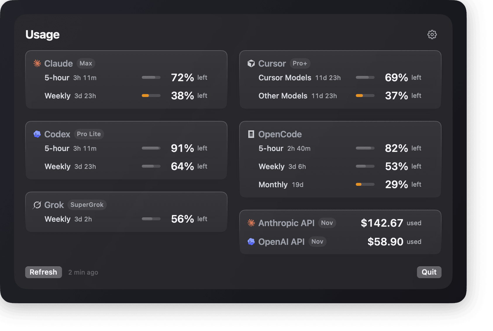

# Headroom

**How much of your AI subscriptions do you have left?** Headroom answers that from the macOS menu
bar for Claude, ChatGPT/Codex, Grok, Cursor, Antigravity, GitHub Copilot and OpenCode Go: every 5-hour,
weekly and monthly limit, side by side, with when each one resets.

<p align="center">
  
</p>

## Download

- **Mac:** [headroom.zantos.co](https://headroom.zantos.co). Updates install from inside the app.
- **iPhone and iPad:** [App Store](https://apps.apple.com/app/id6787519784). The phone app and
  its widgets show what your Mac reads, synced through iCloud.

Requires macOS 15 or later on Apple silicon, plus the official CLI for each subscription you
want to track (`claude`, `codex`, `grok`, `cursor-agent`, `agy`, `copilot` or `opencode`), signed in.

## What it shows

- **Every limit, with its reset.** 5-hour, weekly, monthly and per-model limits, and how long
  until each resets.
- **Every account.** Track several Claude, Codex, Grok or OpenCode accounts at once, each
  signed in through the official CLI.
- **Menu bar pills.** Pick which providers show in the menu bar, with or without percentages.
- **Widgets** on the Mac desktop, the iPhone and iPad Home Screen, and the Lock Screen.
- **Reminders** to use up an allowance before it resets, if you want them.
- **API spend (optional).** Dollars spent this month or over the last 30 days on metered
  OpenAI, Anthropic and xAI APIs.

## How it reads your usage

- **Official clients only.** Headroom reads the usage each provider's official CLI reports,
  and you always sign in through that CLI. Headroom never creates its own sign-ins, reads
  browser cookies or scrapes private dashboards.
- **Checking usage costs nothing.** Polling never sends a model prompt or spends your allowance.
- **No collection.** Headroom has no analytics, telemetry or servers of its own. Requests go
  straight from your Mac to each provider, and iPhone sync uses your own iCloud. See the
  [privacy policy](https://headroom.zantos.co/privacy).

Details for each provider: [How it works](docs/how-it-works.md).

## Help

- Setup problems and what each message means: [Troubleshooting](docs/troubleshooting.md)
- Bug reports and feature requests: **support@zantos.co**
- Security problems: [SECURITY.md](SECURITY.md)

## Build from source

```bash
swift build   # the Mac app and its core library
swift test    # unit tests: all mocked, no CLI, network or Keychain
swift run Headroom --demo six-providers   # the menu bar app with sample data
```

Needs Xcode 27 (Swift 6.4). See [Development](docs/development.md) for app bundle builds,
widgets and the iPhone app.

## Contributing

Outside code PRs need a GitHub contribution proposal labeled `accepted` by the maintainer first.
Tiny documentation fixes can come directly. Start with [CONTRIBUTING.md](CONTRIBUTING.md);
[AGENTS.md](AGENTS.md) explains the architecture and the rules every change follows. For a new
provider, follow [Adding a provider](docs/adding-a-provider.md) before implementation.

## License

Headroom is licensed under the [GNU General Public License v3.0](LICENSE). Contributions are
accepted under the [Contributor License Agreement](CLA.md).

The Headroom name and app icon are not licensed under the GPL. Forks are welcome, but a fork you
publish needs its own name and icon, and must not suggest it is Headroom or made by its maintainer.
