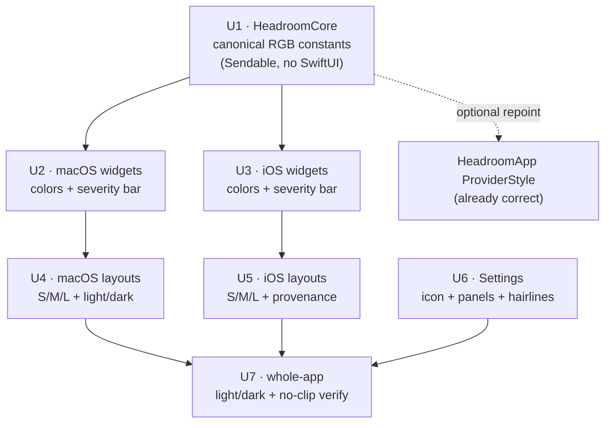

# feat: Settings + widget UI redesign — extend the popover's visual language to Settings and all widgets

## Summary

The menu-bar **popover** has already been redesigned and is live (raised tiles, a shared
`RaisedTile` modifier, native Tahoe glass controls, unified brand colors, severity capsule
bars, motion refinements). This plan extends that same visual language to the two surfaces
that still lag it — the **Settings window** and the **macOS + iOS widgets** — and dials every
change for **both light and dark mode**.

Three problems drive the widget work specifically: (1) unified colors don't reach the widgets
(iOS hard-codes a *green* Codex accent and *orange* Claude; macOS uses its own RGB copy), (2)
iOS widgets show **no severity bar at all** and macOS uses a default `ProgressView`, and (3)
the current widget layouts don't fit their **fixed WidgetKit canvases** — the medium clips its
second provider and the large's reset/renewal text is a cramped run-on.

The redesign was validated as self-contained HTML mockups and, for widgets, **headless-rendered
and measured** to confirm every family fits its real fixed height with zero overflow.

**Popover is precedent, not scope** — this plan references `RaisedTile` and the established
tokens but does not modify the popover. A single final verification unit (U7) re-checks the
whole app (popover + settings + widgets) in both appearances.

---

## Problem Frame

- **Settings** still uses a hand-drawn `VesselMark()` vector instead of the real app icon, and
  reads as one flat scroll — the data-heavy sections don't separate from the app preferences.
  It has no explicit light-mode treatment beyond system defaults.
- **Widgets** drifted from the app: inconsistent brand colors across platforms (a real bug —
  iOS Codex is green), missing severity encoding on iOS, default `ProgressView` bars on macOS,
  and layouts that **overflow the fixed widget heights** (medium clips; large crams).
- The popover redesign established the target language (unified `#D9783F` / `#4757FF` brand
  colors, `#33C759`/`#FF9E0A`/`#FF453B` severity capsule bars, tabular numerals, raised tiles,
  the label + inline-reset bar row). Settings and widgets must match it.

**Hard platform constraint:** every `WidgetFamily` (`systemSmall`/`systemMedium`/`systemLarge`)
renders at a **fixed height**. Content that exceeds it is silently clipped. Layouts here were
verified to fit; the implementer must re-verify per family and against worst-case data.

**Repo rule (unrelated but standing):** do not reintroduce Claude subscription-OAuth / Keychain
token reuse (see `AGENTS.md`). This plan touches only UI and never approaches that path.

---

## Requirements

| ID | Requirement |
|----|-------------|
| R1 | A single canonical source defines the brand (Claude clay / Codex blue) and severity (green/amber/red) color **values**, read by the app and both widget targets, so they can't drift. |
| R2 | macOS widgets replace the default `ProgressView` meter with the severity capsule bar used in the popover; iOS widgets gain that bar (they currently have none). |
| R3 | iOS widgets stop using `.green`/`.orange` and use the canonical Claude clay / Codex blue. |
| R4 | The **medium** widget fits its 4×2 canvas by laying the two providers out as side-by-side columns split by a hairline (not stacked). No clipping. |
| R5 | The **large** widget uses full-width labeled bars with the reset time **inline** next to the label and renewal as a quiet right-aligned footer per provider — one datum per line, no run-on. No clipping. |
| R6 | The **small** widget keeps the provider-line + bar shape, tightened to fit; iOS small also shows "from Mac · Nm" provenance without clipping. |
| R7 | Widgets read cleanly in **light and dark**: secondary text and bar tracks meet contrast (≥4.5:1 body / ≥3:1 large-bold); no white-on-white or invisible tracks. |
| R8 | iOS widgets show **"from Mac · Nm"** provenance (they render an iCloud-synced snapshot from the Mac). |
| R9 | Settings replaces `VesselMark()` with the real macOS app icon via `NSApplication.shared.applicationIconImage`, ~34pt. |
| R10 | Settings elevates the **Subscription Usage** and **API Spend** sections (only those two) onto raised panels, and softens the bright full-width dividers between the top preference groups into inset hairlines — dialed for light and dark. |
| R11 | All existing widget states (waiting/paused/unavailable/needs-setup, stale/needs-attention indicators) keep working and adopt the unified colors; nothing regresses. The needs-attention triangle keeps its glyph and maps to the **amber** severity value (`#FF9E0A`) on **both** platforms (repoint the hardcoded `.orange` in macOS `WidgetProviderRow` *and* iOS `HeadroomIOSWidgetView`); a critical/stale escalation may use red (`#FF453B`). |
| R12 | `swift build` clean, `swift test` green (currently 120), the app builds and launches, and every surface is confirmed by eye in **both** appearances; each widget family confirmed non-clipping. |

**Traceability:** the widget behaviors trace to the headless-verified mockup
`.context/headroom-widgets-redesign-v2.html`; settings to `.context/headroom-settings-division-v2.html`;
the popover precedent to `.context/headroom-popover-depth-glass.html` (all gitignored — concrete
specs are embedded below so this plan is self-contained).

---

## Key Technical Decisions

**KTD1 — Canonical color values live in `HeadroomCore` as SwiftUI-free constants.**
`HeadroomCore` must stay SwiftUI-free (`AGENTS.md`), so it cannot vend `Color`. Define the
canonical brand/severity values there as `Sendable` RGB constants (plain `Double` components or a
small value type), and have each UI layer (`HeadroomApp` `ProviderStyle`, macOS
`WidgetProviderStyle`, iOS widget views) construct `Color(red:green:blue:)` from them. This makes
the *values* single-sourced (R1) without violating the layering rule. The app's `ProviderStyle`
already uses the correct values — repoint it at the shared constants opportunistically so it can't
drift later, but the load-bearing fixes are the two widget targets.

**KTD2 — The widget severity bar is its own small view, not the popover's `UsageBarView`.**
`UsageBarView` lives in `HeadroomApp` and depends on `TimelineView`/`now`. Widgets get a minimal
`WidgetUsageBar` (a `Capsule` track + severity `Capsule` fill, ~6pt tall, reading KTD1 colors).
Prefer one shared source file added to **both** widget targets' compile membership; if the project
structure makes shared widget-UI files costly, a tiny duplicated view in each target is acceptable
**as long as both read the KTD1 color constants** — colors are the drift risk, a 15-line capsule
is not.

**KTD3 — Settings panels use an *opaque-surface* elevation, not the glass `RaisedTile` as-is.**
`RaisedTile`'s light-mode fill (`white 0.92→0.80`) is tuned to sit on the translucent glass
popover. On the **opaque** Settings window a near-white panel on a white window has no contrast.
Either add an appearance/`context` parameter to `RaisedTile` (e.g. `.glass` vs `.opaque`) that
switches the light-mode fill to a subtle gray tint (`secondarySystemFill`-like), or add a sibling
`groupedPanel` style for opaque surfaces. Verify the panel is clearly distinguishable in light
mode.

**KTD4 — Medium widget goes 2-column; large adopts the popover bar row.** The 4×2 medium is
*wider than tall*; stacking two providers overflows. Two provider **columns** split by a 1px
hairline fit. The large's tall canvas uses the popover's `label · inline-reset … %` row with a
full-width bar, plus a right-aligned renewal footer.

**Single-provider rule (applies to R4, R5, U4, U5):** the provider list is variable
(`ForEach(envelope.providers)`) — a user may have only Claude *or* only Codex enabled. When
**one** provider is present: the medium renders that provider **full-width (single column, no
hairline)**; the large **drops the inter-provider hairline**. The two-column / inter-provider
hairline split applies only when **both** providers are present. Never render an orphan empty
column or dangling divider.

**KTD5 — Fixed-canvas fit is a verification gate, not a hope.** Layouts were headless-measured to
fit at small/medium/large. The implementer re-verifies each family in Xcode previews/simulator,
including worst-case data (long Codex model names like "GPT-5.3-Codex-Spark", "from Mac" footer,
100% and <10% values).

---

## High-Level Technical Design

**Color-source dependency (KTD1) and unit dependency order:**

**Widget size → layout shape (KTD4):**

| Family | Shape | Per provider | Reset/renewal |
|--------|-------|--------------|---------------|
| Small | "Weekly left" + provider lines | logo + name + weekly % + bar | — |
| Medium | two columns split by hairline | logo + name + Weekly meter + 5-hour meter | — |
| Large | stacked, hairline between providers | logo + name + plan pill; each window a full-width labeled bar | reset **inline** with label; renewal right-aligned footer |

---

## Output / Concrete Specs (embedded so the plan is self-contained)

**Canonical colors (RGB):**
- Claude clay `#D9783F` = `(0.85, 0.47, 0.26)`; Codex blue `#4757FF` = `(0.28, 0.34, 1.00)`
- Severity: healthy green `#33C759` = `(0.20, 0.78, 0.35)`; low amber `#FF9E0A` = `(1.00, 0.62, 0.04)`; critical red `#FF453B` = `(1.00, 0.27, 0.23)`

**Provider-name text colors (for contrast; the logo squares keep full brand color):**
- Light: Claude `#BD5C22`, Codex `#333FD6` · Dark: Claude `#E79068`, Codex `#96A0FF`

**Widget light/dark tokens:**
- Secondary text — light `rgba(60,60,67,0.74)`, dark `rgba(235,235,245,0.66)`
- Tertiary text — light `rgba(60,60,67,0.55)`, dark `rgba(235,235,245,0.44)`
- Bar track — light `black 14%`, dark `white 16%` · Hairline divider — light `black 9%`, dark `white 10%`
- Severity bar: `Capsule` track + `Capsule` fill, ~6pt tall (widgets), tabular `%`

**Settings:** app icon `Image(nsImage: NSApplication.shared.applicationIconImage)` ~34pt square;
raised panels on **Subscription Usage** and **API Spend** only; inset hairlines (not full-width
`Divider()`) between General / Menu Bar / Widgets.

---

## Scope Boundaries

**In scope:** Settings window styling (`SettingsView.swift`, `WidgetSettingsSection.swift`);
macOS widgets (`Sources/HeadroomWidgets`); iOS widgets (`Sources/HeadroomIOSWidgets`); a canonical
color source in `HeadroomCore`; light + dark for all of the above.

**Out of scope / not touched:**
- The **popover** — already redesigned and live; referenced as precedent only (U7 re-verifies it).
- **Lock-screen accessory widgets** — iOS renders these monochrome; brand/severity color doesn't apply.
- Any data/provider/snapshot logic — this is presentation only. Existing snapshot models and the
  widget status/empty states keep their behavior (restyled, not rebuilt).

### Deferred to Follow-Up Work
- Committing / opening a PR. This plan completes at **verified code** (U7); landing follows repo
  conventions / the LFG run's own flow.
- Repointing `HeadroomApp/ProviderStyle` at the KTD1 constants is optional polish (the app already
  has correct values) — do it if cheap, else leave a note.

---

## Implementation Units

### U1. Canonical brand + severity color values in HeadroomCore

**Goal:** One SwiftUI-free source of truth for the brand and severity color values (R1, KTD1).

**Requirements:** R1
**Dependencies:** none
**Files:**
- `Sources/HeadroomCore/Models/` — new file (e.g. `BrandColorValues.swift`) defining `Sendable`
  RGB constants for Claude, Codex, and the three severity bands (plain `Double` r/g/b, or a small
  `Sendable` struct). No `import SwiftUI`.
- `Tests/HeadroomCoreTests/` — new test file asserting the values.

**Approach:** Expose per-provider and per-severity `(red, green, blue)` triples (or a tiny value
type with those fields). Keep names aligned with existing domain types (`ProviderID`,
`UsageSeverity`) so callers map cleanly. Do not add `Color` here.

**Patterns to follow:** mirror the value-type + `Sendable` style of `Sources/HeadroomCore/Models/UsageModels.swift`.

**Test scenarios:**
- Happy path: each constant returns the exact spec triple (Claude `(0.85,0.47,0.26)`, Codex
  `(0.28,0.34,1.00)`, green `(0.20,0.78,0.35)`, amber `(1.00,0.62,0.04)`, red `(1.00,0.27,0.23)`).
- Mapping: a `UsageSeverity` → severity-value lookup returns the right band for `.healthy/.low/.critical`.

**Verification:** `swift test` passes with the new assertions.

---

### U2. macOS widgets — adopt canonical colors + severity capsule bar

**Goal:** macOS widgets read U1 colors and render the severity capsule bar instead of the default
`ProgressView` (R1, R2, KTD2).

**Requirements:** R1, R2
**Dependencies:** U1
**Files:**
- `Sources/HeadroomWidgets/WidgetProviderStyle.swift` — build `Color` from U1 constants (replace
  the local RGB copies).
- `Sources/HeadroomWidgets/Views/WidgetUsageMeter.swift` — replace `ProgressView(...).tint(...)`
  with the `WidgetUsageBar` capsule (severity fill from U1).
- New `Sources/HeadroomWidgets/Views/WidgetUsageBar.swift` (the shared capsule bar per KTD2), or a
  shared file added to both widget targets' membership.

**Approach:** A `Capsule` track (token color) with an overlaid severity `Capsule` fill sized to
`percentRemaining`. Keep it thin (~6pt). Pull severity color from U1 via `WidgetProviderStyle`.

**Patterns to follow:** existing `WidgetUsageMeter.swift` label+value row; keep that row, swap only
the bar.

**Test scenarios:** Test expectation: none — SwiftUI widget view; verified via preview + U7. (Color
correctness is covered by U1's value tests.)

**Verification:** widget target builds; macOS medium/large previews show capsule bars in brand/severity colors.

---

### U3. iOS widgets — adopt canonical colors + add severity capsule bar

**Goal:** iOS widgets stop using `.green`/`.orange`, use U1 brand colors, and gain the severity
capsule bar they lack (R1, R2, R3, KTD2).

**Requirements:** R1, R2, R3
**Dependencies:** U1
**Files:**
- `Sources/HeadroomIOSWidgets/Views/HeadroomIOSWidgetView.swift` — replace the hardcoded
  `id == "claude" ? .orange : .green` (around the provider-accent helper) and the `.orange`
  attention color usage with U1-derived colors; add `WidgetUsageBar` under each window's %.
- Shared `WidgetUsageBar` from U2 (added to this target's membership) or a local twin reading U1.

**Approach:** Mirror U2. iOS currently shows only `label … %` per window with no bar — add the
capsule bar beneath, same severity mapping.

**Patterns to follow:** U2's `WidgetUsageBar`; the existing `providerSummary` row structure.

**Test scenarios:** Test expectation: none — SwiftUI widget view; verified via preview + U7.

**Verification:** iOS widget target builds; Codex reads **blue** (not green) in previews; bars present.

---

### U4. macOS widget layouts — fit every family, light/dark

**Goal:** Re-lay macOS small/medium/large to the verified shapes, fitting fixed heights, in both
appearances (R4, R5, R6, R7, R11, KTD4, KTD5).

**Requirements:** R4, R5, R6, R7, R11
**Dependencies:** U2
**Files:** (all macOS widget views live under `Sources/HeadroomWidgets/Views/`)
- `Sources/HeadroomWidgets/Views/HeadroomMediumWidgetView.swift` — **two provider columns** split by
  a 1px hairline (single column when one provider); each column: logo+name header, Weekly meter, 5-hour meter.
- `Sources/HeadroomWidgets/Views/HeadroomLargeWidgetView.swift` / `Views/WidgetProviderRow.swift` —
  full-width labeled bars with **inline reset** (`label · Resets … ` left, `%` right, bar below) and
  a right-aligned **renewal footer**; hairline between providers (dropped when one provider). Replace
  the current dense detail run-on. Note: `WidgetProviderRow.swift` also holds the hardcoded `.orange`
  needs-attention triangle — repoint it per R11 (see below).
- `Sources/HeadroomWidgets/Views/HeadroomSmallWidgetView.swift` — keep provider-line + bar; tighten
  spacing so it fits.
- `Sources/HeadroomWidgets/Views/WidgetStatusView.swift` — confirm empty/status states still fit and
  adopt tokens (R11). It renders `VesselMark` (the *widget* one, `Views/VesselMark.swift` — separate
  from the Settings copy); **keep VesselMark here** (widget status identity is out of scope for the
  app-icon swap).

**Approach:** Apply the embedded light/dark tokens (secondary/tertiary text, track, divider). Use
`.containerBackground(.background, for: .widget)` as today. No nested cards — grouping is spacing +
hairline + brand color (the widget is already a card).

**Patterns to follow:** the popover `UsageBarView` label+inline-reset row (conceptually); the
mockup `.context/headroom-widgets-redesign-v2.html`.

**Execution note:** verification is visual-fit-first — build the widget previews for each family in
both appearances before considering the unit done.

**Test scenarios:** Test expectation: none — SwiftUI layout; **fit is the gate**: each of
small/medium/large renders with no clipped content in light and dark, including worst-case data
(long model names, 100%/<10%, stale indicator).

**Verification:** Xcode previews (or simulator) for all three families × both appearances show no
overflow; medium shows both providers fully; large shows reset inline + renewal footer, no run-on.

---

### U5. iOS widget layouts — mirror macOS, add provenance, light/dark

**Goal:** Bring iOS small/medium/large to the same shapes, add "from Mac" provenance, fit fixed
heights, both appearances (R4, R5, R6, R7, R8, R11, KTD4, KTD5).

**Requirements:** R4, R5, R6, R7, R8, R11
**Dependencies:** U3
**Files:**
- `Sources/HeadroomIOSWidgets/Views/HeadroomIOSWidgetView.swift` — medium → two columns; large →
  full-width inline-reset bars + renewal footer; small → provider lines + bar + **"from Mac · Nm"**
  footer, tightened to fit.
- `Sources/HeadroomIOSWidgets/Views/IOSWidgetStatusView.swift` — confirm status states fit + adopt tokens.

**Approach:** Reuse U4's structure. The timestamp/provenance line reads "from Mac · Nm" since the
snapshot is iCloud-synced from the Mac (R8). Small is the tightest canvas — trim spacing so the
footer fits (headless-verified at these values).

**Patterns to follow:** U4; existing `providerSummary`/`small()`/`medium()`/`large()` methods.

**Execution note:** iOS small is the tightest — verify the "from Mac" footer does not clip.

**Test scenarios:** Test expectation: none — SwiftUI layout; fit gate identical to U4, plus the
small-with-provenance case must not clip.

**Verification:** iOS previews for all families × both appearances, no overflow; Codex blue; bars present; provenance shown.

---

### U6. Settings window — real app icon, elevated panels, softer hairlines

**Goal:** Real macOS app icon in the header, elevate the two data sections, soften the top dividers,
dialed for light and dark (R9, R10, KTD3).

**Requirements:** R9, R10
**Dependencies:** U1 is not required; may proceed in parallel with widget units.
**Files:**
- `Sources/HeadroomApp/UI/SettingsView.swift` — replace `VesselMark()` in the header with
  `Image(nsImage: NSApplication.shared.applicationIconImage).resizable().frame(width: 34, height: 34)`
  (rounded as needed); wrap the **Subscription Usage** and **API Spend** section `VStack`s in the
  opaque raised-panel style; replace the bright `Divider()`s between General/Menu Bar/Widgets with
  inset hairlines.
- `Sources/HeadroomApp/UI/RaisedTile.swift` — add an opaque-surface variant/parameter (KTD3) OR add
  a sibling `groupedPanel` style; ensure the light-mode fill is a subtle gray tint that reads on the
  opaque window (not near-white).
- `Sources/HeadroomApp/UI/WidgetSettingsSection.swift` — renders the **Widgets** group's toggles +
  help text. Update only if its own internal spacing/dividers need to match the softened hairlines;
  no change if the inter-group hairlines all live in `SettingsView.swift`. (Named in scope; call it
  explicitly so it isn't silently skipped.)

**Approach:** Only those two sections get panels (no nested-card noise on every group). The
`VesselMark` in `SettingsView.swift` is a **file-private** struct used only in the Settings header —
independent of the widget target's own `VesselMark` (`Sources/HeadroomWidgets/Views/VesselMark.swift`,
used by `WidgetStatusView`). Removing the Settings copy after the icon swap is safe local cleanup and
cannot affect widgets (non-blocking).

**Patterns to follow:** the popover's `RaisedTile` usage in `ProviderCardView.swift`; the mockup
`.context/headroom-settings-division-v2.html`.

**Test scenarios:** Test expectation: none — SwiftUI view/styling; verified via U7 (real icon shows;
panels have contrast in both modes; hairlines softer).

**Verification:** Settings window in light and dark shows the real app icon, two clearly-elevated
data panels with real light-mode contrast, and softened inter-group dividers.

---

### U7. Whole-app verification — build, test, light/dark, no-clip

**Goal:** Prove the full surface set (popover + settings + widgets) is correct and non-regressing in
both appearances (R12, R11, KTD5).

**Requirements:** R11, R12
**Dependencies:** U4, U5, U6
**Files:** none (verification unit).

**Approach:** Run the gates below; fix any fallout in the owning unit rather than here.

**Test scenarios:** Test expectation: none — this unit *is* the verification pass.

**Verification (all must pass):**
- `swift build` clean; `swift test` green (≥120, no regressions).
- `./Scripts/build-app.sh debug` succeeds; launch `Headroom.app`.
- **Light and dark**: toggle System Appearance and confirm the **popover** (precedent — must still
  read correctly, raised tiles + glass), **Settings** (icon, panels, hairlines), and **widgets**
  all read cleanly with real contrast.
- **Widget no-clip**: each family (macOS + iOS small/medium/large) renders with no clipped content in
  both appearances, incl. worst-case data (long Codex model names, 100%/<10%, "from Mac" footer, stale states).
- Codex accent is **blue** on iOS (regression check on the fixed bug).

---

## Verification Contract

- **Build:** `swift build` clean.
- **Tests:** `swift test` — U1's color-value assertions added; existing 120 still green.
- **App:** `./Scripts/build-app.sh debug` builds `Headroom.app`; app launches.
- **Visual (both appearances):** popover, Settings, and every widget family confirmed by eye in
  light and dark; no widget clipping; iOS Codex blue.

## Definition of Done

All of U1–U7 complete; the Verification Contract passes; no widget family clips in either
appearance; brand + severity colors are single-sourced (U1) and identical across app, macOS
widgets, and iOS widgets; Settings shows the real app icon with elevated, contrast-correct panels;
the popover is unchanged and still correct. No commit/PR required (deferred).

---

## Risks & Dependencies

- **R-fit (high):** widget content overflowing fixed canvases is the top risk — it's silent
  (clipped, no error). Mitigation: KTD5 verification gate per family + worst-case data; the mockups
  were headless-measured to fit at these values, but real SF metrics and Dynamic Type can differ.
  If a family is tight, reduce spacing before cutting content; never let a datum clip.
- **R-shared-widget-code (medium):** the two widget targets may not currently share a Swift file.
  If adding shared membership is awkward, duplicate the tiny `WidgetUsageBar` per target — but both
  **must** read U1 colors (KTD2). Confirm target membership in `project.yml` / `Headroom.xcodeproj`.
- **R-opaque-panel (medium):** reusing `RaisedTile` as-is on the opaque Settings window yields
  white-on-white (invisible) panels in light mode. KTD3 requires an opaque variant — verify light
  contrast explicitly.
- **R-appicon-at-runtime (low):** `NSApplication.shared.applicationIconImage` returns the running
  app's icon; confirm it resolves in the built `.app` (it should — the icon ships in the bundle).
- **Dynamic Type (low, iOS):** large accessibility text sizes can overflow. Out of strict scope, but
  note behavior; prefer `.lineLimit(1)` + truncation on long labels, matching the popover.

---

## Sources & Research

- Approved mockups (gitignored, in `.context/`): `headroom-widgets-redesign-v2.html` (widgets,
  headless-verified fit), `headroom-settings-division-v2.html` (settings), `headroom-popover-depth-glass.html` (popover precedent).
- Widget code map: macOS `Sources/HeadroomWidgets` (families S/M/L, `WidgetProviderRow`,
  `WidgetUsageMeter`, `WidgetProviderStyle`), iOS `Sources/HeadroomIOSWidgets/Views/HeadroomIOSWidgetView.swift`
  (inline `.orange`/`.green` at the provider-accent helper, no bars).
- Popover precedent in-repo: `Sources/HeadroomApp/UI/RaisedTile.swift`, `ProviderCardView.swift`,
  `APISpendSectionView.swift`, `UsageBarView.swift`, `PopoverView.swift`.
- `AGENTS.md`: `HeadroomCore` is SwiftUI-free (drives KTD1); no Claude subscription-OAuth (standing).
