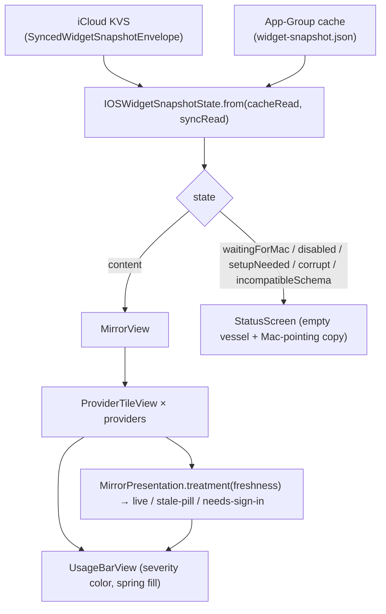

# Headroom iOS Companion — Mirror Interface - Plan

## Goal Capsule

- **Objective:** Replace the placeholder `IOSCompanionView` with the approved "Mirror" interface — a faithful, glanceable port of the macOS popover — rendered from the already-synced `WidgetSnapshotEnvelope`, plus designed state screens, a light-touch About sheet, widget-tap entry, and entrance motion.
- **Authority hierarchy:** This plan → the approved mockup `design/ios-companion.html` (visual source of truth) → repo conventions in `AGENTS.md`. The mockup governs layout and tokens; `AGENTS.md` governs the hard "display-only, no provider fetch on device" constraint.
- **Execution profile:** iOS-only UI work in the existing `HeadroomIOS` target plus one SwiftUI-free helper in `HeadroomCore`. No macOS app, projector, or iCloud-schema changes.
- **Stop conditions:** Stop and surface if the work would require changing the synced envelope shape, the macOS publish path, or provider/credential access — those are out of scope and signal a scope error.
- **Tail ownership:** Standard `ce-work` tail (build, test, PR per repo conventions).

---

## Product Contract

### Summary

Build the "Mirror" iOS companion screen: two provider tiles (Claude, Codex) with Session + Weekly bars, health-severity colors, plan badges, verbatim reset labels, and an "Updated N min ago" header, rendered from the redaction-safe `WidgetSnapshotEnvelope` the widgets already read. Add designed freshness/sync state screens, a light-touch About sheet with device-local appearance, widget-tap entry, and the ring-shadow/light-glow elevation with staggered entrance motion.

### Problem Frame

The iOS app target already exists and the cross-device sync (iCloud KVS + App-Group cache → `IOSWidgetSnapshotState`) already works, but `IOSCompanionView` is a placeholder `List`/`ContentUnavailableView`. When a user taps the Headroom widget, it opens into an unfinished screen that does not match the care of the Mac app or the shipped widgets. The companion should look intentional and mirror the Mac's answer — how much room is left — sized for a glance and a thumb.

### Requirements

**Rendering & parity**

- R1. The app renders the synced `WidgetSnapshotEnvelope` as the Mirror layout: one tile per provider with Session + Weekly bars, a plan badge, verbatim reset labels, and a "Plan renews" row; a "Usage" title with an "Updated N min ago" subtitle derived from `generatedAt`.
- R2. Bars are colored by window `severity` (healthy/low/critical); provider brand color (Claude clay, Codex blue) appears only on identity (logo, plan badge), never on the meter.
- R3. Percentages use tabular numerals; bar fill and percentage animate on value change; a "Low" chip appears only when a window is critical and not dimmed.

**Elevation & motion**

- R4. Tiles are elevated with a layered ring-shadow in light mode and a restrained luminous edge (faint white ring + top rim) in dark mode — no hard borders, no heavy drop shadows.
- R5. Content enters with a staggered fade-and-rise and bars fill from zero on appear; motion conveys state only (no looping or pulsing), and every animation has a Reduce Motion fallback.

**States**

- R6. Freshness renders distinctly per provider: live (normal), transient stale (dimmed bars + "Stale" pill), and needs-attention (an actionable notice pointing to the Mac — never a CLI command).
- R7. Non-content sync states (waiting-for-Mac, sync paused, iCloud unavailable, unreadable, incompatible schema) render designed status screens with iOS-adapted copy that points to the Mac; the first-run/waiting screen shows an empty vessel.

**Navigation & settings**

- R8. Pull-to-refresh re-reads the snapshot; the app also refreshes on foreground and when iCloud reports an external change.
- R9. Tapping a Headroom iOS widget opens the app to the full picture.
- R10. A settings entry opens an About sheet showing sync status, source, a "managed on your Mac" note, and version, plus a device-local appearance control (System/Light/Dark). Provider-visibility toggles are deferred.

**Architecture & quality**

- R11. The app reads only the redaction-safe envelope; it never fetches providers, runs a CLI, or touches credentials, and requires no macOS, projector, or iCloud-schema change.
- R12. Feature logic (freshness→treatment, reset text, updated label) lives SwiftUI-free in `HeadroomCore` and is unit-tested; the build stays clean under Swift 6 complete concurrency checking.

### Scope Boundaries

- No macOS app, `WidgetSnapshotProjector`, or `WidgetSnapshotEnvelope`/sync-schema changes — the envelope already carries `planLabel`, `renewalDate`, per-window `resetLabel`, and `severity`.
- No provider fetching, CLI, or credential access on device (per `AGENTS.md`).
- No API-spend surface on iOS in this pass (subscription windows only, matching the widgets).

#### Deferred to Follow-Up Work

- The "Vessels" layout (and Rings/Grid/Board explorations) — parked; the mockup retains the code.
- Re-skinning the existing iOS widget to match — the widget shipped recently and is out of scope here.
- Provider-visibility toggles and any per-device filtering in settings.
- A shared iOS UI module unifying app + widget styling (accept small constant duplication for now).

---

## Planning Contract

### Key Technical Decisions

- **Render from the existing envelope; change nothing upstream.** The iOS app compiles `HeadroomCore/Widgets` + `HeadroomCore/Sync` directly (it can't depend on the macOS-only `HeadroomCore` static lib) and reads `WidgetSnapshotEnvelope` via `WidgetSnapshotCache.appGroup()` + `iCloudSnapshotSync` → `IOSWidgetSnapshotState.from(cacheRead:syncRead:)`. All Mirror fields already exist on the envelope, so no schema, projector, or macOS work is needed.
- **Testable logic goes in `HeadroomCore/Widgets`, SwiftUI-free.** SwiftUI views in the iOS target are not reachable by the `HeadroomCoreTests` suite (macOS, logic-only, Apple `Testing` framework). Placing the presentation helper in `Sources/HeadroomCore/Widgets/` means it is compiled into the macOS lib (so tests reach it) and into both iOS targets (which already include that directory), with no new `project.yml` source entries. It returns semantic enums/strings (never SwiftUI `Color`/`View`), honoring the "HeadroomCore has no SwiftUI" rule.
- **App-local design system with duplicated constants.** The severity/accent RGB constants and a `.headroomTile()` elevation modifier live in `Sources/HeadroomIOS/DesignSystem/`, duplicating the few color values already duplicated across `WidgetProviderStyle` and the macOS app. This avoids `project.yml` churn and macOS/iOS conditional-compilation risk; a shared UI module is deferred.
- **Elevation replaces borders and drop shadows.** `.headroomTile()` applies the ring-shadow recipe in light (a `0 0 0 1px` ~5%-black ring + three soft ambient layers) and a restrained light glow in dark (faint white ring + top-rim highlight + minimal ambient), branching on `@Environment(\.colorScheme)`.
- **Widget-tap entry via `widgetURL` + `onOpenURL`.** The iOS widget entries set a `widgetURL`; the app handles it in `onOpenURL` and refreshes. The app is single-screen, so the URL only needs to foreground the app and trigger a read; a minimal URL scheme is registered for robustness.
- **Appearance is device-local.** Stored via `@AppStorage` and applied at the root with `.preferredColorScheme`; it does not touch the synced snapshot.

### High-Level Technical Design

The iOS render pipeline reads the already-synced envelope, maps it to a typed state, and routes to either the Mirror or a designed status screen. Per-provider freshness maps through a SwiftUI-free treatment helper.

### Sequencing

U1 and U2 are the foundation (design tokens; testable presentation helper) and can proceed in parallel. U3 builds the Mirror views on both. U4 (states) and U5 (About sheet) build on U3. U6 (lifecycle + deep link) builds on U3 and closes the loop.

---

## Implementation Units

### U1. iOS design system: tokens, elevation, provider logo

**Goal:** A small SwiftUI token + component layer the Mirror is built from — colors, type scale, radii, the `.headroomTile()` elevation modifier, and an iOS `ProviderLogoView`.

**Requirements:** R2, R4

**Dependencies:** none

**Files:**
- Create: `Sources/HeadroomIOS/DesignSystem/HeadroomTheme.swift`
- Create: `Sources/HeadroomIOS/DesignSystem/Elevation.swift`
- Create: `Sources/HeadroomIOS/DesignSystem/ProviderLogoView.swift`

**Approach:**
- `HeadroomTheme`: severity→`Color` (healthy `0.20,0.78,0.35`; low `1.00,0.62,0.04`; critical `1.00,0.27,0.23`), provider accents (Claude `0.85,0.47,0.26`; Codex `0.28,0.34,1.00`), ink/surface roles per `colorScheme`, radii (tile 17), and the entrance easing (`timingCurve(0.22,1,0.36,1)`). Mirror the naming in `Sources/HeadroomWidgets/WidgetProviderStyle.swift` for consistency.
- `Elevation.swift`: a `.headroomTile(cornerRadius:)` `ViewModifier` implementing the ring-shadow (light) / light-glow (dark) recipe from the mockup, branching on `@Environment(\.colorScheme)`; no `border`/`stroke` outline.
- `ProviderLogoView`: load the brand asset from `BrandIcons.xcassets` (already compiled into the iOS target) by `WidgetProviderStyle.assetName(for:)` names, with an SF Symbol + accent fallback (iOS `Image`/`UIImage`, not `NSImage`).

**Patterns to follow:**
- `Sources/HeadroomWidgets/WidgetProviderStyle.swift` (accent/severity/asset constants)
- `Sources/HeadroomApp/UI/ProviderStyle.swift` (logo-resolution shape, adapted from AppKit to UIKit)

**Test scenarios:** Test expectation: none (pure SwiftUI tokens/modifiers) — verified by SwiftUI previews and the simulator smoke in the Verification Contract. Contrast is checked in that smoke: body text ≥ 4.5:1 on both light (near-white) and dark tiles.

**Verification:** Previews render each token/elevation in light and dark; the modifier produces no hard outline; text contrast holds in both schemes.

### U2. Mirror presentation helper (SwiftUI-free, in HeadroomCore)

**Goal:** The testable feature logic that turns envelope values into display decisions, with no SwiftUI dependency.

**Requirements:** R1, R3, R6, R12

**Dependencies:** none

**Files:**
- Create: `Sources/HeadroomCore/Widgets/MirrorPresentation.swift`
- Test: `Tests/HeadroomCoreTests/MirrorPresentationTests.swift`

**Approach:**
- `treatment(for: WidgetProviderFreshness) -> MirrorRowTreatment`, where the returned value encodes: `.live` → normal; `.stale(_, needsAttention: false)` → dimmed bars + "Stale" pill; `.stale(message, needsAttention: true)` → needs-sign-in notice (iOS copy, e.g. "Sign in again on your Mac") with dimmed prior bars; `.pending` → skeleton.
- `resetText(for: WidgetWindowSummary, now: Date) -> String`: return `resetLabel` verbatim when present, else compute from `resetsAt` via `Countdown.string` ("Resets in 4h 59m" / "Resets now").
- `updatedLabel(generatedAt: Date, now: Date) -> String?`: thin wrapper over `Countdown.updatedLabel`.
- `showsLowChip(severity: WidgetUsageSeverity, dimmed: Bool) -> Bool`: true only for `.critical && !dimmed`.
- Return only enums/`String`/`Bool` — never SwiftUI types — so this compiles into `HeadroomCore` and both iOS targets and is reachable by tests.

**Execution note:** Implement test-first; this is the durable, verifiable core of the feature.

**Patterns to follow:**
- `Sources/HeadroomCore/Models/Countdown.swift`
- `Sources/HeadroomCore/Widgets/WidgetSnapshotModels.swift`
- `Tests/HeadroomCoreTests/` (Apple `Testing` framework: `@Test` / `#expect`)

**Test scenarios:**
- Happy path: `.live` → normal treatment (not dimmed, no pill, no notice).
- Edge case: `.stale(message, needsAttention: false)` → dimmed + "Stale" pill, no notice.
- Error path: `.stale(message, needsAttention: true)` → needs-sign-in notice, dimmed, and the notice text points to the Mac and contains no `$`/CLI command.
- Edge case: `.pending` → skeleton treatment.
- Happy path: `resetText` returns `resetLabel` verbatim when present.
- Edge case: `resetText` with `resetLabel == nil` and future `resetsAt` computes "Resets in …"; with past `resetsAt` returns "Resets now".
- Edge case: `updatedLabel` returns nil when `generatedAt` maps through `Countdown.updatedLabel` as pending-equivalent, "just now" at ≤1 min, "N min ago" otherwise.
- Happy path: `showsLowChip` true only for critical + not dimmed; false for critical + dimmed and for low/healthy.

**Verification:** `swift test` passes the new suite; the file imports no SwiftUI, provider, credential, or CLI types.

### U3. Mirror interface views

**Goal:** Replace the placeholder companion content with the Mirror: header, provider tiles, usage bars, plan-renews row, pull-to-refresh, and staggered entrance.

**Requirements:** R1, R2, R3, R4, R5, R8

**Dependencies:** U1, U2

**Files:**
- Modify: `Sources/HeadroomIOS/Views/IOSCompanionView.swift`
- Create: `Sources/HeadroomIOS/Views/MirrorView.swift`
- Create: `Sources/HeadroomIOS/Views/ProviderTileView.swift`
- Create: `Sources/HeadroomIOS/Views/UsageBarView.swift`

**Approach:**
- `MirrorView`: a scroll view with a large "Usage" title and an "Updated N min ago" subtitle (from `MirrorPresentation.updatedLabel`), `.refreshable` re-reading the snapshot, and provider tiles stacked with 10-ish-pt spacing.
- `ProviderTileView`: header (logo + display name + plan badge tinted by provider accent), Session + Weekly `UsageBarView`s driven by `MirrorPresentation.treatment`, and a "Plan renews" footer row from `renewalDate`. Uses `.headroomTile()`.
- `UsageBarView`: label + reset text + tabular percentage + a capsule track/fill (severity color, min 4pt), the "Low" chip per `showsLowChip`, a spring fill animation, `.contentTransition(.numericText())` on the percentage, and a dimmed variant for stale.
- Entrance: stagger the tiles' fade-and-rise and fill the bars from zero on appear; gate all of it behind `accessibilityReduceMotion`.
- `IOSCompanionView` keeps its existing read/refresh logic and routes `.content` → `MirrorView`; non-content states route to U4.

**Patterns to follow:**
- `Sources/HeadroomApp/UI/ProviderCardView.swift` and `UsageBarView.swift` (layout hierarchy, severity ramp, spring params `response: 0.3, dampingFraction: 0.9`) — translated, not card-nested.
- `design/ios-companion.html` (the approved Mirror spacing, type, and motion).

**Test scenarios:** Feature logic is covered in U2; views are verified by previews and simulator smoke:
- Covers R1. Live fixture (Claude Session low / Weekly amber; Codex healthy) renders two tiles with both bars, plan badges, verbatim reset labels, and "Updated just now".
- Covers R3. Pull-to-refresh re-reads and the percentage/fill animate to new values.
- Covers R5. With Reduce Motion on, content appears with no transform animation; bars show final values immediately.

**Verification:** iOS app builds and, in the simulator with a seeded live fixture, renders the Mirror matching the mockup; pull-to-refresh works; Reduce Motion path verified.

### U4. Designed state screens

**Goal:** Replace `IOSSyncStatusView` usage with designed screens for every non-live state, including the inline stale/needs-sign-in treatments and the empty-vessel first run.

**Requirements:** R6, R7

**Dependencies:** U1, U2, U3

**Files:**
- Create: `Sources/HeadroomIOS/Views/StatusScreen.swift`
- Create: `Sources/HeadroomIOS/DesignSystem/VesselMark.swift`
- Modify: `Sources/HeadroomIOS/Views/MirrorView.swift` (inline stale pill + needs-sign-in notice via `MirrorPresentation.treatment`)
- Modify: `Sources/HeadroomIOS/Views/IOSCompanionView.swift` (route non-content states to `StatusScreen`)

**Approach:**
- `VesselMark`: port the vessel/liquid drawing from `Sources/HeadroomWidgets/Views/VesselMark.swift` into the iOS design system; add an empty/dashed variant for the waiting state.
- `StatusScreen`: a shared layout (vessel + title + message) used by `waitingForMac`, `disabled`, `setupNeeded`, `corrupt`, and `incompatibleSchema`, with iOS-adapted copy that points to the Mac.
- Inline treatments inside tiles: transient stale → dimmed bars + "Stale" pill; needs-attention → an amber notice ("Sign in again on your Mac") with dimmed prior bars. Never render a CLI command on device.

**Patterns to follow:**
- `Sources/HeadroomWidgets/Views/VesselMark.swift` (drawing) and `Sources/HeadroomIOSWidgets/Views/IOSWidgetStatusView.swift` (state copy) — restyled to the mockup.
- The existing case→copy mapping in `Sources/HeadroomIOS/Views/IOSCompanionView.swift`.

**Test scenarios:** State→screen selection is already covered by `IOSWidgetSnapshotState.from` tests in `HeadroomCoreTests`; treatment mapping is covered in U2. Views verified by simulator smoke:
- Covers R7. Seeded waiting-for-Mac (no snapshot) shows the empty-vessel screen with Mac-pointing copy, not blank content.
- Covers R6. Seeded transient-stale fixture shows dimmed bars + "Stale" pill; needs-attention fixture shows the "Sign in again on your Mac" notice and no `$`/CLI text.
- Edge case: disabled / incompatible-schema fixtures each render their designed status screen.

**Verification:** Each seeded state renders its designed screen in the simulator; no CLI command appears in any state.

### U5. About sheet + device-local appearance

**Goal:** A settings entry that opens a light-touch About sheet (sync status, source, "managed on your Mac", version) with a device-local appearance control.

**Requirements:** R10

**Dependencies:** U1

**Files:**
- Create: `Sources/HeadroomIOS/Views/AboutSheetView.swift`
- Modify: `Sources/HeadroomIOS/Views/MirrorView.swift` (toolbar settings button → sheet)
- Modify: `Sources/HeadroomIOS/HeadroomIOSApp.swift` (apply `.preferredColorScheme` from stored appearance)

**Approach:**
- `AboutSheetView`: sync status ("Synced N min ago" from the envelope's `generatedAt`/`publishedAt`), source label, a "Refresh interval, API keys and renewal dates are managed in Headroom on your Mac" note, and version; plus an Appearance control (System/Light/Dark).
- Appearance stored via `@AppStorage` (an app-local `AppearanceSetting` raw value) and applied at the root with `.preferredColorScheme`.
- Provider-visibility toggles are intentionally omitted (deferred).

**Patterns to follow:**
- `design/ios-companion.html` settings frame (grouped rows, "managed on your Mac" note, appearance segmented control).
- `Sources/HeadroomApp/UI/WidgetSettingsSection.swift` (copy tone for the Mac-boundary note).

**Test scenarios:** Test expectation: none for the sheet chrome (verified by preview/smoke). If `AppearanceSetting`'s raw↔`ColorScheme` resolution is non-trivial, cover it with a small logic check; otherwise smoke:
- Covers R10. Opening the sheet shows sync status + version + the Mac-managed note; switching appearance to Light/Dark re-themes the app and persists across relaunch (simulator smoke).

**Verification:** Settings button opens the sheet; appearance changes apply and persist; no provider-visibility controls present.

### U6. Widget-tap entry + refresh lifecycle

**Goal:** Tapping the iOS widget opens the app to the Mirror, and the app refreshes on foreground and on external iCloud change.

**Requirements:** R8, R9, R11

**Dependencies:** U3

**Files:**
- Modify: `Sources/HeadroomIOS/HeadroomIOSApp.swift` (`onOpenURL`, `scenePhase` refresh, iCloud external-change observation)
- Modify: `Sources/HeadroomIOSWidgets/Views/HeadroomIOSWidgetView.swift` (set `widgetURL`)
- Modify: `project.yml` (register a minimal `headroom://` URL type for `HeadroomIOS`)

**Approach:**
- Set `.widgetURL(URL(string: "headroom://usage"))` on the iOS widget content so a tap launches the app.
- In the app, handle `onOpenURL` (foreground + read), refresh on `scenePhase == .active`, and observe `NSUbiquitousKeyValueStore.didChangeExternallyNotification` to re-read when a newer snapshot arrives while the app is alive.
- Register a minimal URL scheme via `project.yml` (`INFOPLIST_KEY_`/`CFBundleURLTypes`) so the scheme resolves; the single-screen app treats the URL as "foreground + show the full picture".
- No provider fetch, CLI, or credential access is introduced.

**Patterns to follow:**
- `Sources/HeadroomIOSWidgets/HeadroomIOSTimelineProvider.swift` and `Sources/HeadroomIOS/Views/IOSCompanionView.swift` (existing read path via `WidgetSnapshotCache` + `iCloudSnapshotSync`).

**Test scenarios:** Read/refresh logic is covered by `IOSWidgetSnapshotState.from` tests; wiring verified by smoke:
- Covers R8. Foregrounding the app after seeding a newer snapshot updates the displayed values; an external-change notification re-reads while the app is open.
- Covers R9. Tapping the widget in the simulator/device opens the app to the Mirror.
- Edge case: launching cold via the widget URL shows the Mirror (or the correct state screen), not a blank first frame.

**Verification:** Widget tap opens the app to the full picture; foreground and external-change refresh work; the iOS app target imports no provider/credential/CLI types. Document any device-only signing/provisioning blocker precisely.

---

## Verification Contract

| Gate | Command / method | Applies to |
|---|---|---|
| Core logic | `swift build` and `swift test` pass under complete concurrency | U2 (and regression across `HeadroomCore`) |
| Project generation | `xcodegen generate` succeeds with all targets | U6 (project.yml change) |
| iOS build | `xcodebuild -scheme HeadroomIOS -destination 'generic/platform=iOS Simulator'` builds | U1, U3, U4, U5, U6 |
| State smoke | Seed the App-Group cache (`widget-snapshot.json`) / iCloud KVS with fixture envelopes and launch in Simulator: live, transient-stale, needs-attention, waiting-for-Mac, disabled | U3, U4 |
| Interaction smoke | Pull-to-refresh updates values; Reduce Motion path; About sheet + appearance persist; widget tap opens the app | U3, U5, U6 |
| Contrast | Body text ≥ 4.5:1 on light (near-white) and dark tiles | U1 |

Concrete repo commands: `swift build`, `swift test`, `./Scripts/build-app.sh` (regenerates the project via `xcodegen`), and `swift run Headroom --probe-claude` is unaffected. Device-only checks (real iCloud propagation, widget tap on hardware) are smoke, not blockers — record any signing/provisioning gap precisely rather than faking success.

---

## Definition of Done

- All units landed; `swift build` and `swift test` green under Swift 6 complete concurrency, including the new `MirrorPresentationTests`.
- `HeadroomIOS` builds for an iOS Simulator destination and renders the Mirror matching `design/ios-companion.html` for a seeded live fixture, in both light and dark.
- Every non-live state renders its designed screen; needs-attention points to the Mac with no CLI command anywhere on device.
- About sheet shows sync status + version + Mac-managed note; device-local appearance switches and persists; no provider-visibility toggles.
- Tapping an iOS widget opens the app to the full picture; foreground and external-iCloud-change refresh work.
- The iOS app imports no provider, credential, or CLI types, and no macOS/projector/iCloud-schema files changed.
- Motion has Reduce Motion fallbacks and no looping/pulsing artifacts.
- Abandoned/experimental code from the pass is removed; `README.md` gets a one-line note that the iOS companion shows the Mirror UI. Any device-only blocker is recorded in `BUGS.md`.

---

## System-Wide Impact

- **Consumer-only:** The iOS app remains a display-only consumer of the redaction-safe envelope. The Mac publish path, projector, and sync schema are untouched.
- **Shared code:** The one addition to shared code is a SwiftUI-free `MirrorPresentation` in `HeadroomCore/Widgets`, compiled into the macOS lib (tested there) and both iOS targets. It introduces no new dependency direction.
- **Device-local state:** Appearance is `@AppStorage` on device and never enters the synced snapshot.
- **Unchanged invariants:** Claude usage stays compliant via the Mac CLI probe; no provider/credential access is added on iOS.

---

## Risks & Dependencies

| Risk | Likelihood | Impact | Mitigation |
|---|---|---|---|
| SwiftUI views aren't unit-testable in the existing suite | High | Low | Push feature logic into the tested `MirrorPresentation` helper; verify views via previews + simulator smoke. |
| Simulator can't fully prove iCloud propagation or widget-tap launch | Medium | Medium | Seed the App-Group cache / KVS with fixtures for state smoke; do widget-tap and real-iCloud checks on device and document any signing gap. |
| Light-mode pure-white tiles reduce text contrast | Low | Medium | Verify body text ≥ 4.5:1 in the contrast gate; tune ink tokens if borderline. |
| URL-scheme registration via XcodeGen is fiddly | Low | Low | Keep the scheme minimal; `widgetURL` opens the app even before deep routing exists — the scheme only future-proofs. |
| Brand asset missing on iOS | Low | Low | `BrandIcons.xcassets` is already compiled into the iOS targets; `ProviderLogoView` falls back to SF Symbol + accent. |

---

## Sources & Research

- Approved mockup (visual source of truth): `design/ios-companion.html`
- Data layer the app renders: `Sources/HeadroomCore/Widgets/WidgetSnapshotModels.swift`, `Sources/HeadroomCore/Widgets/WidgetSnapshotCache.swift`, `Sources/HeadroomCore/Sync/iCloudSnapshotSync.swift`, `Sources/HeadroomCore/Sync/IOSWidgetTimelineMapping.swift`
- Placeholder being replaced: `Sources/HeadroomIOS/Views/IOSCompanionView.swift`, `Sources/HeadroomIOS/Views/IOSSyncStatusView.swift`
- Translation source (macOS Mirror): `Sources/HeadroomApp/UI/PopoverView.swift`, `ProviderCardView.swift`, `UsageBarView.swift`, `ProviderStyle.swift`
- Reusable styling/vessel: `Sources/HeadroomWidgets/WidgetProviderStyle.swift`, `Sources/HeadroomWidgets/Views/VesselMark.swift`
- Models: `Sources/HeadroomCore/Models/UsageModels.swift`, `Sources/HeadroomCore/Models/Countdown.swift`
- Build/packaging: `project.yml` (existing `HeadroomIOS` + `HeadroomIOSWidgets` targets), `Scripts/build-app.sh`
- Prior plan establishing the sync path: `docs/plans/2026-07-04-002-feat-ios-companion-widget-icloud-plan.md`
- Constraint: `AGENTS.md` (display-only on device; no provider fetch/CLI/credentials)
