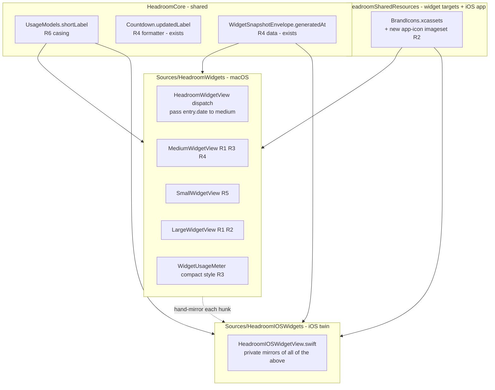

# Unified Widget Redesign - Plan

## Goal Capsule

- **Objective:** Implement the Paper-finalized widget redesign in both WidgetKit extensions — macOS (`Sources/HeadroomWidgets`) and iOS (`Sources/HeadroomIOSWidgets`) — across small/medium/large, light and dark.
- **Visual authority:** The Paper artboards "iOS Widgets - Editable From Simulator" and "macOS Widgets - Editable From Real WidgetKit Code" (Headroom Paper file, App UI page) are the target look. This plan carries the extracted values; when plan text and artboard disagree, the artboard wins.
- **Execution profile:** Build on branch `kylezantos/ios-dark-ring-shadow` on top of its uncommitted elevation/brand-mark changes — do not revert or regenerate those hunks (`Sources/HeadroomIOSWidgets/Views/HeadroomIOSWidgetView.swift` and `Sources/HeadroomWidgets/Views/WidgetProviderIcon.swift` are already dirty).
- **Stop conditions:** Surface instead of guessing if WidgetKit's default content margins make the artboard geometry unreachable without `contentMarginsDisabled()` (see KTD1).

---

## Product Contract

### Summary

Carry the widget design finalized in Paper into the real WidgetKit code: medium and large widgets get a "Usage" title with the app icon tucked top-right, the medium gets its reworked spacing/typography system, the small gets a breathability pass, the macOS medium gains the relative timestamp it lacks, and the weekly label casing unifies to "Weekly" across platforms.

### Problem Frame

The widget design was iterated in Paper (spacing audit against Apple's widget guidelines, then the "Usage" + tucked-icon header treatment) and approved on all eight artboard variants. The shipping code still renders the old design: "Headroom" app-name headers, 12pt margins on the medium, ~11pt percent values, cramped small-widget rows, no timestamp on the macOS medium, and lowercase "weekly" from the shared label source. The two widget extensions are deliberate hand-mirrored duplicates, so every change lands twice.

### Requirements

**Header and branding**

- R1. Medium and large widgets title "Usage" instead of "Headroom" on both platforms (matches the companion app's screen title).
- R2. The app icon renders as a rounded mark at the trailing edge of the header: 18pt on medium, 20pt on large, both platforms, correct in light and dark.

**Medium layout**

- R3. Medium matches the artboard geometry: ~16pt effective content margins; two equal-width provider columns with a centered hairline separator (the existing single-provider full-width branch is preserved); percent values 14pt bold monospaced-digit, right-aligned on the label row above 6pt bars; secondary labels ("Weekly", "5h") at 11pt.
- R4. Medium shows a relative freshness timestamp ("N min ago") at 11pt in the header's trailing cluster on both platforms — macOS gains it (data is already in the envelope via `generatedAt`), iOS restyles its existing one from `.caption2` to match.

**Small layout**

- R5. Small gets the breathability pass: ~14pt effective margins and a larger gap between the two provider rows (current row spacing is 7pt; artboards show ~12pt), with the title unified to "Weekly left" on both platforms.

**Vocabulary**

- R6. The weekly window label renders "Weekly" (capitalized) everywhere widgets show it, on both platforms.

**Constraints**

- R7. Changes layer onto the uncommitted `ios-dark-ring-shadow` working tree.
- R8. Effective outer margins come from WidgetKit's default content margins plus minimal per-view padding — no `contentMarginsDisabled()` (user-confirmed direction; artboards are the target look, not a pixel contract).

### Scope Boundaries

- No extraction of a shared cross-platform widget module — the hand-mirrored duplication convention stands (file headers say "Keep the two in sync").
- No changes to the companion app screens, the macOS popover, or the menu-bar label beyond whatever R6's shared-label fix touches.
- Small widgets get no app icon and no "Usage" title — they keep the content-first "Weekly left" title.
- `configurationDisplayName("Headroom")` stays as-is in both widget bundles; the gallery name is attribution, the header title is content.

#### Deferred to Follow-Up Work

- Consolidating the duplicated widget style/metrics literals (`WidgetProviderStyle` vs the private `IOSWidgetStyle`) into a shared SwiftUI-free metrics type in `HeadroomCore` (precedent: `HeadroomBrandMark.opticalScale`).
- Removing dead code `Sources/HeadroomWidgets/Views/WidgetProviderRow.swift` (compiled but unreferenced).
- Unifying the three `VesselMark` variants.

---

## Planning Contract

### Key Technical Decisions

- **KTD1 — Margin strategy: system content margins + tuned inner padding.** Keep WidgetKit's default content margins active and shrink each view's explicit outer padding so the *effective* margin lands at the artboard values (~16pt medium, ~14pt small). Rationale: system margins adapt across OS versions and surfaces; user confirmed this over pixel-exact hardcoding. The exact split between system margin and residual padding is a deferred implementation detail — measure the rendered result in the widget gallery and adjust the residual, don't precompute.
- **KTD2 — App icon ships as a new imageset in `Sources/HeadroomSharedResources/BrandIcons.xcassets`.** That catalog is already in both widget extension targets and the iOS app (the macOS app bundles its own icon resources separately), so no `project.yml` target-membership edits are needed. Source art is the existing full-bleed `Sources/HeadroomApp/Resources/AppIcon/vessel-app-icon.svg`; rounding is applied at render time with the established recipe from `Sources/HeadroomIOS/DesignSystem/HeadroomAppIconView.swift` — `RoundedRectangle(cornerRadius: size * 0.22, style: .continuous)` clip. Neither widget bundle currently contains any app-icon artwork, so `UIImage(named: "AppIcon")` shortcuts are not an option.
- **KTD3 — "Weekly" casing fixed at the source, not per-view.** Change `WindowKind.shortLabel` (`Sources/HeadroomCore/Models/UsageModels.swift`; not the similarly named widget-side `WidgetWindowKind`) from `"weekly"` to `"Weekly"` so the projector, both widget extensions, and any other consumer agree. Views keep rendering labels verbatim (repo convention). Accepted transitional state: cached/synced snapshots carry the old casing until the Mac app re-exports; widgets self-heal on the next snapshot.
- **KTD4 — Typography changes land inside `WidgetUsageMeter`'s compact style (and its private iOS twin), not a new component.** The medium already has the right row structure (label left, percent right, bar below); the redesign is a values change (percent → 14pt bold monospaced-digit, label → 11pt medium) plus row spacing.
- **KTD5 — Per-platform duplication is honored, sequenced macOS-first.** macOS views change first (they're the smaller, file-per-view side and `swift build` type-checks them cheaply), then the iOS single-file twin mirrors them. Every macOS hunk gets a corresponding iOS hunk in the same review.

### High-Level Technical Design

Where each change lands, given the shared-core / duplicated-views topology:

Header target layout (medium and large, both platforms): leading `Text("Usage")` at the existing title size (`.headline` medium / 19pt semibold large), `Spacer`, trailing cluster of timestamp (medium only, 11pt medium, secondary color) then rounded app-icon mark (18pt / 20pt) with ~8pt gap.

### Sources & Research

- Paper file "Headroom", App UI page — the eight approved widget artboards (light/dark × iOS/macOS × updated sizes): https://app.paper.design/file/01KWQPH9GJBA32EBQF71CD7T90/2-0
- `Headroom.xcodeproj` is generated by xcodegen from `project.yml` (`Scripts/build-app.sh` runs `xcodegen generate`) — never hand-edit the pbxproj; new files inside existing globbed directories and new imagesets inside an existing catalog need no `project.yml` change, but the project still regenerates on next build.
- The iOS widget extension has no `HeadroomCore` dependency — `project.yml` compiles selected core files directly into it, so no `import HeadroomCore` in iOS widget code.
- `swift build` type-checks the macOS widget target; iOS widget code is only covered by `xcodebuild` against the `HeadroomIOS` scheme. No `#Preview` blocks exist anywhere in `Sources/`; simulator review uses `HEADROOM_PREVIEW=1` seeded data (`Sources/HeadroomIOS/DesignSystem/CompanionPreviewSeed.swift`, currently untracked on this branch).
- `WidgetUsageMeter` current values for reference: compact percent is `.caption2.bold().monospacedDigit()`, bar height already 6pt, medium outer padding currently `.padding(12)`, small padding 10h/11v with row spacing 7.

---

## Implementation Units

### U1. App icon asset reachable from both widget bundles

**Goal:** A rounded-app-icon mark is renderable at 18–20pt inside both widget extensions.
**Requirements:** R2
**Dependencies:** none
**Files:** `Sources/HeadroomSharedResources/BrandIcons.xcassets/` (new imageset from `Sources/HeadroomApp/Resources/AppIcon/vessel-app-icon.svg`); new small view `Sources/HeadroomWidgets/Views/WidgetAppIconMark.swift`; iOS twin added inside `Sources/HeadroomIOSWidgets/Views/HeadroomIOSWidgetView.swift`.
**Approach:** Mirror the existing brand-icon imageset shape (universal, single SVG, `preserves-vector-representation`). The mark view renders the image in a fixed frame with the `size * 0.22` continuous-corner clip and the subtle shadow from `HeadroomAppIconView`; identical output on both platforms. If SVG rendering of this particular file misbehaves in an asset catalog, fall back to PNG scales exported by `Scripts/gen-app-icon.mjs` — decide at implementation.
**Test scenarios:** Test expectation: none — asset plumbing; proven by U2/U3 builds and the visual pass in the Verification Contract.
**Verification:** Both extension targets build; the mark renders non-empty in light and dark.

### U2. macOS widget views match the artboards

**Goal:** macOS small/medium/large render the approved design.
**Requirements:** R1, R2, R3, R4, R5, R8
**Dependencies:** U1
**Files:** `Sources/HeadroomWidgets/Views/HeadroomWidgetView.swift`, `HeadroomMediumWidgetView.swift`, `HeadroomSmallWidgetView.swift`, `HeadroomLargeWidgetView.swift`, `WidgetUsageMeter.swift`.
**Approach:** Medium: replace the bare `Text("Headroom")` with the header layout from the HTD section; pass `now: entry.date` into the medium view (mirroring how the large view already receives it) and render `Countdown.updatedLabel(capturedAt: envelope.generatedAt, now:)`; equalize the two columns; retune `WidgetUsageMeter` compact typography per KTD4; reduce outer padding per KTD1. Small: title → "Weekly left", row gap 7 → ~12, padding per KTD1. Large: title → "Usage", add the 20pt mark trailing. Preserve: single-provider full-width medium branch, `needsAttention` warning triangle in column headers, nil-window "--" meter state.
**Execution note:** Tune KTD1's residual padding against the rendered widget gallery, not by arithmetic — this is the unit where the margin fork would surface if system margins fight the artboard look.
**Test scenarios:** Test expectation: none — SwiftUI layout with no unit seam in this repo; behavior proven visually per the Verification Contract. Layout must be checked in these states: two providers, single provider (no separator), nil window ("--"), `needsAttention` triangle present, "100%" (widest percent, must not wrap or truncate), "N hr ago" (widest timestamp).
**Verification:** `swift build` clean; widget gallery screenshots (light + dark, all three sizes) match the macOS artboards.

### U3. iOS widget twin mirrors U2

**Goal:** iOS small/medium/large render the approved design, hunk-for-hunk with U2.
**Requirements:** R1, R2, R3, R4, R5, R7, R8
**Dependencies:** U1, U2
**Files:** `Sources/HeadroomIOSWidgets/Views/HeadroomIOSWidgetView.swift`.
**Approach:** Mirror every U2 change into the private twins (`IOSWidgetUsageMeter`, the size views, header). iOS-specific deltas: the medium timestamp already exists — restyle `.caption2` → 11pt medium and move it into the trailing cluster next to the new icon mark; the small keeps its "from Mac · N min ago" footer. Layer carefully on the branch's dirty `providerIcon` optical-scale hunks (R7).
**Test scenarios:** Test expectation: none — same rationale and same visual state checklist as U2.
**Verification:** `xcodebuild -project Headroom.xcodeproj -scheme HeadroomIOS -destination 'generic/platform=iOS Simulator' build` clean; simulator widget gallery (light + dark) matches the iOS artboards.

### U4. "Weekly" casing unified at the source

**Goal:** The weekly label renders "Weekly" on every widget surface.
**Requirements:** R6
**Dependencies:** none (independent of U1–U3)
**Files:** `Sources/HeadroomCore/Models/UsageModels.swift` (`WindowKind.shortLabel` and its stale doc comment); `Tests/HeadroomCoreTests/UsageMathTests.swift` (the only existing `shortLabel` test, covering the `.other` passthrough case).
**Approach:** Capitalize at the source per KTD3. Call-site audit result (verified during review): `WidgetSnapshotProjector.windowSummary` is the sole production consumer of `shortLabel`; no menu-bar or accessibility code reads it, and its doc comment claiming menu-bar/accessibility use is stale — correct the comment in the same change.
**Test scenarios:** `shortLabel` for the weekly kind returns "Weekly"; projector output carries "Weekly" in the envelope window label; the existing `.other`-case passthrough test still passes; 5h label unchanged as "5h".
**Verification:** `swift test` green; a fresh Mac snapshot export shows "Weekly" in both platforms' medium/large widgets.

---

## Verification Contract

| Gate | Command / check | Proves |
|---|---|---|
| Core + macOS type-check | `swift build` | U1, U2, U4 compile under Swift 6 strict concurrency |
| Unit suite | `swift test` | U4 label change and fixtures (all mocked; no CLI/network/Keychain) |
| iOS build | `xcodebuild -project Headroom.xcodeproj -scheme HeadroomIOS -destination 'generic/platform=iOS Simulator' build` | U1, U3 compile (only coverage for iOS widget code) |
| macOS visual | `./Scripts/build-app.sh`, add widgets, screenshot gallery light + dark | U2 matches macOS artboards |
| iOS visual | Simulator with `HEADROOM_PREVIEW=1` seeded data, widget gallery light + dark | U3 matches iOS artboards |
| State sweep | Single provider, nil window, `needsAttention`, "100%", "N hr ago" | No regression in variable-content states |

## Definition of Done

- All four units implemented; every macOS layout hunk has its iOS mirror.
- All Verification Contract gates pass; visual gates checked in both light and dark.
- Screenshots of both widget galleries presented against the Paper artboards for sign-off.
- No `contentMarginsDisabled()` introduced; no `project.yml` hand-edits beyond what xcodegen regeneration requires.
- Diff contains no abandoned experiments; untouched deferred items (style consolidation, `WidgetProviderRow` removal, `VesselMark` unification) remain deferred, not half-done.
