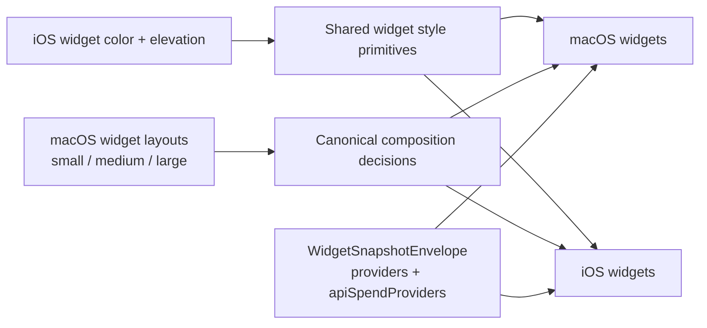

# refactor: Unify Widget Design and Color System

## Summary

Make the macOS widgets the composition source of truth while bringing the iOS widget color/elevation system into the shared widget look. Then update the iOS widgets to mirror the current macOS small, medium, and large layouts exactly, preserving API spend treatments in medium/large widgets and leaving screenshot capture for a follow-up execution step.

---

## Problem Frame

The shipped widget work now supports updated macOS layouts and API spend, but the two platform widget sets still diverge visually. macOS has the better information architecture and spacing: no redundant `Usage` title, no app icon in the widget body, quota-first sections, and compact API spend placement. iOS has the preferred color, surface, and elevation treatment. The result is two correct but mismatched widget families, which makes the product feel less intentional and blocks trustworthy website screenshots.

---

## Requirements

- R1. Preserve the current macOS widget structure as the layout/composition source of truth across small, medium, and large families.
- R2. Bring the preferred iOS widget color, surface, ring, hairline, text, bar-track, and elevation treatment into the macOS widgets.
- R3. Update iOS widgets to mirror the current macOS widget layouts, including removing the medium/large `Usage` title and app-icon mark from the widget content.
- R4. Keep API spend visible in medium/large widgets when exported spend data exists, without crowding or displacing quota-first usage information.
- R5. Preserve existing widget data contracts, snapshot projection behavior, iCloud/app-group sync behavior, and Mac-as-source-of-truth API spend configuration.
- R6. Verify both platform widget sets in representative states: no API spend, live API spend, stale/pending API spend, one provider, and two providers.
- R7. Keep screenshot sourcing out of this plan's implementation diff; screenshots are captured after the unified widgets are built and installed.

---

## Scope Boundaries

- Do not change subscription usage polling, Claude CLI probing, Codex API usage fetching, API spend fetching, or snapshot projection semantics.
- Do not add API spend to small widgets unless the existing small layout can accommodate it without weakening weekly quota glanceability.
- Do not add iOS-side API spend settings, key entry, provider enablement, or direct API fetching.
- Do not redesign the Mac popover, iPhone companion app, website, DMG, app icon, or non-widget settings surfaces.
- Do not capture or replace website screenshots in this plan PR.

### Deferred to Follow-Up Work

- Website screenshot capture and `app/headroom/page.tsx` image replacement: execute after the unified widgets are installed and visually approved.
- Deeper SwiftUI code extraction into a fully shared widget view library: only pursue if implementation proves the parity change cannot stay small and maintainable.

---

## Context & Research

### Relevant Code and Patterns

- `Sources/HeadroomWidgets/Views/HeadroomSmallWidgetView.swift` already has the preferred small-widget composition: `Weekly left`, compact provider rows, bars, and no footer when space is tight.
- `Sources/HeadroomWidgets/Views/HeadroomMediumWidgetView.swift` already has the preferred medium-widget composition: provider columns centered in the family, optional compact API spend row, hairline separation, and footer placement.
- `Sources/HeadroomWidgets/Views/HeadroomLargeWidgetView.swift` already has the preferred large-widget composition: provider sections separated by hairlines, inline reset labels, optional API spend section, and trailing freshness footer.
- `Sources/HeadroomWidgets/Views/WidgetAPISpendView.swift` contains the shipped macOS medium/large API spend treatment from PR #22.
- `Sources/HeadroomWidgets/WidgetProviderStyle.swift` and `Sources/HeadroomIOSWidgets/Views/HeadroomIOSWidgetView.swift` currently duplicate similar color primitives. The iOS file also defines `IOSWidgetStyle.tileSurface`, `tileRing`, and `IOSWidgetTile`, which are the preferred color/elevation direction.
- `Sources/HeadroomIOSWidgets/Views/HeadroomIOSWidgetView.swift` currently diverges structurally with `Usage` headers, an app icon mark, large provider tiles, and iOS-specific spacing.
- `Sources/HeadroomWidgets/Views/HeadroomWidgetPreviews.swift` has API spend preview seed data that should remain representative after the visual update.
- `Tests/HeadroomCoreTests/WidgetSnapshotProjectorTests.swift`, `Tests/HeadroomCoreTests/SyncedWidgetSnapshotModelsTests.swift`, and `Tests/HeadroomCoreTests/UsageStoreTests.swift` cover the data contract and should not need behavior changes unless the implementation discovers a projection regression.

### Institutional Learnings

- No `docs/solutions/` learning exists for widget visual parity. The relevant local learning is in the merged plan and PR trail: keep API spend separate from quota windows and keep widgets rendering redaction-safe snapshots.

### Related PRs

- PR #20, `iOS companion + widget design unification`, introduced the iOS companion/widget redesign direction and platform parity groundwork.
- PR #21, `Polish macOS widget layout`, established the newer macOS widget layout that should now be treated as the composition source of truth.
- PR #22, `feat: mirror API spend to iOS and widgets`, added API spend summaries and medium/large widget renderers that this plan must preserve.

### External References

- Not used. The codebase has direct local patterns for WidgetKit family-specific layouts and the request is primarily project-specific visual parity.

---

## Key Technical Decisions

- Treat macOS widget structure as canonical: iOS should converge to the current macOS small/medium/large composition rather than continuing a parallel `Usage` header and tile-based large-widget structure.
- Treat iOS widget color/elevation as canonical: macOS should adopt the warmer provider text, softer secondary/tertiary text, bar tracks, hairlines, and elevated surface/ring treatment where those primitives apply.
- Prefer a small shared widget style layer over a broad view extraction: the immediate mismatch is visual parity and composition drift, not a proven need to collapse all macOS/iOS widget SwiftUI into one target.
- Keep platform-specific WidgetKit modifiers at the platform edge: iOS still owns `.containerBackground(.background, for: .widget)` and rendering-mode behavior, while macOS keeps its existing WidgetKit extension structure.
- Preserve API spend as an optional medium/large section: it remains subordinate to quota at a glance and should vanish cleanly when `apiSpendProviders` is empty.
- Use manual visual verification as a required acceptance gate: the meaningful risk is cramped, clipped, or mismatched widget rendering in the system gallery, not just Swift compilation.

---

## Open Questions

### Resolved During Planning

- Which platform owns composition? macOS owns composition because its shipped widgets have the preferred structure and API spend accommodation.
- Which platform owns color/elevation? iOS owns the preferred color system and surface treatment.
- Should screenshots be part of this implementation? No. Screenshots follow after the app is built, installed, and approved visually.

### Deferred to Implementation

- Exact shared-style placement: start with the smallest maintainable style extraction; only create a shared cross-target style file if target membership and access boundaries stay simple.
- Exact large-widget surface treatment on macOS: adopt the iOS elevation intent, but tune against actual WidgetKit rendering so macOS does not become visually heavier than the system gallery context supports.
- Whether old iOS-only helper views can be deleted outright or should be retained briefly for preview/debug convenience depends on the final mirrored structure.

---

## High-Level Technical Design

> *This illustrates the intended approach and is directional guidance for review, not implementation specification. The implementing agent should treat it as context, not code to reproduce.*

The intended end state is not a wholesale target merger. It is a parity pass:

- macOS keeps its layout structure and gains the iOS color/elevation feel.
- iOS keeps platform-specific WidgetKit background/rendering behavior and mirrors the macOS layout structure.
- API spend continues to render from `WidgetSnapshotEnvelope.apiSpendProviders` in medium/large families only.

---

## Implementation Units

### U1. Establish Shared Widget Style Primitives

**Goal:** Make the iOS color/elevation system available to both widget implementations without changing widget data behavior.

**Requirements:** R2, R5

**Dependencies:** None

**Files:**
- Modify: `Sources/HeadroomWidgets/WidgetProviderStyle.swift`
- Modify: `Sources/HeadroomIOSWidgets/Views/HeadroomIOSWidgetView.swift`
- Modify or create if needed: `Sources/HeadroomCore/Models/BrandColorValues.swift`
- Modify or create if needed: shared widget style file under `Sources/HeadroomWidgets/` or `Sources/HeadroomCore/Widgets/`

**Approach:**
- Compare the macOS `WidgetProviderStyle` primitives against the iOS `IOSWidgetStyle` primitives and identify which values are already equivalent versus which are iOS-only.
- Move or duplicate only the minimum shared primitives needed for parity: provider text accents, secondary/tertiary text, bar track, hairline, tile surface/ring, and shadow intent.
- Keep brand color and severity color values grounded in the existing HeadroomCore color constants.
- Avoid moving platform-only helpers into core if they depend on WidgetKit rendering mode or SwiftUI modifiers that do not belong in the core model layer.

**Patterns to follow:**
- Existing `WidgetProviderStyle` static style API
- Existing `IOSWidgetStyle` color/elevation values
- `HeadroomBrandColorValues` and `HeadroomSeverityColorValues` as canonical RGB sources

**Test scenarios:**
- Test expectation: no new unit test is required for pure SwiftUI color constants unless the implementation changes `HeadroomBrandColorValues` or `HeadroomSeverityColorValues`.
- Manual happy path: macOS and iOS widget previews use the same provider accent, muted text, hairline, and bar-track intent in dark mode.
- Manual edge case: light-mode previews remain legible and do not collapse low-contrast hairlines or text.

**Verification:**
- Both widget targets compile with shared style primitives, and no data-model or snapshot tests require behavior updates.

---

### U2. Apply the iOS Color System to macOS Widgets

**Goal:** Keep the current macOS widget composition while adopting the preferred iOS visual treatment.

**Requirements:** R1, R2, R4, R5, R6

**Dependencies:** U1

**Files:**
- Modify: `Sources/HeadroomWidgets/Views/HeadroomSmallWidgetView.swift`
- Modify: `Sources/HeadroomWidgets/Views/HeadroomMediumWidgetView.swift`
- Modify: `Sources/HeadroomWidgets/Views/HeadroomLargeWidgetView.swift`
- Modify: `Sources/HeadroomWidgets/Views/WidgetAPISpendView.swift`
- Modify: `Sources/HeadroomWidgets/Views/WidgetUsageMeter.swift`
- Modify: `Sources/HeadroomWidgets/Views/WidgetUsageBar.swift`
- Modify: `Sources/HeadroomWidgets/Views/HeadroomWidgetPreviews.swift`

**Approach:**
- Preserve the shipped macOS hierarchy, provider ordering, footer placement, API spend placement, and family-specific spacing unless visual verification reveals a direct clash with the new style.
- Apply the shared/iOS-derived text, bar, hairline, tile/surface, and ring primitives to macOS widget views.
- If the iOS tile/elevation treatment is too heavy for the current macOS large layout, tune surface opacity/ring/shadow inside the shared style rather than changing the large-widget information architecture.
- Keep small widgets quota-only and compact.

**Patterns to follow:**
- Current macOS widget files from PR #21 and PR #22
- `WidgetAPISpendCompactRow` and `WidgetAPISpendSection` for medium/large API spend
- Existing WidgetKit content-margin comments and family-specific padding decisions

**Test scenarios:**
- Manual happy path: macOS small widget still shows weekly quota rows with no title/icon additions and no clipping.
- Manual happy path: macOS medium widget with no API spend still centers provider columns and footer cleanly.
- Manual happy path: macOS medium widget with API spend shows compact spend without crowding quota bars.
- Manual happy path: macOS large widget with API spend shows provider sections, spend section, and footer with clear hierarchy.
- Manual edge case: one-provider and two-provider snapshots both preserve balance.
- Manual error path: stale/pending API spend remains readable and attention styling does not overpower quota state.

**Verification:**
- macOS widget gallery previews visually match the approved layout structure while taking on the iOS color/elevation feel.

---

### U3. Mirror macOS Layouts in iOS Widgets

**Goal:** Replace the iOS-only widget composition with the macOS canonical composition while retaining iOS platform rendering behavior.

**Requirements:** R1, R3, R4, R5, R6

**Dependencies:** U1, U2

**Files:**
- Modify: `Sources/HeadroomIOSWidgets/Views/HeadroomIOSWidgetView.swift`
- Modify if needed: `Sources/HeadroomIOSWidgets/Views/IOSWidgetStatusView.swift`
- Modify if needed: `Sources/HeadroomIOS/DesignSystem/CompanionPreviewSeed.swift`

**Approach:**
- Remove the medium/large `Usage` header and `IOSWidgetAppIconMark` from content layouts.
- Align iOS small with macOS small: `Weekly left`, compact provider weekly rows, compact spacing, and no unnecessary footer when it competes with data density.
- Align iOS medium with macOS medium: provider columns as the primary content, optional compact API spend row, hairline separation, and freshness footer matching the macOS placement intent.
- Align iOS large with macOS large: provider sections separated by hairlines, no iOS-only provider tile cards, optional API spend section, and trailing freshness footer.
- Keep `.containerBackground(.background, for: .widget)`, `.widgetURL(...)`, and any rendering-mode accommodations required by WidgetKit on iOS.

**Patterns to follow:**
- `Sources/HeadroomWidgets/Views/HeadroomSmallWidgetView.swift`
- `Sources/HeadroomWidgets/Views/HeadroomMediumWidgetView.swift`
- `Sources/HeadroomWidgets/Views/HeadroomLargeWidgetView.swift`
- iOS `containerBackground` and WidgetKit rendering-mode handling currently in `HeadroomIOSWidgetView`

**Test scenarios:**
- Manual happy path: iOS small widget matches macOS small composition and uses the shared color treatment.
- Manual happy path: iOS medium widget no longer shows `Usage` or the app icon and matches macOS medium spacing/hierarchy.
- Manual happy path: iOS large widget no longer shows `Usage`, no longer uses large provider tile cards, and matches macOS large provider-section composition.
- Manual edge case: iOS medium/large widgets with API spend preserve readable spend amounts and period/freshness state.
- Manual error path: iOS waiting/setup/corrupt status widgets still render through `IOSWidgetStatusView` and are not affected by content-layout parity.

**Verification:**
- iPhone Continuity widget previews in the macOS widget gallery visually mirror the Mac widget set apart from expected system-level platform rendering.

---

### U4. Preserve API Spend and Snapshot Contract Behavior

**Goal:** Ensure the visual refactor does not regress the API spend support and snapshot compatibility shipped in PR #22.

**Requirements:** R4, R5, R6

**Dependencies:** U2, U3

**Files:**
- Inspect: `Sources/HeadroomCore/Widgets/WidgetSnapshotModels.swift`
- Inspect: `Sources/HeadroomCore/Widgets/WidgetSnapshotProjector.swift`
- Inspect: `Sources/HeadroomCore/Engine/UsageStore.swift`
- Test: `Tests/HeadroomCoreTests/WidgetSnapshotProjectorTests.swift`
- Test: `Tests/HeadroomCoreTests/SyncedWidgetSnapshotModelsTests.swift`
- Test: `Tests/HeadroomCoreTests/UsageStoreTests.swift`

**Approach:**
- Avoid touching core snapshot/projection code unless implementation reveals a compile issue from style/view refactoring.
- Keep `apiSpendProviders` optional in rendering: when empty, widgets use the no-spend layout; when present, medium/large widgets render spend.
- Confirm legacy snapshot decoding, redaction safety, and spend-only export tests still pass after view changes.

**Patterns to follow:**
- `docs/plans/2026-07-07-001-feat-api-spend-mirror-widgets-plan.md`
- PR #22 API spend snapshot tests and preview data

**Test scenarios:**
- Happy path: existing API spend projection tests still pass unchanged.
- Edge case: legacy snapshot without API spend still decodes and renders the no-spend widget path.
- Error path: stale API spend data still renders as stale/pending rather than disappearing or presenting credential controls.
- Integration: spend-only refresh export behavior remains unchanged.

**Verification:**
- Data contract tests remain green without requiring snapshot model behavior changes.

---

### U5. Build, Install, and Visually Verify Both Widget Sets

**Goal:** Prove the unified widgets are ready for screenshot capture in a clean local build.

**Requirements:** R6, R7

**Dependencies:** U1, U2, U3, U4

**Files:**
- Inspect: `Scripts/build-app.sh`
- Inspect: `Headroom.app` build output
- Inspect: macOS widget gallery previews
- Inspect: iPhone Continuity widget gallery previews

**Approach:**
- Build and install from a clean branch/worktree after implementation.
- Refresh WidgetKit registration so the gallery shows the newly built widget extension.
- Verify both Mac and iPhone widget entries in the system gallery before capturing website screenshots.
- Capture screenshots only after Kyle approves the visual result.

**Patterns to follow:**
- Existing local install flow used to build and register `/Applications/Headroom.app`
- WidgetKit review checklist from `.agents/skills/widgetkit/SKILL.md`

**Test scenarios:**
- Manual happy path: widget gallery shows one current Mac Headroom widget set from `/Applications/Headroom.app` and the expected iPhone Continuity set.
- Manual happy path: small/medium/large Mac widgets and small/medium/large iPhone widgets all show the unified layout direction.
- Manual edge case: API spend dummy/demo data appears in medium/large widgets without layout clipping.
- Manual edge case: the no-API-spend state still looks intentional, not like a missing section.
- Manual error path: stale/pending provider and spend states remain legible.

**Verification:**
- The installed app and widget extension are the latest branch build, both widget sets match the planned design direction, and screenshot capture can proceed as a separate step.

---

## System-Wide Impact

- **Interaction graph:** This should be a widget-rendering refactor only. `WidgetSnapshotEnvelope` continues to feed macOS widgets, iOS widgets, and iPhone mirror surfaces without changing provider fetch or sync ownership.
- **Error propagation:** Typed freshness and stale/pending states should remain display inputs only; view changes must not transform errors or hide attention states.
- **State lifecycle risks:** Widget gallery caching may show old previews after install; implementation verification must explicitly refresh/re-register WidgetKit before judging visuals.
- **API surface parity:** macOS and iOS widgets should render the same conceptual surfaces for subscription quota and API spend, while platform-only WidgetKit modifiers remain separate.
- **Integration coverage:** Existing core tests prove projection/sync behavior; manual gallery checks prove the layout/color parity that unit tests cannot meaningfully assert.
- **Unchanged invariants:** Mac remains the source of truth for API spend configuration, iOS does not fetch spend directly, and small widgets remain quota-first.

---

## Risks & Dependencies

| Risk | Mitigation |
|------|------------|
| Shared style extraction creates target membership or dependency churn. | Start with the smallest style move; keep platform-specific WidgetKit concerns in platform files. |
| iOS large widget loses useful depth when provider tile cards are removed. | Replace tile-card reliance with the shared macOS provider-section hierarchy plus iOS-derived surface/ring treatment. |
| API spend makes medium widgets crowded. | Preserve the shipped compact spend row and verify live/stale/no-spend states in the gallery before approval. |
| Widget gallery caches stale designs and misleads screenshot capture. | Build from a clean branch, reinstall, re-register WidgetKit, and confirm process/plugin paths before screenshots. |
| Visual parity work accidentally changes data behavior. | Keep core projection/sync files untouched unless necessary and require existing API spend/snapshot tests to remain green. |

---

## Documentation / Operational Notes

- No user-facing documentation update is needed for the visual parity PR.
- The follow-up screenshot PR should document the source build/commit used for captures in its PR body.
- If implementation creates a reusable widget style helper, a short code comment may explain why platform modifiers remain outside the shared style.

---

## Sources & References

- Related plan: `docs/plans/2026-07-07-001-feat-api-spend-mirror-widgets-plan.md`
- Related PR: [#20 iOS companion + widget design unification](https://github.com/kylezantos/headroom/pull/20)
- Related PR: [#21 Polish macOS widget layout](https://github.com/kylezantos/headroom/pull/21)
- Related PR: [#22 feat: mirror API spend to iOS and widgets](https://github.com/kylezantos/headroom/pull/22)
- WidgetKit guidance: `.agents/skills/widgetkit/SKILL.md`
