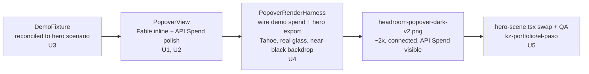

> Historical document: website ownership moved to `headroom-site` in September 2026.
> References below to portfolio publication describe the former setup. For new releases,
> follow [the current release runbook](../release/website-dmg-release.md).

# feat: Refine popover (Fable inline, API Spend) and land headless Tahoe hero render

**Target repos:** app changes (U1–U4) live in this repo, **Headroom** (`tunis-v1` workspace). The hero-image swap (U5) lives in the portfolio repo **`kz-portfolio/el-paso`** (serves `headroom.zantos.co`). All file paths are repo-relative to whichever repo the unit targets, labeled per unit.

---

## Summary

Refine the real macOS popover — inline the "Weekly (Fable)" reset like the other rows, and tighten the API Spend section — then make the `headroom.zantos.co` hero a headless render of that popover showing **real Tahoe Liquid Glass** with API Spend visible. The app stays the single source of truth; the site image is a render of it, not an HTML replica.

---

## Problem Frame

Kyle refined the popover in a Paper artboard ("macOS Popover - Dark Editable (matches live v1)"). Comparing that mockup to the shipped app surfaced two genuine wins worth porting into the real app, plus a gap in how the site renders the popover:

1. **Fable reset inconsistency.** In `UsageBarView`, the reset countdown renders inline (`· Resets in …`) for `.fiveHour`/`.weekly` windows but drops to a separate sub-line under the bar for `.other` windows. That `.other` rule exists to keep Codex's long model labels (e.g. `GPT-5.3-Codex-Spark…`) from overflowing — but it also catches Claude's short `"Weekly (Fable)"`, so Fable's reset sits on its own line, visibly out of rhythm with the two rows above it.

2. **API Spend needs to be right by construction.** Kyle uses a subscription only (no API key), so the section is absent from his own popover — but users who add a key will see it, and it should read as cleanly as the usage cards. Its current per-row "Updated N min ago" sub-line duplicates the header's consolidated "Updated" stamp.

3. **The hero under-sells the surface.** The site currently serves a flat popover PNG. The app is now compatible with **both Sequoia (`.regularMaterial`) and Tahoe (Liquid Glass)**; Tahoe's Liquid Glass is a genuine selling point, and a flat solid-shell render shows neither OS's actual surface. The headless render harness also only wires Claude + Codex providers, so it can't currently produce a popover render *with* the API Spend section at all.

The decision (made in session): keep the hero a real-app render — do **not** revive the deleted HTML replica (`components/headroom/popover.tsx`, removed deliberately per the "real renders" architecture) — but upgrade it to real Tahoe glass, at best-available scale, with API Spend included.

---

## Key Technical Decisions

**KTD1 — Hero stays a real-app render; the HTML replica is not revived.** `headroom.zantos.co` renders the popover as a raster export of the real SwiftUI app. The deleted DOM replica reintroduces app-vs-site drift and doubles the maintenance surface; it stays deleted.

**KTD2 — Hero shows real Tahoe Liquid Glass, captured at display scale (~2×), not a solid 3× shell.** Both supported OSes ship a translucent surface and Tahoe's glass is a differentiator, so a flat solid shell under-sells the product. The in-repo harness already captures the real compositor surface via `screencapture`, which faithfully renders Liquid Glass — but at the display's backing scale (~2×), where a solid-shell `ImageRenderer` path could reach 3× but cannot rasterize live material. ~2× is 1:1-sharp on every Mac display (where the desktop hero actually lives) and only marginally soft on 3× iPhones in the mobile stacked layout — an accepted trade for showing the real premium surface. A real-glass 3× path is a deferred nice-to-have, not a blocker.

**KTD3 — Fable inline via fit-aware layout, not a widened boolean.** Replace `UsageBarView.resetInline`'s window-kind switch with a fit-aware layout (`ViewThatFits`: inline preferred, stacked sub-line fallback), so short labels like `"Weekly (Fable)"` inline while long Codex model labels still drop to their own line. This fixes Fable without special-casing a label string and without regressing the overflow case the original rule protected.

**KTD4 — Keep the app's hierarchy and material; port only the two wins.** The app's big percentage (18pt semibold) leads each row and its native card material reads as genuine macOS. Port only the Fable-inline fix and the API-Spend polish; do **not** adopt the mockup's flatter/tighter surfaces or its smaller (17px) number.

**KTD5 — Reconcile the shared demo fixture to the locked hero scenario.** `DemoFixture` feeds every demo surface (popover, macOS widgets, iOS mirror, capture script). Its current values already produce most of the hero scenario (Claude 72% / 38% left, Codex 91% / 64% left); the only utilization gap is the **Fable window** (currently 38% left, hero wants 54%). **The popover's reset text is computed from `resetsAt` via `Countdown.resetText`, which deliberately ignores `resetLabel`** (`Countdown.swift:28` — AGENTS.md's "shown verbatim via `resetLabel`" note is stale for the popover; that path feeds only the widget/iOS mirror via `MirrorPresentation`). So the popover already renders relative "Resets in …" text from the current `resetsAt` offsets; to hit the artboard's exact durations, adjust the **`resetsAt` offsets** (not `resetLabel`), which needs a minutes component on the `soon(hours:days:)` helper for "3h 15m". Do **not** edit `resetLabel` for the hero — it changes only the deferred widget/iOS surfaces and would desync them from the un-regenerated site assets. The Fable-utilization change is the only value that ripples to widget/iOS demo mode; those assets aren't regenerated here (see Scope Boundaries), so the shipped widget/iOS shots — which don't surface Fable — stay visually consistent.

**KTD6 — Render backdrop matches the site hero background.** Real glass samples what's behind it, so the harness backdrop for the hero export must be the site's near-black hero background (not the harness's default desk gradient), so the captured translucency composites correctly when placed on the framed desktop.

**KTD7 — Verify on both Sequoia and Tahoe.** The layout changes (U1, U2) are OS-agnostic SwiftUI, but the popover surface differs by OS. Verify the refined popover renders cleanly on both `.regularMaterial` (Sequoia) and Liquid Glass (Tahoe).

---

## High-Level Technical Design

The change spans two repos and a render step. The asset pipeline:

The app (U1–U4) is the source of truth; U5 consumes its output. Nothing on the site is authored by hand — the popover image is always a render of the shipped SwiftUI.

---

## Implementation Units

### U1. Fable reset inline (fit-aware)

**Goal:** `"Weekly (Fable)"` shows its reset inline (`· Resets in 4d`) like the Weekly and 5-hour rows, while long Codex `.other` labels still wrap to their own sub-line.

**Requirements:** Problem Frame #1; KTD3, KTD4.

**Dependencies:** none.

**Repo:** Headroom (this repo).

**Files:** `Sources/HeadroomApp/UI/UsageBarView.swift`

**Approach:** Replace the `resetInline` window-kind boolean and its two consumption sites (the inline `Text` in the header `HStack` and the trailing `if !resetInline` sub-line) with a fit-aware layout that prefers the inline arrangement and falls back to the stacked sub-line when the label + reset + percentage cannot fit on one line. Keep the existing type ladder — 13pt medium label, 11pt tertiary reset, **18pt semibold percentage as the row lead** (KTD4). Preserve the existing `accessibilityValue` string (label + percent + reset) regardless of which arrangement renders.

**Patterns to follow:** the existing row `HStack(alignment: .firstTextBaseline)` recipe and `ProviderStyle` color roles already in `UsageBarView`; mirror the large-widget meter rhythm the file cites.

**Test scenarios:** `Test expectation: none` — layout-only change with no new pure logic; the reset string and percentage already come from tested `Countdown`/`percentageMode` helpers. Verified visually via the U4 harness render (run on each OS per the Verification Contract): Fable inline in the demo scenario; a long Codex `.other` label (longest real model name) still wraps without clipping or truncating the percentage.

---

### U2. API Spend section polish

**Goal:** The API Spend rows read as cleanly as the usage cards in the live state — inline middot period, no redundant per-row "Updated" line — while preserving the actionable pending / stale / needs-setup / "Add key" states.

**Requirements:** Problem Frame #2; KTD4.

**Dependencies:** none.

**Repo:** Headroom (this repo).

**Files:** `Sources/HeadroomApp/UI/APISpendSectionView.swift`; a new month-name label source (view-level, or a spend-row-specific field in `Sources/HeadroomCore/…` — **not** the shared `APISpendPeriod.currentMonth.label`) + `Tests/HeadroomCoreTests/…` if that label lands in core.

**Approach:** In the **live** row, drop the "Updated N min ago" `statusLine` — it duplicates the popover header's consolidated stamp — and present name + inline middot period (`Anthropic API · July`) with the monospaced-digit amount trailing, matching the artboard and the usage-row hierarchy. Keep `statusLine` for the non-live states (`.pending` "Waiting for cost data", `.stale` "Stale"/"Needs setup", and the "Add key" affordance) since those carry information the header does not. Derive the month name (`July`) from a **separate display-only label** — `APISpendPeriod.currentMonth.label` is the fixed string "Current month" and is shared with the Settings period `Picker` (`SettingsView`), so mutating it would silently regress Settings; add a spend-row-specific month label and the leading middot in the view instead.

**Patterns to follow:** the sibling usage cards' type roles; the existing `raisedTile(cornerRadius: 10)` + 13pt padding so the spend tile stays flush with the provider cards; `ProviderLogoView(size: 16)` already used for the row mark.

**Test scenarios:**
- If a month-name label lands in core: `Tests/HeadroomCoreTests/…` — the new spend-row label returns the current month's name (`July`) while the shared `APISpendPeriod.currentMonth.label` ("Current month", used by the Settings picker) is unchanged; boundary at month rollover uses the correct month.
- View layout: `Test expectation: none` for the view arrangement — verified visually via U4's live-state hero and its non-live spend variant (live rows show inline period, no "Updated" sub-line; a `.stale`/`.pending`/no-amount row still shows its status line and the "Add key" button).

---

### U3. Reconcile DemoFixture to the locked hero scenario

**Goal:** Demo mode reproduces the hero scenario exactly: Claude 5-hour 72% / Weekly 38% / Weekly (Fable) 54% left; Codex 5-hour 91% / Weekly 64% left; spend $142.67 / $58.90; Claude resets phrased relatively to match the artboard.

**Requirements:** KTD5.

**Dependencies:** none (independent of U1/U2; consumed by U4).

**Repo:** Headroom (this repo).

**Files:** `Sources/HeadroomCore/DemoFixture.swift`; `Tests/HeadroomCoreTests/DemoFixtureTests.swift`; `Tests/HeadroomCoreTests/UsageStoreTests.swift`; `Tests/HeadroomCoreTests/WidgetSnapshotProjectorTests.swift`

**Approach:** Adjust the Fable window so it reads **54% left** (the only utilization gap — the 5-hour windows and the two non-Fable weekly windows already match). To match the artboard's reset durations in the popover, set the Claude windows' **`resetsAt` offsets** — `Countdown.resetText` renders these live as "Resets in 4d" / "Resets in 3h 15m", so extend the `soon(hours:days:)` helper with a minutes component for the 5-hour "3h 15m". Do **not** edit `resetLabel`; the popover ignores it (see KTD5). Codex already matches; spend snapshots ($142.67 / $58.90) already match — leave them. Keep the change minimal and localized.

**Patterns to follow:** existing `UsageWindow(kind:utilization:resetsAt:resetLabel:)` construction and the `soon(...)` helper already in the file.

**Test scenarios:**
- `DemoFixtureTests` — Claude windows assert 5-hour / Weekly / Fable produce 72 / 38 / 54 percent-left; assert `Countdown.resetText` (from the `resetsAt` offsets) renders "Resets in 4d" / "Resets in 3h 15m" / "Resets in 4d" — **not** `resetLabel`; Codex asserts 91 / 64.
- Severity bands resolve as designed for the reconciled values (38% left → amber; 54/64/72/91 → healthy) so the hero shows the same one amber + rest-green pattern as the artboard.
- Any other test asserting on `DemoFixture` values (`UsageStoreTests`, `WidgetSnapshotProjectorTests`) updated to the reconciled numbers and green.

---

### U4. Render harness: wire demo API Spend + hero export

**Goal:** The headless render produces a connected, dark popover **with the API Spend section visible**, on the real Tahoe Liquid Glass surface, over the site's hero background — the asset the portfolio consumes.

**Requirements:** Problem Frame #3; KTD1, KTD2, KTD6, KTD7.

**Dependencies:** U1, U2, U3.

**Repo:** Headroom (this repo).

**Files:** `Sources/HeadroomApp/PopoverRenderHarness.swift`; possibly `Sources/HeadroomApp/HeadroomApp.swift` if a distinct hero flag/name is added.

**Approach:** Wire the demo spend providers (`DemoFixture.anthropicSpend` / `openAISpend` via `DemoSpendProvider`) into the harness's `UsageStore` for the connected state, through the same seam `AppComposition` uses to register live spend providers — verify the exact `UsageStore` spend-provider entry point during implementation rather than assuming a signature. **Registering providers is necessary but not sufficient: the API Spend surfaces are off by default** (`Preferences.isSurfaceEnabled` returns `surface.isSubscription`, so `.anthropicAPI`/`.openAIAPI` start disabled and `UsageStore.apiSpendProviderOrder` is empty, hiding the section). The hero render's preferences must also `setSurfaceEnabled(true, …)` for both API surfaces, mirroring how the app's demo path enables them. With spend wired **and enabled**, the `connected` × `dark` render becomes the hero (API Spend visible). Set the hero render's backdrop to the site's near-black hero background (KTD6) instead of the default desk gradient, so the captured Liquid Glass composites correctly on the framed desktop. Keep the real-surface `screencapture` capture path (KTD2) — do not switch the hero to the offscreen `cacheDisplay`/solid path, which would flatten the glass. Emit the hero under a clear, versioned name for the portfolio hand-off. Capture must run on a **Tahoe** machine for Liquid Glass (note this in the harness/run docs); the same code on Sequoia yields the `.regularMaterial` surface, which is the correct fallback there.

**Execution note:** This is a diagnostic/tooling change; prefer running the harness and inspecting the emitted PNG over unit coverage.

**Test scenarios:** `Test expectation: none` — diagnostic harness with no behavioral unit surface. Verified by running the harness and inspecting the hero PNG: dark, connected, three Claude rows (Fable inline), two Codex rows, API Spend section with both providers and amounts, real Liquid Glass over a near-black backdrop, no clipping. Also emit a **non-live spend variant** (one live provider + one `.stale`/needs-setup/no-amount) so U2's retained `statusLine` and "Add key" affordance are inspectable — these states never appear in the live hero.

---

### U5. Portfolio: swap hero asset + QA

**Goal:** `headroom.zantos.co` serves the new popover render; the old asset is retired after a passing visual check.

**Requirements:** Problem Frame #3; KTD1, KTD2.

**Dependencies:** U4.

**Repo:** **`kz-portfolio/el-paso`** (portfolio).

**Files:** `public/images/headroom/headroom-popover-dark-v2.png` (add — new versioned filename, additive); `components/headroom/hero-scene.tsx` (update popover `<Image>` `src`, `alt`, and `sizes`/dimensions if the aspect shifted); `public/images/headroom/headroom-popover-dark-v1.png` (delete **after** QA passes); `app/headroom/__tests__/page.test.tsx` (update if it asserts on the popover image `src`/`alt`).

**Approach:** Drop the U4 render in as a new `-v2` file (never overwrite in place — matches the stale-cache-avoidance convention the prior real-renders work used). Point the popover slot at it and update the `alt` to the real content and `sizes` to the rendered width. Run `pnpm lint` + `pnpm build`, then dev-browser (headless, per global browser rules) at desktop ~1440 and phone ~390: popover crisp, API Spend visible, Liquid Glass reads correctly on the dark scene, framed-scene composition and mobile stack intact. Only after the verdict passes: delete `-v1` and re-run the build.

**Test scenarios:**
- `app/headroom/__tests__/page.test.tsx` green (updated for the new `src`/`alt` if asserted).
- Verified via dev-browser: screenshots at ~1440 and ~390 captured; popover sharpness acceptable against the crisp HTML menu bar; API Spend present; no layout drift; mobile stack unchanged.

---

## Scope Boundaries

**In scope:** the popover Fable-inline fix, API-Spend polish, the demo-fixture reconciliation, the harness spend-wiring + hero export, and the portfolio popover-hero swap.

### Deferred to Follow-Up Work
- **Re-syncing the widget and iPhone demo assets** on the site to the reconciled fixture. `DemoFixture` also feeds those surfaces, but this plan only re-renders and swaps the **popover** hero. The widget/iOS shots stay as-is; they won't be regenerated in this pass (they already advertise the matching Claude 38 / Codex 64 weekly values, so the visible site stays consistent).
- **A real-glass 3× capture path** for maximum sharpness on 3× phone displays, if ~2× ever proves too soft in practice.

### Out of scope / non-goals
- Reviving the deleted HTML popover replica (`components/headroom/popover.tsx`) — explicitly rejected (KTD1).
- Adopting the mockup's flatter/tighter card surfaces or its smaller (17px) percentage (KTD4).
- Any non-popover popover-app UI (settings, widgets, iOS views).
- Reintroducing Claude subscription-OAuth / Keychain-token reuse (hard repo prohibition, unrelated but never crossed).

---

## Risks & Dependencies

- **Real-glass capture is not fully headless/CI-able.** `screencapture` needs a live window + Screen Recording permission and captures at display scale. Mitigation: run the hero export on Kyle's Tahoe machine (the harness already handles the permission path and falls back to `cacheDisplay` only when capture is unavailable). Accept ~2× per KTD2.
- **Demo-fixture ripple.** Reconciling `DemoFixture` changes the numbers any *future* widget/iOS demo capture would show. No such capture happens in this plan, so the live site is unaffected; the risk is only a momentary source-of-truth vs. shipped-asset gap for widgets until a future re-sync (tracked in Deferred).
- **`ViewThatFits` borderline selection.** A near-fit long Codex label could pick inline and clip. Mitigation: U1/U4 verification exercises the longest real Codex model label to confirm it wraps.
- **Period-label mismatch.** If `APISpendPeriod.currentMonth.label` isn't the month name, U2 needs a small core change + test rather than a view-only edit.

---

## Verification Contract

**Headroom (this repo):**
- `swift build` clean under strict concurrency.
- `swift test` green, with `DemoFixtureTests` (and any dependent `UsageStore`/`WidgetSnapshotProjector` fixtures) updated to the reconciled scenario.
- `swift run Headroom --render-popover <dir>` (or `--demo`): inspect the connected-dark hero — Fable inline, API Spend visible — on **both** Sequoia (`.regularMaterial`) and Tahoe (Liquid Glass), or note which OS the capture machine ran and confirm the other surface separately.

**Portfolio (`kz-portfolio/el-paso`):**
- `pnpm lint` + `pnpm build` clean; `page.test.tsx` green.
- dev-browser headless QA at ~1440 and ~390: popover crisp, API Spend present, glass reads on the dark scene, composition + mobile stack intact.

## Open Questions

These surfaced in document review as genuine judgment calls, not defects — resolve before/while executing rather than silently in code.

- **OQ1 — Does the glass survive the near-black backdrop? (challenges KTD2 + KTD6.)** Liquid Glass over a near-black surface samples near-black, so the captured interior may read almost identically to the solid shell it replaced — meaning the ~2× sharpness trade (KTD2) buys translucency the static render mostly hides. Resolve empirically before retiring v1: render the real-glass-2× hero and a solid-3× hero over the *actual* site scene and compare. If the glass interior is imperceptible, either lighten/texture the immediate backdrop (revisit KTD6) or keep the sharper 3× flat shell.
- **OQ2 — Is real-glass 3× actually reachable?** The plan treats ~2× as fixed for the `screencapture` path. A quick spike — render the popover at ~1.5× logical size (the harness hard-codes 432pt) and capture at backing scale, then downscale on the site — may yield real glass *and* 3× density, dissolving the KTD2 trade. Worth trying before accepting the softness.
- **OQ3 — Split the PR/DoD?** U1–U2 ship a user-facing fix to *every* user; U3–U5 only touch the marketing hero and depend on a specific Tahoe machine + Screen Recording permission + a subjective softness verdict. Consider landing U1/U2 independently so the app fix isn't blocked by the capture, unless there's a reason to couple them.

## Definition of Done

Fable inlines in the shipped popover on both OSes; API Spend reads as cleanly as the usage cards with its non-live states preserved; the demo fixture reproduces the locked hero scenario; the render harness emits a connected-dark, API-Spend-inclusive, real-Tahoe-glass hero PNG; and `headroom.zantos.co` serves that new asset with the old one retired, all checks green.
