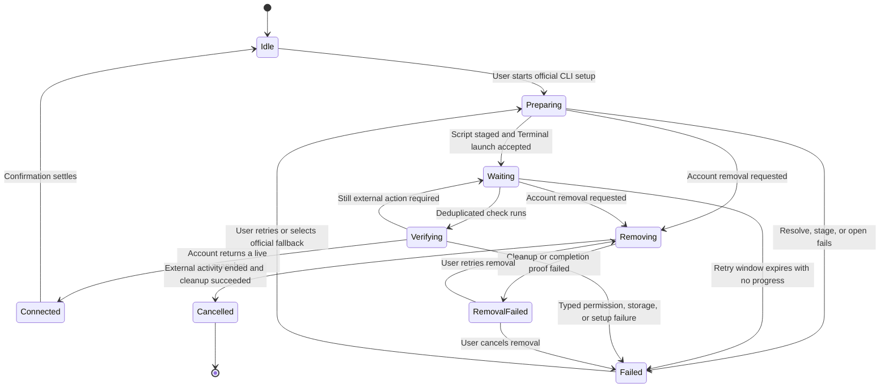
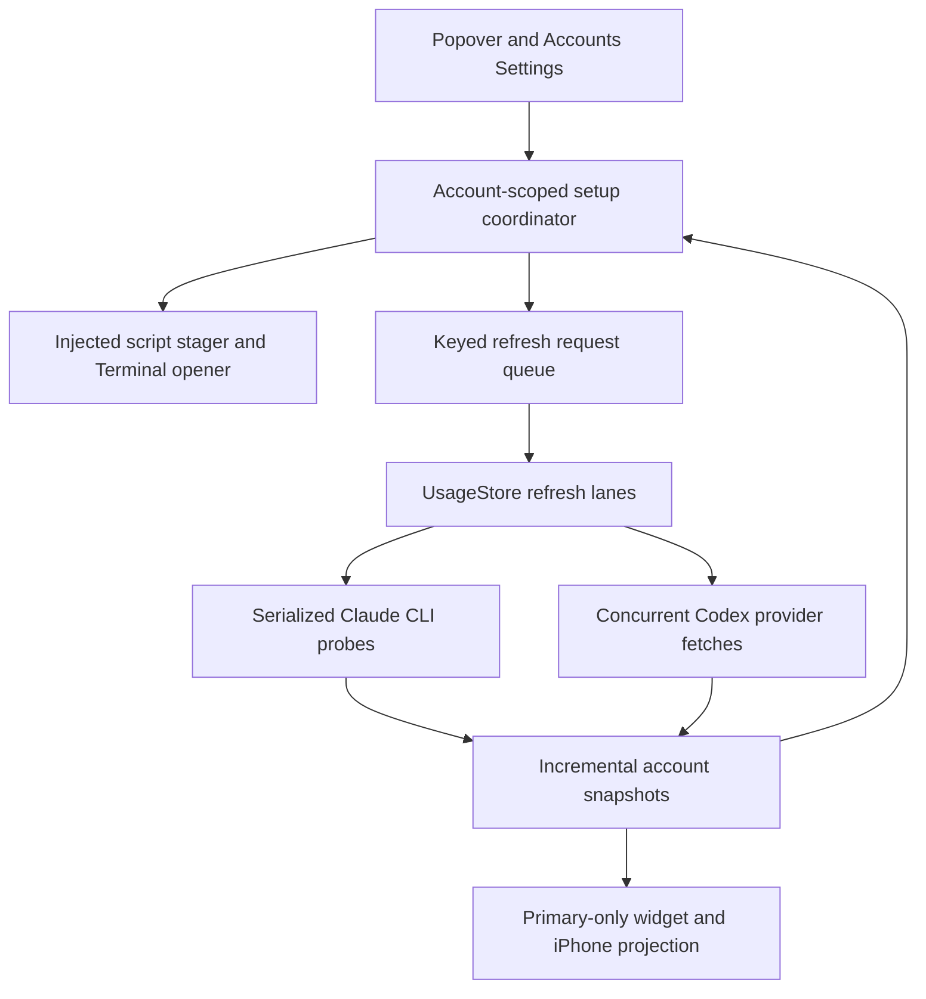
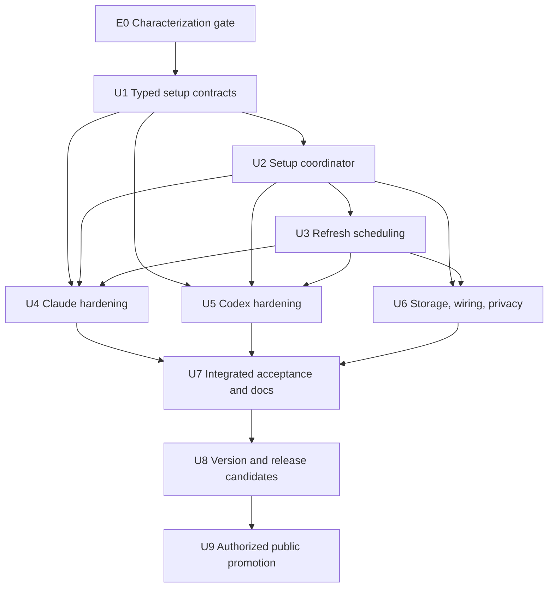

> Historical document: website ownership moved to `headroom-site` in September 2026.
> References below to portfolio publication describe the former setup. For new releases,
> follow [the current release runbook](../release/website-dmg-release.md).

# fix: Stabilize provider setup and the 1.1 release

## Summary

Make Claude and Codex setup dependable for built-in and additional accounts, close the
multi-account lifecycle gaps found in release review, and define the automated and installed-app
gates that must pass before Headroom is promoted as macOS 1.1.0 with a new iOS build. The work is
characterization-first: preserve the official-CLI authentication boundary, make every setup state
typed and testable, then prove the signed artifacts rather than treating a green unit suite as the
entire release decision.

Execution began on 2026-07-20. U1–U6 are implemented and the automated portion of U7 is green;
the current evidence and remaining release gates are recorded in
[`docs/release/1.1-release-evidence.md`](../release/1.1-release-evidence.md). Version stamping,
archives, commits, publication, and installed-app acceptance remain intentionally pending until
the entry and live-interaction gates in that record are closed.

| Gate | Actual meaning | Required outcome |
|---|---|---|
| Claude workspace trust | Claude Code's own per-folder safety prompt | Guided Terminal handoff, no background interaction with unknown first-run screens, automatic recovery |
| Codex app-data access | macOS permission to read the built-in CLI's file | Permission denial is distinct from missing login and has a re-grant path |
| Provider login | Official Claude or Codex CLI authentication | Headroom opens the correct account-scoped CLI flow but never owns credentials or callbacks |
| Multi-account readiness | Independent account homes, state, retries, and deletion | No cross-account reads, dropped setup retries, late Terminal opens, or orphaned local sign-ins |
| Candidate readiness | Release source/archive behavior, not unit tests alone | Full automated suite, Release build, iOS archive, interaction/render acceptance, and required iPhone gates pass |
| Public release completion | Explicitly authorized publication followed by live acceptance | Public Sparkle update and TestFlight install pass before announcement |

## Problem Frame

The current branch has broad unit and render coverage, and prior release-audit runs passed the
existing Swift suite, macOS Release build, iPhone UI tests, iOS source preflight, and the
multi-account render matrix. That evidence does not cover the most failure-prone code: the
AppKit Terminal handoffs, setup task lifecycle, macOS privacy denial, real credential-storage
configuration, or the interaction between bounded setup retries and a long serialized Claude
refresh.

The intermittent setup reports are credible because review found concrete timing and routing
failures. A targeted retry is silently discarded whenever another refresh is active; successful
setup only settles when a SwiftUI view happens to be mounted; Codex permission denial is
misclassified as missing login; Codex may cache a successful login in the OS credential store
while Headroom waits for `auth.json`; and Claude's setup script does not use the same robust
login-shell executable resolution as the background probe. These are release blockers for a
version whose headline feature is multi-account support.

## Requirements

- R1. Built-in and additional Claude accounts must distinguish CLI missing, login required,
  workspace trust required, normal interactive readiness, unknown first-run UI, and transient
  capture failure without matching user-facing error strings.
- R2. A background Claude probe must emit `/usage` only after positively recognizing a normal
  interactive surface. Trust, login, unknown, slow-start, and timeout states must receive no
  automatic keystrokes and must still honor hard teardown deadlines.
- R3. Built-in and additional Codex accounts must distinguish an absent file, macOS
  permission denial, malformed or unsupported credentials, rejected credentials, CLI missing,
  incomplete browser callback, and a successful readable login.
- R4. Every authentication action must remain an explicit handoff to the official provider CLI.
  Headroom must not implement Claude subscription OAuth, receive a Codex browser callback,
  refresh provider login tokens, or write provider credentials itself.
- R5. Before implementation commits to file-backed Codex setup, a dedicated-user characterization
  must prove that the official CLI can write a readable `auth.json` in the exact account home
  without mutating global configuration or silently selecting a different identity from the
  user's normal CLI. Normal browser login remains primary, with the CLI's device-code flow
  available as a user-invoked fallback when the localhost callback is blocked. If the identity
  contract cannot be made observable and consistent, 1.1 remains blocked pending a different
  storage boundary.
- R6. Setup lifecycle state must be account-scoped, observable, cancellable, and owned outside
  mounted views. Preparing, waiting, failed, connected, cancelled, and removed accounts must
  have deterministic transitions for both providers.
- R7. Setup refresh requests that arrive during another refresh must be queued and deduplicated
  by `AccountKey`, then drained when safe. Manual setup checks must not be lost to timer backoff,
  and successful results must settle their setup session without an open popover or Settings
  window.
- R8. Claude probes must remain serialized to avoid a process storm, while Codex and completed
  Claude results publish without waiting for the final Claude account. The documented two-minute
  polling floor must be enforced consistently in preferences and the engine.
- R9. Removing an extra account must cancel every Headroom-owned setup/open/retry task, prevent
  late refresh resurrection, and provide an honest, recoverable result for deletion of its
  Headroom-owned config home. Built-in and sibling accounts must never be mutated.
- R10. Production wiring must be directly testable: built-in accounts use the CLI defaults;
  additional Claude accounts use their exact isolated `CLAUDE_CONFIG_DIR` and workspace;
  additional Codex accounts use their exact `CODEX_HOME` and auth file; all preserve the
  original `AccountID`.
- R11. Diagnostics, fixtures, scripts, errors, logs, widget payloads, and iCloud payloads must
  remain redaction-safe. No shipped diagnostic mode may print account email, organization,
  token, auth payload, or unredacted provider-panel text. Headroom-owned account directories
  must be owner-only, and release evidence must verify provider-created credential files are not
  group/world-readable without Headroom rewriting their contents.
- R12. macOS release promotion requires the complete Swift suite, strict-concurrency Release
  build, app interaction/render acceptance, and a signed installed-DMG plus Sparkle-update pass.
  If promoted, the target is macOS 1.1.0 with the next unused build (currently expected to be
  21 after checking the production appcast).
- R13. This release includes a new iOS upload. It must keep host and widget versions paired and
  use a build higher than
  the actual App Store Connect maximum (currently at least 24 based on local metadata). iPhone
  UI/TestFlight acceptance is required; iPad runtime testing is optional, while universal
  device-family, orientation, archive, and App Store metadata checks remain required.
- R14. Release notes and user documentation must accurately describe multi-account behavior,
  the API-spend top-up links, provider setup, privacy recovery, primary-only menu bar/widgets,
  and deletion of only the selected Headroom-owned additional-account sign-in.
- R15. One signed installed-app login through a fresh additional home is a non-waivable gate for
  every provider named in the 1.1 multi-account claim. Distinct simultaneous subscription values
  require real second paid accounts; if those are unavailable, the product owner must explicitly
  accept that the headline distinct-values behavior remains unverified against two paid accounts,
  and release evidence must not report it as tested.

## Scope Boundaries

- Do not reintroduce Claude subscription OAuth, Keychain credential reuse, a third-party OAuth
  login, or a spoofed Claude Code client identity.
- Do not make Headroom a Codex OAuth client or teach it to receive browser callbacks, refresh
  tokens, or write `auth.json`. Passing an explicit storage option to the official CLI is still
  a CLI handoff and is in scope.
- Do not automate approval of Claude workspace trust or macOS privacy prompts. The user must
  make those decisions in the official provider/system UI.
- Do not add iOS account management. iPhone and widgets continue to receive only the primary,
  redaction-safe Mac projection.
- Do not make iPad runtime testing a release gate. Required universal metadata and App Store
  screenshot obligations remain separate from runtime QA policy.
- Do not fold in general exponential backoff, Intel runtime support, watchOS, unrelated widget
  contrast work, or a broad setup UI redesign.
- This plan documents the complete release sequence, but stabilization and candidate work through
  U8 does not authorize publishing a DMG, uploading TestFlight, merging the portfolio release, or
  announcing the release. U9 may run only after a separate explicit ship/publish instruction.

### Deferred to Follow-Up Work

- General exponential backoff for repeated transient provider/network failures.
- A durable cross-provider support bundle beyond the redaction-safe setup diagnostics needed
  to characterize this release.
- Support for using Codex credentials directly from the OS credential store. Version 1.1 keeps
  Headroom's existing file-reader boundary and has the official CLI create the supported file.
- Product work for selecting an additional account on menu bar, macOS widgets, iPhone, or iOS
  widgets. Compact surfaces remain primary-only.

## Context & Research

### Relevant Code and Patterns

- `Sources/HeadroomCore/Providers/ClaudeUsageCLIProbe.swift` owns the PTY, boot capture,
  first-run markers, input, deadlines, and process-group teardown. Its guaranteed teardown and
  official `/usage` path are load-bearing and must be preserved.
- `Sources/HeadroomCore/Providers/ClaudeProvider.swift` currently reduces trust and login states
  into generic `FailureReason` messages. `Sources/HeadroomApp/UI/ProviderCardView.swift` and
  `Sources/HeadroomApp/UI/PopoverView.swift` then identify guided trust setup by exact message
  equality.
- `Sources/HeadroomApp/UI/ClaudeSetupViews.swift`,
  `Sources/HeadroomApp/UI/CodexSetupViews.swift`, and
  `Sources/HeadroomApp/UI/SetupSessions.swift` hold static retry/opening task dictionaries and
  direct AppKit/script effects. This code is outside the only current Swift test target.
- `Sources/HeadroomCore/Engine/UsageStore.swift` uses one `isRefreshing` gate. It drops targeted
  setup refreshes during any active cycle and buffers the serialized Claude lane until the last
  Claude provider completes.
- `Sources/HeadroomCore/Credentials/CodexAuthReader.swift` uses `try?` for file reads, collapsing
  an absent file, permission denial, and I/O failure into the same missing-login result even
  though `CredentialError` documents a distinction.
- `Sources/HeadroomCore/Providers/CodexConnection.swift` centralizes the official login command
  and safe script generation. It is the pattern to extend for account-specific storage and the
  user-invoked device-code fallback.
- `Sources/HeadroomCore/Providers/AccountStorage.swift` already contains safe path encoding and
  an injected storage protocol, but removal is detached fire-and-forget and tests use a no-op
  storage implementation.
- `Sources/HeadroomApp/HeadroomApp.swift` is the production composition root. Its provider
  factory is not currently covered by automated tests.
- `Sources/HeadroomApp/PopoverRenderHarness.swift` provides the 33-state multi-account visual
  matrix. `docs/solutions/popover-scrollview-zero-height.md` establishes that this harness does
  not replace an actual `MenuBarExtra` interaction smoke.

### Existing Evidence and Gaps

- The existing package suite passed 259 tests across 25 suites during the release audit, with
  focused multi-account, registry, Codex login-script, and Claude parser/provider suites also
  passing. This plan does not discard that evidence; it adds coverage where none exists.
- Existing multi-account tests cover registry limits, per-account snapshots, sibling isolation,
  primary-only compact projections, add/remove behavior, targeted refresh, serialized Claude
  probes, and late-result non-resurrection.
- Those tests use `NoopAccountStorage`; they do not assert exact create/remove calls, deletion
  failure, setup staging/opening, retry timing, view-independent settlement, TCC denial,
  production factory paths, or real Terminal behavior.
- The render harness covers two, three, and five accounts plus mixed health and Settings in both
  appearances. It is visual evidence, not interaction or signed-install evidence.
- A fresh isolated Claude config home and fresh Codex home have already been shown not to fall
  back to the built-in login. A real second paid subscription was not exercised, so independent
  live values across distinct paid accounts remain a stated residual risk until that test occurs.

### Installed CLI Characterization

- The planning machine currently has Claude Code 2.1.215 and Codex CLI 0.144.6.
- Claude now exposes official `auth login` and `auth status` commands, but usage still requires
  the interactive official-client `/usage` panel. The implementation must characterize current
  first-run transcripts rather than assume older English copy is stable.
- Codex 0.144.6 documents `codex login`, `codex login status`, and `codex login --device-auth`.
  Generated commands must be validated against the installed release-time CLI, not guessed.

### Institutional Learnings

- `docs/solutions/popover-scrollview-zero-height.md`: offscreen SwiftUI captures can look correct
  while the real menu-bar window collapses; use the actual menu bar item for release acceptance.
- `docs/solutions/codex-window-kind-mislabel.md`: live provider contracts can differ from
  speculative schemas; capture a redacted real example and classify from authoritative fields.
  Setup work follows the same characterization-first posture.
- PR #71 and its follow-up hardening established Headroom-owned account homes, per-account
  scripts, primary-only compact surfaces, serialized Claude probes, and late-result guards. This
  plan extends those patterns rather than replacing the account model.

### External References

- [OpenAI Codex authentication](https://learn.chatgpt.com/docs/auth) documents browser login,
  `auth.json` versus OS credential-store caching, `cli_auth_credentials_store = file | keyring |
  auto`, and `codex login --device-auth` for blocked localhost callbacks.
- `docs/release/website-dmg-release.md` is the authoritative Developer ID, notarization,
  Sparkle, public asset, and installed-update runbook.
- `docs/release/ios-app-review-testflight.md` is the iOS source/archive/TestFlight runbook and
  records iPhone as required and iPad runtime as optional.

## Key Technical Decisions

- **Replace message-driven recovery with typed provider setup outcomes.** Display copy may
  change without changing behavior. Claude login, trust, and unknown boot screens; Codex
  missing file, permission denial, storage mismatch, and rejected credentials must be distinct
  before views decide which action to show.
- **Make an account-scoped coordinator the setup source of truth.** The coordinator owns
  preparing, waiting, retries, cancellation, failure, and settlement. SwiftUI renders its state
  but cannot be required for correctness. Script staging, executable lookup, workspace opening,
  pasteboard fallback, scheduling, and refresh requesting are injected boundaries.
- **Queue targeted refresh intent instead of sharing one lossy boolean gate.** Fleet refreshes
  remain coalesced, but setup checks are a keyed pending set. Repeated retries for the same
  account coalesce, removed/disabled accounts are discarded safely, and results publish as soon
  as each provider finishes.
- **Fail closed before Claude PTY input.** The probe needs a recognized normal-ready state before
  it writes. No-output startup, new onboarding copy, trust, login, and timeout all return typed
  safe outcomes with zero input while preserving hard teardown.
- **Align each handoff with the exact configuration the provider reads.** Claude setup and probe
  share one resolved executable/PATH and account workspace descriptor. Codex reader, `CODEX_HOME`,
  manual command, standard login script, and device-code script share one descriptor; built-in
  setup explicitly avoids an inherited custom home, and additional accounts use their exact
  Headroom-owned home.
- **Characterize Codex identity before selecting file mode as the durable contract.** Headroom
  does not currently read the OS credential store. A dedicated-user spike must prove that a
  per-invocation file-store override writes the exact file Headroom reads, leaves global Codex
  configuration untouched, and cannot make Headroom report a different account than ordinary
  CLI sessions without a visible warning and recovery path. Device-code login remains an
  explicit user choice, not an automatic fallback. Failure to prove this blocks U1-U5 rather
  than silently redefining the built-in account.
- **Never auto-open a queued Codex login.** Only one browser-login handoff may be active. A second
  account shows which account is blocking it and exposes Continue Setup after the slot is free;
  Headroom never opens Terminal later without a fresh user action.
- **Make removal completion honest and recoverable.** Config-home deletion becomes awaited and
  result-bearing. The row remains present and disabled as Removing until cleanup succeeds, then
  disappears. Failure becomes Removal Failed with Retry and Cancel Removal. Registry removal
  cannot silently outrun a failed delete. Setup already opened outside Headroom requires the
  completion-marker/pending-cleanup contract proven by the entry characterization so a provider
  CLI cannot recreate an unregistered home after the UI promises deletion.
- **Separate deterministic tests from signed runtime acceptance.** Unit tests use transcript,
  filesystem, clock, opener, and provider doubles only. Real CLI, TCC, Terminal, browser,
  notarization, Sparkle, and paid-account behavior are signed-app manual/integration gates.
- **Bump only after stabilization gates pass.** macOS moves from 1.0.9 to 1.1.0 because
  multi-account support and API-spend top-up links are release-level behavior. Build numbers are
  verified against production services immediately before stamping; local metadata is evidence,
  not authority for a remote upload.
- **Separate candidates from publication.** U8 stamps and proves source/archive candidates. U9 is
  the only public-mutation unit and requires a new explicit ship/publish instruction; its live
  Sparkle and TestFlight acceptance blocks announcement, not candidate preparation.

## Open Questions

### Resolved During Planning

- **Is Claude folder trust a macOS trust/TCC prompt?** No. It is Claude Code's own safety prompt
  for the stable Headroom workspace. Any system privacy dialog is triaged separately with the
  signed build and a screenshot.
- **Does Codex have the same folder-trust step?** No. Codex has separate macOS file access,
  credential storage/login, and browser callback gates.
- **Should Headroom support Codex keyring reads in 1.1?** No. It will preserve the existing
  file-reader architecture only if the entry characterization proves the file-backed identity
  contract is coherent. An unobservable keyring/file identity split is a release blocker, not an
  accepted compatibility behavior.
- **Should a blocked Codex callback silently switch authentication modes?** No. Standard login
  remains primary; device-code login is a visible, user-invoked official-CLI fallback.
- **Is iPad runtime QA required?** No. iPhone is the required runtime target. Universal build
  metadata and App Store obligations still apply.
- **What is the macOS marketing version?** 1.1.0, contingent on this plan's gates. The next build
  is expected to be 21 but must be checked against the live appcast before stamping.
- **Is the iOS build optional in this release train?** No. The new iOS build remains in scope;
  iPhone runtime/TestFlight acceptance is required and iPad runtime testing is optional.

### Deferred to Implementation

- Exact type and file boundaries for provider setup outcomes. The behavior must be typed and
  Core-testable; implementation may extend `FailureReason` or introduce a dedicated recovery
  model if that keeps non-setup consumers simpler.
- The most reliable redaction-safe way to direct users to the correct macOS Privacy & Security
  pane. If a stable system URL cannot be validated, show precise manual navigation instead of
  guessing a private URL scheme.
- Whether real distinct paid accounts are available for both providers at release time. Missing
  access does not convert mocked isolation into a passed live test; it triggers the explicitly
  framed headline-correctness decision in R15. Fresh additional-home login itself is not waivable.

## High-Level Technical Design

> This state sketch is directional. It names ownership and transitions without prescribing exact
> Swift types or signatures.

## Verification Strategy

| Layer | Deterministic coverage | Runtime evidence |
|---|---|---|
| Recovery classification | Sanitized Claude transcripts; Codex file error/storage fixtures; no message matching | Current installed CLI help/status characterization |
| Setup coordinator | Virtual clock, suspended stager/opener, duplicate/cancel/remove/view-unmounted cases | Finder-launched Terminal handoffs from signed app |
| Refresh engine | Suspended providers, queued account checks, serial/overlap/publication timing | Add/sign in while a real long Claude refresh is active |
| Storage and privacy | Recording storage spy, deletion failure, sentinel payload/script/diagnostic tests | Clean-user TCC allow/deny/re-grant and account-home inspection |
| Production wiring | Inspectable built-in/extra provider descriptors | Fresh isolated home per provider; default account unchanged |
| Presentation | Setup states, 2/3/5-account render matrix, app interaction coverage | Real `MenuBarExtra`, Settings, widget, light/dark acceptance |
| Distribution | Source/archive metadata and generated-project validation | U8: Release build and iPhone archive; U9 after authorization: fresh notarized DMG, public Sparkle update, and TestFlight pass |

## Implementation Units

### Entry gate. Prove load-bearing external contracts before U1

**Goal:** Resolve the behaviors Headroom cannot infer safely before its state model or recovery UI
is frozen.

**Dependencies:** None. U1-U6 must not start until the applicable observations and decisions are
recorded with redaction-safe evidence.

**Characterization:**
- In a dedicated macOS test user, exercise Codex standard and device-code login against an
  isolated `CODEX_HOME` using the proposed per-invocation file-store override. Prove the exact
  readable `auth.json` is created, the default home and global config remain byte-for-byte
  unchanged, and file versus keyring precedence cannot make Headroom and an ordinary CLI session
  silently represent different identities. If it can, choose a different storage boundary before
  U1; do not normalize the mismatch as successful setup.
- Run Claude `auth status` against the built-in home and an isolated `CLAUDE_CONFIG_DIR`. If it
  reliably distinguishes logged-in from logged-out state, use it as the authoritative login
  classifier and reserve PTY transcript matching for trust, usage readiness, and unknown UI.
- Use the generated Terminal wrapper to prove a redaction-safe completion marker can represent
  normal exit, user cancellation, app/view closure, and a late provider write. Select that marker
  plus durable pending cleanup as the removal contract; if the wrapper cannot prove completion,
  removal while an external setup is active must remain visibly blocked.
- Record the owner and permission modes created for Headroom-owned account homes and official-CLI
  credential files. Require owner-only directories and no group/world-readable credentials.
- Record the installed Claude/Codex versions and supported-command matrix. An older or newer CLI
  that lacks a characterized command must fail visibly and safely rather than receiving guessed
  flags or PTY input.

**Verification:**
- The evidence record contains no auth contents, emails, provider panels, callback URLs, or
  account identifiers. It records only command/version support, typed outcomes, path class
  (built-in versus isolated), mutation checks, permission modes, and pass/fail decisions.
- The selected Codex identity and Terminal cleanup contracts are written into U1/U2 tests before
  production behavior changes.

### Provider recovery presentation contract

| Typed outcome | Primary action | Secondary action | Automatic behavior | Stable exit |
|---|---|---|---|---|
| Claude CLI missing | Show install guidance | Copy manual command | None | Retryable failure |
| Claude login required | Open official Claude login | Check Now | Bounded checks only after handoff | Live or actionable failure |
| Claude trust required | Open official Claude workspace | Check Now | Bounded checks only after handoff | Live or actionable failure |
| Claude unknown/slow/transient UI | Check Again | Open guided setup | Never type into the unknown surface | Live or actionable failure |
| Codex auth absent | Connect with official Codex CLI | Device-code alternative | Bounded checks only after handoff | Live or actionable failure |
| Codex permission denied | Open/manual Privacy & Security guidance | Check Now | No login action or loop | Live or access failure |
| Codex malformed/rejected auth | Reconnect with official CLI | Check Now | Bounded checks only after handoff | Live or actionable failure |
| Codex file/keyring identity mismatch | Resolve account-storage conflict | Check Now | Never claim connected | Live or blocked decision |
| Codex callback incomplete | Reopen standard login | Start device-code login | No silent mode switch | Live or actionable failure |
| Codex login slot occupied | Continue Setup after slot frees | Cancel | Never auto-open Terminal | Preparing or idle |
| Additional-account removal | Retry Removal on failure | Cancel Removal | Row stays disabled while Removing | Removed or Removal Failed |

All rows require provider/account-specific accessible labels. Waiting-to-live and
waiting-to-failed transitions announce once; removal confirmation receives initial focus and
restores focus to the originating row on cancel/failure; Reduce Motion uses an immediate visual
state change rather than an animated-only cue.

### U1. Define typed provider setup and credential outcomes

**Goal:** Make every setup decision derive from a testable provider state rather than display
copy or a collapsed filesystem error.

**Requirements:** R1, R3, R4, R11

**Dependencies:** None

**Files:**
- Modify: `Sources/HeadroomCore/Providers/ClaudeUsageCLIProbe.swift`
- Modify: `Sources/HeadroomCore/Providers/ClaudeProvider.swift`
- Modify: `Sources/HeadroomCore/Credentials/CredentialModels.swift`
- Modify: `Sources/HeadroomCore/Credentials/CodexAuthReader.swift`
- Modify: `Sources/HeadroomCore/Credentials/CredentialStore.swift`
- Modify: `Sources/HeadroomCore/Providers/CodexConnection.swift`
- Modify if needed: `Sources/HeadroomCore/Models/UsageModels.swift`
- Test: `Tests/HeadroomCoreTests/ClaudeProviderTests.swift`
- Test: `Tests/HeadroomCoreTests/CredentialStoreTests.swift`
- Test: `Tests/HeadroomCoreTests/CodexConnectionTests.swift`
- Add sanitized fixtures under: `Tests/HeadroomCoreTests/Fixtures/`

**Approach:**
- Characterize sanitized current Claude normal, trust, theme, login selector, logged-out,
  unknown prompt, no-output, and partial-repaint transcripts before changing classification.
- When the entry gate validates isolated `claude auth status`, use it for login-required versus
  logged-in state. Keep PTY classification responsible for trust, usage readiness, unknown UI,
  and transient capture; do not duplicate a stable official status command with copy matching.
- Keep source-layer states distinct through the provider/recovery boundary. Views receive a
  typed recovery action and separate redaction-safe copy.
- Encode the provider recovery presentation table as one testable mapping from typed outcome to
  status, primary/secondary actions, automatic policy, and stable exit; views must not invent
  provider-specific recovery behavior independently.
- Replace `try?` Codex auth reads with explicit absent, permission denied, malformed, and I/O
  outcomes without exposing the URL or caught error text.
- Treat permission denial as an access-recovery state, not a login action. Treat missing file as
  initial connect and rejected live credentials as reconnect.
- Represent unsupported/no-readable-file storage as a setup compatibility state so successful
  browser completion cannot leave an indefinite generic spinner.

**Execution note:** Write characterization tests first. Do not alter PTY input or setup UI until
the state taxonomy is locked by fixtures.

**Patterns to follow:**
- Typed, redacted `FailureReason` construction in provider tests.
- Pure Codex connection derivation in `CodexConnection.swift`.
- Lenient parsing with explicit unknown cases rather than whole-snapshot failure.

**Test scenarios:**
- Claude trust transcript produces trust-required; theme and login-method transcripts produce
  login-required only when the characterized official status agrees; missing CLI, normal-ready,
  unknown UI, and transient capture remain distinct.
- Isolated Claude status tests prove built-in and additional account homes cannot borrow one
  another's login result; unsupported status output fails safely into typed characterization.
- Changing a user-facing message does not change the recovery action.
- Codex ENOENT produces initial connect; permission denial produces access guidance and no login
  loop; malformed and generic I/O failures are redacted and typed separately.
- Rejected Codex credentials produce reconnect while preserving prior usage windows.
- Keyring/auto-without-readable-file cannot be classified as a successful Headroom connection.
- Fixtures containing account emails, organization names, paths, auth filenames, and tokens do
  not appear in any failure message or encoded diagnostic result.

**Verification:**
- Every provider setup branch has one typed expected outcome, and no setup branch is selected by
  comparing display strings.

### U2. Move setup lifecycle into an injectable account-scoped coordinator

**Goal:** Make preparing, opening, retrying, settling, and cancelling correct without depending
on static UI state or a mounted view.

**Requirements:** R4, R6, R7, R9

**Dependencies:** U1

**Files:**
- Create or modify: `Sources/HeadroomCore/Engine/SetupSessionCoordinator.swift`
- Modify: `Sources/HeadroomApp/UI/SetupSessions.swift`
- Modify: `Sources/HeadroomApp/UI/ClaudeSetupViews.swift`
- Modify: `Sources/HeadroomApp/UI/CodexSetupViews.swift`
- Modify: `Sources/HeadroomApp/UI/ProviderCardView.swift`
- Modify: `Sources/HeadroomApp/UI/AccountsSettingsTile.swift`
- Create: `Tests/HeadroomCoreTests/SetupSessionCoordinatorTests.swift`

**Approach:**
- Begin with the entry-gate Terminal wrapper contract. Do not freeze coordinator cancellation or
  removal APIs until completion, cancellation, and late-write behavior are observable or the UI
  has committed to blocking removal while an external setup remains active.
- Make setup state keyed by the full `AccountKey`, not provider-only or account-ID-only
  dictionaries.
- Inject the clock/scheduler, script preparation, executable resolution result, Terminal opener,
  pasteboard fallback, account-existence check, and targeted refresh requester.
- Expose preparing and explicit failure states so a slow resolver or open failure is visible
  rather than looking like a dead button or silently copying a command.
- Deduplicate repeated opens for one account while allowing independent provider sessions. Permit
  only one active Codex browser login handoff at a time. A second account enters a visible blocked
  state and exposes Continue Setup after the slot is free; it is never auto-opened later.
- Cancel preparation, the final pre-open transition, retries, and pending settlement together.
  Recheck cancellation and account existence immediately before opening Terminal.
- Accept refresh outcomes directly and self-settle on live. Views render coordinator state and
  optional connected payoff but do not perform lifecycle cleanup.
- When the bounded automatic retry window expires, return to a stable actionable state with Check
  Now, Reopen Terminal, and the appropriate official fallback. Never leave an abandoned session
  looking permanently active.

**Patterns to follow:**
- `@MainActor` observable state in `UsageStore`.
- Provider/account identity through `AccountKey`.
- Injected production effects with deterministic test doubles used throughout HeadroomCore.

**Test scenarios:**
- Rapid duplicate clicks produce one preparation and one Terminal open.
- Claude and Codex sessions, and two non-conflicting account sessions, cannot overwrite or cancel
  one another.
- A suspended preparation cancelled by account removal never opens Terminal or enters waiting.
- Stage failure, opener rejection, missing executable, and pasteboard failure each become a
  visible redaction-safe retry state.
- Retry schedules fire through a virtual clock, cancel per account, and never fire after live,
  cancel, or removal.
- Retry exhaustion stops automatic work and restores explicit recovery controls without losing
  the account or its last-known windows.
- A live refresh self-settles with popover and Settings absent.
- Reopen restarts only the selected account session.
- A second Codex account remains blocked while the first handoff is active; freeing the slot does
  not open Terminal until Continue Setup is activated for that exact account.

**Verification:**
- Coordinator tests cover every transition in the setup diagram, including cancellation at each
  async boundary, without AppKit, Terminal, filesystem, network, Keychain, or real time.

### U3. Queue setup refreshes and publish provider results incrementally

**Goal:** Ensure setup completion is detected promptly during long fleet refreshes while keeping
Claude process load bounded.

**Requirements:** R7, R8, R9

**Dependencies:** U2

**Files:**
- Modify: `Sources/HeadroomCore/Engine/UsageStore.swift`
- Modify: `Sources/HeadroomCore/Engine/PollingEngine.swift`
- Modify: `Sources/HeadroomCore/Settings/Preferences.swift`
- Test: `Tests/HeadroomCoreTests/MultiAccountTests.swift`
- Test: `Tests/HeadroomCoreTests/UsageStoreTests.swift`
- Test: `Tests/HeadroomCoreTests/PreferencesTests.swift`
- Create if useful: `Tests/HeadroomCoreTests/PollingEngineTests.swift`

**Approach:**
- Preserve coalescing for redundant fleet/manual cycles but store targeted setup intent in a
  deduplicated account-keyed queue.
- Drain queued keys after the active cycle, skipping accounts that were removed or whose surface
  was disabled. Return each targeted outcome to the setup coordinator.
- Keep Claude providers in one serial lane and allow other providers to overlap. Merge/export
  each completed result instead of accumulating the entire Claude lane first.
- Apply never-signed-in timer backoff using typed setup state, not only `.notLoggedIn`, while
  keeping manual and setup checks exempt.
- Define one two-minute minimum poll constant and clamp persisted reads, writes, and engine input
  to it.

**Execution note:** Use suspended provider doubles so tests assert ordering and publication, not
wall-clock guesses.

**Test scenarios:**
- Add/sign in during a suspended global refresh; repeated retry requests coalesce and run once
  immediately after the cycle.
- A queued account removed before drain is never fetched or resurrected.
- A disabled provider surface drops queued work while retaining its account metadata.
- Manual targeted refresh bypasses timer backoff; never-signed extra Claude accounts follow the
  exact every-fourth timer rule.
- Claude maximum concurrency remains one while Codex overlaps the Claude lane.
- Codex and the first Claude result become observable before the final Claude probe completes.
- A live-to-empty-stale result preserves only that account's prior windows.
- Persisted/programmatic one-minute intervals read and execute as two minutes; default five
  minutes remains unchanged.

**Verification:**
- No setup check can be silently discarded, no removed account can be fetched, and completion
  latency is bounded by the active cycle rather than multiple future poll intervals.

### U4. Harden Claude boot safety and the guided login/trust handoff

**Goal:** Make the Claude flow safe across slow startup and version-manager installs while giving
built-in and additional accounts consistent guided recovery.

**Requirements:** R1, R2, R4, R6, R7, R10, R11

**Dependencies:** U1, U2, U3

**Files:**
- Modify: `Sources/HeadroomCore/Providers/ClaudeUsageCLIProbe.swift`
- Modify: `Sources/HeadroomCore/Providers/CLIExecutableResolver.swift`
- Create or modify: `Sources/HeadroomCore/Providers/ClaudeSetupCommand.swift`
- Modify: `Sources/HeadroomApp/UI/ClaudeSetupViews.swift`
- Modify: `Sources/HeadroomApp/UI/ProviderCardView.swift`
- Modify: `Sources/HeadroomApp/UI/PopoverView.swift`
- Test: `Tests/HeadroomCoreTests/ClaudeProviderTests.swift`
- Create: `Tests/HeadroomCoreTests/ClaudeSetupCommandTests.swift`
- Test: `Tests/HeadroomCoreTests/SetupSessionCoordinatorTests.swift`

**Approach:**
- Extract a pure boot/input classifier or transcript driver so tests can assert whether input is
  allowed before touching the real PTY mechanics.
- Require positive normal-readiness before `/usage`. A quiet period with zero bytes is not a
  ready signal; unknown UI fails safely with no input.
- Preserve process-group teardown and total deadlines on every exit.
- Generate setup scripts from a resolved, shell-quoted Claude executable and a safe login-shell
  PATH that also lets version-managed Node launchers find their interpreter.
- Use one account descriptor for built-in/default versus additional config/workspace routing.
  Built-in scripts omit `CLAUDE_CONFIG_DIR`; additional scripts export the exact isolated value.
- Route both first-login and workspace-trust states to the guided official-CLI setup for a single
  built-in account as well as compact additional-account rows.
- Correct setup reassurance so a logged-out user is not told that no login is required; state
  instead that `/usage` itself does not spend model usage and sign-in remains in Claude Code.

**Test scenarios:**
- Slow startup with no bytes, trust, theme, login, and unknown onboarding screens receive zero
  `/usage` or Enter writes.
- A recognized normal prompt emits exactly the intended usage command sequence.
- Timeout and every early return tear down the child process group.
- Built-in and additional scripts use the exact expected workspace/config behavior.
- Executable, interpreter path, workspace, and config paths containing spaces/apostrophes remain
  one shell token; NVM/asdf/mise-style locations remain runnable.
- Missing executable produces nonzero, redaction-safe guidance and retains the manual fallback.
- Every generated script parses as zsh and contains no account identity, token, auth payload,
  provider response, or caught error.
- Setup completed with views closed becomes live and cancels later retries.

**Verification:**
- Fixture tests prove fail-closed input; generated scripts are syntactically valid; signed-app
  acceptance proves Finder-launched trust and fresh isolated login recover automatically.

### U5. Make Codex login storage, permissions, and callback recovery deterministic

**Goal:** Ensure official Codex login writes exactly where Headroom reads and route permission or
callback problems to actions that can actually fix them.

**Requirements:** R3, R4, R5, R6, R7, R10, R11

**Dependencies:** U1, U2, U3

**Files:**
- Modify: `Sources/HeadroomCore/Credentials/CodexAuthReader.swift`
- Modify: `Sources/HeadroomCore/Credentials/CredentialStore.swift`
- Modify: `Sources/HeadroomCore/Providers/CodexConnection.swift`
- Modify: `Sources/HeadroomApp/UI/CodexSetupViews.swift`
- Modify: `Sources/HeadroomApp/UI/ProviderCardView.swift`
- Modify: `Sources/HeadroomApp/UI/AccountsSettingsTile.swift`
- Modify: `Sources/HeadroomApp/HeadroomApp.swift`
- Test: `Tests/HeadroomCoreTests/CredentialStoreTests.swift`
- Test: `Tests/HeadroomCoreTests/CodexConnectionTests.swift`
- Test: `Tests/HeadroomCoreTests/CodexAccountLoginTests.swift`
- Test: `Tests/HeadroomCoreTests/SetupSessionCoordinatorTests.swift`

**Approach:**
- Build reader path, environment, display command, standard login, and device-code login from one
  account descriptor.
- For built-in setup, explicitly target the default home expected by the reader rather than
  inheriting an unrelated `CODEX_HOME`. For additional setup, export the exact Headroom-owned
  home.
- Implement only the storage/identity contract accepted at the entry gate. If file mode is
  accepted, ask the official CLI to use it for both login modes; Headroom still never creates or
  updates credential content and never mutates the user's global Codex configuration.
- Show permission-specific guidance without offering a login action that cannot repair access.
  After a re-grant, Check Now and relaunch must use the same provider without reinstalling or
  recreating the account.
- Keep standard browser login primary. Expose device-code login only as an explicit fallback and
  preserve the same account/file-store descriptor.
- Serialize active Codex login handoffs to avoid localhost callback collision, while preserving
  independent non-login provider polling.

**Test scenarios:**
- Built-in and additional standard/device scripts target the exact file their provider reads.
- Built-in setup cannot inherit a custom home; additional setup cannot fall back to default.
- File-store selection is present on official CLI invocations, but scripts contain no credential
  contents or Headroom-owned OAuth logic.
- Permission denial shows no Connect loop; absent auth shows Connect; rejected auth shows
  Reconnect; re-grant transitions back through the existing provider.
- Keyring/auto configuration cannot leave the coordinator claiming success without a readable
  account file or hide an identity mismatch between Headroom and the normal CLI.
- Standard and device-code actions stay visibly distinct, shell-safe, zsh-valid, and account
  scoped.
- Removing/cancelling during suspended preparation prevents a later Terminal open.
- Two Codex account login requests cannot compete for the callback; the second remains visibly
  blocked without losing identity and requires Continue Setup after the first slot is free.

**Verification:**
- Tests prove path/storage/command alignment, and a signed clean-user test proves allow,
  deny/re-grant, standard login, and device-code fallback behavior.

### U6. Make account deletion, production wiring, and diagnostics auditable

**Goal:** Close the remaining multi-account data-lifecycle and privacy gaps before treating the
feature as release-ready.

**Requirements:** R9, R10, R11, R15

**Dependencies:** U2, U3

**Files:**
- Modify: `Sources/HeadroomCore/Providers/AccountStorage.swift`
- Modify: `Sources/HeadroomCore/Engine/UsageStore.swift`
- Modify: `Sources/HeadroomApp/UI/AccountsSettingsTile.swift`
- Modify: `Sources/HeadroomApp/HeadroomApp.swift`
- Modify: `Sources/HeadroomApp/PopoverRenderHarness.swift`
- Modify: `Package.swift` or `project.yml` only if a small app-support test target is required
- Test: `Tests/HeadroomCoreTests/MultiAccountTests.swift`
- Test: `Tests/HeadroomCoreTests/SyncedWidgetSnapshotModelsTests.swift`
- Test: `Tests/HeadroomCoreTests/DemoScenarioParityTests.swift`
- Create: `Tests/HeadroomCoreTests/AccountStorageLifecycleTests.swift`
- Create or modify: production configuration tests in the narrowest testable target

**Approach:**
- Replace the no-result storage contract with async/result-bearing operations and a recording
  spy. Missing directories count as already removed; other failures remain redacted and
  retryable.
- Sequence cancellation, in-flight fetch invalidation, config cleanup, registry/provider removal,
  and exports so UI promises match durable state.
- Implement the chosen post-open Terminal cleanup contract from the U2 characterization. It must
  survive app/view closure and prevent an unregistered home from being silently recreated.
- Keep the selected account row present and disabled as Removing until external activity has
  ended and cleanup succeeds. On failure, show Removal Failed with Retry Removal and Cancel
  Removal; do not remove registry/provider state first and attempt cleanup afterward.
- Create Headroom-owned account directories with owner-only permissions. Verify provider-created
  credential files are not group/world-readable and fail with redacted guidance if the official
  CLI produces an unsafe result; never rewrite credential contents.
- Extract an inspectable production provider configuration descriptor. `AppComposition` consumes
  it to construct providers, while tests compare built-in/default and additional/exact paths and
  IDs without real CLI, network, Keychain, or filesystem access.
- Make every shipped setup diagnostic structured and redacted. Remove the raw Claude panel
  preview and do not retain a raw-output mode in production or support instructions.
- Plant sensitive sentinels across labels, account IDs, paths, auth filenames, tokens, panels,
  and errors; prove they do not enter widget/iCloud payloads, UI failure copy, logs, or diagnostics.

**Test scenarios:**
- Add invokes exact directory creation; successful remove deletes exactly one additional account
  home; built-in and sibling homes are untouched.
- Deletion failure leaves a recoverable visible account or durable pending cleanup and never
  claims complete deletion.
- Removing keeps the account row disabled until success; cleanup failure transitions to Removal
  Failed, Retry targets the same account, and Cancel Removal restores the prior registered state.
- Removal during suspended fetch/setup prevents late snapshot, Terminal, retry, or provider
  resurrection.
- A post-open setup process cannot leave an untracked credential home after cleanup completes.
- Production Claude built-in has no override; extra has exact config/workspace/account ID.
- Production Codex built-in reads default; extra has exact home/auth/account ID.
- Primary widget/iPhone projection is byte-for-byte unaffected by adding, failing, renaming, or
  removing an additional account.
- Sensitive sentinels are absent from every exported/diagnostic/script surface except an
  allowlisted Headroom-owned path where the official CLI requires it.
- Additional-account homes are owner-only and official-CLI credential files are not group/world
  readable in both deterministic filesystem tests and signed clean-user evidence.

**Verification:**
- Storage-spy and production-descriptor tests prove exact lifecycle effects; privacy tests prove
  additional-account metadata and credentials cannot cross projection/support boundaries.

### U7. Add interaction acceptance and reconcile release documentation

**Goal:** Verify the completed behavior at app boundaries and make documentation match what 1.1
actually ships.

**Requirements:** R12, R13, R14, R15

**Dependencies:** U4, U5, U6

**Files:**
- Modify: `Sources/HeadroomApp/PopoverRenderHarness.swift`
- Add or modify: a narrow macOS interaction harness/test target under `Tests/`
- Modify: `README.md`
- Modify: `AGENTS.md`
- Modify: `BUGS.md`
- Modify: `docs/plans/2026-07-03-002-feat-multi-account-profiles-plan.md`
- Modify: `docs/release/website-dmg-release.md`
- Modify: `docs/release/ios-app-review-testflight.md`
- Modify as needed: `docs/release/appstore-listing.md`

**Approach:**
- Add deterministic interaction coverage for Add Account, preparing/waiting/live, Check Now,
  rename commit, remove confirmation/failure, cap enforcement, scroll cap, compact density, and
  the full recovery-presentation table. Keep provider effects mocked.
- Regenerate the complete multi-account render matrix and inspect representative two, three,
  five, mixed-failure, and Settings states in both appearances.
- Run a real `MenuBarExtra` smoke because the offscreen render harness cannot prove window
  measurement or interaction.
- Mark the old multi-account plan implemented/superseded and record deviations: user labels
  instead of provider email identity, Headroom-owned homes instead of arbitrary paths, no disable
  switch, primary-only compact surfaces, and removal of the selected additional local sign-in.
- Add a README multi-account section and correct AGENTS claims about serialized Claude probes and
  the now-enforced two-minute floor. Remove stale test counts from BUGS or update them without
  turning volatile totals into release truth.
- Extend the DMG acceptance runbook with Claude trust/login, Codex permission/storage/callback,
  real additional-account lifecycle, and post-Sparkle permission persistence.
- Keep iPhone required/iPad optional wording consistent across the iOS runbook and release copy.

**Test scenarios:**
- Mocked app interaction completes Add → preparing → waiting → live for each provider and works
  with the settings/popover surface dismissed between transitions.
- Rename persists on focus loss; cap disables only the correct provider; remove failure is honest;
  Check Now stays account-scoped.
- Two/three/five-account layouts scroll and compact correctly with mixed live/stale/setup states,
  keyboard navigation, VoiceOver labels, Reduce Motion, and both appearances.
- Keyboard order and activation remain logical through async changes; waiting-to-live and
  waiting-to-failed announce once; removal confirmation focus enters and returns predictably;
  Reduce Motion has a non-animated state-change path.
- API-spend Add Credits continues to resolve to the expected Anthropic and OpenAI billing pages.
- iPhone projection/UI tests confirm additional accounts never appear and primary content remains
  unchanged.

**Verification:**
- Interaction tests, 33 render outputs, and live menu-bar smoke agree; every user-facing document
  describes the implemented behavior and no longer treats iPad runtime QA as required.

### U8. Stamp and prove the macOS 1.1 and iOS release candidates

**Goal:** Convert the stabilized code into source/archive candidates and stop before external
publication mutations.

**Requirements:** R12, R13, R14, R15

**Dependencies:** U7

**Files:**
- Modify: `project.yml`
- Regenerate: `Headroom.xcodeproj/project.pbxproj`
- Modify: release notes/appcast inputs used by `Scripts/release-app.sh`
- Update after verified acceptance: `docs/release/ios-app-review-testflight.md`

**Approach:**
- Check the production appcast before stamping. Bump macOS host and widget together from 1.0.9
  to 1.1.0 and use the next unused build, expected to be 21 from current evidence.
- Check App Store Connect and bump the iOS host/widget pair together above the real maximum;
  local evidence makes 24 the minimum candidate, not a guaranteed available build.
- Run the full Swift package suite, strict-concurrency Release build, generated-project drift
  check, complete recovery-presentation interaction gates, render gates, macOS source preflight,
  and an iOS archive with matching host/widget metadata.
- Require iPhone UI tests against the stamped candidate. iPad runtime remains optional; universal
  device-family, orientation, archive, and App Store metadata checks remain required.
- Assemble release notes led by multi-account support and API-spend top-up links, plus a release
  evidence checklist with every U9 installed-app scenario still marked pending.
- Do not run `Scripts/release-app.sh`, mutate the portfolio repository, upload TestFlight, or
  merge/deploy public assets in U8.

**Test scenarios:**
- Recovery classification, account setup, queued refresh, deletion, privacy, and presentation
  suites all pass together from the stamped source tree.
- Add during an active long refresh still completes; Codex publishes before the Claude fleet;
  mixed siblings remain isolated across relaunch.
- Removing an additional account during every setup phase leaves no late Terminal, retry,
  registered row, or untracked local sign-in; built-in and sibling homes remain byte-for-byte
  untouched.
- Real two/three/five-account popover behavior, scroll, light/dark, accessibility, menu bar,
  macOS widgets, API-spend top-up links, and primary iPhone sync match documentation.
- macOS host/widget and iOS host/widget versions/builds agree with `project.yml`, the generated
  Xcode project, built products, and archive metadata.

**Verification:**
- A release evidence record names every automated gate, the exact candidate versions/builds, and
  the remaining U9 signed/install/live gates. Passing U8 means ready to request promotion; it does
  not mean released.

### U9. Publish and complete installed acceptance only after explicit authorization

**Goal:** Turn the approved U8 candidates into public artifacts, then prove the paths actual users
receive before announcing the release.

**Requirements:** R12, R13, R14, R15

**Dependencies:** U8 plus a new explicit user instruction to ship/publish.

**Approach:**
- Use the repo-local `release-website-dmg` skill and authoritative DMG runbook. Ensure the release
  commit is merged to Headroom `main`, seed staging non-destructively from production history,
  then build/sign/notarize/staple and validate the local artifact before any portfolio copy.
- Publish through a normal `kz-portfolio` branch/PR and its documented production path; preserve
  every versioned DMG, checksum, delta, and prior appcast item.
- Upload the paired iOS host/widget build to App Store Connect/TestFlight and verify the uploaded
  build numbers are the stamped U8 values.
- Validate live manifest/appcast/checksums and a fresh public DMG, then run the installed public
  1.0.9 → 1.1 Sparkle update in a dedicated test user or VM. Confirm the update preserves the
  stable Claude workspace, existing trust decision, signing identity, and recoverable TCC state.
- On Tahoe and real macOS 15 Apple silicon, verify menu bar, popover, Settings, widget, TCC
  allow/deny/re-grant, Claude login/trust, Codex standard/device login, additional accounts,
  removal, relaunch, and primary-only projections.
- Complete one non-waivable fresh real additional-home login per provider in the signed installed
  app. Exercise two distinct paid accounts where available; otherwise record explicit acceptance
  that distinct simultaneous live values remain unverified.
- When a prior affected reporter can be contacted, provide the signed candidate and obtain one
  redaction-safe confirmation for that provider's repaired setup path. If no reporter is
  reachable, record the result as internally reproduced and signed-install verified, not as
  reporter-confirmed.
- Require clean iPhone TestFlight acceptance, demo/widget persistence, demo exit, and real primary
  sync. iPad runtime remains optional.
- Do not announce while any U9 gate remains open. If a live verification fails, preserve or
  restore the prior public asset set according to the release runbook and report the failed gate.

**Verification:**
- The final release record contains target versions/builds, public URL, checksum match, appcast
  result, installed Sparkle start/end versions, TestFlight build/result, real-provider coverage,
  and any explicitly accepted two-paid-account residual risk.

## System-Wide Impact

- **Provider boundary:** Claude gains typed boot/setup outcomes but still uses the official CLI's
  `/usage`; Codex retains file reading and the existing usage HTTP client while official CLI login
  is made file-store deterministic.
- **State lifecycle:** Setup ownership moves from static view helpers to an account coordinator.
  `UsageStore` becomes the result source and queued-refresh executor; views become consumers.
- **Concurrency:** Claude remains serial. Targeted work becomes keyed rather than dropped; Codex
  can overlap polling but not competing browser-login handoffs. Cancellation is checked at every
  async boundary.
- **Persistent data:** Account registry semantics remain compatible. Additional config-home
  deletion becomes result-bearing, and any pending cleanup state must be durable enough not to
  orphan credential-bearing directories.
- **Privacy:** New error distinctions expose categories only, never paths or caught errors. Raw
  Claude output is absent from every shipped diagnostic path. Additional-account homes are
  owner-only; widget/iCloud projections remain primary-only and credential-free.
- **Presentation:** Setup cards gain preparing and explicit failure/recovery states. Normal live,
  stale, menu bar, widget, and iPhone presentation remain unchanged except for more accurate setup
  copy.
- **Distribution:** U8 proves source/archive candidates without publishing. Explicitly authorized
  U9 proves signed entitlements, TCC behavior, Sparkle identity, notarization, public assets,
  installed updates, and iPhone TestFlight behavior as one release system.

## Risks & Dependencies

| Risk | Mitigation / release rule |
|---|---|
| Claude changes first-run TUI copy again | Fail closed on unknown UI, keep sanitized fixture characterization, and run a release-time live probe; never add OAuth fallback |
| Codex changes login flags or storage behavior | Verify installed CLI help at release time, keep command contracts centralized, and fail visibly instead of guessing |
| macOS TCC errors are not uniquely identifiable from one Foundation error | Characterize signed clean-user behavior; use a conservative typed access failure and precise manual recovery, never route uncertainty into login |
| External Terminal continues after Headroom cancellation | Select the completion-marker/pending-cleanup contract at the entry gate; do not freeze coordinator APIs or claim deletion until durable cleanup can be verified |
| More accounts make refresh appear hung | Publish results incrementally, serialize only Claude, show account-scoped preparing/waiting, and enforce the two-minute floor |
| Test seams become a broad architecture rewrite | Extract only lifecycle, command/config, storage, and opener boundaries required for deterministic coverage; preserve provider and UI abstractions |
| Real second paid accounts are unavailable | Keep signed fresh-home login non-waivable; frame explicit acceptance as shipping distinct simultaneous paid-account values unverified, not as a passed test |
| Signed development behavior differs from notarized install | Treat clean-user signed DMG and public Sparkle update acceptance as blockers; source/render success cannot waive them |
| iPad regressions go unnoticed | Keep universal metadata/orientation checks and App Store screenshot obligations; runtime iPad QA is optional by explicit product decision |

## Release Blockers

- Any Claude background path can type into an unknown/login/trust screen.
- Setup retry, cancellation, or settlement still depends on timing or a mounted view.
- A targeted setup check can still be dropped by another refresh.
- Codex permission denial, missing login, keyring-only storage, and callback failure remain
  indistinguishable or loop through an action that cannot repair them.
- Removing an account can open Terminal later, resurrect a snapshot, silently fail to delete its
  local sign-in, or mutate default/sibling state.
- Production built-in/additional path wiring is not directly covered.
- A sensitive sentinel appears in diagnostics, scripts beyond required local path routing,
  widget/iCloud payloads, UI copy, or logs.
- The entry gate cannot prove a coherent Codex file/keyring identity contract, safe per-account
  storage override, reliable Terminal cleanup signal, or owner-only credential-home posture.
- Full Swift tests, Release build, render/interaction pass, notarization/Gatekeeper, real Tahoe
  and macOS 15 Apple-silicon runtime, public Sparkle update, or required iPhone/TestFlight gates
  fail at their applicable U8/U9 stage.
- No signed installed-app login through a fresh additional home for either provider. This gate is
  not waivable for a provider named in the 1.1 multi-account claim.

## Documentation / Operational Notes

- Mark `docs/plans/2026-07-03-002-feat-multi-account-profiles-plan.md` completed/superseded rather
  than silently rewriting its historical requirements.
- Update README setup language to call this a guided official-CLI handoff, not an automatic login.
  Auto-retry is convenience; the user owns trust, browser login, device code, and system privacy.
- Correct AGENTS to say Claude account probes are serialized and the enforced poll floor is two
  minutes.
- Update BUGS after implementation: remove resolved setup/poll-floor items, retain generic
  transient backoff and parser drift, and stop using a stale test count as status.
- Release notes should lead with multi-account support and API-spend top-up links. State that the
  popover shows all configured accounts; menu bar, macOS widgets, iPhone, and iOS widgets remain
  primary-only.
- Never ask testers to share auth files, raw Terminal output, browser screens, account emails, or
  provider tokens. Collect only redaction-safe state categories, CLI/app versions, signed-build
  identity, OS version, and reproduction steps.

## Sources & References

- `AGENTS.md`
- `PRODUCT.md`
- `README.md`
- `BUGS.md`
- `docs/plans/2026-07-03-002-feat-multi-account-profiles-plan.md`
- `docs/plans/2026-07-10-001-feat-codex-connection-flow-plan.md`
- `docs/solutions/popover-scrollview-zero-height.md`
- `docs/solutions/codex-window-kind-mislabel.md`
- `docs/release/website-dmg-release.md`
- `docs/release/ios-app-review-testflight.md`
- PR #71, `feat(accounts): track multiple subscription accounts per provider`
- [OpenAI Codex authentication](https://learn.chatgpt.com/docs/auth)
- Local CLI characterization on 2026-07-20: Claude Code 2.1.215; Codex CLI 0.144.6
