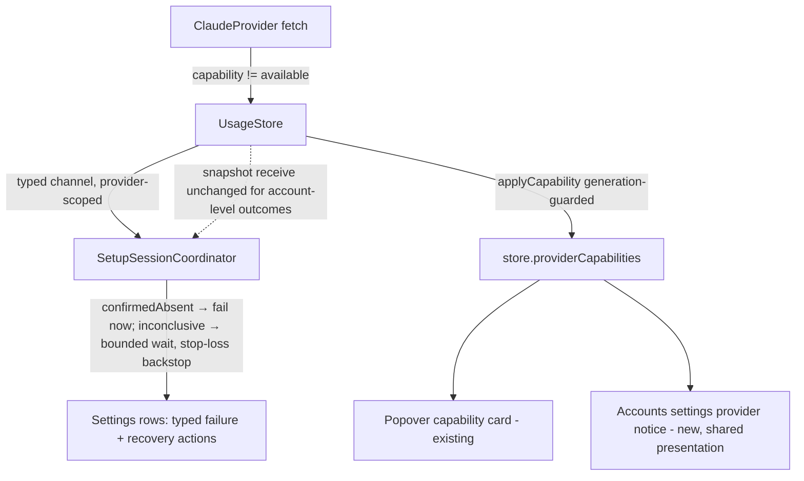
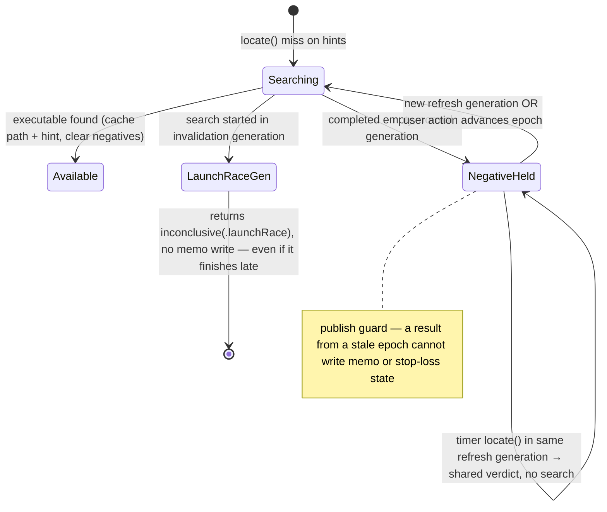

# Account Setup & Recovery Hardening - Plan

## Goal Capsule

- **Objective:** Fix the four verified recovery-state defects in multi-account setup (hidden provider-wide recovery, stuck "verifying", repeated negative CLI discovery, launch-race false install) and close the confirmed reachability/guidance gaps (secondary recovery actions in settings, Grok device-code entry, API-key guidance, troubleshooting docs).
- **Authority:** This plan's Requirements and KTDs govern. The credential architecture is out of bounds: official-CLI handoffs and per-account config-home isolation stay exactly as they are (AGENTS.md hard constraint).
- **Stop conditions:** Stop and surface if a fix would require weakening the capability/account-setup separation from commit `c656957a`, mutating account snapshots to carry provider-wide state, or extending the refreshable locator to Grok/Cursor.
- **Tail ownership:** Implementation ends at green `swift test` + `xcodebuild` HeadroomAppTests + build + the live-probe and demo-visual gates. The Track A signed-candidate acceptance matrix is a release-time gate owned by the release runbook, not this plan's implementation (see Definition of Done).

---

## Product Contract

### Summary

Harden account setup and recovery UX across Claude/Codex/Grok/Cursor and API spend, keeping the official-CLI credential architecture untouched. Source: a GPT-5.6 external audit whose findings were independently re-verified against the code; all four defects confirmed, two audit claims corrected. Revised once after a multi-persona + cross-model document review (see Sources & Research).

### Problem Frame

Multi-account auth shipped with sound credential isolation, but the recovery states around it have gaps. When the Claude CLI is missing or undiscoverable, the Accounts settings screen — the place users manage accounts — shows rows stuck on "Fetching…" with no install or retry action, while the recovery UI exists only on the popover card. A setup session that ends its Terminal handoff during a capability failure hangs in "verifying" forever with no timeout, and the verifying state blocks every restart path. With several Claude accounts and a slow or broken login shell, the same failed CLI discovery re-runs serially for every account, every cycle. And the launch-race safety state is consumed by the first account's discovery, so a sibling account probing in the same CLI-replacement window can flip the whole provider to a false "Install Claude Code". Around these, smaller gaps: settings renders only the primary recovery action, Grok's implemented device-code login has no UI entry point, the API-spend key editors give no help obtaining the elevated keys they demand, and public docs have no troubleshooting path for any of it.

### Requirements

**Recovery-state correctness**

- R1. When a provider-wide Claude capability failure is active, Accounts settings shows one provider-level recovery notice with install/retry actions; account rows never sit on an unexplained "Fetching…".
- R2. A setup session never remains in "verifying" indefinitely. A `confirmedAbsent` capability failure during post-handoff verification fails immediately with a typed, announced failure; an `inconclusive` one stays in bounded verification until a live result arrives or the stop-loss expires. Any other silent strand cause settles through the same stop-loss.
- R3. One timer refresh generation runs at most one full negative CLI discovery search regardless of configured Claude account count. User-initiated actions (Check Now, Check Again, opening setup, adding an account) always force a fresh search through a path that verifiably reaches the locator.
- R4. A CLI replacement window never produces a false provider-wide "Install Claude Code". Recovery actions split by scope: CLI installation/discovery actions are provider-scoped (the executable is shared); login, device-code, trust, and storage actions stay scoped to their account. Per the Track A release matrix: exactly one provider-level install/retry notice, sibling accounts keep their last eligible usage.

**Recovery reachability**

- R5. Secondary recovery actions (device code, Check Now, privacy help, guided setup) are reachable from Accounts settings account rows, not only the popover.
- R6. Grok device-code sign-in is reachable from the recovery UI and runs through the account-scoped coordinator with `GROK_HOME` isolation, like every other sign-in.
- R7. Retry/Sign In buttons never silently no-op while a setup wrapper is still open; the user sees why and what to do ("close the setup window, then retry").

**Guidance and docs**

- R8. Each API-spend key editor names the required key type (admin/management, not a plain API key), links to the provider console page where it is obtained, and recommends a dedicated, minimally scoped, independently revocable key where the provider supports scoping. Copy does not promise spend paths that BUGS.md records as unverified or broken.
- R9. README ships a compact per-provider troubleshooting matrix (see U7) and its multi-account text covers Grok (up to 5 accounts, `GROK_HOME`) and Cursor's deliberate single-account limit. Out-of-scope findings are ledgered in BUGS.md, not dropped.

### Acceptance Examples

- AE1. **Covers R1, R4.** Given the `claude` binary is absent at launch with two configured Claude accounts, when the first refresh cycle completes, then Accounts settings shows one "Install Claude Code" provider notice with its secondary action; rows without retained usage read "Waiting for Claude Code", rows with retained usage keep their last-known values dimmed; no row reads "Fetching…" and no row offers its own sign-in CTA.
- AE2. **Covers R2.** Given a Claude account's Terminal handoff exits while the CLI has been removed, when the final verification refresh reports `confirmedAbsent`, then the row settles immediately to a typed failure ("Claude Code wasn't found…") with recovery actions — not a spinner — and the failure is announced to VoiceOver once. An `inconclusive` result instead keeps the session verifying until a live result or the stop-loss.
- AE3. **Covers R4.** Given the CLI is being replaced (launch fails with `launchNotFound`) and two accounts' searches start within the same invalidation generation, when both complete empty — even if one finishes after the generation's window — then both report inconclusive (transient stale, windows retained dimmed), never `confirmedAbsent`.
- AE4. **Covers R3.** Given a negative discovery verdict is held for the current refresh generation, when the user installs the CLI and clicks Check Now, Check Again, or Sign In, then the epoch advances, discovery runs fresh, and no in-flight older search can publish its stale verdict afterward.
- AE5. **Covers R2, R3.** Given an account failed with a typed capability failure, when the user installs the CLI and triggers Check Now, then discovery succeeds, the account's next fetch returns live data, and the session settles to connected with no residual failure state.

### Scope Boundaries

**Deferred to Follow-Up Work**

- In-app troubleshooting sheet (interactive four-provider UI) — design-heavy; deferred (session-settled: user-approved — chosen over including it here: it deserves its own design pass). The README troubleshooting matrix in U7 is the shipping substitute.
- Grok "wrapper succeeded but auth absent" storage-mismatch analog — ledger in BUGS.md.
- Menu-bar attention for a dead CLI (capability failures are transient reasons, so `needsAttention` never trips) — ledger in BUGS.md as an explicit decision.
- Orphaned Claude account config homes cleanup (BUGS.md already tracks it) — stays deferred.

**Outside this work's identity**

- Any change to the credential method: no OAuth/Keychain token reuse, no `wham/usage` transport swap for Codex (session-settled: user-approved — chosen over "driving the official Codex status surface": documented deliberate path per AGENTS.md, no compliance gain today). Watch-item only.
- Extending the refreshable Claude locator to Grok/Cursor — gated behind characterization fixtures per BUGS.md.
- Multi-organization API spend (multiple keys per provider) — remains a real, acknowledged limitation.
- Changing the Grok install URL. The audit's "HTTP 403" was curl bot-blocking, not a dead link (x.ai 403s all curl traffic); verify once in a real browser during implementation and leave the URL unless that check fails.

---

## Planning Contract

### Key Technical Decisions

- KTD1. **Capability failures reach the coordinator through a new typed channel, not by un-withholding snapshot notifications.** Add `receiveCapabilityFailure(_ state: ProviderCapabilityState, for providerID:)` (or equivalent) to `SetupSessionCoordinator`; it settles the affected sessions of that provider per KTD2's severity split. The naive fix — dropping `notifiesSetup` in `UsageStore` — is wrong two ways: `mergeResult` early-returns before `merge` for windowless accounts, and a transient-reason snapshot would map to `.retryExhausted`, consuming `handoffsAwaitingFinalRefresh` and destroying the Codex `codexStorageMismatch`/`codexCallbackIncomplete` completion mapping. The withholding was added deliberately (`c656957a`) to keep provider-wide capability out of per-account login state; the typed channel preserves that separation. `SetupSessionFailure.providerCapability` and its `failureMessage` rendering already exist — reuse them.
- KTD2. **Verification failure severity is split, and the stop-loss bound is derived from the serial lane, not the retry ladder.** `confirmedAbsent` during final verification fails every awaiting/verifying session of the provider immediately to `.failed(.providerCapability(.confirmedAbsent))`. `inconclusive` keeps sessions in bounded verification — a later live snapshot settles them connected — and only stop-loss expiry fails them to `.failed(.providerCapability(.inconclusive(…)))`; this avoids announcing a failure that flips to connected moments later during path churn. The stop-loss also covers non-capability strand causes (e.g. the surface-disabled silent return). Its bound must exceed the worst-case final-refresh wait: configured Claude account count × per-probe deadline on the serial lane plus one probe of margin (≈4 minutes at five accounts) — never the retry ladder's 3–30s scale, which would falsely fail healthy setups. Drive it through `SetupRetryScheduling` (virtual-clock testable), never `Task.sleep`.
- KTD3. **The locator's negative-result contract is generation/epoch-based, not wall-clock.** Three rules, one mechanism, all inside the one shared `CLIExecutableLocator` actor (which serves every Claude probe and setup prep, so this lands once):
  1. *Refresh-generation reuse:* timer probes within one refresh generation share the negative verdict — at most one full search per generation, exact by construction rather than by a tuned TTL that breaks at six accounts or on a slow shell.
  2. *Epoch advance on user action:* Check Now / Check Again / opening setup / adding an account advance the locator epoch and force a fresh search. Because `UsageProvider.fetchResult()` carries no parameters and the probe never forces its first attempt, the force must happen at the app boundary: the `.checkNow` branch of `SetupSessions.performRecovery` (and the notice's Check Again) force-resolves the shared locator before invoking the refresh, and `prepareHandoff` resolves with force.
  3. *Publish guard:* a search result may write memo or stop-loss state only if its epoch is still current — an in-flight timer search finishing after a successful forced search must not re-publish its stale negative.
  Negative state is in-memory only — BUGS.md records "no persistent backoff" as a design choice and "paths are hints, not identity" forbids durable negative state. Claude-only.
- KTD4. **The launch-race stop-loss is generation-scoped with a straddle rule.** Every search *started* within the invalidation generation returns `.inconclusive(.launchRace)` — even if it finishes after the generation's window — and writes no negative memo; only a search started in a later generation may confirm absence. This replaces the consumed-by-first-completion behavior and defines the boundary the old design left ambiguous. Claude-only; do not touch Grok/Cursor locator behavior.
- KTD5. **The settings capability notice is additive provider-group presentation with explicit scoping, visibility, and row-derivation rules.**
  - *Scoping (per R4):* the notice's actions are provider-scoped — install and Check Again operate on shared discovery. Check Again forces discovery (KTD3 epoch advance), then refreshes the primary account only, never a five-account sweep. Per-row actions stay account-scoped (login, device code, trust).
  - *Visibility:* the notice renders whenever a capability failure is active, including during active setup sessions — suppressing it behind an abandoned Terminal wrapper would hide the only explanation of the failure. Actions are state-aware: while a wrapper is open, the affected action shows the existing "Close setup, then retry" refusal pattern instead of silently no-opping (R7).
  - *Row derivation:* while the notice is active, row status is derived, never a raw pending fallthrough — no retained usage → "Waiting for Claude Code"; retained usage → last-known values kept visible and dimmed; never an indefinite "Fetching…". Presentation only: it must never mutate, re-stamp, or hide per-account snapshots that `UsageContinuityPolicy` retains (`docs/solutions/logic-errors/claude-partial-usage-window-freshness.md` is the prior burn).
  - Extract `ProviderCardView.capabilityRecoveryPresentation(state:hasActiveSetupSession:)` to shared scope, replacing its active-session suppression with the state-aware-action rule above; popover and tile consume the same function.
- KTD6. **Grok device code mirrors the Codex pattern: enum case + route + presentation change as one unit, with a mandatory cross-account binding test.** Add `connectGrokDeviceCode` to `SetupRecoveryAction`, route it `.setup(.deviceCode)`, and make it the `grokAuthAbsent` secondary — evicting Check Now, exactly as `codexAuthAbsent` does, with `automaticPolicy: .boundedChecksAfterHandoff` covering the loss. No exclusive login slot: Grok device auth binds no callback listener (verified 2026-08-01, coordinator comment). Account isolation is a boundary, so the two-account concurrent binding test in U5 is required, not conditional.
- KTD7. **API-key guidance is links plus role naming plus least-privilege advice, hedged.** One `SettingsHelpText` + `Link` line under each key editor naming the key type (Anthropic admin key, OpenAI admin key, xAI management key from console.x.ai), linking the console page, and recommending a dedicated key with the narrowest scope the console offers (xAI management keys support scoped ACLs) so it can be revoked without affecting other tooling. Do not promise the spend paths work: BUGS.md records the Anthropic request 400-ing on a likely date-format bug and OpenAI's path as unverified. Exact console URLs verified in a real browser at implementation time (HTTPS, official provider domains — these links sit above credential fields).

### Assumptions

- The per-probe deadline used to derive the KTD2 stop-loss bound comes from the probe's existing hard deadlines; the derivation is mechanical (account count × deadline + margin), with ≈4 minutes at five accounts as the sanity reference.
- Capability presentation copy stays Claude-specific — only `ClaudeProvider` sets `reportsProviderCapability` today. Parameterize only if a second capability-reporting provider appears.
- `SetupSessions`' default-parameter locator fallbacks (used by tests/previews) may hold un-memoized instances; production paths must resolve through the shared configured locator (U2 audits this).

### High-Level Technical Design

Capability-failure flow after the fix (defects 1 and 2):

Locator verdict lifecycle under the generation/epoch contract (defects 3 and 4):

Diagrams are directional guidance; prose and KTDs are authoritative.

---

## Implementation Units

### U1. Typed capability-failure channel and verifying stop-loss

- **Goal:** A setup session can never hang in "verifying"; capability failures during verification settle per the KTD2 severity split.
- **Requirements:** R2 (and enables R1's row states). KTD1, KTD2.
- **Dependencies:** none.
- **Files:** `Sources/HeadroomCore/Engine/SetupSessionCoordinator.swift`, `Sources/HeadroomCore/Engine/UsageStore.swift`, `Tests/HeadroomCoreTests/SetupSessionCoordinatorTests.swift`, `Tests/HeadroomCoreTests/MultiAccountTests.swift`.
- **Approach:**
  1. Add the provider-scoped capability-failure entry point per KTD1; `confirmedAbsent` settles all awaiting/verifying sessions of the provider immediately via the existing `invalidateWork` path; `inconclusive` leaves them verifying (bounded).
  2. Forward capability failures from `UsageStore` (`fetchAccountIfEligible` and the `refreshSubscriptions` capability application point); leave `notifiesSetup` snapshot withholding as-is.
  3. Add the `.verifying` stop-loss per KTD2 — scheduled on verifying entry, cancelled by any settlement, bound derived per the Assumptions, settling to `.failed(.retryExhausted)` (no capability evidence) or `.failed(.providerCapability(.inconclusive(…)))` (inconclusive evidence seen).
- **Patterns to follow:** `SetupCoordinatorHarness` + `ManualSetupScheduler` (virtual time), generation guards, `invalidateWork` settlement discipline, existing `failureMessage` rendering for `.providerCapability`.
- **Test scenarios:**
  - Covers AE2. Handoff ends, final refresh reports `confirmedAbsent` → immediate `.failed(.providerCapability(.confirmedAbsent))`; `handoffsAwaitingFinalRefresh` consumed without misclassifying as `.retryExhausted`.
  - Covers AE2. `inconclusive` during final refresh → session stays verifying; a live snapshot before stop-loss settles `.connected`; stop-loss expiry without one settles `.failed(.providerCapability(.inconclusive))`.
  - Two accounts of one provider awaiting final refresh; one `confirmedAbsent` settles both (provider fan-out); provider B's sessions untouched.
  - Codex path regression: `codexAuthAbsent` + wrapper-succeeded still maps to `codexStorageMismatch`; wrapper-failed to `codexCallbackIncomplete` (capability channel must not consume their completion state).
  - Verifying with no notification at all (e.g. surface disabled) → stop-loss fires via manual scheduler → `.failed(.retryExhausted)`; retry restarts cleanly (verifying no longer blocks `begin`).
  - Slow-but-healthy verification: final refresh completes after the retry-ladder scale but within the derived bound → stop-loss does not fire (virtual clock).
  - Covers AE5. A failed session receives a live snapshot after the CLI returns → settles `.connected` with no residual failure state.
  - Stop-loss cancelled by settlement; never fires after cancel/removal (generation guard).
- **Verification:** `swift test` green; no change to snapshot-merge behavior pinned by `MultiAccountStoreTests`.

### U2. Locator generation/epoch contract and forced-discovery vertical path

- **Goal:** One negative search per refresh generation; user actions verifiably force fresh discovery end-to-end; no false "Install Claude Code" during a CLI replacement window.
- **Requirements:** R3, R4. KTD3, KTD4.
- **Dependencies:** none (pairs with U1 for the end-to-end story).
- **Files:** `Sources/HeadroomCore/Providers/CLIExecutableLocator.swift`, `Sources/HeadroomCore/Providers/ClaudeUsageCLIProbe.swift` (only if the epoch surface needs a probe-side hook), `Sources/HeadroomApp/UI/SetupSessions.swift` (app-boundary force at `.checkNow` and `prepareHandoff`), `Tests/HeadroomCoreTests/CLIExecutableLocatorTests.swift`, `Tests/HeadroomCoreTests/ClaudeProviderTests.swift`, `Tests/HeadroomAppTests/AccountsSettingsInteractionTests.swift`.
- **Approach:**
  1. Implement the KTD3 contract inside the actor: refresh-generation negative reuse, epoch advance + forced search, publish guard for stale epochs.
  2. Wire the app-boundary force: `performRecovery`'s `.checkNow` branch and the notice's Check Again force-resolve the shared locator before invoking the account refresh; `prepareHandoff` resolves with force. Audit that these paths use the shared configured locator, not the default-parameter fallbacks (Assumptions).
  3. Implement KTD4: searches started in an invalidation generation return `.inconclusive(.launchRace)` regardless of when they finish, and never write negative state.
  4. Record new diagnostic categories only if they pass the redaction allowlist test.
- **Execution note:** Implement KTD3 and KTD4 as one contract — the straddle rule and the publish guard are two faces of the same generation mechanism, and the memo must never observe a launch-race verdict.
- **Patterns to follow:** scripted `shellSearch`/`validate`/`now` seams in `CLIExecutableLocatorTests`, existing generation counters in the actor, `probeInvalidatesLaunchRaceAndRetriesWithRediscoveredExecutable` for the end-to-end race shape.
- **Test scenarios:**
  - Five (and seven — above-cap regression) sequential timer `locate()` calls with an absent CLI in one refresh generation → exactly one shell search, regardless of elapsed virtual time.
  - Adjacent refresh generations with different elapsed times → second generation searches again (no stale reuse across generations).
  - Covers AE4. Negative held + user-initiated force → epoch advances, fresh search runs, newly present executable found.
  - Interleaving: a timer search in flight when a forced search succeeds → the old result's publish is rejected (stale epoch); next timer cycle does not re-search a false negative.
  - Covers AE3. `invalidate(reason: .launchNotFound)`, two searches started in that generation, one finishing after its window → both `.inconclusive(.launchRace)`, no memo writes; a search started in a later generation may confirm absence.
  - App-boundary vertical (in `AccountsSettingsInteractionTests`): cached absence → CLI becomes available → Check Now → fresh discovery observed (scripted search count) → account refresh proceeds. Covers AE4/AE5's UI-to-store-to-probe chain.
  - Positive discovery clears negative state and epochs cleanly.
  - `invalidatedHintIsInconclusiveForOneCycleThenCanConfirmAbsence` semantics re-pinned to the generation contract (deliberate update — that test pins the old consumed-by-first behavior).
- **Verification:** `swift test` green including `ClaudeProviderTests`; `swift run Headroom --probe-claude` still behaves (same shared locator).

### U3. Provider-wide capability recovery in Accounts settings

- **Goal:** Settings stops hiding provider-wide Claude recovery; rows never strand on an unexplained "Fetching…"; the notice stays visible and actionable even with a wrapper open.
- **Requirements:** R1, R4, R7 (notice half). KTD5.
- **Dependencies:** U1 (typed failure states), U2 (Check Again's forced discovery).
- **Files:** `Sources/HeadroomApp/UI/AccountsSettingsTile.swift`, `Sources/HeadroomApp/UI/ProviderCardView.swift` (extract shared gating), shared home for the pure presentation function (follow where `AccountsSettingsInteractions` lives), `Sources/HeadroomApp/DemoFixture.swift` (capability-failure demo scenario), `Tests/HeadroomAppTests/AccountsSettingsInteractionTests.swift`.
- **Approach:**
  1. Extract `capabilityRecoveryPresentation` to shared scope with KTD5's visibility rule (state-aware actions replace active-session suppression); popover adopts the same function.
  2. Render the provider-group notice from `store.providerCapabilities` using the popover's visual pattern (warning label + primary `SetupChipButtonStyle` + quieter secondary). Check Again = force discovery, then refresh primary only.
  3. Implement KTD5 row derivation: "Waiting for Claude Code" (no retained data) / dimmed last-known values (retained data); demote per-row account-scoped CTAs while the notice shows.
  4. Add a capability-transition accessibility announcement with its own dedupe (mirror `announcedFailures`).
  5. Add a demo scenario that poses a Claude `confirmedAbsent` capability state — demo providers report no capability and demo mode skips setup wiring, so the existing `multi-2` scenario can never render the notice.
- **Patterns to follow:** `ProviderCapabilityRecoveryView` rendering, pure-function testing style of `ProviderCardCapabilityTests`, `SetupSessions.performRecovery` routing, existing "Close setup, then retry" copy for the wrapper-open state.
- **Test scenarios:**
  - Covers AE1. Capability `confirmedAbsent`, two accounts (one with retained windows, one without) → notice presented; retained row exposes dimmed values, bare row exposes "Waiting for Claude Code"; no "Fetching…", no per-row sign-in CTA.
  - Active setup session with wrapper open → notice still presented; its blocked action exposes the close-setup refusal state, not a silent no-op.
  - Capability `.available`/`.discovering`/`.unknown` → no notice; rows behave exactly as today (snapshot behavior unchanged — continuity guard).
  - Notice actions route through `recoveryRoute`; Check Again path asserts forced discovery + primary-only refresh (with U2's vertical test).
  - Announcement fires once per capability transition, not per render.
- **Verification:** `xcodebuild -project Headroom.xcodeproj -scheme HeadroomAppTests -destination 'platform=macOS' test` green; visual check via `swift run Headroom --demo <capability-failure scenario>`.

### U4. Secondary recovery actions and abandoned-handoff feedback in settings

- **Goal:** Every recovery presentation's secondary action is reachable from settings on a layout that fits the window; retry never silently no-ops.
- **Requirements:** R5, R7. Also routes capability-failure rows' secondary from the capability table (Check Again / Open Guided Setup), not the snapshot table.
- **Dependencies:** U1, U3.
- **Files:** `Sources/HeadroomApp/UI/AccountsSettingsTile.swift`, `Sources/HeadroomCore/Engine/SetupSessionCoordinator.swift` (typed refusal or state for open-wrapper retry), `Tests/HeadroomAppTests/AccountsSettingsInteractionTests.swift`, `Tests/HeadroomCoreTests/SetupSessionCoordinatorTests.swift`.
- **Approach:**
  1. Rows needing a secondary action move status text and actions to a second line below the name/email column — mirroring the popover's vertical identity/action split — rather than forcing a third control into the single-line `HStack` at the window's 360pt minimum width.
  2. Render `secondaryLabel`/`secondaryAction` as the quieter button of the popover pairing (`HoverButtonStyle`), routed through `performRecovery` with account-scoped retry.
  3. Accessibility labels carry the account label ("Use Device Code for \<label\>").
  4. Replace the silent `activeHandoffs` no-op in `start()` with visible state: reuse the "Close setup, then retry" copy pattern.
- **Test scenarios:**
  - Rows with `.failed(.providerCapability(.inconclusive))` present Check Again / Open Guided Setup from the capability table.
  - Secondary action for `codexAuthAbsent` (device code) routes to `.setup(.deviceCode)` from the tile path.
  - `begin` while the wrapper is still open → typed refusal/state observable by the tile, not a silent return; retry works after `handoffDidEnd`.
  - Rows without a secondary render exactly one button and stay single-line.
- **Verification:** both test targets green; keyboard/VoiceOver pass over a two-action row; layout check at the settings window's minimum width.

### U5. Grok device-code entry point

- **Goal:** The implemented `--device-auth` flow is reachable, and cross-account binding is proven.
- **Requirements:** R6. KTD6.
- **Dependencies:** none (U4 makes it reachable from settings too).
- **Files:** `Sources/HeadroomCore/Models/ProviderSetup.swift`, `Sources/HeadroomApp/UI/SetupSessions.swift`, `Tests/HeadroomAppTests/AccountsSettingsInteractionTests.swift`, `Tests/HeadroomCoreTests/GrokAccountLoginTests.swift`.
- **Approach:** one unit: add `connectGrokDeviceCode` case, route `.setup(.deviceCode)`, swap into `grokAuthAbsent` secondary per KTD6. The compiler and `everyRecoveryActionHasOneAppBoundaryRoute` force complete wiring.
- **Test scenarios:**
  - New action routes to `.setup(.deviceCode)` (route test updates).
  - `grokAuthAbsent` presentation offers Connect Grok primary + Use Device Code secondary, `boundedChecksAfterHandoff` retained.
  - **Required:** concurrent device-code sessions for two distinct Grok accounts, launched from the settings presentation path → each session's generated script and resulting credential home stay bound to its own `GROK_HOME`; no cross-account leakage, no exclusive-slot regression.
- **Verification:** both test targets green.

### U6. API-spend key acquisition guidance

- **Goal:** Users learn which elevated key each provider needs, where to get it, and to scope it narrowly.
- **Requirements:** R8. KTD7.
- **Dependencies:** none.
- **Files:** `Sources/HeadroomApp/UI/SettingsView.swift`.
- **Approach:** `SettingsHelpText` + `Link` under each `apiKeyEditor` per KTD7 (key role, why a plain API key fails, least-privilege/revocability advice); verify the three console URLs in a real browser (HTTPS, official domains); hedge Anthropic/OpenAI copy per BUGS.md. While in a browser, also confirm the Grok install URL renders (Scope Boundaries note). Keys continue to flow only through the existing `CredentialStore` Keychain path — this unit adds no new sink for key material.
- **Test scenarios:** Test expectation: none for the help text itself (pure presentation). If a URL-per-provider helper is extracted, one mapping test beside the existing `APIKeyProvider` extensions.
- **Verification:** build + visual check of all three editors; links open the right console pages.

### U7. Troubleshooting docs and BUGS.md ledger

- **Goal:** A stuck user can self-serve from the README; public docs match the four-provider multi-account reality; deferred findings are ledgered, not orphaned.
- **Requirements:** R9.
- **Dependencies:** U1–U6 (describes what shipped).
- **Files:** `README.md`, `AGENTS.md`, `BUGS.md`.
- **Approach:**
  1. README: add a compact per-provider troubleshooting matrix covering — required official CLI + install link; standard and device-code login commands; how extra-account isolation works (`CLAUDE_CONFIG_DIR`/`CODEX_HOME`/`GROK_HOME`); the common failure states ("CLI not found", "not logged in", wrapper still open, privacy denial, verification timeout) and what each recovery action does; Check Again behavior; the `--probe-claude/-codex/-grok/-cursor` diagnostics; Cursor's deliberate single-account limit; API-spend key type, acquisition link, and known limitations.
  2. README "Multiple subscription accounts": add Grok (5 accounts, `GROK_HOME`, device-code option) and Cursor's single-account limit.
  3. AGENTS.md "Multi-account (Jul 2026)": add `GROK_HOME` to the config-home list; update gotchas for the capability→coordinator channel and the locator generation contract.
  4. BUGS.md: mark the "caching could reduce cost" note partially discharged by the negative-generation contract; add entries for menu-bar silence on dead CLI (explicit decision), the Grok storage-mismatch analog, and the deferred in-app troubleshooting sheet.
- **Test scenarios:** Test expectation: none — documentation.
- **Verification:** docs read consistently with shipped behavior; no stale "Claude and Codex only" multi-account claims remain; the troubleshooting matrix names every failure state U1–U4 can surface.

---

## Verification Contract

| Gate | Command | Applies to |
|---|---|---|
| Core suite | `swift test` | U1, U2, U5 (core halves), regression for all |
| App suite | `xcodebuild -project Headroom.xcodeproj -scheme HeadroomAppTests -destination 'platform=macOS' test` | U2 (vertical), U3, U4, U5 (route/presentation), U6 build |
| Build | `swift build` | all |
| Live probe smoke | `swift run Headroom --probe-claude` | U2 (shared locator unchanged for the happy path) |
| Demo visual | `swift run Headroom --demo <capability-failure scenario>` (added in U3) and `--demo multi-2` | U3, U4 |
| Vertical recovery proofs | one test per mechanism (not per button): provider capability retry, standard CLI login, device-code login, wrapper-open refusal — each asserting success-to-connected and the typed terminal failure | U1–U5 |

Baseline before this work: 503 tests in 47 suites, all passing.

## Definition of Done

- All units landed; **every Verification Contract gate run and green** — including the live probe smoke and both demo visual checks, not only the two test suites.
- Every new failure state renders through typed `FailureReason`/`SetupSessionFailure` — no interpolated errors; new diagnostics pass the redaction allowlist test.
- Abandoned-attempt code removed from the diff.
- Docs and BUGS.md updated per U7, including the README troubleshooting matrix.
- **Release gate (not implementation):** this work changes Claude executable discovery, provider capability, and account setup — the Track A signed-candidate matrix (`docs/release/website-dmg-release.md`: two real accounts, Finder launch, path churn, transient discovery failure, divergent login/trust, privacy deny/regrant) must run before the next DMG publication that includes it. The matrix run should use dedicated non-production accounts with post-run credential cleanup/revocation; propose that addition to the release runbook when scheduling it.

---

## Sources & Research

- **Origin:** GPT-5.6 external audit of multi-account auth (this branch), all four defects independently re-verified in source: `AccountsSettingsTile.swift` (no `providerCapabilities` read; primary-only recovery), `UsageStore.swift` (`notifiesSetup` withholding + `mergeResult` early return), `SetupSessionCoordinator.swift` (`.verifying` blocks restarts, no stop-loss), `CLIExecutableLocator.swift` (positive-only caching; stop-loss consumed by first completion).
- **Audit corrections made during review:** Grok install URL "403" is curl bot-blocking, not a dead link; Codex `wham/usage` caveat kept out of scope (documented deliberate path). Audit's coverage claim (503/47 passing) reproduced locally.
- **Revision pass (2026-08-08):** multi-persona + independent cross-model document review, adjudicated by a second GPT-5.6 pass and user approval. Material changes: generation/epoch locator contract replaced the wall-clock TTL (unifying the memo-scoping, stale-publish, and boundary-straddle findings); Check Now/Check Again forced discovery specified as an app-boundary vertical path with an end-to-end test; verification severity split (`confirmedAbsent` fails now, `inconclusive` bounded-waits) with a lane-derived stop-loss bound; R4/KTD5 scoping reconciled (discovery provider-scoped, login account-scoped); notice visible during active sessions with state-aware actions; derived row status replaced both the "Fetching…" contradiction and blank-suppression; Grok binding test made mandatory; capability-failure demo scenario added; all gates pulled into Definition of Done; README troubleshooting matrix pulled into U7.
- **Prior plans:** `docs/plans/2026-07-20-001-fix-provider-setup-multi-account-release-stabilization-plan.md` (verifying/retry contract, typed-state throttling precedent), `docs/plans/2026-07-31-001-feat-grok-cursor-providers-plan.md` (Grok device-auth verification 2026-08-01, xAI management-key note).
- **Learnings:** `docs/solutions/logic-errors/claude-partial-usage-window-freshness.md` (never flatten finer-grained freshness — the KTD5 continuity guard); BUGS.md (no-persistent-backoff decision, locator characterization gate for Grok/Cursor, unverified spend paths).
- **Key test seams:** `SetupCoordinatorHarness`/`ManualSetupScheduler`, scripted `shellSearch`/`now` in `CLIExecutableLocatorTests`, `CapabilityStubProvider` mocks, pure-function app-boundary tests in `AccountsSettingsInteractionTests`.
