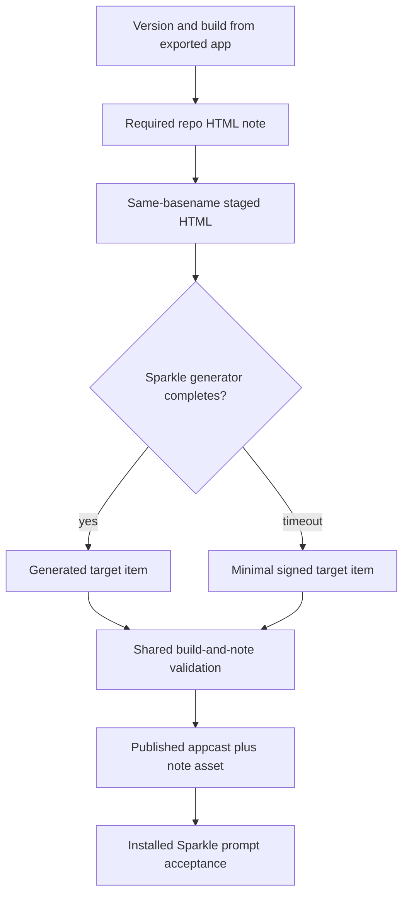

> Historical document: website ownership moved to `headroom-site` in September 2026.
> References below to portfolio publication describe the former setup. For new releases,
> follow [the current release runbook](../release/website-dmg-release.md).

# Versioned Sparkle Release Notes - Plan

## Goal Capsule

- **Objective:** Make a version-and-build-specific release-note file a required input to every public Headroom DMG release and prove that Sparkle displays it before installation.
- **Authority:** The requirements and KTDs in this plan govern this change. `docs/release/website-dmg-release.md` remains authoritative for the complete release procedure.
- **Execution profile:** Extend the current shell release pipeline and its release runbook without changing signing, notarization, publication authority, or app update UI code.
- **Stop conditions:** Stop if the selected Sparkle 2.9.4 tool cannot attach same-basename HTML notes, if the fallback feed cannot express the same note link, or if verification cannot bind a note to the target build.
- **Tail ownership:** `ce-work` owns implementation, local verification, review, and commits. Public artifact generation and deployment remain release-operator actions.

---

## Product Contract

### Summary

Every public macOS release must supply one HTML release-note file named for its exact Headroom marketing version and build. The release pipeline must publish and link that file through either appcast-generation path, reject missing or mismatched notes, and require the installed-app acceptance pass to inspect the notes in Sparkle's update prompt.

### Problem Frame

`Scripts/release-app.sh` currently generates valid signed update items but supplies no version-specific release notes. The normal Sparkle generator therefore has no note file to discover, while the timeout fallback writes a minimal item with no release-note element. A release can pass the existing minimum-system and enclosure checks even though its update prompt explains nothing to the user.

### Requirements

**Release input**

- R1. Each public macOS version/build must have a non-empty HTML source at `docs/release/sparkle/Headroom-<version>-<build>.html`.
- R2. The release pipeline must reject a missing or empty R1 source before it generates or accepts an appcast for that build.

**Appcast output**

- R3. The normal Sparkle generator must publish the R1 file beside the matching versioned DMG and link it from that build's appcast item.
- R4. The timeout fallback appcast must link the same published note file from the same build item.
- R5. Post-generation validation must reject an appcast when the target build has no release-note link, links a different filename, or has no non-empty staged note file.

**Release acceptance**

- R6. The release runbook must copy the versioned note with the other public assets and verify its live URL before declaring the macOS assets published.
- R7. Installed-app acceptance must confirm the target release notes are visible and readable in Sparkle's update prompt before the tester accepts the update.

### Acceptance Examples

- AE1. Given no note file for the exported app's version/build, when the release reaches its appcast preflight, then it exits nonzero and produces no accepted target-build feed.
- AE2. Given a valid note and a successful `generate_appcast` run, when the target item is validated, then its release-note URL ends in the exact same-basename HTML filename and that staged file is non-empty.
- AE3. Given a valid note and a timed-out `generate_appcast` run, when the fallback item is written and validated, then it carries the same release-note URL as AE2.
- AE4. Given an older public installation sees the new appcast, when the tester opens **Check for Updates...**, then the update prompt displays the target release's notes before installation is accepted.

### Scope Boundaries

- Do not publish a DMG, mutate `kz-portfolio`, deploy the public site, or perform a real installed-app update as part of this implementation.
- Do not redesign Sparkle's update prompt or replace Sparkle's standard user driver.
- Do not migrate the existing `docs/release/1.1-release-notes.md`; it remains historical candidate documentation rather than a version/build-bound Sparkle input.
- Do not change appcast retention, delta generation, signing, notarization, or rollback behavior beyond carrying the new note asset through those existing paths.

---

## Planning Contract

### Key Technical Decisions

- KTD1. **Use same-basename HTML as the canonical Sparkle input.** Store `Headroom-<version>-<build>.html` under `docs/release/sparkle/`, then stage it beside `Headroom-<version>-<build>.dmg`. Sparkle 2.9.4's documented `generate_appcast` convention discovers same-basename HTML and emits `sparkle:releaseNotesLink`; HTML also works on every Headroom-supported macOS version without a conversion dependency. Governs R1-R4.
- KTD2. **Link notes instead of embedding them in the feed.** Both paths emit a public `sparkle:releaseNotesLink` for the staged HTML asset. This keeps the normal and fallback shapes aligned and avoids separate HTML escaping rules in the handwritten XML. Governs R3-R5.
- KTD3. **Validate the target item and its local asset together.** A shared shell helper selects the item by `sparkle:version`, checks the exact expected note URL, and verifies the staged file is non-empty. This extends the existing target-build validation pattern in `Scripts/macos-compatibility.sh` without treating unrelated historical items as the release candidate. Governs R2 and R5.
- KTD4. **Keep release-note mechanics in a focused sourced script.** `Scripts/release-app.sh` remains the release orchestrator, while a small sourceable helper owns naming, staging, fallback XML, and target-item validation so both branches can be exercised without signing or notarization. Governs R2-R5.

### High-Level Technical Design

The shared validation gate is authoritative for either branch. The normal generator still owns deltas and feed history; the fallback only preserves its existing minimal-feed responsibility while adding the same release-note contract.

### Assumptions

- The release note is versioned by both marketing version and build because multiple public builds can share a marketing version.
- English HTML is the required baseline. Localized notes remain outside this change.
- An empty file is equivalent to a missing note. Editorial quality remains a release-review judgment rather than a shell heuristic.
- A sourceable shell helper and a fixture-driven shell test are appropriate because the changed behavior runs before Swift code and depends on filesystem/XML output.

### Risks and Dependencies

- Sparkle could emit a relative release-note URL when the expected public URL is absolute. Pass an explicit release-note URL prefix and validate the resulting target item.
- A fallback-only implementation could drift from the normal feed. Route both branches through the same staged filename and validation helper.
- The note could be linked locally but omitted from the portfolio copy. Add it to the asset-copy and live-verification steps, and make installed acceptance prove prompt rendering.
- Shell XML parsing is intentionally narrow. Match the existing item-by-build strategy and validate only the target item rather than attempting a general RSS parser.

### Sources and Research

- `Scripts/release-app.sh` owns appcast generation and its timeout fallback.
- `Scripts/macos-compatibility.sh` provides the existing target-build appcast validation pattern.
- `docs/release/website-dmg-release.md` owns public asset verification and installed-app acceptance.
- [Sparkle publishing documentation](https://sparkle-project.org/documentation/publishing/) defines the same-basename HTML release-note convention used by KTD1.

---

## Implementation Units

### U1. Add the versioned note contract

- **Goal:** Define and test one source-to-staging contract for an exact version/build release note.
- **Requirements:** R1, R2; AE1.
- **Dependencies:** None.
- **Files:** `Scripts/sparkle-release-notes.sh`, `Tests/ReleaseScripts/sparkle-release-notes-tests.sh`.
- **Approach:** Add sourceable helpers that derive the canonical and staged same-basename paths, reject absent or empty source files, and copy a valid note without rewriting its contents.
- **Execution note:** Start with a failing shell test for the missing, empty, and valid-note cases before adding the helper.
- **Patterns to follow:** Strict Bash settings and typed nonzero exits in `Scripts/release-app.sh`; small verification functions in `Scripts/macos-compatibility.sh`.
- **Test scenarios:**
  - Covers AE1. A missing exact version/build source returns nonzero and does not create a staged note.
  - An empty exact version/build source returns nonzero and does not create a staged note.
  - A non-empty source is copied to the exact DMG-basename HTML path with unchanged contents.
  - A note for another build does not satisfy the requested build.
- **Verification:** The focused shell test demonstrates all path and missing-input outcomes without invoking signing, notarization, or network operations.

### U2. Enforce notes in both appcast paths

- **Goal:** Make normal and fallback appcasts carry the same target-build note and fail closed when the link or asset is missing.
- **Requirements:** R3-R5; AE2, AE3.
- **Dependencies:** U1.
- **Files:** `Scripts/release-app.sh`, `Scripts/sparkle-release-notes.sh`, `Tests/ReleaseScripts/sparkle-release-notes-tests.sh`.
- **Approach:** Stage the note after reading the exported version/build and before appcast generation. Give `generate_appcast` an explicit release-note URL prefix, add the same link to fallback XML, then run the shared target-item validator after either branch.
- **Execution note:** Add failing fixtures for normal, fallback, absent-link, wrong-link, and missing-staged-file outcomes before wiring the release orchestrator.
- **Patterns to follow:** `write_minimal_appcast`, `run_generate_appcast_with_timeout`, and `headroom_verify_appcast_minimum`.
- **Test scenarios:**
  - Covers AE2. A generator-style item for the target build with the exact note URL and staged file passes.
  - Covers AE3. The fallback writer emits the exact note URL and passes the same validator.
  - A target item without `sparkle:releaseNotesLink` fails.
  - A target item that links another build's note fails.
  - A correct link with a missing or empty staged file fails.
  - A valid historical item cannot satisfy a target build whose item lacks notes.
- **Verification:** Focused tests prove both branches and all fail-closed cases; `bash -n` accepts every changed shell script.

### U3. Extend publication and installed acceptance

- **Goal:** Make the release operator publish, verify, and visually accept the target notes.
- **Requirements:** R6, R7; AE4.
- **Dependencies:** U2.
- **Files:** `docs/release/website-dmg-release.md`, `.agents/skills/release-website-dmg/SKILL.md`.
- **Approach:** Document how to author the exact version/build HTML file, include it in the portfolio asset copy, validate the live note URL from the target appcast item, and inspect the note content in the installed older app's Sparkle prompt before approving installation.
- **Patterns to follow:** Existing separation of candidate, published, and Sparkle-accepted states in both release documents.
- **Test scenarios:** Test expectation: none -- this unit changes the manual release contract; U2 provides automated feed validation, while AE4 requires the production-signed installed-app workflow.
- **Verification:** The runbook makes a missing live note or missing prompt content a named blocker and the bundled release skill includes the asset and acceptance expectations.

---

## Verification Contract

| Gate | Applies to | Expected outcome |
|---|---|---|
| `bash Tests/ReleaseScripts/sparkle-release-notes-tests.sh` | U1, U2 | Normal, fallback, and failure fixtures all pass. |
| `bash -n Scripts/release-app.sh Scripts/sparkle-release-notes.sh Tests/ReleaseScripts/sparkle-release-notes-tests.sh` | U1, U2 | All changed shell files parse successfully. |
| `swift test` | Whole change | Existing Headroom logic remains green. |
| Installed older-public-app acceptance from `docs/release/website-dmg-release.md` | U3, future release | The update prompt visibly shows the target notes before installation, then the app updates to the expected version/build. |

---

## Definition of Done

- A missing or empty exact version/build note stops release feed creation with a nonzero result.
- Normal and fallback target items link the same versioned HTML asset and pass one shared validator.
- Automated fixtures cover successful and rejected note/feed states without release credentials.
- The public-asset checklist includes the HTML note and validates its live link.
- Installed-app acceptance requires a visible-note check before update approval.
- Signing, notarization, delta, feed-history, and publication authority behavior remain unchanged.
- No abandoned helper, fixture, or alternate note format remains in the diff.
