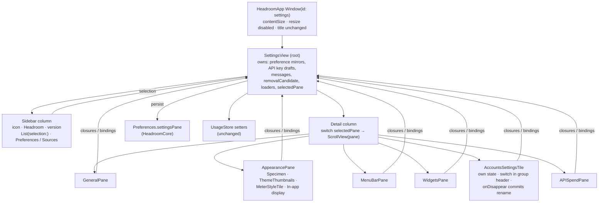
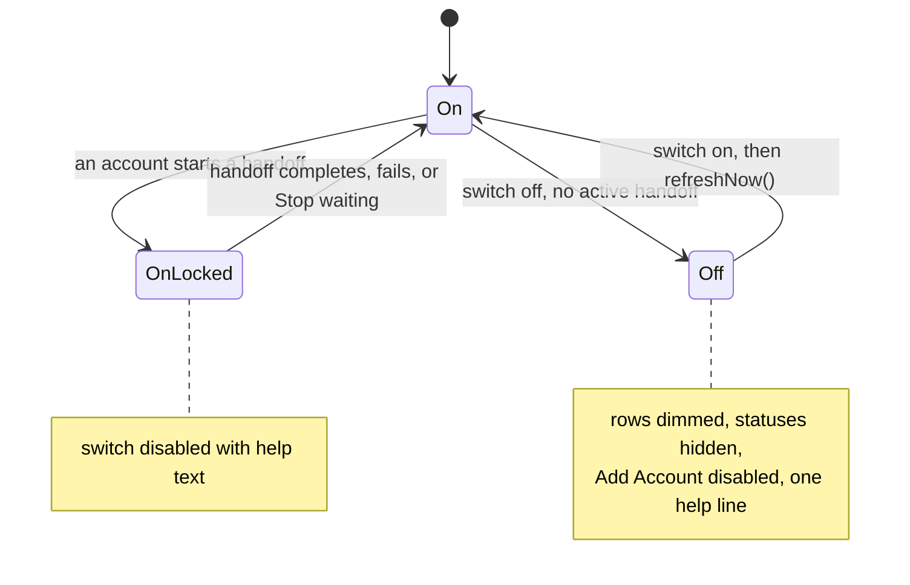

# Settings Sidebar Window - Plan

## Goal Capsule

- **Objective:** A Headroom user opens Settings and finds every preference in seconds: the window is a System Settings style sidebar with six named destinations, the visual choices sit together in one Appearance pane behind a live specimen of a provider card, and each provider's on/off switch lives next to the accounts it controls.
- **Means:** Option A from `design/settings-redesign-options.html`, built on `NavigationSplitView` with the existing tiles re-housed as panes (KTD1, KTD3).
- **Authority:** This plan's Requirements govern behavior. `AGENTS.md` hard constraints override anything here that conflicts: the official-CLI-only Claude path, Swift 6 strict concurrency, typed `FailureReason`, the no-pulsing rule, and the rule that meter and window acceptance uses the live `MenuBarExtra` app rather than `--render-popover`.
- **Stop conditions:** Stop and surface if the sidebar cannot be made to render its first selection reliably on macOS 15 after applying KTD1's fallback. Stop if hoisting settings state per KTD3 would require changing `UsageStore` or `AccountsSettingsInteractions` public behavior. Stop if any unit would touch provider polling, credential handling, or the popover.

---

## Product Contract

### Summary

Replace the single 460×700 scrolling column of eight peer tiles with a fixed 720×660 window: a sidebar listing General, Appearance, Menu Bar, Widgets & iPhone under "Preferences" and Accounts, API Spend under "Sources", and one pane at a time on the right. Appearance collects Theme (as three mini-window thumbnails), Meter style, and the in-app display toggles under a live, inert specimen of a provider card and the menu bar strip. The "Subscription Usage" tile disappears: its display preferences move to Appearance and its per-provider switches move into the Accounts provider groups. The app icon, name, and version move to the sidebar top; the Done footer goes; "Check for Updates…" becomes a General row. The sidebar reopens on the last-visited pane.

### Problem Frame

The meter style system gave Settings a real set of visual choices, and the window did not catch up. Eight tiles carry the same material, title weight, and width, so nothing says which are everyday preferences and which are one-time plumbing. Theme, meter style, and Percentages are split across three tiles roughly 900pt apart, Theme is a three-word picker with no preview beside swatches that do preview, and nothing on screen shows what a chosen combination looks like on the popover. "Subscription Usage" mixes a display preference with the switches that decide whether a provider is polled at all, which already forces a help line in Accounts explaining why an account sits in "Needs sign-in". There is no map for a 1,300pt scroll. The exploration doc (`design/settings-redesign-options.html`, sections "Today" and "Proposed information architecture") records these six weaknesses with mocks.

### Key Decisions

- KD1. **Go straight to the sidebar window; no interim single-column pass.** (session-settled: user-directed — chosen over the exploration doc's "ship C then A" sequencing: C's sticky jump bar is custom chrome that would be deleted one release later, and the tile merge and Accounts regroup are shared work either way.) Governs R1, R9.
- KD2. **The window frame is fixed at the Appearance pane's height; short panes show empty space; Accounts scrolls internally, and any pane scrolls when larger text makes its content taller than the frame.** (session-settled: user-approved — chosen over resizing the window per pane, which is jarring, and over a taller window.) Governs R2.
- KD3. **App icon, name, and version live in the sidebar top; the Done footer is removed; Check for Updates becomes a General row.** (session-settled: user-approved — chosen over keeping today's header and footer: sidebar settings windows on macOS close with ⌘W and carry no Done button.) Governs R3, R13.
- KD4. **A live specimen of the popover card and menu bar strip sits at the top of Appearance.** (session-settled: user-approved — Option D's idea adopted as a component rather than a separate preview pane, because Accounts and API Spend have nothing to preview.) Governs R6.
- KD5. **Theme is picked from three mini-window thumbnails.** (session-settled: user-approved — chosen over keeping the segmented System | Light | Dark for this pass, accepting one new custom control so Theme gets the same feedback level as the meter swatches beside it.) Governs R7.
- KD6. **The sidebar reopens on the last-visited pane, persisted across launches.** (session-settled: user-approved — chosen over always opening on General, matching System Settings.) Governs R4.
- KD7. **Every visual choice collects under Appearance, and each provider's subscription switch moves into its Accounts group.** (session-settled: user-approved — the proposed information architecture in the exploration doc, accepted with Option A.) Governs R8, R9.

### Requirements

**Window and navigation**

- R1. Settings is a sidebar window with six destinations in sidebar order General, Appearance, Menu Bar, Widgets & iPhone (group "Preferences"), Accounts, API Spend (group "Sources"); exactly one pane is visible at a time.
- R2. The window is 720pt wide and fixed at the measured height of the Appearance pane at default text size (target 660pt); the user cannot resize it; each pane scrolls internally only when its content is taller than the frame (per KD2).
- R3. The sidebar top shows the app icon, "Headroom", and the version stamp; there is no footer; the window closes with ⌘W or the close button; "Check for Updates…" is a General row that is hidden when no updater is configured (per KD3).
- R4. Reopening Settings selects the last-visited pane; a missing or unrecognized stored value selects General (per KD6).
- R5. The window title stays "Headroom Settings" so multi-display re-homing keeps working.

**Appearance pane**

- R6. The pane opens with a specimen: one provider card rendered by the real card view from fixture data, re-rendering as Theme, meter style, and Percentages change, plus the menu bar strip on its dark plate, which follows Percentages only because the menu bar projection carries no meter style by design; the specimen accepts no clicks and is one labelled, non-interactive accessibility element (per KD4).
- R7. Theme is a row of three thumbnails (System, Light, Dark) with a 2pt accent ring on the selection; VoiceOver announces it as a single picker with three values; choosing one applies the theme immediately as today (per KD5).
- R8. Meter style keeps today's controls and behavior; Percentages (Left | Used) and "Show Codex Spark counters in app" live in a third Appearance tile titled "In-app display" (per KD7).

**Accounts pane**

- R9. Each provider group header carries that provider's subscription switch; the "Subscription Usage" tile no longer exists (per KD7).
- R10. The switch is disabled with a help tooltip while any account of that provider has an active setup handoff.
- R11. "Off" means "not fetched", never "unmanageable": while a provider is off, its account rows dim, status labels, fetch-recovery buttons, and the capability banner hide, and one help line reads "Not fetched while this provider is off." Add Account, sign-in, rename, remove, stop-tracking, and "Show CLI Account" stay live, because Grok and Cursor ship off and a new user must still be able to add their first account before switching the provider on.
- R12. An uncommitted account rename commits when the user leaves the Accounts pane or closes the window.

**Preserved behavior**

- R13. API key drafts, the Replace key flow, result messages, and the remove-key confirmation survive switching panes; Return in the key field saves.
- R14. Menu Bar, Widgets & iPhone, and API Spend panes keep today's rows, help text, and live-preview cross-fade.
- R15. Both appearances, Reduce Motion, Reduce Transparency, and Increase Contrast are honored; no idle motion anywhere.

### Scope Boundaries

- Popover, widgets, iPhone companion, and the meter renderer are untouched.
- Sidebar search is out; six panes do not need it.
- The preset gallery (Option H), the grouped `Form` rewrite (Option F), and the refresh-interval slider stay parked per the exploration doc's recommendation.

#### Deferred to Follow-Up Work

- Retrofit the meter shape and fill swatches with the same picker accessibility representation as the theme thumbnails (KTD5); today they are plain buttons, and this plan only adds the new control in that shape.
- Menu Bar's "Priority providers" and "Preferred window" rows iterate every registered provider, so a provider switched off in Accounts still appears there and can render a neutral meter. Pre-existing; record in `BUGS.md` under U5.

---

## Planning Contract

### Key Technical Decisions

- KTD1. **Sidebar is a `NavigationSplitView` whose sidebar is a `List(selection:)` of a `SettingsPane` value; the detail column switches on that value.** Value-driven detail sidesteps the macOS 15 first-selection render bug reported for `NavigationLink(destination:)` sidebars. `.listStyle(.sidebar)`, `.navigationSplitViewColumnWidth(min: 180, ideal: 196, max: 250)` so "Widgets & iPhone" has room under larger text sizes, `.toolbar(removing: .sidebarToggle)` (macOS 14+). Collapse via ⌥⌘S cannot be fully disabled on macOS; accept it. **Fallback:** if the live smoke gate on macOS 15 shows the first click not rendering its pane, or a collapsed sidebar leaving no way back, first try `TabView` with `.tabViewStyle(.sidebarAdaptable)` (macOS 15+), which keeps system sidebar semantics and material; only if that also fails, use `HSplitView` with the same `List`, under an explicit exemption from KTD9 that applies an AppKit `.sidebar` visual-effect material to the list column so R15 still holds in both appearances.
- KTD2. **Fixed frame: `.frame(width: 720, height: H)` on the split view container, `.windowResizability(.contentSize)` on the scene, `.windowResizeBehavior(.disabled)` and `.windowMinimizeBehavior(.disabled)` (macOS 15+) on the root.** H is measured from the Appearance pane at default text size during U3 and then pinned. Every pane body is a `ScrollView` with no `fixedSize` on the path, so larger accessibility text still reaches every row (R2). `.contentMinSize` stays out: it only enforces a floor.
- KTD3. **All root state stays on `SettingsView`; panes are stateless views fed bindings and closures.** `apiKeyDrafts`, `replacingKeyProviders`, `credentialMessages`, `messageDismissals`, `removalCandidate`, the `@State` preference mirrors, `loadPreferences()` on appear, and `.task { refreshSavedKeyPresence() }` remain on the root, so pane switches cannot discard a typed key (R13). `AccountsSettingsTile` keeps its own state (it is mounted only while Accounts is selected) and gains an `onDisappear` that commits any pending rename draft; U4 confirms it fires on window close as well as pane switch, and adds an explicit commit on the window's close path if it does not (R12). The tile's `duplicateLoginLabels` state and its `.task(id: claudeDuplicateFingerprint)` scan move to the root as well, so returning to Accounts does not blank the "Same login as X" badges and re-read a large `.claude.json` on every visit; the resolved labels are passed into the tile. Confirmation dialogs stay where they are: on macOS they are window-modal sheets, so the sidebar cannot switch panes underneath them.
- KTD4. **The specimen is `ProviderCardView` built from a `DemoFixture` specimen snapshot with a synthetic account id, wrapped inert and silent.** `.allowsHitTesting(false)` plus `.accessibilityElement(children: .ignore)` with a label such as "Preview of a provider card in the selected style." `ProviderCardView` gains an `announcesAccessibilityEvents` flag (default true) that gates both `SetupSessions.announceFailureIfNeeded` and `announceCapabilityIfNeeded`; the specimen sets it false, because the capability dedupe is keyed by provider, so a synthetic account id alone would still reset the real Claude entry. The menu bar strip reuses `MenuBarLabel` with fixture `MenuBarMeter`s on the dark plate and follows Percentages only (R6). Live inputs for the card are the root's mirrored `meterStyle`, `usagePercentageMode`, and `appearancePreference` (via the window's color scheme).
- KTD5. **Theme thumbnails are three `Button`s in an `HStack` whose container carries `.accessibilityRepresentation { Picker("Theme", …) }`.** VoiceOver gets picker semantics (R7); keyboard reach matches the existing swatches (Full Keyboard Access). `.pickerStyle(.radioGroup)` was rejected because it cannot host thumbnail labels without the radio circles. The thumbnail art is drawn in SwiftUI from `RaisedTile` and window tokens, not bitmaps, so it re-themes with the scheme; the System thumbnail is a diagonal split of the Light and Dark drawings.
- KTD6. **The subscription switch's enabled state and the off-state row presentation come from pure functions in `AccountsSettingsInteractions`.** A `SubscriptionSwitchPresentation` (or equivalent) takes the accounts, `SetupSessions.hasActiveHandoff` results, and `isSurfaceEnabled`, and returns enabled/disabled plus help text; `AccountsSettingsTile` renders it. This keeps R10 and R11 testable in `AccountsSettingsInteractionTests` without mounting SwiftUI, matching how rename focus is tested today.
- KTD7. **Last pane is a `Preferences` key backed by a `String` raw-value `SettingsPane` enum in HeadroomCore, not `@AppStorage` or `@SceneStorage`.** `@SceneStorage` is destroyed when a macOS window closes; `@AppStorage` bypasses the injectable `Preferences` seam every other setting uses. Unknown raw values decode to `.general` (R4).
- KTD8. **The window keeps its title and identity; no `.navigationTitle` anywhere in the split view.** `placeSettingsWindowOnActiveScreen()` finds the window by `title == "Headroom Settings"`; a navigation title would rewrite it silently (R5). The sidebar header block clears the floating traffic lights with a measured top inset (today's content uses 30pt).
- KTD9. **No hand-rolled sidebar material and no macOS 26-only modifiers.** On Tahoe the system supplies the floating Liquid Glass sidebar; on Sequoia the vibrant sidebar material. `backgroundExtensionEffect` and `safeAreaBar` are 26-only and not needed. Pane content keeps `RaisedTile` opaque tiles on the window background exactly as today, so the tile spec (13pt pad, 10pt radius, 15pt semibold titles) is unchanged.
- KTD10. **`PopoverRenderHarness.renderSettings` is updated to render each pane at the fixed frame rather than the old 460×1240 column.** It stays a compile-time diagnostic only; `BUGS.md` already disqualifies its captures as acceptance evidence.

### High-Level Technical Design

Component topology and state ownership after the split:

Provider switch state machine inside an Accounts group (KTD6):

### Assumptions

- 720×660 fits the smallest Apple-silicon MacBook display with the menu bar visible; the Appearance pane's measured height decides the final value.
- No current `DemoFixture` snapshot reaches the critical band (the Claude windows sit at 38, 72, and 54 percent remaining; critical is 15 percent or less), so U3 adds a dedicated specimen accessor whose three Claude windows span healthy, low, and critical. Without it, Color as event and Hue ramp would preview as identical neutrals.

---

## Implementation Units

### U1. Pane identity and persistence in HeadroomCore

- **Goal:** A `SettingsPane` value with six cases and a persisted "last pane" preference.
- **Requirements:** R4 (KD6 via KTD7).
- **Dependencies:** none.
- **Files:** `Sources/HeadroomCore/Settings/Preferences.swift` (new key and property), a new `Sources/HeadroomCore/Settings/SettingsPane.swift`, `Tests/HeadroomCoreTests/PreferencesTests.swift`.
- **Approach:** `SettingsPane: String, CaseIterable, Identifiable, Sendable` with `general, appearance, menuBar, widgets, accounts, apiSpend`, a `label`, and a `group` (`preferences` / `sources`) so the sidebar order and section headers derive from the enum. `Preferences.settingsPane` follows the existing string raw-value pattern: unknown or missing decodes to `.general`.
- **Patterns to follow:** `Preferences.appearancePreference` getter/setter and `appearancePreferenceDefaultsPersistsAndIgnoresUnknownValues` in `PreferencesTests`.
- **Test scenarios:**
  - Fresh defaults return `.general`.
  - Setting `.accounts` persists and reads back after constructing a second `Preferences` on the same suite.
  - A stored unknown string (for example `"billing"`) reads back as `.general`.
  - `SettingsPane.allCases` order matches the sidebar order in R1, and the two groups partition the six cases.
- **Verification:** `swift test` green including the new cases.

### U2. Window shell, sidebar, and pane extraction

- **Goal:** The window becomes the fixed-frame sidebar layout with General, Menu Bar, Widgets & iPhone, and API Spend panes carrying today's rows unchanged.
- **Requirements:** R1, R2, R3, R5, R13, R14 (KD1, KD2, KD3 via KTD1, KTD2, KTD3, KTD8, KTD9).
- **Dependencies:** U1.
- **Files:** `Sources/HeadroomApp/UI/SettingsView.swift`, new `Sources/HeadroomApp/UI/SettingsSidebar.swift`, new `Sources/HeadroomApp/UI/SettingsPanes.swift` (or one file per pane), `Sources/HeadroomApp/HeadroomApp.swift`, `Sources/HeadroomApp/UI/SettingsRows.swift`.
- **Approach:**
  1. Replace the root `VStack(ScrollView + hairline + footer)` with `NavigationSplitView { sidebar } detail: { detail }` inside the fixed frame (KTD1, KTD2); drop the `minWidth: 360 … maxHeight: .infinity` frame and the footer.
  2. Sidebar: header block (34pt app icon from `AppIconGlyph`, "Headroom" 15pt semibold, version 11pt monospaced tertiary) with the traffic-light inset, then `List(selection:)` with two `Section`s and SF Symbol `Label`s per pane (`slider.horizontal.3`, `circle.lefthalf.filled`, `menubar.rectangle`, `square.grid.2x2`, `person`, `key`).
  3. Detail: `switch selectedPane` over stateless pane views wrapped in `ScrollView` with the 20pt inset; the pane title (15pt semibold, kern −0.2) is the first row.
  4. Persist `selectedPane` through `preferences.settingsPane` on change; read it in `loadPreferences()`.
  5. General pane gains a "Software updates" row: label leading, `Check for Updates…` bordered small button trailing, whole row hidden when `softwareUpdates.canCheckForUpdates` is false.
  6. Move `apiKeyEditor`, `configuredAPIKeyRow`, `apiProviderRows` into the API Spend pane view as closures/bindings from the root; add `.onSubmit` on the secure field to call save (R13).
  7. Scene: `.windowResizability(.contentSize)`, keep `.defaultSize` matching the frame, keep the title string; root view adds `windowResizeBehavior(.disabled)` and `windowMinimizeBehavior(.disabled)`.
  8. Remove `onDone` and the `dismiss` path only if nothing else calls them; `openSettings()` is unchanged.
- **Execution note:** This unit's proof is the live window in both appearances; unit coverage does not apply to layout. Verify the first sidebar click renders its pane on macOS 15 before moving on (KTD1 fallback trigger).
- **Patterns to follow:** `settingsTile(_:content:)` and `responsiveControlRow` stay the row grammar; `HeadroomMotion.settle` for the selection cross-fade if any; `.help` on every icon-only control.
- **Test scenarios:**
  - Test expectation: none for layout. Behavioral coverage of pane persistence lives in U1; the Return-to-save path is covered by the existing credential store tests through the same `saveKey` call.
- **Verification:** window opens 720pt wide at the provisional 660pt height and cannot be resized (H is pinned in U3); each of the four extracted panes shows today's rows and help text verbatim; typing a partial API key, switching to General, and returning shows the draft intact; Return in the key field saves; window title is still "Headroom Settings" and re-homes to the screen under the cursor; ⌘W closes.

### U3. Appearance pane with specimen and theme thumbnails

- **Goal:** Appearance shows the inert specimen, the thumbnail Theme picker, Meter style, and the In-app display tile.
- **Requirements:** R6, R7, R8 (KD4, KD5, KD7 via KTD4, KTD5).
- **Dependencies:** U2.
- **Files:** new `Sources/HeadroomApp/UI/AppearanceSpecimen.swift`, new `Sources/HeadroomApp/UI/ThemeThumbnailPicker.swift`, `Sources/HeadroomApp/UI/SettingsPanes.swift`, `Sources/HeadroomApp/UI/MeterStyleTile.swift` (unchanged unless its tile chrome needs the pane's width), `Sources/HeadroomCore/DemoFixture.swift` (new specimen accessor), `Tests/HeadroomCoreTests/DemoFixtureTests.swift`, `Sources/HeadroomApp/UI/ProviderCardView.swift` (announcement flag), `Sources/HeadroomApp/UI/SettingsView.swift` (pin H).
- **Approach:**
  1. Add a `DemoFixture` specimen accessor: a Claude snapshot whose three windows land in the healthy, low, and critical bands. Specimen well (`ClaudeSetupStyle.wellBackground`, 7pt radius) containing `ProviderCardView` from that snapshot with a synthetic account and the root's mirrored `meterStyle` and `usagePercentageMode`, then the menu bar strip on its dark plate as in today's Menu Bar tile; caption "Follows the choices below." Inert per KTD4.
  2. Theme tile: `ThemeThumbnailPicker(selection: $appearancePreference)`; 96×64 thumbnails drawn from tokens; selected ring `Color.accentColor` 2pt, unselected hairline; labels 10.5pt medium; `.help` per thumbnail; container `accessibilityRepresentation` (KTD5). Selection continues to call `applyToProcess()`.
  3. `MeterStyleTile` unchanged, full pane width so the swatch grids stop wrapping.
  4. "In-app display" tile: the Percentages segmented row with its help line and the Spark counters checkbox, moved from the old Subscription Usage tile with their store calls intact.
  5. Measure the pane height at default text size and pin H in U2's frame.
- **Execution note:** Accept the specimen in both appearances and under Increase Contrast in the live window; confirm VoiceOver reads the theme row as one picker and never reads the fixture account name.
- **Patterns to follow:** `MeterStyleTile.shapeSwatch` for swatch chrome and `accessibilityValue("Selected")`; the Menu Bar tile's dark plate for the strip.
- **Test scenarios:**
  - The new `DemoFixture` specimen accessor yields one window in each of the healthy, low, and critical bands, and its account id differs from every built-in and demo account id.
  - Test expectation for the SwiftUI views: none; covered by the live acceptance in U6.
- **Verification:** changing Format, Shape, and Fill updates the card; Percentages updates the card and the menu bar strip; Theme re-themes the card; clicking inside the specimen does nothing; the specimen never posts a `SetupSessions` failure or capability announcement.

### U4. Subscription switch moves into the Accounts provider groups

- **Goal:** Each provider group header carries its subscription switch with the handoff guard and off-state presentation; the Subscription Usage tile is deleted.
- **Requirements:** R9, R10, R11, R12 (KD7 via KTD3, KTD6).
- **Dependencies:** U2.
- **Files:** `Sources/HeadroomApp/UI/AccountsSettingsTile.swift`, `Sources/HeadroomApp/UI/AccountsSettingsInteractions.swift`, `Sources/HeadroomApp/UI/SettingsView.swift` (remove `subscriptionTile`, `surfaceSwitchRow`; keep `surfaceBinding` reachable to the tile; host the hoisted duplicate-login labels per KTD3), `Tests/HeadroomAppTests/AccountsSettingsInteractionTests.swift`.
- **Approach:**
  1. Add a pure presentation function in `AccountsSettingsInteractions` returning the switch's enabled state and help text from the provider's accounts and their `SetupSessions` states (KTD6).
  2. Header layout: mark + name, "n of 5" counter, spacer, `Add Account…`, then the switch trailing. Cursor (capacity 1): mark + name, spacer, switch.
  3. Off state (R11): dim the rows, hide status labels, fetch-recovery buttons, and the `ProviderCapabilityRecoveryView` banner, keep `Add Account…`, sign-in, rename, removal, and "Show CLI Account" live, and replace the existing "turned off in Subscription Usage" help line with "Not fetched while this provider is off."
  4. Switching on calls the same binding as today (`setSurfaceEnabled` inside the settle animation, then `refreshNow()`).
  5. `onDisappear` on the tile commits any pending label draft through the existing `commitLabel` path (R12).
- **Execution note:** Write the guard's characterization test first, next to `stopWaitingClearsSetupActiveRemovalRefusalAndRoutesForceCancel`.
- **Patterns to follow:** `capabilityRowPresentation` and `recoveryRowActions` as the shape for the new pure function; `SettingsSwitchRow` for the switch styling.
- **Test scenarios:**
  - A provider with no active handoff yields an enabled switch and no help text.
  - A provider with one account in an active handoff yields a disabled switch whose help text names the reason.
  - A provider switched off yields the off-state presentation (rows dimmed, statuses and capability banner hidden, management actions still enabled) regardless of each account's snapshot state.
  - Cursor (capacity 1) yields a header presentation without a counter or add action but with the switch.
  - A pending rename draft is committed when the tile disappears (pure helper: draft present plus disappear yields a commit for that account).
- **Verification:** `xcodebuild -project Headroom.xcodeproj -scheme HeadroomAppTests -destination 'platform=macOS' test` green; in the live window, switching Grok off dims its rows while Add Account still works, switching it on refreshes it; the demo store enables every surface, so reach the off state by switching a provider off by hand; a row mid-handoff shows the switch disabled with the tooltip; closing the window with ⌘W while a rename field is focused keeps the new name on reopen.

### U5. Render harness and docs

- **Goal:** The settings render diagnostic matches the new window and the project docs describe it.
- **Requirements:** KTD10; supports R14.
- **Dependencies:** U2, U3, U4.
- **Files:** `Sources/HeadroomApp/PopoverRenderHarness.swift`, `AGENTS.md` (the `Sources/HeadroomApp` architecture bullet and the multi-account paragraph's "Settings → Accounts" reference), `BUGS.md` (the deferred Menu Bar provider-list item).
- **Approach:** `renderSettings` renders each `SettingsPane` at the fixed frame, one PNG per pane and appearance; `AGENTS.md` gains one sentence on the sidebar window and where the panes live; `BUGS.md` records the deferred item from Scope Boundaries.
- **Test scenarios:**
  - Test expectation: none; diagnostic and docs only.
- **Verification:** `swift build` clean; `swift run Headroom --render-popover <dir>` still exits 0 and writes one file per pane and appearance.

### U6. Live acceptance gate

- **Goal:** The finished window is accepted in the real app on both appearances with accessibility settings exercised.
- **Requirements:** R1 through R15 (KD1 through KD7).
- **Dependencies:** U1 through U5.
- **Files:** none new.
- **Approach:** Run `swift run Headroom --demo multi-4 --meter-style micro.chip.event`, open Settings from the gear, and walk every pane in Light and Dark; repeat with Reduce Motion, Reduce Transparency, Increase Contrast, and a larger system text size on; VoiceOver spot check of the sidebar, the theme row, and the specimen; open Settings once on a build whose saved window state still holds the old 460×700 frame and confirm it opens at the new fixed frame (`defaultSize` applies only on first launch); if a macOS 15 machine is available, confirm the first sidebar click renders (KTD1 fallback trigger) and the sidebar material.
- **Test scenarios:**
  - Test expectation: none; this unit is the manual acceptance the repo requires for window and meter visuals.
- **Verification:** every requirement above observed true in the live window; findings fixed in the owning unit before declaring done.

---

## Verification Contract

| Gate | Command | Proves |
| --- | --- | --- |
| Build | `swift build` | Swift 6 strict concurrency clean across all units |
| Core tests | `swift test` | U1 persistence and fixture coverage; no regressions |
| App-boundary tests | `xcodebuild -project Headroom.xcodeproj -scheme HeadroomAppTests -destination 'platform=macOS' test` | U4 switch guard, off-state, and rename-commit helpers |
| Live window | `swift run Headroom --demo multi-4 --meter-style micro.chip.event` then open Settings | U2, U3, U6 layout, specimen, accessibility, both appearances |
| Harness | `swift run Headroom --render-popover <dir>` | U5 diagnostic still runs; not acceptance evidence |

## Definition of Done

- All gates above pass and their output is shown, not summarized; for U6 the artifact is a screenshot of every pane in both appearances from the live demo window plus a per-requirement pass list for R1 through R15.
- The window opens at the fixed frame on the remembered pane, every pane shows today's rows and help text, and the Subscription Usage tile is gone with its controls relocated.
- The specimen card follows every Appearance choice, the strip follows Percentages, and both are inert to pointer and VoiceOver.
- A provider mid-handoff cannot be switched off; an off provider's rows read as off.
- No copy changes beyond the strings this plan names; no new dependencies.
- Abandoned experiments (an `HSplitView` attempt if KTD1's fallback was not needed, unused pane files) are removed from the diff.
- `AGENTS.md` and `BUGS.md` updated per U5.

---

## Sources

- `design/settings-redesign-options.html`: sections "Today", "Proposed information architecture", "A. Sidebar navigation", "D. Preview-first studio", and the component gallery's theme picker.
- `Sources/HeadroomApp/UI/SettingsView.swift`, `AccountsSettingsTile.swift`, `MeterStyleTile.swift`, `ProviderCardView.swift`, `MenuBarLabel.swift`, `PopoverRenderHarness.swift`; `Sources/HeadroomApp/HeadroomApp.swift` (`openSettings`, `placeSettingsWindowOnActiveScreen`).
- `docs/solutions/popover-scrollview-zero-height.md`: a self-sizing window and a `ScrollView` need an explicit frame; unit tests and the offscreen renderer both miss layout regressions.
- Apple documentation: `toolbar(removing:)` (macOS 14+), `navigationSplitViewColumnWidth`, `windowResizeBehavior` (macOS 15+), `containerBackground(_:for: .window)` (macOS 15+), `backgroundExtensionEffect` (macOS 26 only), `SceneStorage` lifetime on macOS, `accessibilityRepresentation`.
- Apple Developer Forums threads 766131 (first-selection render bug with `NavigationSplitView` on macOS 15), 776849 (sidebar collapse cannot be disabled), 810793 (`Settings` scene styling cannot be customized), 721016 (`defaultSize` only applies on first launch).
- WWDC25 session 323: `NavigationSplitView` sidebars get the floating Liquid Glass treatment automatically on macOS 26.
