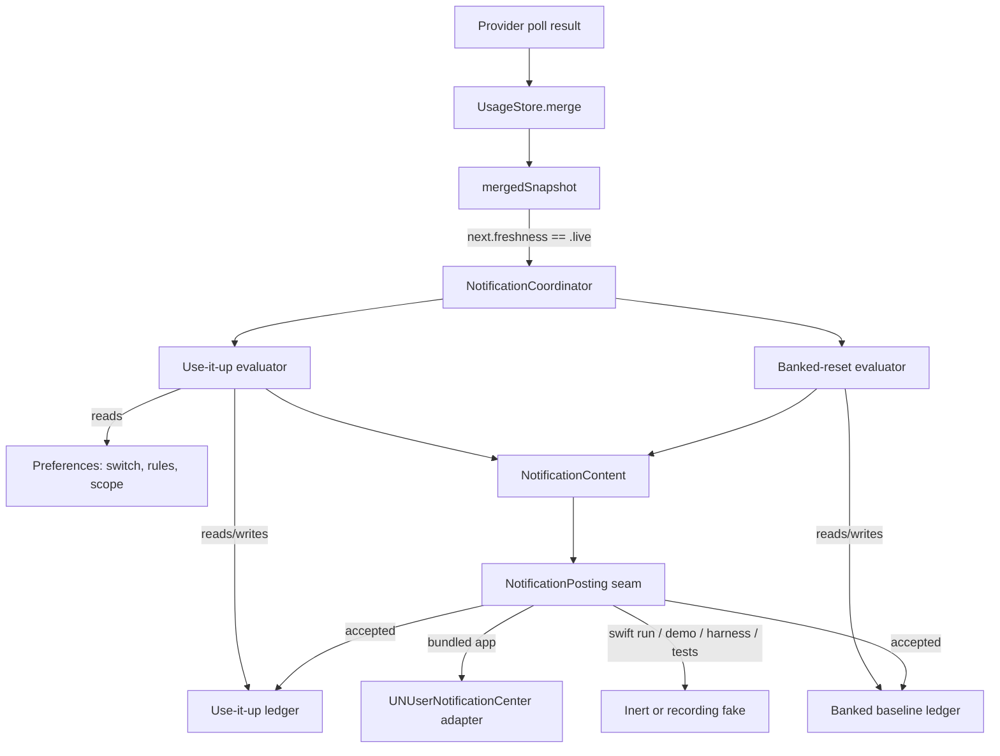
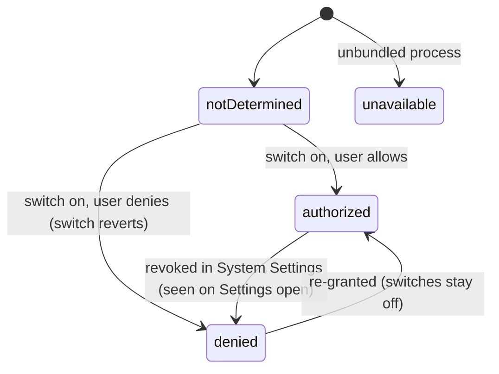

# Notifications Pane - Plan

## Goal Capsule

- **Objective:** A Headroom user who opts in gets a Mac notification when a limit is close to resetting with usage they have not spent, and when Codex banks a new reset. They control when and how the reminders arrive.
- **Means:** A new Notifications pane in Settings, plus a Core evaluator that runs on each fresh poll result and posts through a UserNotifications adapter (KTD1, KTD2).
- **Authority:** The Product Contract requirements (R-IDs) win on behavior. The KTDs win on mechanism within those R-IDs. `design/notifications-pane-mockup.html` is the visual and copy reference; where it and an R-ID disagree, the R-ID wins. AGENTS.md hard constraints apply throughout.
- **Stop conditions:** Stop and report if a settled decision proves infeasible. Stop if the notification adapter cannot be kept away from unbundled processes, or if any change requires touching Claude OAuth or credential paths.
- **Execution profile:** Core logic test-first under `swift test`. App adapter and pane verified by `HeadroomAppTests`, headless Settings renders, and one bundled-app smoke check.
- **Tail ownership:** The caller (LFG) owns review, commit, and PR.

---

## Product Contract

### Summary

Add a seventh Settings destination, **Notifications**, holding two opt-in tiles. **Use-it-up reminders** notify you when a limit is close to its reset and still has at least a chosen share left. You define the rules. **Banked resets** notifies you when Codex banks a new spare reset. Both are local notifications from the running Mac app.

### Problem Frame

People on usage-capped AI plans lose whatever they don't spend before a weekly or billing-period reset. A user asked for a nudge because they currently set calendar reminders to "burn through AI credits". Headroom already polls every provider and account, so it knows when a reset is close and how much is left. It never tells anyone unless they open the popover. Codex banked resets are also easy to miss: the plan capsule shows them only on hover, or when a limit is critical.

### Key Decisions

- **Rule list in its own pane.** Option C from the 19 Sep options doc, drawn in `design/notifications-pane-mockup.html`. (session-settled: user-approved — chosen over option A, a single switch in General with fixed defaults: the user wants editable rules and a room for later notification types.) Governs R1, R2.
- **Rules are fully user-defined.** (session-settled: user-directed — chosen over a fixed two-rule list, a four-rule cap, or a preset lead-time menu: "customizable to whatever people want… how many rules… is up to the user".) Governs R4, R5, R6.
- **Mac-local notifications only.** (session-settled: user-approved — chosen over iPhone push: push needs new server infrastructure.) Governs R19.
- **Codex banked-reset notice.** (session-settled: user-directed — chosen over having no banked notice: the user requested it; only Codex reports banked resets.) Governs R14, R15, R16.
- **Behavior and copy follow the reviewed mockup.** (session-settled: user-approved — chosen over the options-doc variants with a four-rule cap and a pace line in the banner: the user reviewed the interactive mockup and approved it.) Governs R3, R7–R13, R17, R18.
- **Build only from current Settings components.** (session-settled: user-directed — chosen over treating the mockup's approximated CSS as the source of truth: "use the visual design language and components we're currently using to keep it on brand and elevated".) Governs R20.

### Requirements

**Pane and controls**

- R1. Settings gains a **Notifications** destination. It is the last item in the App sidebar group, after Widgets & iPhone, and uses the `bell` symbol.
- R2. The pane holds two titled tiles in this order: "Use-it-up reminders" and "Banked resets". The Banked resets title carries a "Codex" pill badge.
- R3. The Use-it-up tile has a switch, "Remind me before unused usage resets", which is off by default. Its help line reads "A notification when a limit is close to resetting and you still have plenty left."
- R4. The tile has an editable rule list. Each rule has a lead time (a whole number plus an hours or days unit, 1–48 hours or 1–30 days) and a threshold (1–100, "% or more is left"). Out-of-range or blank input clamps into range on commit. Changing the unit keeps the number and clamps it.
- R5. Rule count is unlimited, and an empty list is allowed. "Add reminder" appends a rule seeded from the shortest rule: half its lead time in hours, rounded down (at least 1 hour), and half its threshold, rounded down (at least 1%). With an empty list it appends 1 day at 50%.
- R6. Defaults are two rules: 1 day at 50% and 6 hours at 25%. Rules sort by longest lead first when an edit is committed, not while typing.
- R7. An "Applies to" group has three checkboxes: Weekly limits (on), Billing periods with a "Grok, Cursor" hint (on), and 5-hour windows (off). A help line explains the 5-hour default and the lead-time rule (R10).
- R8. "Reset to defaults" appears only when the rules or the Applies-to choices differ from the defaults. It restores both.
- R9. When the switch is off, the rule list and Applies to stay visible but are disabled and dimmed. A help line under the list states the firing guarantees and binds its "can land up to N min late" figure to the slowest effective interval across tracked accounts, the same figure General's cadence sentence uses. When the list is empty, the help line says nothing will be sent.

**Use-it-up firing**

- R10. A rule applies to every provider and every account. It covers the limits whose kind is ticked in Applies to and whose known length is longer than the rule's lead time.
- R11. A rule is due for a limit when all of these hold:
  - the poll result is fresh for that limit;
  - the limit has a genuine scheduled reset;
  - the time left is at or under the lead time and above zero;
  - the share left, rounded the way the popover shows it, is at or above the threshold.
- R12. Each rule fires at most once per limit per reset cycle, and this survives relaunch. When several rules are due for one limit in one evaluation, the user gets one notification and every due rule is marked fired.
- R13. Banner title: "{N}% of {limit name} is still unused". Add the account name when the provider shows more than one account. Body: "Resets in {time left}, {reset clock time}." N uses the popover's percent rounding.

**Banked resets**

- R14. The Banked resets tile has a switch, "Tell me when Codex banks a new reset", which is off by default. Its help line reads "Codex can bank spare limit resets for later. Headroom reads the count on each refresh and never spends one."
- R15. The notice fires when a fresh live Codex poll reports a banked-reset count higher than the last count recorded for that account. It never fires on the first count seen for an account, on a decrease, on a retained count from a failed poll, or on a count that isn't reported.
- R16. Banner title "Codex banked a reset". Body "{Account} now has N banked resets." When Codex has one account, the body is "You now have N banked resets." Use singular "reset" when N is 1.

**Permission**

- R17. Headroom asks macOS for notification permission the first time either switch turns on, never at launch. If the user denies it, that switch reverts to off.
- R18. When permission is denied, both switches are off and dimmed. A notice tile at the top of the pane reads "Notifications are turned off for Headroom in System Settings, so nothing here can be sent." and offers "Open System Settings…". Headroom re-checks permission every time Settings opens.

**Boundaries and visual language**

- R19. Notifications are posted locally by the running Mac app. The pane and banners never imply iPhone delivery.
- R20. The pane uses the current Settings components, type ramp, spacing, and motion helpers. The rule row is the only new component.

### Acceptance Examples

- AE1. **Covers R11, R12.**
  - **Given:** Claude Weekly shows 80% left, resets in 23h, and the defaults are on.
  - **When:** a fresh poll lands.
  - **Then:** one banner fires, and the 1 day rule is marked fired for this cycle.
  - **And:** at the next poll (still 23h, 80%), nothing fires.
- AE2. **Covers R12.**
  - **Given:** the Mac slept through both lead times. Codex Weekly shows 60% left and resets in 4h.
  - **When:** the first fresh poll after wake lands.
  - **Then:** one banner fires, and both default rules are marked fired.
- AE3. **Covers R10.**
  - **Given:** a 2-day rule, 5-hour windows ticked, and a 5-hour window at 100% left.
  - **When:** a poll lands.
  - **Then:** the 2-day rule is ignored for that window.
- AE4. **Covers R11.**
  - **Given:** Claude's snapshot is live, but its retained `Weekly (Fable)` row is `.stale`.
  - **When:** a poll lands.
  - **Then:** nothing fires for the Fable row.
- AE5. **Covers R15.**
  - **Given:** a Codex account seen for the first time with 1 banked reset.
  - **When:** its first fresh poll lands.
  - **Then:** no banner fires, and the baseline records 1.
  - **And:** a later fresh poll showing 2 fires "…now has 2 banked resets."
- AE6. **Covers R15.**
  - **Given:** the notice switch is off and the count rises from 1 to 2.
  - **When:** the user turns the switch on.
  - **Then:** nothing fires until the count rises above 2.
- AE7. **Covers R17, R18.**
  - **Given:** permission is not yet determined.
  - **When:** the user turns on "Remind me…" and denies the prompt.
  - **Then:** the switch returns to off, and the notice tile appears.

### Scope Boundaries

- iPhone or push delivery (R19).
- Low-headroom warnings, "your limit just reset", and other notification types. The pane leaves room for them.
- E's draggable runway track. It is the natural header specimen for the Use-it-up reminders tile once the rule shape settles.
- Redeeming banked resets. Headroom never redeems.
- Tap routing. A tap gets the system's default behavior: the app activates and nothing opens (KTD8).

### Deferred to Follow-Up Work

- Routing a notification tap into Settings or a future popover-open path (KTD8).
- A rule preview line inside the pane (the mockup's "Against sample usage" panel is a review aid, not a pane feature).

### Sources

- `design/notifications-pane-mockup.html`: approved layout, copy, states, and "How it behaves".
- `design/use-it-up-reminders-options.html`: the 19 Sep options doc (A–E) and the shared-behaviour notes.

---

## Planning Contract

### Key Technical Decisions

- KTD1. **The evaluator lives in HeadroomCore; posting is behind a protocol.** A `@MainActor` notification coordinator in Core receives each merged snapshot. It reads the preferences and ledgers, builds notification content, and calls an injected `NotificationPosting` seam that reports whether the request was accepted. Core never imports UserNotifications. Tests use a recording fake. This follows AGENTS.md: everything injectable, and providers never throw.
- KTD2. **Hook point is `UsageStore.merge`, fresh results only.** Evaluate directly after `UsageContinuityPolicy.mergedSnapshot` (`Sources/HeadroomCore/Engine/UsageStore.swift`, beside the existing `bankedResetAcknowledgements?.lower` call). Evaluate only when `next.freshness == .live`, and per limit only when `window.freshness.isLive`. Launch restore, account lifecycle presets, and capability failures never reach the evaluator. This follows `docs/solutions/logic-errors/claude-partial-usage-window-freshness.md`, where a live snapshot can carry stale model rows.
- KTD3. **Limit scope comes from classified kind.**
  - Weekly limits: `.weekly`, plus weekly model rows (`.other` labels ending in weekly, e.g. `Weekly (Fable)`, `GPT-5 weekly`).
  - Billing periods: `.billingPeriod`, plus `.other("Billing period")` and `.other("Nd")`, only from Grok or Cursor. Codex also emits `Nd` labels; those are excluded.
  - 5-hour windows: `.fiveHour`, plus 5h model rows.
  - Unknown `.other` labels are excluded.
  - Codex Spark counters (`kind.isCodexSparkCounter`) are excluded unless `showCodexSparkCountersInApp` is on, mirroring `UsageStore.filterCodexSparkCounters`. The user never sees those rows.
  - Length comes from the kind: 5 hours, 7 days, the billing period's `duration`, or N days for "Nd". A limit with unknown length skips the lead-time length check.
  - Implements R10.
- KTD4. **Reset-cycle identity uses a tolerance.** The use-it-up ledger stores one entry per (AccountKey, `WindowKind.persistentID`), holding the cycle deadline and the fired rule IDs. A deadline more than 30 minutes from the stored one starts a new cycle and clears the fired set. This absorbs Codex's `resetsInSeconds` drift (`Sources/HeadroomCore/Providers/UsageDTOs.swift`) and Claude's minute-resolution parse. Entries whose deadline is more than one day past are pruned on write.
- KTD5. **Rules carry a stable UUID; firing keys include the values.** The UUID identifies a row for SwiftUI and never changes, so an edit animates in place. The ledger records a firing key of the form `<uuid>:<lead minutes>:<threshold>`. Editing a rule's lead time or threshold therefore re-arms it for the current cycle, while reordering and resorting do not. Firing keys for rules no longer present are ignored and pruned.
- KTD6. **Mark fired only after a successful post.**
  - If the poster reports failure (denied, unavailable, or an error), nothing is recorded, so a later fresh poll can retry within the same cycle.
  - While a post is in flight, the coordinator holds an in-memory marker per (AccountKey, `persistentID`), and per account for banked resets. A second merge for the same limit skips until the post returns.
  - On return, the coordinator writes the ledger only if the account is still attached. That stops a post racing an account removal from resurrecting a purged entry.
- KTD7. **A separate banked-reset baseline ledger.** `BankedResetAcknowledgements` (`Sources/HeadroomCore/Settings/BankedResetAcknowledgements.swift`) treats a missing record as zero, and the popover card consumes it. The notice needs its own per-account store with the same array-of-entries JSON shape. A missing record means "seed silently". The store updates on every fresh live Codex poll that reports a count, whether or not the switch is on (AE6). It is purged at the same lifecycle sites as the acknowledgement store: account removal, and Sign Out & Set Up Again.
- KTD8. **No tap routing in v1.** The `MenuBarExtra` popover has no programmatic open API. Opening Settings on a usage reminder would be the wrong destination. The delegate implements only `willPresent` (so banners show while Settings is frontmost) and leaves `didReceive` at default.
- KTD9. **The UserNotifications adapter refuses to run unbundled.** `UNUserNotificationCenter.current()` raises an uncatchable Objective-C exception without a bundle proxy. This was verified by a local probe during planning. The adapter touches the center only when `Bundle.main.bundleIdentifier` is set and `bundleURL` ends in `.app`. Otherwise it is an inert client with authorization `.unavailable`. `--demo`, `--render-popover`, and `swift run` all compose the inert client.
  - `HeadroomAppTests` runs inside the real bundled app as its test host, so the bundle guard alone passes there.
  - `AppComposition` therefore also composes the inert client when `XCTestConfigurationFilePath` is set, reusing the `usesNoOpWidgetExporter(environment:)` pattern.
- KTD10. **Swift 6 delegate shape.** The delegate is a nonisolated `NSObject` subclass using completion-handler or nonisolated async variants. A `@MainActor` delegate with async methods fails to compile over non-Sendable `UNNotification` parameters, which the planning probe confirmed. The app holds it strongly, because `center.delegate` is weak. It is set in `AppDelegate` before launch completes. `willPresent` returns banner, list, and sound. Interruption level stays `.active`; time-sensitive needs an entitlement and isn't justified.
- KTD11. **Permission states.** The client exposes `notDetermined`, `authorized` (including provisional), `denied`, and `unavailable`. Headroom requests only with alert and sound, never provisional, because a quiet delivery defeats a reminder. On Settings open, `denied` persists both switches off (R18). Re-granting clears the notice but leaves the switches off for the user to turn back on.
- KTD12. **Deterministic request and thread identifiers.**
  - Use-it-up request ID: `use-it-up.<provider>.<account>.<persistentID>.<deadline epoch minutes>`.
  - Banked request ID: `codex-banked.<account>.<count>`.
  - `threadIdentifier` is `<provider>.<account>`, so Notification Center groups per account.
  - A repost with the same ID replaces the earlier banner rather than stacking. The ledgers remain the real dedupe.
  - Payloads carry display names only, never emails or account identifiers beyond the internal key.
- KTD13. **The reset clock phrase is a new Core formatter.** The body's time-left part reuses `Countdown`'s shared "Resets in …" grammar. The clock part ("today at 4:00 PM", "tomorrow at 9:00 AM", "Sunday at 9:00 AM", or a short date beyond a week) is new, because no absolute-time formatter exists in Sources. It formats in the user's current time zone and locale, both injectable, per AGENTS.md's rule that source time zones are provenance only.
- KTD14. **Preferences follow existing patterns.** Two Bool keys default off. The rule list and the Applies-to set are JSON-encoded through small Codable stores, the way `AccountRegistry` and `BankedResetAcknowledgements` encode theirs. `UsageStore` mirrors the values it needs, following the `setMeterStyle` pattern, so the pane edits through the store.
- KTD15. **The rule row composes native controls.** Each rule row is:
  - an editable numeric `TextField` in the `.roundedBorder` style, with tabular digits and a `Stepper` beside it;
  - a menu-style `Picker` for hours or days;
  - the threshold field with the same stepper;
  - a remove button in the Accounts and pill-card remove idiom.

  No Settings pane has an editable numeric field yet; the only `TextField` is the Accounts rename field. So typed entry, clamp-on-commit (R4), and sort-on-commit (R6) are new behavior. They are not a reuse of General's read-only stepper label, and the numeric-text transition applies only to stepper-driven changes.

  Each field and the remove button carries a per-row accessibility label ("Lead time, reminder 1", "Remove reminder 1"), following the `accessibilityLabel` convention on Accounts and pill-card remove buttons.

  Rows sit in a recessed well (`ProviderStyle.recessedWell`) with hairline separators. Row insert and remove use `HeadroomMotion.resolved(…, reduceMotion:)` inside one `withAnimation`. Sorting commits after edit end, per `docs/solutions/ui/swiftui-layout-owned-drag-position.md`. Nothing pulses.
- KTD16. **SettingsTile gains a title accessory.** `SettingsTile` draws its title as plain `Text` and has no accessory slot. Add an init that takes a trailing title accessory, so "Banked resets" can carry the existing `SettingsPillBadge`. This extends a shared component; it is not a new one.

### High-Level Technical Design



Per-limit use-it-up decision (directional):

```text
for each limit in fresh snapshot:
  skip unless limit.freshness is live and resetSchedule is scheduled(deadline)
  scope = classify(limit.kind); skip unless scope ticked
  entry = ledger[account, persistentID]; if |deadline - entry.deadline| > 30 min → new cycle, fired = {}
  due = rules where rule.id not in fired
            and (length unknown or length > rule.lead)
            and 0 < deadline - now <= rule.lead
            and percentLeft >= rule.threshold
  if due non-empty and switch on: post one notification; on success add all due ids to fired
```

Permission states:



### Assumptions

- Model rows can be classified from their `.other` labels reliably enough for KTD3. Unrecognized labels are excluded rather than guessed.
- The `x-apple.systempreferences:com.apple.Notifications-Settings.extension?id=<bundle id>` deep link works on macOS 15 and 26. This is community-documented, not Apple API. Verify it once on the bundled app. Fall back to the bare pane URL if `?id=` is ignored.
- A reminder can land late by up to one effective polling interval, and is skipped entirely if no fresh poll arrives before the reset (R11). The per-account schedule can stretch CLI lanes; the help line states the chosen interval.
- `SettingsView`'s `.onAppear` reload runs each time the Settings window reopens. If it doesn't, re-check permission from the `openSettings()` path instead.

### Implementation Constraints

- Swift 6 strict concurrency stays clean. No UserNotifications import in HeadroomCore.
- No change to Claude, Codex, Grok, or Cursor transports, and no new polling.
- Tests never touch real notifications, the CLI, network, or Keychain.
- The widget, phone projection, and menu bar ignore notification state.

---

## Implementation Units

### U1. Notification preferences and rule model

- **Goal:** Persist the two switches, the rule list, and the Applies-to set, with the clamping, sorting, seeding, and default rules.
- **Requirements:** R3–R8, R14 (KTD5, KTD14)
- **Dependencies:** none
- **Files:**
  - `Sources/HeadroomCore/Settings/NotificationPreferences.swift` (new: rule model, scope set, defaults, clamp/sort/seed helpers)
  - `Sources/HeadroomCore/Settings/Preferences.swift` (keys and accessors)
  - `Sources/HeadroomCore/Engine/UsageStore.swift` (mirrored state and setters)
  - `Tests/HeadroomCoreTests/NotificationPreferencesTests.swift`
- **Approach:**
  1. Define a rule as an ID, a whole-number amount, an hours/days unit, and a threshold. Add a derived lead interval.
  2. Clamping and unit-change behavior follow R4.
  3. Seed behavior follows R5. Sort order follows R6: lead descending, then threshold descending.
  4. Encode the rules and scope as versioned JSON keys (`reminderRules.v1`, `reminderScope.v1`). A missing key yields the defaults. A corrupt key yields the defaults without overwriting.
  5. Store setters write through to Preferences.
- **Patterns to follow:** `AccountRegistry` JSON load/save; the `Preferences` Bool-default-off accessor; `UsageStore.setMeterStyle`.
- **Test scenarios:**
  - A fresh defaults suite yields both switches off, the two default rules, and scope {weekly, billingPeriod}.
  - Round-trip: save three custom rules and a scope with 5-hour on, reload from a new Preferences on the same suite, and get equal values.
  - A clamp of 0 hours gives 1 hour. 49 hours gives 48 hours. 31 days gives 30 days. A threshold of 0 gives 1, and 150 gives 100.
  - A unit change from 48 hours to days gives 30 days, not 2 days.
  - Seed from a shortest rule of 6 hours at 25% gives 3 hours at 12%. From 1 hour at 1% it gives 1 hour at 1%. From an empty list it gives 1 day at 50%.
  - Sort orders [6h/25, 2d/70, 1d/50] as [2d/70, 1d/50, 6h/25]. Identical leads order by threshold descending.
  - Editing a rule's amount assigns a new ID. Resorting keeps IDs.
  - A corrupt rules JSON falls back to defaults and leaves the stored bytes untouched.
  - "Is default" is true for the defaults, and false after one edit or a scope change.
- **Verification:** `swift test` passes the new suite. Existing `PreferencesTests` stay green.

### U2. Use-it-up evaluator and cycle ledger

- **Goal:** A pure Core function that decides which notifications a fresh snapshot triggers, plus the persisted ledger that stops repeats.
- **Requirements:** R10–R13 (KTD3, KTD4, KTD5, KTD6, KTD12, KTD13)
- **Dependencies:** U1
- **Files:**
  - `Sources/HeadroomCore/Notifications/UseItUpEvaluator.swift` (new: scope classification, lengths, due logic)
  - `Sources/HeadroomCore/Notifications/UseItUpLedger.swift` (new: persisted per-limit cycle entries)
  - `Sources/HeadroomCore/Notifications/NotificationContent.swift` (new: title/body/identifier/thread builders)
  - `Sources/HeadroomCore/Models/ResetClockFormatter.swift` (new: KTD13 phrase)
  - `Tests/HeadroomCoreTests/UseItUpEvaluatorTests.swift`
  - `Tests/HeadroomCoreTests/ResetClockFormatterTests.swift`
- **Approach:**
  1. Classification and length follow KTD3.
  2. Due logic follows R11. Evaluation returns proposed notifications plus the ledger updates to apply on post success (KTD6).
  3. The limit name reuses the popover's display names (`WindowKind.displayName`, or `spokenName` where it reads better in a sentence), prefixed by the provider name unless the label already starts with it (e.g. "Cursor Models").
  4. The percent uses `percentRemaining` with the popover's rounding.
- **Execution note:** Implement test-first. The due logic and cycle tolerance carry the feature's correctness.
- **Patterns to follow:** `UsageContinuityPolicy` pure-function style; `BankedResetAcknowledgements` versioned JSON array; `Countdown.string(to:now:)`.
- **Test scenarios:**
  - Covers AE1. A fresh live weekly limit at 80% left, 23h to reset, and defaults produce one notification tagged with the 1 day rule. Re-evaluating the same input after applying the update produces none.
  - Covers AE2. At 60% left and 4h to reset, both rules are due and produce one notification. Both IDs are recorded.
  - At 30% left and 4h to reset, only the 6 hour rule is due (30% is below the 1 day rule's 50%).
  - At 20% left and 4h to reset, nothing fires because 20% is below both thresholds.
  - Time left of exactly the lead time is due. One second above it is not. Zero or negative time left is not due.
  - Covers AE3. A 2-day rule is ignored for a 5-hour window. A 3-hour rule applies to it when 5-hour is ticked.
  - Covers AE4. A live snapshot whose Fable row is `.stale` fires nothing for that row.
  - A window with `.unresolved` reset evidence never fires.
  - A limit kind not ticked in Applies to never fires. Billing-period limits fire when ticked.
  - Unknown `.other` labels are excluded. `Weekly (Fable)` and `GPT-5 weekly` map to weekly. `GPT-5 5h` maps to 5-hour.
  - A Codex Spark weekly row is excluded while `showCodexSparkCountersInApp` is off, and included when it is on.
  - A Codex `.other("10d")` row is excluded. A Grok `.other("30d")` row maps to Billing periods.
  - At 49.6% left, the share shows as 50% and satisfies a 50% threshold, matching the popover.
  - A cycle deadline drifting 8 seconds between polls stays the same cycle. A deadline 7 days later starts a new cycle, and the rule can fire again.
  - An edited rule (new ID) after firing is due again in the same cycle.
  - When the switch is off, nothing is proposed.
  - Ledger entries a day past their deadline are pruned on write.
  - Copy with a single account: "80% of Claude Weekly is still unused" / "Resets in 23h, tomorrow at 9:00 AM." With two accounts, the account label appears in the title.
  - The formatter, with a fixed zone, locale, and now, produces "today at 4:00 PM", "tomorrow at 9:00 AM", "Sunday at 9:00 AM", and a short date for 12 days out.
- **Verification:** `swift test` passes. The evaluator has no dependency on UserNotifications or the main bundle.

### U3. Banked-reset baseline and evaluator

- **Goal:** Detect a real rise in a Codex account's banked-reset count and propose one notification.
- **Requirements:** R14–R16 (KTD7, KTD12)
- **Dependencies:** U1
- **Files:**
  - `Sources/HeadroomCore/Notifications/BankedResetNotificationBaseline.swift` (new)
  - `Sources/HeadroomCore/Notifications/NotificationContent.swift` (banked copy)
  - `Tests/HeadroomCoreTests/BankedResetNotificationTests.swift`
- **Approach:**
  1. Keep one entry per account holding the last live count.
  2. On a fresh live Codex snapshot with a non-nil count, compare the count against the entry:
     - A missing entry records the count and proposes nothing.
     - A higher count proposes a notification (when the switch is on), then records the new count.
     - A lower or equal count records the count and proposes nothing.
  3. Account purge mirrors `BankedResetAcknowledgements.purge`.
- **Patterns to follow:** `BankedResetAcknowledgements` (JSON array, `maxEntries` cap, purge).
- **Test scenarios:**
  - Covers AE5. The first count of 1 records silently. A later 2 proposes "…now has 2 banked resets." A later 2 again proposes nothing.
  - Covers AE6. With the switch off, a rise from 1 to 2 records 2 and proposes nothing. After switching on, 2 proposes nothing and 3 proposes one notification.
  - A drop from 2 to 1 records 1 and proposes nothing. A later rise back to 2 proposes one.
  - A nil count (not reported) changes nothing.
  - A null-as-zero count of 0, then 1, proposes one.
  - A stale snapshot carrying a retained count changes nothing.
  - Copy with one Codex account: "You now have 1 banked reset." With two: "Work now has 2 banked resets."
  - Purge removes the account's entry. The next count seeds silently.
- **Verification:** `swift test` passes. The capsule acknowledgement tests are unchanged.

### U4. Notification coordinator wiring in UsageStore

- **Goal:** Run both evaluators on each fresh merge, post through the seam, and apply ledger updates on success. Purge on account lifecycle.
- **Requirements:** R10–R16 (KTD1, KTD2, KTD6)
- **Dependencies:** U2, U3
- **Files:**
  - `Sources/HeadroomCore/Notifications/NotificationCoordinator.swift` (new: `@MainActor`, owns evaluators and ledgers, takes `NotificationPosting`)
  - `Sources/HeadroomCore/Notifications/NotificationPosting.swift` (new protocol plus an inert implementation)
  - `Sources/HeadroomCore/Engine/UsageStore.swift` (optional injected coordinator; call in `merge`)
  - `Sources/HeadroomCore/Engine/UsageStoreAccountLifecycle.swift` (purge on remove and reset)
  - `Tests/HeadroomCoreTests/Mocks.swift` (recording poster)
  - `Tests/HeadroomCoreTests/NotificationCoordinatorTests.swift`
- **Approach:**
  1. Place the call beside the existing `bankedResetAcknowledgements?.lower` hook, gated on `next.freshness == .live`.
  2. Posting is async. The coordinator applies ledger updates only after the poster returns success.
  3. Provider and account display names come from the store (`accounts(for:)`, `ProviderAccount.label`, `ProviderID.displayName`).
  4. The multi-account check counts visible accounts at post time.
  5. The coordinator is optional on `UsageStore`, so existing tests are unaffected.
- **Patterns to follow:** the `bankedResetAcknowledgements` optional-seam injection in `UsageStore.init`; `MutableDateSource` for now.
- **Test scenarios:**
  - A store with a recording poster merges a fresh Codex result at 27% left and 5h to reset, and posts one use-it-up notification with the expected identifier and thread.
  - Merging a failed poll (stale snapshot with retained windows) posts nothing.
  - A launch-restored snapshot posts nothing.
  - A poster returning failure records nothing. A later fresh merge posts again.
  - Removing a Codex account purges both ledgers for it.
  - With two Claude accounts, each gets its own notification, and the account label appears in the titles.
  - Capability failures (`receiveCapabilityFailure`) never reach the coordinator.
  - Two fresh merges for one limit while the first post is still pending produce one post.
  - An account removed while its post is pending leaves no ledger entry after the post returns.
- **Verification:** `swift test` passes, including the full existing `UsageStoreTests`.

### U5. UserNotifications adapter and app composition

- **Goal:** Post real notifications from the bundled app, report permission state, and stay inert everywhere else.
- **Requirements:** R17–R19 (KTD6, KTD8–KTD12)
- **Dependencies:** U4
- **Files:**
  - `Sources/HeadroomApp/UserNotificationClient.swift` (new: bundle guard, authorization status and request, post, delegate, Settings deep link)
  - `Sources/HeadroomApp/HeadroomApp.swift` (AppDelegate delegate setup; `AppComposition` wiring; inert client under `--demo` and `--render-popover`)
  - `Headroom.xcodeproj/project.pbxproj` (regenerated with `xcodegen generate` after adding files; the checked-in project lists files explicitly)
  - `HeadroomAppTests/NotificationClientTests.swift` (or the existing app-test folder)
- **Approach:**
  1. The client implements Core's `NotificationPosting` and an app-side authorization protocol with the four KTD11 states.
  2. Bundle guard per KTD9. Delegate per KTD10.
  3. `openSystemSettings()` opens the deep link from Assumptions, with the bare-pane fallback.
  4. The client is created once in composition and injected into both the store's coordinator and `SettingsView`.
- **Patterns to follow:** `AppComposition` service wiring; the `SetupSessions` `NSWorkspace.open` usage; demo-mode isolated defaults.
- **Test scenarios:**
  - The guard reports unavailable when `bundleURL` isn't a `.app`, and never calls the center (test through an injected bundle descriptor).
  - Authorization mapping: authorized maps to authorized, provisional to authorized, denied to denied, not determined to not determined.
  - The inert client returns failure from post, and its status is unavailable.
  - The composition decision picks the inert client when the environment carries `XCTestConfigurationFilePath`, so no system prompt or real banner appears during `xcodebuild test`.
- **Verification:**
  - `xcodebuild … HeadroomAppTests test` passes.
  - `swift run Headroom --demo` launches without crashing.
  - A bundled `./Scripts/build-app.sh` build shows the permission prompt on first switch-on. Ask the user before this manual check, because it shows UI on their screen.

### U6. Notifications Settings pane

- **Goal:** The pane from R1–R9, R14, and R18, built from current Settings components.
- **Requirements:** R1–R9, R14, R17, R18, R20 (KTD11, KTD15, KTD16)
- **Dependencies:** U1, U5
- **Files:**
  - `Sources/HeadroomCore/Settings/SettingsPane.swift` (`notifications` case, label, group)
  - `Sources/HeadroomApp/UI/SettingsSidebar.swift` (`bell` symbol and scale)
  - `Sources/HeadroomApp/UI/SettingsView.swift` (detail case, authorization state, Settings-open re-check, client injection)
  - `Sources/HeadroomApp/UI/NotificationsSettingsPane.swift` (new: pane, tiles, permission notice)
  - `Sources/HeadroomApp/UI/ReminderRuleRow.swift` (new: KTD15 row)
  - `Sources/HeadroomApp/UI/SettingsRows.swift` (KTD16 title accessory on `SettingsTile`)
  - `Sources/HeadroomApp/PopoverRenderHarness.swift` (fake client; an extra denied-state render of the pane)
  - `HeadroomAppTests/NotificationsSettingsPaneTests.swift`
- **Approach:**
  1. Build the pane as a `SettingsPaneScaffold` holding:
     - an optional permission notice tile (R18);
     - a titled "Use-it-up reminders" `SettingsTile`: a `SettingsSwitchRow` plus `SettingsHelpText`, the rule well, a `SettingsGroupLabel("Applies to")` with checkboxes, and a conditional "Reset to defaults" link-style button;
     - a titled "Banked resets" tile with the `SettingsPillBadge` "Codex" in its header, and a switch row with help text.
  2. Dimming uses `.disabled` plus the Accounts 0.45 opacity idiom.
  3. Turning a switch on while status is `notDetermined` requests permission and reverts the switch on denial (R17). With status `unavailable`, the switches are disabled, and a help line says notifications need the installed app.
  4. The help line's interval figure reuses the effective-interval computation behind `SettingsView.cadenceSentence` (R9).
  5. Recheck the sidebar fit and minimum window height for seven destinations.
- **Patterns to follow:**
  - `GeneralSettingsPane` (Stepper, numeric transition, titled second tile)
  - `AccountsSettingsTile` (disabled/dim, remove buttons)
  - `SettingsRows.swift` (all shared rows, the type ramp, metrics)
  - `settingsPreviewWell` / `ProviderStyle.recessedWell`
  - `.settingsReveal` for the conditional Reset link
- **Test scenarios:**
  - The pane lists as the seventh destination, in the App group, after Widgets & iPhone.
  - In the default state, both switches are off, the rule controls are disabled, two rules show, and no Reset link appears.
  - After adding a rule, Reset to defaults appears. Tapping it restores the defaults and hides the link.
  - Removing every rule shows the empty-state help line, and the switch stays on.
  - Covers AE7. A fake client in `notDetermined` that denies on request reverts the switch to off and shows the notice.
  - A fake client in `denied` at Settings open persists both switches off and shows the notice. Switching the fake to `authorized` and reopening clears the notice, and the switches stay off.
  - A fake client in `unavailable` disables both switches and shows the installed-app line.
  - Committing a lead-time edit resorts the list. Mid-typing does not.
  - Each rule row's fields and remove button expose per-row accessibility labels.
- **Verification:**
  - `--render-popover <dir>` produces `settings-notifications-light/dark.png` and a denied-state render.
  - Inspect them against `design/notifications-pane-mockup.html` for structure, type ramp, and spacing. The harness can't serve as final acceptance (BUGS.md capture limits).
  - Final visual acceptance is one short live Settings check on the bundled app, asked for first.

### U7. Docs and vocabulary

- **Goal:** Record the feature and its constraints where agents and readers look.
- **Requirements:** none directly; documents KTD2, KTD7, KTD9
- **Dependencies:** U4–U6
- **Files:**
  - `AGENTS.md` (a Notifications gotcha: fresh-only evaluation, the unbundled crash guard, separate ledgers, no tap routing)
  - `CONCEPTS.md` (Use-it-up reminder, Banked-reset notice)
  - `design/notifications-pane-mockup.html` and `design/use-it-up-reminders-options.html` (committed as spec artifacts)
- **Approach:** Keep the AGENTS.md note to one gotcha paragraph that cites KTD2, KTD7, and KTD9. Use CONCEPTS entries in its existing glossary format.
- **Test scenarios:** Test expectation: none. This unit is documentation only.
- **Verification:** The docs read consistently with the shipped behavior.

---

## Verification Contract

| Gate | Command / method | Proves |
|---|---|---|
| Build | `swift build` | Core and app compile clean under Swift 6 strict concurrency |
| Core tests | `swift test` | U1–U4 behavior, including AE1–AE6 (AE7 is proved by the App tests gate) |
| App tests | `xcodegen generate && ./Scripts/build-app.sh --deps-only && xcodebuild -project Headroom.xcodeproj -scheme HeadroomAppTests -destination 'platform=macOS' -derivedDataPath ./.xcode-derived test` | U5 adapter mapping and U6 pane states with fake clients |
| Headless render | `swift run Headroom --render-popover <dir>` in light and dark | The pane structure, denied state, and seven-row sidebar |
| Demo smoke | `swift run Headroom --demo` | No UserNotifications crash when unbundled |
| Bundled smoke (ask first) | `./Scripts/build-app.sh`, then open Headroom.app and turn a switch on | The permission prompt, a real banner, and the Settings deep link |

## Definition of Done

- Every R-ID is implemented, and every AE has a passing test.
- `swift build`, `swift test`, and the HeadroomAppTests run are green, with their output shown.
- Headless renders of the Notifications pane exist in both appearances and match the mockup's structure using current components.
- No UserNotifications import in HeadroomCore. No crash under `swift run`, `--demo`, or `--render-popover`.
- AGENTS.md and CONCEPTS.md are updated. Both design artifacts are committed.
- The PR states the provider-parity exception: banked resets are Codex-only because no other provider reports them.
- Abandoned or experimental code is removed from the diff.
