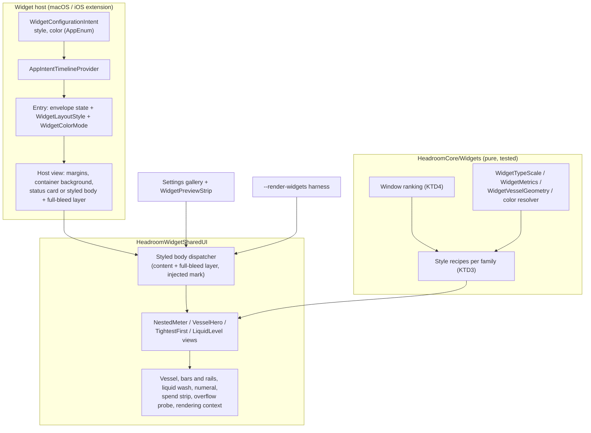
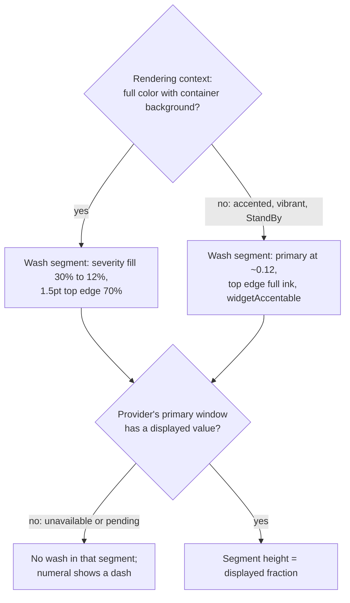

# Widget Styles - Plan

## Goal Capsule

- **Objective:** A Headroom user can pick, for each widget on their Mac or iPhone, one of four widget styles that read their remaining usage at a glance with the same clarity as the popover. Widgets they already placed keep working after the update.
- **Means:** One App Intent widget configuration per host with Style and Color parameters (KTD1). The parameters drive four shared SwiftUI style bodies built on pure Core recipes (KTD3, KTD4).
- **Authority:** Product Contract R-IDs win on behavior. KTDs win on mechanism within those R-IDs. `design/widget-styles-round2.html` is the visual reference (its `<script>` render functions and token-sourced CSS). Where it and an R-ID disagree, the R-ID wins. AGENTS.md and DESIGN.md rules apply throughout.
- **Stop conditions:**
  - Stop after the upgrade spike (U10) and report to Kyle if placed widgets do not render after the in-place update. Kyle decides between the release-notes fallback (a recorded R8 exception) and blocking the release.
  - Stop if any change needs a widget envelope schema bump.
  - Stop if the iOS targets still fail to build after U1 for a reason outside this plan.
- **Execution profile:**
  - Core recipes test-first under `swift test`.
  - Shared views are checked by the widget render harness as they land (U3 minimal command, U8 full sweep), in both appearances and at the 6.1″ geometry.
  - iOS compile gates after U1, U10, U5 and U6.
  - The upgrade spike (U10) is checked on device by Kyle before the style work proceeds.
  - Final Edit Widget, tinted and StandBy checks are on device (U9).
- **Tail ownership:** Kyle owns the on-device checks (U10, U9). The implementer owns review (`ce-code-review` on the merged tree), commit and PR.

---

## Product Contract

### Summary

Replace today's widget layout with four styles: **Nested Meter**, **Vessel Hero**, **Tightest First**, and **Liquid Level**. Each comes in small, medium and large, on macOS and iPhone. Users pick a style and a color mode for each widget through Edit Widget. New and already-placed widgets start on Nested Meter with Always colored. Settings → Widgets & iPhone shows a gallery of the four styles, like the meter-style tile. The iOS targets are fixed first so the iPhone widgets compile.

### Problem Frame

Kyle judged the shipped widgets as falling below the popover's standard. They are a generic progress-bar list with no single at-a-glance answer, wasted space on large, and nothing that reads as Headroom. Two rounds of options docs (`design/widget-redesign-directions.html`, then `design/widget-styles-round2.html`) settled on four styles. Kyle expects these to work like other Headroom style choices: several options a user picks between. Separately, the iOS app and widget targets have not compiled on `main` since 2026-09-23 (BUGS.md), so no iPhone change can be verified until that is fixed.

### Requirements

**Styles**

- R1. Each of the four styles renders at systemSmall, systemMedium and systemLarge on both hosts, following `design/widget-styles-round2.html`.
- R2. Every style supports Claude, Codex, Grok and Cursor, and one or two widget providers (`WidgetSnapshotEnvelope.widgetProviders`). A provider's primary window is its weekly window, else its tightest billing pool. Single-window providers (Grok, Codex weekly-only) and Cursor's two sibling pools each have a defined rendering.
- R3. Tightest First ranks windows by displayed value, lowest first, including model rows (Fable) and Spark counters. Stale windows rank by their value alongside live ones, and only unavailable windows go last. Small and medium headline each shown provider's lowest window. Large headlines the lowest window across all shown providers and lists the rest in order.
- R4. Vessel Hero's vessel keeps the menu-bar vessel's 11:18 proportion, is as tall as the numeral's digit ink, and sits on the numeral's baseline. The caption hangs under the numeral.
- R5. Numerals render in the system font at semibold with monospaced digits, no kerning, and the "%" at full size.
- R6. Small Vessel Hero and small Liquid Level show one provider: the first widget provider, unless it has no displayed value yet and the second one does.

**Configuration**

- R7. Edit Widget offers **Style** (Nested Meter, Vessel Hero, Tightest First, Liquid Level; default Nested Meter) and **Color** (Always colored, Only when low; default Always colored).
- R8. Widgets placed before the update keep rendering after it, show Nested Meter with Always colored, and gain Edit Widget.
- R9. Today's widget layout is removed. No "Classic" style remains.

**Preserved behavior**

- R10. Nothing overlaps or clips (WCF7). Each style drops whole elements in a fixed order before truncating text. Numerals, bars, vessels and marks never shrink.
- R11. Stale, unavailable, pending, critical and reset-now windows keep their shipped meaning in every style (WCM2–WCM5, WCD3, WCW1, WCW8 in `docs/plans/2026-09-11-001-feat-widget-craft-plan.md`). An unavailable window never looks like 0%.
- R12. Every style stays legible in accented (tinted/clear), vibrant, and stripped-background (StandBy) rendering.
- R13. Status cards (setup needed, disabled, pending, incompatible schema, iPhone sync states) look the same in every style.
- R14. The API spend strip and the "Updated N ago" / "From Mac · N ago" footer appear on large only.
- R15. VoiceOver reads one element per provider with its windows in visual order, and Tightest First large reads one element per row.

**Settings**

- R16. Settings → Widgets & iPhone shows four style thumbnails. Choosing one switches the inert small, medium and large preview, and copy says each widget's style is chosen with Edit Widget.

**Platform**

- R17. The HeadroomIOS and HeadroomIOSWidgets schemes build, so iPhone widget changes are compile-verified.

### Key Decisions

- **Style is chosen per widget through Edit Widget.** Governs R7, R16. (session-settled: user-directed — chosen over one Style picker in Headroom Settings, or both: each widget can differ and the shared widget data does not change)
- **Nested Meter is the default for new and already-placed widgets.** Governs R7, R8. (session-settled: user-directed — chosen over Vessel Hero, Tightest First or Liquid Level as default: it shows every window, so nobody loses information on update)
- **Today's layout is retired.** Governs R9. (session-settled: user-directed — chosen over keeping it as a fifth "Classic" style: less to maintain)
- **Color is a second Edit Widget option, defaulting to Always colored.** Governs R7. (session-settled: user-directed — chosen over green-only or neutral-only healthy color: the widget cannot read the popover's meter setting)
- **Placed widgets convert in place.** Governs R8. (session-settled: user-directed — chosen over leaving old widgets static and adding a second configurable widget: placed widgets gain Edit Widget; the upgrade is checked before the style work)
- **Spend strip and footer on large only.** Governs R14. (session-settled: user-directed — chosen over medium showing them when they fit: matches the approved mocks)
- **Tightest First may headline a model limit.** Governs R3. (session-settled: user-directed — chosen over headlining only 5-hour, weekly and plan pools: matches the mock)
- **Tightest First ranks stale windows by value.** Governs R3. (session-settled: user-approved — chosen over ranking live windows first: the real tightest limit shows, dimmed, instead of hiding while Claude's model row is stale)
- **The Settings preview becomes a style gallery like the meter-style tile.** Governs R16. (session-settled: user-directed — chosen over previewing the default style only)
- **Fix the iOS build in this work, first.** Governs R17. (session-settled: user-approved — chosen over a separate session: it gates iPhone verification and touches the same project file)

### Scope Boundaries

- No widget envelope change (schema stays 3). No usage history.
- No Headroom Settings control that sets a widget's style or color.
- The popover's `MeterStyle` stays independent of widget color mode.
- No interactive widgets (no `Button(intent:)`).
- The iOS companion app's own screens are unchanged.
- Status cards keep today's `HeadroomVesselMark` drawing.

### Deferred to Follow-Up Work

Record each in BUGS.md:

- Dimming numbers when the envelope's `generatedAt` is old (the Mac asleep). This is new behavior for every style, with no existing threshold.
- Per-widget provider choice (small Vessel Hero / Liquid Level showing a chosen provider).
- Previewing Color mode in the Settings gallery.
- Moving the status card's `HeadroomVesselMark` to the new vessel geometry, which would fix its outer-height fill deviation.

---

## Planning Contract

### Key Technical Decisions

- KTD1. **One configurable widget per host, same kind string.**
  - Both hosts move from `StaticConfiguration` + `TimelineProvider` to `AppIntentConfiguration` + `AppIntentTimelineProvider`, with a `WidgetConfigurationIntent` carrying `style` and `color` parameters.
  - Keep `"HeadroomUsageWidget"` (macOS) and `HeadroomIOSWidgetConfiguration.kind` (iOS). Keep `.contentMarginsDisabled()` and iOS `.disfavoredLocations`. Return no `recommendations()`.
  - Implements R7 and R8 (Key Decisions: placed widgets convert in place).
  - **Conflict call-out:** Apple documents no supported Static → App Intent path. Developers report placed iOS widgets freezing on the placeholder until a reboot (Apple forums 661247, 788784).
  - **Gate:** the spike (U10) proves the conversion on the real update path before the style work builds on it. A failure is reported to Kyle under the stop conditions.
- KTD2. **Style and color live in Core as plain enums; the App Intent types live only in the extensions.**
  - `WidgetLayoutStyle` and `WidgetColorMode` are `String`-backed and Foundation-only, in `Sources/HeadroomCore/Widgets/`. `swift test` covers them, and the iOS targets pick them up automatically.
  - The `AppEnum`s and the intent sit in one file compiled into both extensions, never into Core or the Mac app (App Intents in packages has static-linking caveats, WWDC25 244).
  - Under Swift 6, declare intent and enum metadata with `static let` or computed properties, never `static var`.
  - An unknown or missing parameter value resolves to the default. Ad-hoc-signed builds can deliver `nil` enum parameters (linkd rejects them), and an unknown raw value must not blank a widget.
- KTD3. **Each style's decisions are a pure Core recipe.**
  - For each style and family, a recipe takes the envelope, the color mode and `now`. It returns what to draw: the hero window, the rows in order, fill fractions, nested vs sibling-pool structure, wash segments, captions, and the drop order.
  - This follows `MeterRecipe`. Views only lay out recipe output.
  - It puts R2, R3, R6, R10, R11 and R14 under unit tests and stops the four bodies drifting apart.
- KTD4. **One window ranking for every style.**
  - Rank by `displayPercentRemaining`, lowest first. Stale and live windows rank together by value.
  - Unavailable windows (no displayed value) rank last and never headline while another window has a value. Ties keep source order.
  - The primary window applies the same unavailable filter before taking weekly, else the tightest pool. Today's `primarySubscriptionWindow` compares raw `percentRemaining` and can pick an unavailable pool.
  - Implements R2, R3 and R11.
- KTD5. **Color mode replaces WCM1's fixed neutral rule.**
  - `.solid` (Always colored) paints a healthy live window with `healthyFill`. A stale-healthy window takes the popover's `HeadroomMeterColorValues.staleFill(for: UsageSeverity.healthy, …)`, the 35%-chroma green. The `WidgetUsageSeverity` overload maps healthy to `staleNeutralFill`, so it must not be used here.
  - `.event` (Only when low) keeps WCM1: `neutralFill`, and `staleNeutralFill` when stale.
  - Low and critical are identical in both modes.
  - One fill resolver in the shared color helpers serves bars, rails, vessels and the liquid wash.
  - Implements R7 and R11.
- KTD6. **A parameterized widget vessel, with geometry in Core.**
  - `WidgetVesselGeometry` holds the 11:18 ratio, promoted from `VesselGlyph.menuBarSize` (DESIGN.md rule 2).
  - Stroke: about 11% of width, clamped 1.5–2.1pt.
  - Inner inset: stroke + max(0.6, 5.5% of width).
  - Liquid height: inner height × fill, floored at half the inner width.
  - The wall turns critical only when the window is live and critical.
  - A window with no displayed value draws an empty outline with no liquid.
  - In non-full-color rendering, the liquid is the accentable part and the wall stays at secondary ink.
  - Implements R4 and R11.
- KTD7. **Vessel height from CoreText digit ink.**
  - Add a digit-ink measurement next to the existing cached metrics in `HeadroomWidgetTypography.swift`: ascent above the baseline plus overshoot below, for the numeral's font, weight and monospaced-digit feature.
  - The vessel sits in a first-text-baseline row, with its bottom guide offset by the overshoot.
  - Widgets render in one pass, so measure in `body` from the font, never with preference-key round trips.
  - Implements R4.
- KTD8. **Hero numerals are fixed size; labels keep Dynamic Type.**
  - Hero sizes (about 30–50pt) become `WidgetTypeScale` tokens that do not scale.
  - Captions, labels and countdowns keep `@ScaledMetric` with the xxLarge cap (WCF1).
  - Scaling a 42pt hero at xxLarge overflows "100%" and drags the vessel height with it.
  - Implements R5 and R10.
- KTD9. **Styles that paint behind the margins expose a full-bleed background layer.**
  - Widget hosts pad content by the system margins (`HeadroomWidgetView`, `HeadroomIOSWidgetView`). The styled body therefore returns content plus an optional full-bleed layer, which is drawn under the padded content inside the clipped tile.
  - Every caller draws that layer: both widget hosts, the Settings preview strip, the gallery thumbnails and the render harness.
  - Liquid Level emits one wash segment per shown provider. Each segment takes its provider's primary window, the providers split the width equally, and a centre divider appears when two providers show.
  - Rendering rules are read from the rendering context (KTD14):
    - **Full color with the container background shown:** the wash runs from the fill at 30% to 12% alpha, with a 1.5pt top edge at 70%.
    - **Accented, vibrant, or no container background:** `.primary` at about 0.12 opacity, with a 1.5pt top edge at full ink marked `.widgetAccentable()`.
  - Never draw an opaque full-bleed fill. Accented mode turns it into a white slab (WWDC25 278).
  - Implements R12.
- KTD10. **Fit by `ViewThatFits` rungs.**
  - Nested Meter, Vessel Hero and Liquid Level degrade in one shared order:
    1. Plan capsule.
    2. Countdowns on secondary rows.
    3. Spark rows, then model rows.
    4. Spend strip, then footer (large only, R14).
    5. Then truncate flexible text.
  - Tightest First drops list rows from the loosest end of its ranking instead of by kind, so the tightest limits always survive.
  - The hero numeral, the primary meter or level, and marks never drop.
  - The recipe names the rungs. The view supplies the `ViewThatFits` ladder.
  - Implements R10.
- KTD11. **Fix the iOS build by moving `SetupWaitingPhase` out of `ProviderSetup.swift`** into a macOS-only Core file next to `SetupSessionCoordinator`. Adding the coordinator to the iOS targets would cascade into `AccountKey`, `ProviderCapabilityState` and provider code. Implements R17.
- KTD12. **A durable widget render harness in the app.**
  - Add a `--render-widgets <dir>` mode to `PopoverRenderHarness` that renders the real shared bodies with `ImageRenderer`. The `.context` harness from the 2026-09-10 round no longer exists, and its copied views went stale.
  - A minimal render path lands with U3. The full sweep comes in U8 and covers:
    - style × family × fixture × appearance × geometry (macOS and 6.1″)
    - both color modes
    - the accented and stripped-background branches, through the KTD14 override
    - a shrunken-tile pass that stands in for xxLarge labels
    - a contact sheet
  - Style views mark their elements with a shared overflow probe that is inert outside the harness. The sweep flags any probed frame outside the content box.
  - `ImageRenderer` ignores `.dynamicTypeSize` and uses macOS type metrics, so the shrunken-tile pass is layout evidence only. U9 is the gate for iPhone xxLarge.
- KTD13. **The Settings gallery mirrors the meter-style tile.**
  - Reuse `ThemeThumbnailPicker`'s pieces: its `LazyVGrid`, `SettingsSwatchButtonStyle`, `.selectionChrome`, `.settingsSelectionGroup`, and an `accessibilityRepresentation` Picker. The `LazyVGrid` is load-bearing: an `HStack` of fixed thumbnails crashed AppKit layout.
  - Thumbnails carry visible style-name labels.
  - The selection lives in `SettingsView`, per AGENTS.md (panes are stateless). It is passed to the Widgets pane as a binding and defaults to Nested Meter.
  - A `--widget-style <id>` seam seeds the selection through an `AppComposition.demoWidgetStyle(arguments:)` parser that mirrors `demoMeterStyle(arguments:)`.
  - Every in-app render (preview strip, thumbnails, harness) passes `ProviderLogoView` as the mark, because the Mac app has no brand-icon asset catalog.
  - Implements R16.
- KTD14. **A shared rendering context the harness can override.**
  - The shared primitives read one `HeadroomWidget…` rendering-context environment value: full color, accented, or stripped background. It defaults from WidgetKit's `widgetRenderingMode` and `showsWidgetContainerBackground`.
  - The harness overrides it. The WidgetKit keys are read-only outside a widget, so `ImageRenderer` would otherwise only ever produce full color.
  - Implements R12 verification.

### Alternatives Considered

- **Four static widget kinds, one per style.** Every style shows in the gallery, with no intent machinery. Rejected: changing style means removing and re-adding a widget, and placed widgets cannot reach the other styles.
- **Style in the envelope, set in Headroom Settings.** One switch for all widgets. Rejected by Kyle (Key Decisions). It also needs a schema bump and iCloud sync.

### High-Level Technical Design

### Assumptions

- Small Vessel Hero and small Liquid Level showing one provider (R6) follows the approved mocks. Kyle saw them without this trade-off called out.
- `DisplayRepresentation` icons in the Edit Widget picker are optional polish. Ship titles only if icons do not render on iOS 26 or macOS.
- The Settings gallery previews with Always colored only.
- Edit Widget copy:
  - **Style** options: "Nested Meter", "Vessel Hero", "Tightest First", "Liquid Level".
  - **Color** options: "Always colored" and "Only when low". The Color parameter's description reads "Only when low keeps healthy meters neutral until a limit runs low."

### Risks & Dependencies

| Risk | Mitigation |
|---|---|
| Placed widgets freeze or blank after the Static → App Intent change (KTD1) | The U10 spike tests it on the real update path before the style work. Failure is reported to Kyle (stop conditions). |
| Ad-hoc-signed builds deliver `nil` enum parameters | KTD2 default fallback. Device checks use properly signed builds. |
| Liquid wash, rails and vessels in accented, vibrant and StandBy are reasoned, not measured | KTD9 and KTD14, harness override renders, device look in U9. Extend the existing BUGS.md "reasoned, not measured" note. |
| The never-compiled 2026-09-28 `HeadroomTheme` edit fails once U1 lets iOS compile | Fix it in U1 if it is a compile error. Report anything larger. |
| Hero sizes overflow at 6.1″ with xxLarge labels | KTD8 fixed heroes, KTD10 rungs, the U8 shrunken-tile pass, the U9 device check. |
| Parallel streams leave seam bugs (craft round 2026-09-11) | Fix the Core and view API in U2 and U3 first. Run `ce-code-review` on the merged tree before the PR. |
| No previous iPhone build exists to upgrade from, since iOS has not compiled since 2026-09-23 | U10 builds the pre-change commit with U1's fix for the "before" install. |

### Sources & Research

- Current architecture:
  - `Sources/HeadroomWidgetSharedUI/HeadroomWidgetSharedUI.swift` holds the reusable `HeadroomWidgetUsageBar` (with the tinted rules), `HeadroomWidgetAPISpendStrip`, the `HeadroomWidgetStyle` color helpers (that name is taken), and the `HeadroomWidgetUsageMeter` accessibility builder.
  - `HeadroomWidgetFamilyViews.swift` and `HeadroomLargeWidgetView.swift` are retired.
  - Also relevant: `HeadroomWidgetStatusViews.swift` and `HeadroomWidgetTypography.swift`.
- Target wiring:
  - `project.yml` iOS targets take `Sources/HeadroomCore/Widgets` whole and `Models/*` file by file. iOS files import Core conditionally with `#if canImport(HeadroomCore)`.
  - `Package.swift` has no iOS target, so `swift build` never compiles iOS code.
  - `Headroom.xcodeproj` is regenerated by `Scripts/build-app.sh` (xcodegen) and committed.
- Build traps:
  - `WidgetKit.WidgetFamily` collides with Core's `WidgetFamily`; use `HeadroomWidgetFamily`.
  - The shared UI compiles into the Mac app module, so shared names stay `HeadroomWidget`-prefixed.
- Prior decisions:
  - `docs/plans/2026-09-11-001-feat-widget-craft-plan.md` (WC anchors).
  - `docs/plans/2026-08-02-001-feat-widget-two-provider-cap-cleanup-plan.md`.
  - `docs/plans/2026-07-03-001-feat-macos-widgets-plan.md` (its KTD4 anticipated an intent configuration).
- WidgetKit:
  - WWDC23 10103: new parameters take their default.
  - WWDC25 278: accented rendering.
  - Apple forums 661247 and 788784: Static → Intent migration reports.
  - kado PR 96: linkd and unsigned builds.

### Retired anchors

These craft-plan decisions are removed on purpose with the old layout, along with the tests that pin them:

- WCL1: large density tiers, `LargeWidgetDensity`. The large bar height moves to `WidgetMetrics`.
- WCL4: medium gutter and centre rule.
- WCL5: small rhythm.
- WCL9: medium countdown switch.
- WCW7: small "Weekly left" header and `smallHeaderTitle`.
- WCW9: plan capsule on large only. The capsule now follows each style and KTD10.
- WCM1: the fixed neutral healthy fill. It survives as the `.event` color mode (KTD5).

---

## Implementation Units

### U1. Make the iOS targets compile

- **Goal:** HeadroomIOS and HeadroomIOSWidgets build for the iOS Simulator.
- **Requirements:** R17. KTD11.
- **Dependencies:** none.
- **Files:**
  - `Sources/HeadroomCore/Models/ProviderSetup.swift`
  - new `Sources/HeadroomCore/Engine/SetupWaitingPhase.swift`
  - `BUGS.md`
  - `Sources/HeadroomIOS/DesignSystem/`, only if the 2026-09-28 `HeadroomTheme` edit fails to compile.
- **Approach:**
  1. Move `SetupWaitingPhase` and its private helper out of `ProviderSetup.swift` into a Core Engine file. Keep `SetupWaitingPrompt`, `SetupWaitingToken` and `SetupWaitingCopy` in place.
  2. Build both iOS schemes and fix any newly exposed compile errors that are mechanical.
  3. Close the BUGS.md entry.
- **Patterns to follow:** Engine files beside `SetupSessionCoordinator.swift`.
- **Test scenarios:**
  - Existing `SetupWaitingPhase` tests in `Tests/HeadroomCoreTests` pass unchanged after the move.
- **Verification:** both iOS schemes build for `generic/platform=iOS Simulator`. `swift build` and `swift test` stay green.

### U10. Upgrade spike: convert both hosts with today's layout

- **Goal:** Prove that already-placed widgets survive the Static → App Intent conversion on a real update before the style work builds on it.
- **Requirements:** R7, R8. KTD1, KTD2.
- **Dependencies:** U1.
- **Files:**
  - Create `Sources/HeadroomWidgets/HeadroomWidgetConfigurationIntent.swift` (the intent and its `AppEnum`s, also compiled into the iOS extension).
  - Create `Sources/HeadroomCore/Widgets/WidgetLayoutStyle.swift`, holding the style and color-mode enums from U2.
  - Modify on macOS: `Sources/HeadroomWidgets/HeadroomWidgets.swift`, `HeadroomTimelineProvider.swift`, `HeadroomWidgetEntry.swift`.
  - Modify on iOS: `Sources/HeadroomIOSWidgets/HeadroomIOSWidgets.swift`, `HeadroomIOSTimelineProvider.swift`, `HeadroomIOSWidgetEntry.swift`.
  - Modify `project.yml` (an explicit `Sources/HeadroomWidgets/HeadroomWidgetConfigurationIntent.swift` source entry on HeadroomIOSWidgets) and the regenerated `Headroom.xcodeproj`.
  - Add `Tests/HeadroomCoreTests/WidgetLayoutStyleTests.swift`.
  - Create `docs/qa/2026-10-03-widget-config-upgrade-spike.md` (Kyle's checklist).
- **Approach:**
  1. Add the Core enums (U2's enum work lands here).
  2. Swap both configurations per KTD1. The intent file wraps its Core import in `#if canImport(HeadroomCore)`.
  3. Make the providers `AppIntentTimelineProvider`s that carry style and color on the entry. Today's layout still renders and ignores both.
  4. Write Kyle's checklist. Do not publish anything:
     - **macOS:** install the current public release, place a widget at each size, then replace the app with a Developer ID–signed build of the spike.
     - **iPhone:** install the pre-change commit (with U1's fix) on a device through Xcode, place widgets, then install the spike over it.
     - **Both:** confirm placed widgets render with no reboot and that Edit Widget shows Style and Color.
  5. Pause for Kyle's result before U5.
- **Execution note:** Spike-first. Nothing beyond the configuration swap and the enums lands in this unit.
- **Test scenarios:**
  - An unknown raw style string maps to Nested Meter.
  - An unknown color string maps to Always colored.
  - Style and color round-trip through their raw values.
- **Verification:** `swift build`, both iOS schemes build, and Kyle's checklist result is recorded in the QA doc.

### U2. Core ranking, recipes and tokens

- **Goal:** Pure, tested decisions for every style and family.
- **Requirements:** R2, R3, R6, R10, R11, R14. KTD3, KTD4, KTD5, KTD6, KTD8, KTD10.
- **Dependencies:** U10 (enums).
- **Files:**
  - Create in `Sources/HeadroomCore/Widgets/`: `WidgetWindowRanking.swift`, `WidgetStyleRecipes.swift` (or one file per style), `WidgetVesselGeometry.swift`.
  - Modify: `WidgetTypeScale.swift` (hero tokens), `WidgetMetrics.swift` (rail, wash, large bar height and gallery tokens), `Sources/HeadroomCore/Models/BrandColorValues.swift` (color-mode fill resolver values), `WidgetSnapshotModels.swift` (display-aware primary window), and `DemoScreenshotData.swift` (new fixtures).
  - Tests in `Tests/HeadroomCoreTests/`: `WidgetWindowRankingTests.swift`, `WidgetStyleRecipeTests.swift`, `WidgetVesselGeometryTests.swift`, and updates to `BrandColorValuesTests.swift` and `WidgetSnapshotProjectorTests.swift` (`weeklyProviders` and `periodNoun` follow the rebased primary window).
- **Approach:**
  1. Add the ranking (KTD4). Then rebase `primarySubscriptionWindow` on it without changing the envelope.
  2. Add one recipe per style. Each family's output names:
     - the hero window(s) and their captions
     - the ordered rows
     - nested vs sibling-pool structure
     - Liquid Level wash segments (KTD9)
     - fill fractions and inks via the KTD5 resolver
     - the KTD10 rungs
     - whether spend and footer show (large only)
  3. Encode the per-style differences:
     - Tightest First's headline scope per family (R3).
     - Small Vessel Hero and small Liquid Level choose their one provider (R6).
     - Grok's single pool and Cursor's sibling pools follow the design doc's adaptations.
  4. Add fixtures. Each sets `widgetProviderSelection` and varied reset times:
     - Grok + Cursor
     - Codex + Cursor
     - Claude + Grok
     - a tight Claude + Cursor
     - Spark on
     - stale and unavailable rows
     - pending provider
     - first provider pending
- **Execution note:** Implement the ranking and recipes test-first.
- **Patterns to follow:** `MeterRecipe` and `MeterGeometry` in `Sources/HeadroomCore/Models/MeterStyle.swift`, `WidgetStatusCopy`, and the `HeadroomWidgetColorValues` token style with `dark:` pairs.
- **Test scenarios:**
  - Ranking puts a stale 5% window before a live 40% one, and an unavailable window after both.
  - Ranking keeps source order on equal values.
  - Primary window for Cursor with pools at 37% and 69% is the 37% pool. With the 37% pool unavailable, it is the 69% pool.
  - Primary window for Grok's single weekly pool is that pool. For Claude it is Weekly even when 5-hour is lower.
  - Tightest First small and medium headline each provider's own lowest window. Large headlines the lowest across both, and a stale Fable at 5% headlines over a live Weekly at 40%.
  - Tightest First large lists every window ascending, Spark included when present. Its drop rung removes the loosest rows first.
  - Nested Meter reports Cursor's pools as equal-weight siblings. For Claude it reports Weekly as the parent, with 5-hour and Fable as rails.
  - Liquid Level medium and large emit one wash segment per shown provider, with a divider only for two providers.
  - Small Vessel Hero and small Liquid Level output one provider for a two-provider envelope. They output the second provider when the first has no displayed value and the second does. Other small styles output both.
  - Medium recipes never include spend or footer. Large recipes include them when spend exists.
  - A provider whose only window is unavailable yields a dash, no fill, and no countdown (R11).
  - A pending provider yields the waiting caption and no meter values.
  - A reset-now window keeps its fill, and its numeral takes the secondary-ink flag (WCD3).
  - The color resolver gives a live healthy window `healthyFill` in solid mode and `neutralFill` in event mode.
  - The color resolver gives a stale-healthy window the popover's green-tinted stale fill in solid mode and `staleNeutralFill` in event mode, and the two differ.
  - Low and critical fills are the same in both color modes.
  - Vessel geometry at width 13.5 gives a stroke within 1.5–2.1pt.
  - The vessel has no liquid at 0 fill or with no displayed value, and its wall turns critical only when the window is live and critical.
- **Verification:** `swift test` green with the new suites. No SwiftUI import in Core.

### U3. Shared primitives and the minimal render path

- **Goal:** Reusable views the four styles need, plus a render command so each style can be checked as it is built.
- **Requirements:** R4, R5, R11, R12, R15. KTD5, KTD6, KTD7, KTD9, KTD12, KTD14.
- **Dependencies:** U2.
- **Files:**
  - Modify in `Sources/HeadroomWidgetSharedUI/`: `HeadroomWidgetTypography.swift` (digit-ink metric), `HeadroomWidgetSharedUI.swift` (color-mode fill resolver, rail variant of the usage bar, numeral view, extracted per-window accessibility builder, large bar height read from `WidgetMetrics`).
  - Create in `Sources/HeadroomWidgetSharedUI/`: `HeadroomWidgetVessel.swift`, `HeadroomWidgetLiquidWash.swift`, `HeadroomWidgetRenderingContext.swift` (the environment value from KTD14 and the overflow-probe modifier).
  - Modify `Sources/HeadroomApp/PopoverRenderHarness.swift` (minimal `--render-widgets`).
- **Approach:**
  1. Build the vessel per KTD6 and KTD7.
  2. Extend the usage bar to take color mode and a rail weight. It reads the rendering context instead of the WidgetKit keys.
  3. Build the liquid wash per KTD9.
  4. Numerals use `.system(size, weight: .semibold).monospacedDigit()` with no kerning, the "%" in the same run, `.widgetAccentable()` and `.contentTransition(.numericText())`.
  5. Extract `HeadroomWidgetUsageMeter`'s accessibility label and value into a shared per-window builder.
  6. Add the overflow probe. It is inert unless a harness environment flag is set.
  7. Add a minimal `--render-widgets <dir>`: one style, one family, both appearances.
  8. Give every new shared type a `HeadroomWidget…` prefix, because the Mac app compiles this module.
- **Patterns to follow:** `HeadroomWidgetUsageBar` tinted handling, the `HeadroomWidgetFontMetrics` cache, `VesselGlyph.render` clip-then-fill, and the `--meter-style` handling in the harness.
- **Test scenarios:**
  - Harness arguments for `--render-widgets` parse. A missing directory reports usage.
  - Geometry and color decisions are covered in U2.
  - Render checks with the minimal command:
    - The vessel's top and bottom match the digit ink within 0.5pt at 30, 36 and 42pt.
    - A window with no displayed value draws an empty outline.
    - The wash draws in both rendering branches.
- **Verification:** `swift build` green, and the minimal render shows the vessel aligned to the digits.

### U4. The four style bodies

- **Goal:** Nested Meter, Vessel Hero, Tightest First and Liquid Level at three families, rendering U2 recipes with U3 primitives.
- **Requirements:** R1–R6, R10, R11, R14, R15. KTD3, KTD8, KTD9, KTD10.
- **Dependencies:** U2, U3.
- **Files:** in `Sources/HeadroomWidgetSharedUI/`, create:
  - `HeadroomWidgetStyledBody.swift`: a dispatcher, generic over an injected mark, that returns content plus an optional full-bleed layer.
  - `HeadroomWidgetNestedMeter.swift`
  - `HeadroomWidgetVesselHero.swift`
  - `HeadroomWidgetTightestFirst.swift`
  - `HeadroomWidgetLiquidLevel.swift`
- **Approach:**
  1. The dispatcher and each style view are generic over a `mark` closure, as today's family views are. The widget extension uses `HeadroomWidgetProviderIcon` through a convenience init.
  2. One file per style, with small, medium and large views. Layout follows `design/widget-styles-round2.html`, with tokens from U2.
  3. Fit with `ViewThatFits` rungs from the recipe (KTD10):
     - Every text that could wrap gets `lineLimit(1)` and tail truncation.
     - No `minimumScaleFactor`.
     - Every numeral, meter or rail, row, strip and footer carries the overflow probe.
  4. Accessibility per R15:
     - Hide the vessel, wash and rails.
     - Build values from the shared per-window builder.
  5. The dispatcher takes style, family, envelope, color mode, footer prefix, mark and `now`. Status states stay in the host.
  6. The four style files can run as separate streams once U2 and U3 have landed. Check each with the minimal render command as it lands.
- **Patterns to follow:**
  - the retired `HeadroomLargeWidgetView` shed-rows `ViewThatFits`
  - the `HeadroomWidgetUsageMeter` numeral column
  - `HeadroomWidgetAPISpendStrip`
  - today's `mark:` generic on the family views
- **Test scenarios:**
  - Layout decisions are unit-tested in U2.
  - The U8 sweep proves rendering: no probed frame exceeds its tile's content box across every fixture, style, family, both geometries and both appearances.
- **Verification:** each style renders through the minimal command as it lands. The U8 sweep reports zero overflow, and contact sheets match the design doc.

### U5. Wire the styles into the hosts

- **Goal:** Both widget extensions render the styled body chosen in Edit Widget.
- **Requirements:** R7, R12, R13. KTD1, KTD9, KTD14.
- **Dependencies:** U10 (passed), U4.
- **Files:**
  - macOS: `Sources/HeadroomWidgets/Views/HeadroomWidgetView.swift`.
  - iOS: `Sources/HeadroomIOSWidgets/Views/HeadroomIOSWidgetView.swift`.
  - Both: `Sources/HeadroomWidgets/HeadroomWidgetConfigurationIntent.swift` (final copy and picker order).
- **Approach:**
  1. In each host view, replace the family switch with the dispatcher.
  2. Draw the full-bleed layer in the existing ZStack under the padded content.
  3. Seed the rendering context from WidgetKit.
  4. Keep the status-card branch, `widgetURL` and the iOS DEMO capsule. Reserve the capsule's corner when the entry is `.demo`.
  5. Apply the Edit Widget copy from Assumptions. The picker order is Nested Meter, Vessel Hero, Tightest First, Liquid Level.
- **Patterns to follow:** the existing host ZStack and status-card branch.
- **Test scenarios:**
  - Mapping from the intent to Core is covered by U10's unknown-value tests.
  - Host behavior is proven by both extensions building and by U9 on device.
- **Verification:** `swift build`, the documented `xcodebuild … HeadroomAppTests` run, and both iOS schemes build.

### U7. Settings style gallery

- **Goal:** Settings → Widgets & iPhone shows four style thumbnails that switch the preview.
- **Requirements:** R16. KTD9, KTD13.
- **Dependencies:** U4.
- **Files:**
  - Modify `Sources/HeadroomApp/UI/WidgetPreviewStrip.swift`, `Sources/HeadroomApp/UI/SettingsPanes.swift`, `Sources/HeadroomApp/UI/SettingsView.swift`, the `AppComposition` demo-argument parsers, and `Sources/HeadroomApp/PopoverRenderHarness.swift` (the `--widget-style` seam).
  - Create `Sources/HeadroomApp/UI/WidgetStyleGalleryPicker.swift`.
  - Add tests in `Tests/HeadroomAppTests/` beside the `--meter-style` tests.
- **Approach:**
  1. Thumbnails render each style's real small body at swatch scale, with a style-name label.
  2. The preview strip renders the selected style's three families from the frozen settings fixture.
  3. Each tile draws the full-bleed layer inside its clip and passes `ProviderLogoView` as the mark.
  4. The strip stays inert, and dimmed when widgets are off.
  5. Copy reads "Choose a style for each widget with Edit Widget."
- **Patterns to follow:** `ThemeThumbnailPicker`, `MeterStyleTile.swatchBody`, the `AppearanceSpecimen` crossfade, `SettingsSwatchButtonStyle`, and `demoMeterStyle(arguments:)`.
- **Test scenarios:**
  - `--widget-style tightestFirst` parses and selects that style.
  - An unknown id falls back to Nested Meter.
  - The gallery's default selection is Nested Meter.
- **Verification:** `--render-popover <dir> --widgets-only --widget-style <id>` renders each style in both appearances (a sanity check only, per AGENTS.md).

### U6. Retire the old layout

- **Goal:** Remove today's family views and their tokens and tests.
- **Requirements:** R9. Retired anchors.
- **Dependencies:** U5, U7.
- **Files:**
  - Delete:
    - `Sources/HeadroomWidgetSharedUI/HeadroomWidgetFamilyViews.swift`. Move `HeadroomWidgetFooterStamp` and `HeadroomWidgetCopy` out first to keep them.
    - `HeadroomLargeWidgetView.swift`
    - `Sources/HeadroomCore/Widgets/LargeWidgetDensity.swift`
    - `Tests/HeadroomCoreTests/LargeWidgetDensityTests.swift`
  - Modify:
    - `Sources/HeadroomWidgetSharedUI/HeadroomWidgetSharedUI.swift` (no `LargeWidgetDensity` references)
    - `WidgetMetrics.swift` and `WidgetTypeScale.swift`
    - `WidgetSnapshotModels.swift` (`smallHeaderTitle`)
    - Tests: `Tests/HeadroomCoreTests/WidgetMetricsTests.swift`, `WidgetTypeScaleTests.swift`, `WidgetWindowLabelTests.swift`, `DemoScreenshotDataVariantsTests.swift`
    - `Sources/HeadroomWidgets/Views/HeadroomWidgetPreviews.swift`
    - `BUGS.md`: update the "interactive AppIntent" line and add the deferred entries from Scope Boundaries.
- **Approach:** Delete only what no style uses. Keep the margin, axis, spend and numeral-column tokens that the styles reuse.
- **Test scenarios:**
  - The remaining widget suites pass with the retired tiers and ladders removed.
  - The token tests the styles depend on still pin their values.
- **Verification:** `swift test` green. No references to the deleted types remain. Both iOS schemes build.

### U8. Full render sweep

- **Goal:** Headless renders of every style for review, and an automated overflow sweep.
- **Requirements:** verifies R1, R4, R10, R12. KTD12, KTD14.
- **Dependencies:** U4, U3 (minimal command), and the U2 fixtures.
- **Files:** `Sources/HeadroomApp/PopoverRenderHarness.swift`, plus harness argument tests in `Tests/HeadroomAppTests/`.
- **Approach:**
  1. Extend `--render-widgets` to the full matrix: style × family × fixture × appearance × geometry (macOS and 6.1″) × color mode.
  2. Add the accented and stripped-background renders through the rendering-context override.
  3. Add a shrunken-tile pass that reduces each tile's content box by the xxLarge-to-default label ratio.
  4. Every harness tile draws the full-bleed layer and passes `ProviderLogoView`.
  5. Write a contact-sheet HTML, and flag any probed frame outside its content box.
- **Patterns to follow:** the existing `renderSettings` and `--meter-style` handling in `PopoverRenderHarness.swift`.
- **Test scenarios:**
  - Harness arguments parse.
  - An unknown fixture name errors and lists the valid fixtures.
- **Verification:** the sweep reports zero overflow, and the contact sheet is reviewed against `design/widget-styles-round2.html`.

### U9. Documentation and acceptance

- **Goal:** Docs describe the styles, and the final on-device checks cover what headless renders cannot.
- **Requirements:** R7, R12. KTD1.
- **Dependencies:** U5–U8.
- **Files:**
  - `AGENTS.md`: widget styles, the intent configuration, the harness.
  - `DESIGN.md`: new tokens and components.
  - `docs/solutions/`: a learning on the outcome of the Static → App Intent conversion, drawn from U10.
  - new `docs/qa/2026-10-xx-widget-styles-acceptance.md`.
- **Approach:** a checklist for Kyle, on a signed build:
  - Switch each style and color mode in Edit Widget, on Mac and iPhone.
  - Check tinted/clear rendering (iOS 26, Tahoe desktop) and StandBy.
  - Check xxLarge text on a 6.1″ iPhone.
- **Test expectation:** none -- documentation and manual acceptance.
- **Verification:** Kyle completes the checklist. Failures route back to KTD9 or KTD10.

---

## Verification Contract

| Gate | Command or evidence | When |
|---|---|---|
| Core and package build | `swift build` | every unit |
| Unit tests | `swift test` (Swift Testing count, not "Executed 0 tests") | U1, U10, U2, U6 |
| macOS app tests | `./Scripts/build-app.sh --deps-only && xcodebuild -project Headroom.xcodeproj -scheme HeadroomAppTests -destination 'platform=macOS' -derivedDataPath ./.xcode-derived test` | U3, U5, U7, U8 |
| iOS compile | `xcodebuild -project Headroom.xcodeproj -scheme HeadroomIOS -destination 'generic/platform=iOS Simulator' build`, and the same for `HeadroomIOSWidgets`, after regenerating the project | U1, U10, U5, U6 |
| Upgrade spike | Kyle's U10 checklist result recorded in `docs/qa/` | after U10, before U5 |
| Render checks | `swift run Headroom --render-widgets <dir>`: minimal during U3/U4, full sweep with zero overflow in U8 | U3, U4, U8 |
| Settings sanity | `swift run Headroom --render-popover <dir> --widgets-only --widget-style <id>` | U7 |
| Code review | `ce-code-review` on the merged tree before the PR | before PR |
| Device acceptance | U9 checklist on a signed build (Kyle) | before release |

## Definition of Done

- All R-IDs are met. Each traces to a passing test, a harness render, or a device checklist.
- Both iOS schemes build. `swift test` and the HeadroomAppTests run are green.
- The render sweep shows zero overflow for every style, family, fixture and geometry, in both appearances and both color modes.
- The old layout's types, tokens and tests are gone. No dead or experimental code from abandoned attempts remains in the diff.
- AGENTS.md, DESIGN.md and BUGS.md reflect the new styles, configuration and deferred items.
- `ce-code-review` findings are resolved or recorded.
- The U10 result is recorded, and the U9 checklist is handed to Kyle with the PR.
