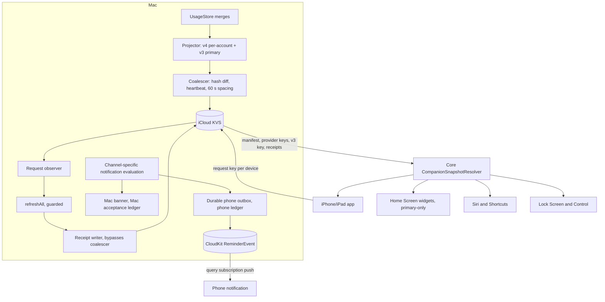
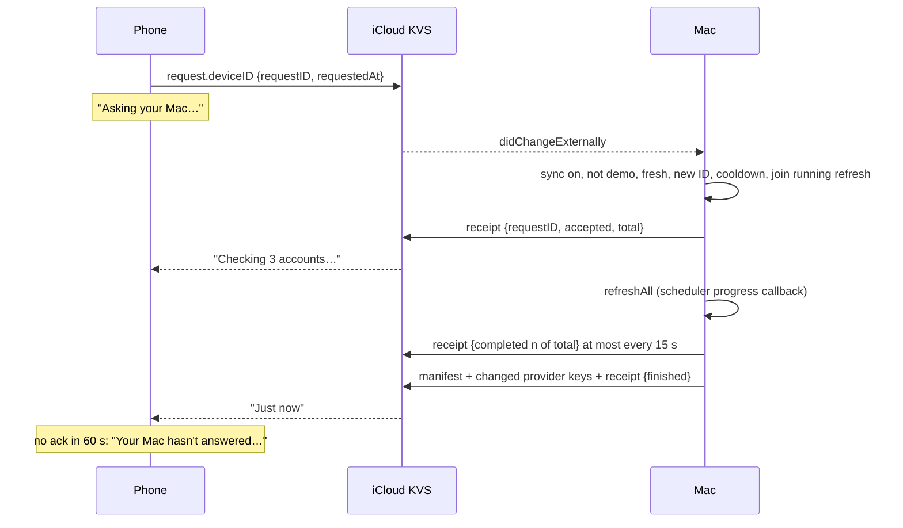
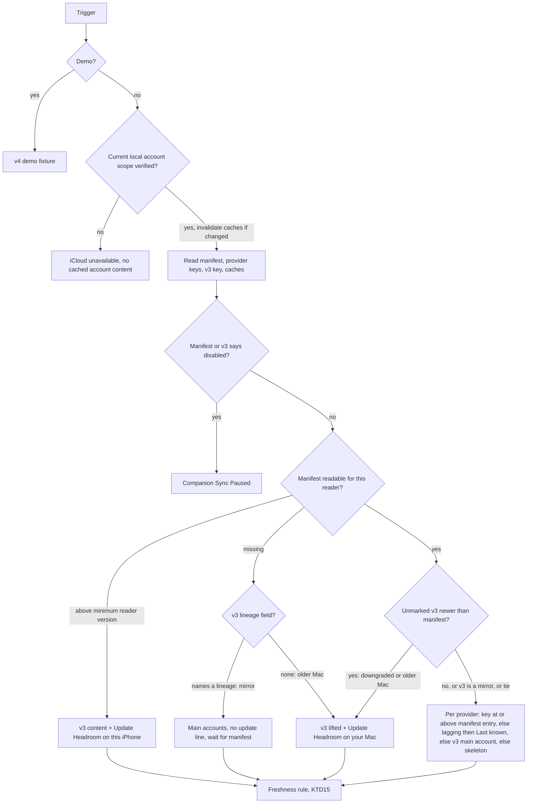
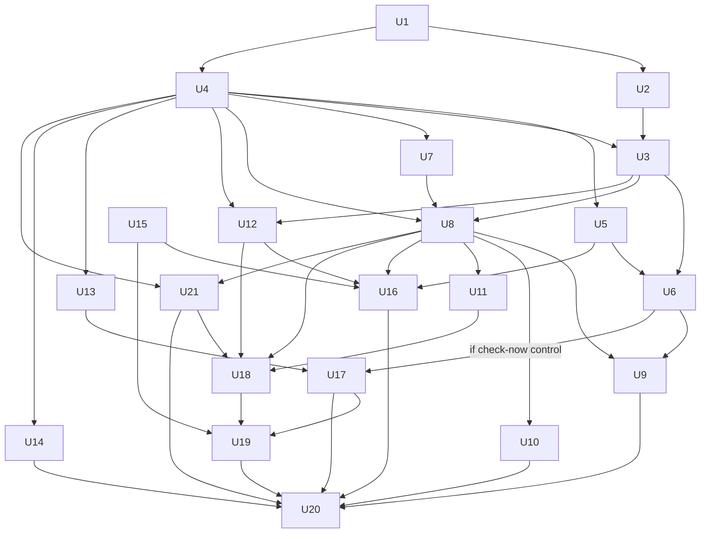

# iPhone and iPad Parity Round - Plan

## Goal Capsule

- **Objective:** A Headroom user with a current Mac opens the iPhone or iPad app and sees every account's real usage in the same look as the Mac popover, with honest freshness. Home Screen and Lock Screen widgets, Control Center and Siri show the main account (Siri also names any tighter account) with the same freshness rules. The App Store page shows that product clearly. Mac and iPhone ship together as version 1.5.
- **Means:** One shared cross-platform UI module carries the popover's components to both apps (KTD1, KTD2). A new sync data version carries every account and the Mac's display choices (KTD5–KTD9). The phone screens are rebuilt from the shared components (KTD3). New phone surfaces (check now, Siri, reminders, Lock Screen, Control Center) read one Core resolver (KTD6).
- **Authority:**
  - Product Contract R-IDs win on behavior. KTDs win on mechanism within their cited R-IDs.
  - Visual reference: `design/ios-parity-options.html` (Kyle's approved options, answers in `docs/plans/2026-10-04-ios-parity-research/kyle-answers.md`). App Store copy reference: `design/appstore-copy-options.html` once Kyle answers it.
  - Research dossiers with file:line evidence: `docs/plans/2026-10-04-ios-parity-research/` (`inventory.md` IDs P/M/S/N/D/B/G/W, `spec-flow.md` gaps C/I/M and scenarios V1–V40, `apple-docs.md`, `repo-patterns.md`, `learnings.md`, `appstore.md`, `appstore-copy.md`).
  - AGENTS.md, DESIGN.md, and the OAuth hard constraint apply throughout. Nothing on the phone talks to a provider.
- **Stop conditions:**
  - Stop U4's loader adoption and report if its signed app/extension account-identity gate fails under the actual KVS entitlements (KTD22). Cached account data must never be served without a verified current account scope.
  - Stop U16 and ship reminders as Mac-only (R29) if the CloudKit spike (U15) fails pass/fail check 1, 2 or 3. Report to Kyle; do not build a local-reminder fallback.
  - Stop U9's check-now path and ship pull-to-re-read for 1.5 if the U6 spike shows the menu bar Mac does not receive phone-written request changes while running in the background, or request-to-acknowledgement p95 exceeds 60 seconds with the multi-20 fixture publishing. Report to Kyle.
  - Stop and report if a change would make the v3 key emit anything a build-33 decoder rejects (KTD5).
  - Stop and report if the 20-accounts-per-provider fixture with Spark rows needs the account-cap step of the drop ladder (KTD7); at or below the envelope every account must reach the phone (R2).
  - Lock Screen widgets and the Control Center control are in 1.5 (R27). If their design from the separate session is not ready when the other units finish, the release waits for it; report to Kyle rather than dropping them.
  - Stop the release if Kyle's on-device widget upgrade check fails; Kyle chooses between release notes and blocking.
- **Execution profile:**
  - Core contracts (wire format, resolver, freshness, attention mapping, check-now state machine) test-first under `swift test`.
  - Every unit ends with an iOS simulator build of `HeadroomIOS` (app plus widget extension) as well as `swift build`.
  - Phone layout is checked with headless `xcrun simctl` captures at default and xxLarge text, never with `ImageRenderer`.
  - Mac popover is re-accepted live after U2/U3 (ask Kyle first, one short batched run).
  - Sync, check-now and reminders need a two-device check on a signed Mac build and a physical iPhone (Kyle).
- **Tail ownership:** Kyle owns the prerequisites P1–P7 (portal, agreements, device checks, App Store Connect, website PR). The implementer owns code, tests, the merged-tree `ce-code-review` pass, commits and the PR.

---

## Product Contract

### Summary

Rebuild the iPhone and iPad app from the Mac popover's components so the phone shows every account, the Mac's meter styles, red critical numbers, short countdowns, spend rows and banked resets. Add a new sync data version that carries all accounts and the Mac's display choices, plus a pull-to-refresh that asks the Mac to check now. Give the phone honest freshness (dimming when the Mac goes quiet), a native Settings sheet with the Mac's Appearance choices and a widgets gallery, a full iPad layout, read-only Siri answers, and reminder pushes from the Mac through iCloud. Lock Screen widgets and a Control Center control ship in the same release, to the design from Kyle's separate session. The App Store page gets the Graphite screenshot set and rewritten copy. Mac and iPhone ship together as 1.5.

### Problem Frame

The phone app is still the July 2026 design. It shows only each provider's main account, draws full-width colored bars, lists Weekly before 5-hour, says "Resets in 2d 23h", keeps a "Low" chip the Mac dropped, tints controls system blue, and leaves three quarters of an iPad empty. The Mac popover moved on in September and October: meter styles, stacked accounts, red critical numerals, typed status lines, spend rows and the Codex banked-reset capsule.

The public App Store build (1.0, build 24) is worse than out of date. It requires sync schema 1 and a `resetsAt` field, and every Mac since 1.1.2 (Jul 28) publishes schema 2 or 3 without it. Every App Store phone paired with a current Mac shows "Snapshot Unreadable" or "Update Needed" (verified in git, `BUGS.md`). The listing ("Headroom Mobile") has two plain screenshots, an iPad shot that is mostly empty and also shows on the Mac App Store, and copy that covers only Claude and Codex. Four other AI-usage apps now use the name "Headroom".

Kyle's direction: bring everything over from the Mac that the phone can do, make the App Store page much better, and ship it all as one 1.5 release that is built carefully and tested.

### Requirements

**Phone usage screen**

- R1. Provider cards on the phone are drawn from the Mac popover's components: identity rows, meter rows in the user's meter style, spend rows and the plan capsule.
- R2. Every account the Mac tracks appears on the phone, stacked inside its provider card in the Mac's order, main account first.
- R3. Rows read 5-hour first, then weekly or billing pools, then model rows, with bare countdowns ("3d 23h") and a red numeral when a limit is critical. There is no "Low" chip.
- R4. Account problems read as typed lines that say what to do on the Mac, in neutral ink. The app uses no amber for account state and no system blue anywhere.
- R5. The Codex plan capsule shows banked resets. It opens on tap, and on its own while a live 5-hour or weekly limit is critical.
- R6. Cards use the popover's proportions one step larger and follow Dynamic Type.
- R7. Opening the app plays a short card entrance; meters then land with the Mac's landing sequence. Numerals show their real value from the first frame.
- R8. Pending providers show skeletons. A Mac that tracks nothing shows a plain line, not a blank screen.

**Freshness**

- R9. "Updated" names the time of the oldest live reading on screen, not the time the Mac last published.
- R10. When the Mac has been quiet longer than its own cadence allows, the app, widgets, Siri, Lock Screen and Control Center dim and say "No update from your Mac since <time>". Surfaces too small for the sentence (circular and inline accessory widgets, the control) show the dimmed treatment plus the bare time; the rectangular accessory widget shows the full sentence.
- R11. When a reset passes with no newer reading, the old number is hidden and the row says when it reset and that it is waiting for the Mac.

**Sync and accounts**

- R12. The Mac publishes a new sync data version that carries every account, display choices, typed attention, banked resets and its refresh cadence, within iCloud key-value limits at the tested envelope of 20 accounts per provider.
- R13. The Mac keeps publishing today's primary-only format alongside the new version.
- R14. A 1.5 phone paired with an older Mac shows the main accounts and says what updating the Mac adds.
- R15. Account titles on the phone are the names the user chose on the Mac, made unique without emails. No email, credential or config path ever syncs.
- R16. Turning off "Sync usage to iPhone" removes synced account data from iCloud.
- R17. Mac changes that affect the phone (account added, renamed, removed or made main; display choices; widget providers; refresh interval) reach the phone without waiting for the next main-account refresh.

**Check now**

- R18. Pulling to refresh asks the Mac to check now and shows the Mac's per-account progress. If the Mac does not answer, the phone says so and keeps the last numbers.
- R19. Check-now requests never start a second full Mac refresh while one is running or inside the cooldown, and never act in demo mode or while sync is off.

**Settings**

- R20. The phone has one Settings sheet with Appearance, Widgets, iPhone sync, Reminders, Demo and About sections.
- R21. Appearance offers the theme, a "Match my Mac" switch for meter style, percentages and account-name ink with phone overrides drawn by the real meter on a live specimen, and a Codex Spark rows switch.
- R22. A read-only widgets gallery shows the four widget styles and how to choose one in Edit Widget.
- R23. About shows maker links and a one-line "Get Headroom for Mac" row. There is no tip jar on the phone.

**iPad**

- R24. iPad shows provider cards in flowing columns that fill the width and adapt to window size.

**Widgets and system surfaces**

- R25. Home Screen widgets keep following the main account and gain the freshness rules of R10 and R11.
- R26. Siri and Shortcuts answer "How much <provider> is left?" from the last sync. They are read-only.
- R27. Lock Screen widgets and a Control Center control ship in 1.5, following the main account and the freshness rules, to the design from Kyle's separate session.

**Reminders**

- R28. When the Mac's "Also send to iPhone and iPad" switch is on, the Mac's use-it-up reminders and banked-reset notices arrive on the phone as notifications through the user's own iCloud.
- R29. If the CloudKit spike fails, reminders stay Mac-only and the phone's Reminders section says so.

**Demo and review**

- R30. Every new phone surface works in Explore Demo with bundled sample data. Demo never writes iCloud on either device.

**App Store and release**

- R31. App Store screenshots follow the Graphite direction with the rewritten copy, for iPhone 6.9″ and iPad 13″.
- R32. The listing uses the name "Headroom by Kyle Zantos" and the rewritten subtitle, description, promotional text, keywords and What's New, and claims only what the shipped build does.
- R33. The iOS app is no longer offered on Macs through the App Store.
- R34. Mac and iPhone ship together as version 1.5.
- R35. The privacy policy, the Mac's sync footnote, phone Settings and App Review notes describe exactly what syncs.

**Mac fixes found in this round**

- R36. A widget-provider change on the Mac reaches iPhone widgets immediately.
- R37. A Mac `--demo` run never writes the user's iCloud store.
- R38. The screenshot script never quits the installed Headroom.

### Key Decisions

- **Popover proportions, one step up.** (session-settled: user-directed — chosen over popover metrics 1:1 and a phone hero layout: the phone is read in the hand, and one Dynamic Type unit keeps the Mac's ratios.) Governs R6.
- **Meter style matches the Mac by default, with a phone override.** (session-settled: user-directed — chosen over a phone-only picker and always-follow-Mac: one product look, but a device choice stays possible.) Governs R21.
- **Accounts stacked inside one provider card.** (session-settled: user-directed — chosen over one card per account and main-plus-disclosure: matches the popover.) Governs R2.
- **A new sync data version, with today's format kept alongside.** (session-settled: user-directed — chosen over optional fields that old phones ignore: a clean contract for the new data. Kyle confirmed keeping the old key and the size safeguards.) Governs R12, R13, R14.
- **Pull to refresh asks the Mac to check now.** (session-settled: user-directed — chosen over re-reading the last sync.) Governs R18, R19.
- **Codex banked resets use the Mac's plan capsule.** (session-settled: user-directed — chosen over a quiet label or leaving it on the Mac.) Governs R5.
- **Short entrance on app open plus the Mac's landing.** (session-settled: user-directed — chosen over the Mac's no-entrance model: an app launch is rarer than a popover open.) Governs R7.
- **iPad flowing columns.** (session-settled: user-directed — chosen over a sidebar split and a single centered column.) Governs R24.
- **Neutral tint like the popover.** (session-settled: user-directed — chosen over the Vessel mint accent.) Governs R4.
- **One Settings sheet on a native list, with every Appearance row, a widgets gallery and no tip jar.** (session-settled: user-directed — chosen over pushed sub-pages, StoreKit tips and a US-only Stripe link.) Governs R20, R21, R22, R23.
- **Reminders as real pushes through CloudKit, gated on a spike.** (session-settled: user-directed — chosen over no phone reminders and best-effort local scheduling; Kyle approved the spike-first, Mac-only-on-failure rule.) Governs R28, R29.
- **Siri and Shortcuts, read-only.** (session-settled: user-approved — Kyle approved Siri; the read-only scope was proposed and accepted.) Governs R26.
- **Lock Screen widgets and Control Center ship in 1.5.** (session-settled: user-directed — in the 2026-10-04 planning chat, after the options doc left them without a verdict, Kyle chose to fold the designs from his separate session into 1.5, over shipping 1.5 without them.) Governs R27.
- **One 1.5 release for Mac and iPhone, everything in it.** (session-settled: user-directed — chosen over an interim 1.5 fix release with the redesign as 1.6, and over a Mac-only schema-1 stopgap that would have revived public 1.0 phones, with the public breakage in view: the iPhone app has few users, so "build this right and test it".) Governs R34.
- **Graphite screenshots, the name "Headroom by Kyle Zantos", Mac availability off, no preview video, custom product page later.** (session-settled: user-directed — chosen over the panorama, widget-first and generated-imagery directions and the other names; copy rewrite with anti-AI passes requested.) Governs R31, R32, R33.

### Scope Boundaries

- Home Screen widgets stay main-account only and keep the schema-3 envelope shape, plus the resolver's freshness inputs.
- Widgets always show "left", even when the app shows "used".
- One Mac per Apple ID. A second Mac is not supported; the manifest names its source so the phone never mixes two Macs (KTD12).
- The phone never signs in, adds accounts, edits API keys, changes the refresh interval or edits reminder rules. Those stay on the Mac.

#### Not possible on the phone, and why

| Mac feature | Why not on the phone |
|---|---|
| Menu bar pills and slosh | No menu bar on iOS |
| Sign-in and CLI handoffs, Make Main, add/remove accounts | Credentials and the official CLIs live on the Mac (OAuth hard constraint) |
| API keys, polling interval, launch at login, Sparkle updates, Quit | Mac-side settings |
| "Same login as X" badge | Settings-only on the Mac; needs email matching that must not sync |
| Hover reveals (spend top-up, capsule hover) | No hover on iPhone; tap replaces it where it matters |
| Lock Screen accessory widgets on Mac | Accessory families do not exist on macOS |

#### Deferred to Follow-Up Work

- Per-device reminder targeting beyond each device's own notification permission.
- Siri and Shortcuts on the Mac (Mac has live data; parity candidate). Recorded, not built.
- A Mac Control Center control, unless the separate Lock Screen/Control design includes one.
- StandBy look check, Live Activities, Apple Watch.
- A custom App Store product page for website visitors (A8).
- Retiring the v3 key (needs the retirement marker in KTD5) in a later release.
- An App Preview video.

### Success Criteria

- With a 1.5 Mac and a 1.5 iPhone on one Apple ID, every account on the Mac appears on the phone within one Mac publish, in the same meter style, and the numbers match the popover.
- With the Mac asleep, every phone surface dims within its threshold and never shows a number past its reset as current.
- At 20 accounts per provider, the sync stays under its KVS budget with no quota violation.
- A reviewer with no Mac can reach every new surface through Explore Demo.
- The first three App Store frames read clearly at search-result size, and no listing sentence matches a competitor phrase in `docs/plans/2026-10-04-ios-parity-research/appstore-copy.md`.

### Acceptance Examples

- AE1. Covers R14. Given a 1.4.1 Mac and a 1.5 phone, when the phone loads, then it shows each provider's main account, offers pull-to-re-read only, and shows "Update Headroom on your Mac to see every account".
- AE2. Covers R18, R19. Given the Mac asleep, when the user pulls to refresh, then after 60 seconds the phone says "Your Mac hasn't answered. It may be asleep, or Headroom isn't open." and keeps the last numbers. When the Mac wakes within 10 minutes, it runs one refresh and the phone finishes.
- AE3. Covers R19. Given five pulls in ten seconds, then the Mac runs exactly one refresh.
- AE4. Covers R16. Given sync is turned off on the Mac, then no per-provider key remains in iCloud and the phone shows "Companion Sync Paused".
- AE5. Covers R10. Given a 5-minute interval and the Mac asleep for 30 minutes, then the app and Siri say "No update from your Mac since <time>"; widgets, Lock Screen and Control dim once they pass their own 60-minute floor (KTD15). Given a 60-minute interval and a stretched Claude lane, then nothing dims. Given a healthy 5-minute Mac and a 60-minute widget reload gap, no widget entry dims.
- AE6. Covers R11. Given a weekly limit that reset at 2:00 pm while the Mac slept, at 2:11 pm the row hides its number and says "Reset at 2:00 pm · waiting for your Mac".
- AE7. Covers R15. Given two Mac accounts named "Work", the phone shows "Work" and "Work · 2", and Make Main does not swap the suffixes.
- AE8. Covers R30. Given Explore Demo, when the user pulls to refresh, then nothing is written to iCloud and the receipt line plays from bundled data.

### Open Questions

Deferred (non-blocking; defaults applied in KTDs, Kyle may redirect):

- Siri's answer shape: main account's tightest window plus weekly if different, plus any tighter account (KTD18).
- One "Match my Mac" switch covering style, percentages and ink, rather than three (KTD11).
- "Also send to iPhone and iPad" Mac switch defaults off; per-device choice is the device's own notification permission (KTD19).
- App Store copy choices from `design/appstore-copy-options.html` (eyebrow style, keyword set, Fable mention, trademark line). U18 and U19 consume the answers.

### Sources

- Research dossiers: `docs/plans/2026-10-04-ios-parity-research/` (cited by file and ID throughout).
- Prior plans this round amends: `docs/plans/2026-09-19-2217-feat-per-account-polling-schedule-plan.md` (KTD9, R19, AE7: extras' merges do not export), `docs/plans/2026-09-26-1111-feat-notifications-pane-plan.md` (no phone notifications), `docs/plans/2026-07-20-001-fix-provider-setup-multi-account-release-stabilization-plan.md` (phone stays primary-only), `docs/plans/2026-10-02-1247-feat-widget-styles-plan.md` (envelope schema stays 3 for widgets; still true).
- Release docs: `docs/release/ios-app-review-testflight.md` (step 10 must be rewritten), `docs/release/appstore-listing.md`, `docs/release/privacy-policy.md`, `docs/release/release-operations.md`.

---

## Planning Contract

### Key Technical Decisions

**Shared UI and build**

- KTD1. **One shared cross-platform UI module, `Sources/HeadroomSharedUI`.** Compiled into the Mac app, the iOS app, and both widget extensions where used, and declared as an SPM target in `Package.swift`. First residents: `MeterGauge`, `ProviderStyle`, `IdentityCapsule.swift` (carrying `IdentityRowMetrics`, `IdentityCapsuleStyle` and the capsule and metadata-label modifiers that `PlanCapsule` needs), `PlanCapsule`, `StatusSentence` styling, `SkeletonMeter` (from `ProviderCardView.swift`), `DotMatrixSpinner` (keep its MIT header) and the AppKit-free half of `HeadroomMotion` (`isKeyboardInitiated` stays Mac-only). Mac originals are deleted, not duplicated. Mechanics (architecture review A19):
  - The SPM module exposes `public` API, including the `accountTitleInk` environment value and other members that are internal today.
  - Every Mac consumer adds `#if SWIFT_PACKAGE import HeadroomSharedUI #endif`.
  - The `HeadroomSharedUI` SPM target depends on `HeadroomWidgetSharedUI` (U3 uses its typography), and every Xcode target that compiles `HeadroomSharedUI` also compiles `HeadroomWidgetSharedUI`.
  - `swift build` (separate modules) catches visibility leaks and xcodebuild (one module) catches name collisions, so every stream-A unit runs both.
  - The shared identity row is generic over its mark view, like `HeadroomWidgetIdentityRow<Mark>`; each app passes its own `ProviderLogoView`, and both logo views stay where they are. `AccountSectionView`, `presentedSetupOutcome` and `neverSignedInOutcome` stay in the Mac app.
  - `HeadroomTheme` keeps only phone layout (background, tile); its color and motion functions retire in U8, once nothing calls them.
- KTD2. **Port the popover row, not the phone row.** `UsageBarView` and the identity row become platform-neutral by swapping `NSFont` measurement and `OpticalLeading` for the CoreText helpers in `HeadroomWidgetTypography.swift`. A Core adapter `UsageWindow(widgetSummary:)` lets the row render synced rows unchanged (inventory D12). It lives in an iOS-included file, not `WidgetSnapshotProjector.swift`, which the iOS targets exclude.
- KTD3. **Phone scale is one Dynamic Type unit over the popover ramp.** (Implements Key Decision "Popover proportions, one step up"; governs R6.) A single `@ScaledMetric(relativeTo: .body)` factor, 1.15 at the default size, multiplies the popover's type and spacing. The phone keeps its opaque Core-tokened tile (r17) rather than the Mac's `RaisedTile`. The spend identity row needs about 344pt at 1.15× against about 323pt on a 393pt phone (learnings §4, computed), so spend rows get a fit rule: the period chip drops to a subline before the title truncates, measured with `ViewThatFits`. Never `minimumScaleFactor`.
- KTD4. **Whole-folder Core membership in both iOS targets.** Replace the nine hand-picked `Sources/HeadroomCore/Models/*.swift` paths in `project.yml` with the `Models`, `Notifications`, `Settings` (minus `LaunchAtLogin.swift`), `Sync` and `Widgets` (minus `WidgetSnapshotProjector.swift`) folders. First move `CLIExecutableDiscoveryIssue` from `Providers/CLIExecutableLocator.swift` into `Models/`: it is the only reference from those five folders into `Engine`, `Providers` or `Credentials` (verified by an iOS typecheck). Rule from here on: a file in those five folders references only types from the same five folders; Mac-only logic lives in `Engine/` or the Mac app. The hand-picked list broke the iOS build three times (`BUGS.md`). An iOS simulator build joins the pre-PR check. Toolchain is Xcode 27.0 / Swift 6.4 / iOS 27 SDK; the iOS deployment target stays 26.0 and any iOS 27 API needs an availability check.

**Sync contract**

- KTD5. **v4 lives under new keys; v3 keeps publishing.** (session-settled: user-directed — chosen over optional fields old phones ignore: a clean contract for multi-account data; implements the Key Decision "A new sync data version"; governs R12, R13.)
  - v4 uses a `headroom.sync.v4.` key namespace: one manifest key, one key per provider, one receipt key and one request key per phone.
  - The existing `headroom.syncedWidgetSnapshot` key keeps a primary-only schema-3 payload. A 1.5 Mac writes v3 and v4 in the same publish with one shared `generatedAt` and adds two fields to the v3 wrapper, `companionSourceID` and `companionGeneration`; older decoders ignore unknown keys. The Mac ID never goes into v3's existing `sourceID`, which build 33 displays as "<sourceID> on Mac".
  - Rationale correction: the public 1.0 phones cannot read v3 either. The old key protects build-33 TestFlight testers and is the source of the phone's old-format cache; it does not rescue App Store 1.0 users, who need 1.5. A Mac-side schema-1 payload that would revive them was considered and declined (Key Decision "One 1.5 release").
  - The v3 projection must never emit a value a build-33 decoder rejects. A golden-JSON test against a frozen copy of the build-33 decoder proves it, including the lineage field.
  - A later release retires v3 by writing a higher inner schema to the old key, so old readers show "Update Needed" instead of freezing.
- KTD6. **One Core resolver for every phone surface.** `CompanionSnapshotResolver` reads the manifest, provider keys, v3 key and the App Group cache, and returns one resolved companion snapshot. The app, the iOS widget extension, Siri, Lock Screen and Control all call it. Rules (spec-flow C1/F1, data-integrity DI-1–DI-4, DI-9):
  1. **Field contract.** U4 opens with one table of every key and field, its type, its unknown-value fallback and the KTD that reads it. Streams code only against this table. Minimum contents:
     - **Keys**, each at most 64 UTF-8 bytes: `headroom.sync.v4.manifest`, `headroom.sync.v4.provider.<providerID>`, `headroom.sync.v4.request.<deviceUUID>`, `headroom.sync.v4.receipt`.
     - **Manifest:** `schemaVersion` and `minimumReaderVersion` (decoded header-first, the `SyncedWidgetSnapshotHeader` pattern), source ID, generation, `generatedAt`, Mac app version, status, provider order, per-provider `{payloadGeneration, digest, effectiveIntervalSeconds}`, `chosenIntervalSeconds`, the display block (KTD11), widget provider selection, the Mac's widget Spark switch, the reminder summary (Mac switch, phone channel, rule summary; KTD19), recent answered request IDs (KTD14) and the drop-ladder level (KTD7).
     - **Provider key:** source ID, `payloadGeneration`, provider-level capability attention, the main account with full windows, extra accounts with slim windows, `omittedAccountCount`, Spark rows flagged, banked resets per account, and that provider's API spend. A provider key exists while either the provider's subscription or its API-spend switch is on; a subscription-off key is marked spend-only and carries no accounts, and the manifest carries the spend order. The only digest is the manifest's per-provider entry (rule 2). Renewal dates are dropped (cut from the UI in July 2026); the Mac also emits nil renewal dates in v3.
     - **Receipt and request:** per KTD14.
     - **Seam:** the KVS store seam gains remove, key enumeration (for launch scans and prefix deletes), changed keys with change reason, and a quota signal.
  2. **Deterministic bytes and digests.** v4 encodes with sorted keys, integer epoch seconds and percentages rounded to one decimal place. One pure Core display normalization clamps remaining usage to 0–100 and rounds to one decimal with an explicit nearest-or-away-from-zero tie rule; display severity derives from that normalized value. The live Mac meter row, the capsule's critical auto-open decision, and both v3/v4 projectors consume the same normalization; the phone applies it idempotently to resolved windows. Provider observations retain their source precision; normalization belongs to presentation. Parity tests compare the actual Mac row and capsule decisions with the phone, including values that round across 15% and 50%. The manifest's per-provider digest is SHA-256 of the exact bytes stored in that key, computed on the Mac at write and on the phone over the raw bytes it reads, never over a re-encoded payload (unknown future fields would change it). Never Swift `Hasher`. The digest covers the full payload including reading times, so a fresh reading with unchanged numbers still updates "Updated".
  3. **Self-describing provider keys.** Each provider key carries its source ID, its provider generation and its body. All account-level data (account list, order, main account, titles, attention, banked resets) lives only in the provider key, so a provider is always internally consistent. The manifest's per-provider entry records the `payloadGeneration` in which that key was last written, so an unchanged key stays valid across later manifests. The phone uses the key when its source matches and its `payloadGeneration` is at or above the manifest's entry for that provider; on equality the digest must match. A key below the manifest's entry is still shown, and after max(2 minutes, one heartbeat) of lag its rows get the per-row "Last known" treatment. A provider with no usable key shows that Mac's v3 main account if present, otherwise a skeleton that becomes "Waiting for your Mac" at the dimming threshold.
  4. **Lineage.** The source ID is a random UUID made once per Mac install, stored in Mac preferences, never a host, serial or user name. The generation is a persisted counter that only increases within one source ID. Data is ordered by generation within a lineage and by `generatedAt` across lineages. A manifest from a new lineage makes the phone drop cached copies from other lineages and show the waiting state until its providers arrive (KTD12, account switches).
  5. **v3 versus v4.** The resolver checks the manifest's status before anything else: a disabled tombstone means paused, never "old Mac". A v3 payload that names the current manifest's lineage is a mirror and never wins while that manifest is readable; ties go to v4; a mirror ahead of the manifest is a sign that a newer manifest is coming, unless it is newer by more than the dimming threshold (the v4 channel is stuck), in which case the phone shows it without the "update your Mac" line and records a diagnostic. A v3 payload with no lineage field (1.4.1 or a downgraded Mac) wins when it is newer than the manifest; only then does the phone show "Update Headroom on your Mac to see every account" (R14). An incompatible or future v3 never hides a readable v4, so retiring v3 later never strands 1.5 phones.
  6. **Versions.** Readers accept any v4 payload whose `minimumReaderVersion` they meet and ignore unknown fields. Only a breaking change raises the minimum. A payload above the reader's minimum falls back to v3 content plus "Update Headroom on this iPhone"; an unreadable v4 never hides a readable v3.
  7. **Lifts.** With only v3, the resolver lifts it into the v4 model with one account per provider and no display block. Slim account windows lift losslessly to `WidgetWindowSummary` (labels derived from `kind`), so U3's one adapter renders every row.
  8. **Caches.** The v4 cache is a separate App Group file storing checked provider payloads keyed by (source ID, provider, generation), the latest manifest and first-seen times, never a finished screen state. Every process uses the same `NSFileCoordinator` transaction anchor in the App Group: coordinated access encloses the complete account-scope check, cache re-read, lineage/generation comparison, merge and atomic replacement. Reads, first-seen creation, both cache writes and invalidation use that same anchor; an in-process actor and atomic replacement alone do not serialize processes. A writer revalidates its captured account scope inside the transaction and cannot restore content after an account change or overwrite a higher generation from the same lineage. First-seen times are created once inside the transaction and shared by every process. Before reading KVS or serving either cache, `CompanionSnapshotLoader` checks an injected, locally validated iCloud-account scope independently of the Mac source ID (KTD22); a changed or unavailable scope blocks old cached content even when the new account has no manifest. Local scope metadata lives in a separate sidecar so `widget-snapshot.json` keeps build-33-compatible bytes taken only from the v3 key, never a projection built from v4.
- KTD7. **Compact payload, enforced budget.** (Keeps Kyle's size safeguards; DI-5.) v4 wire types are compact by design: short coding keys, integer epoch seconds, no derivable fields (window ID, severity), live freshness omitted, one capture time per account with per-window overrides only for retained rows, and account windows without `label`, `resetLabel` or `resetTimeZoneIdentifier`. The main account is not repeated inside `accounts`. Budget: each provider key at most 15 KB and the v4 set at most 64 KB at 20 accounts per provider with Spark rows on. The Mac measures each encoded key before every write and applies the drop ladder whenever a key or the set would exceed budget: first drop extra accounts' model rows, then, only above the 20-account envelope, cap extra accounts per provider with "N more on your Mac". At or below the envelope the compact encoding plus the model-row drop must fit (stop condition). The phone shows the ladder plainly: a neutral "N more on your Mac" line at the end of a capped account stack, and "Model rows are on your Mac" under extra accounts at ladder level 1. The ladder level is recomputed from current content on every publish, so it steps back up when accounts are removed, and it travels in the payload so the phone shows the cap. The quota-violation notification stays as a diagnostic that forces one extra step only if it fires while under budget.
- KTD8. **One serial, coalesced publisher.** (Amends polling plan KTD9/R19/AE7; data-integrity DI-6–DI-8, architecture A6, A7, A21.)
  - A publish is one store-wide flush that writes the changed provider keys, the manifest and the v3 key together, sharing one `generatedAt`. Flushes run at most once per 60 seconds. Merges in between only mark state dirty; extra accounts' merges now count, on the phone path only, and never reload Mac WidgetKit timelines.
  - A heartbeat flush runs once per chosen interval when nothing is dirty, rewriting the manifest and the v3 mirror together under one new `generatedAt`.
  - Forced immediate flushes: check-now finish, sync off, and a change in status, account set, main account, titles, display block, effective interval or widget selection.
  - Receipts are the only writes outside flushes, at most every 15 seconds while a check runs.
  - The generation is assigned on the main actor when state is captured. One serial publisher actor encodes and writes in generation order, drops superseded work, and never writes a lower generation after a higher one.
  - Change detection uses a fingerprint that ignores timestamps, separate from the integrity digest. At each coalesced flush, compare every included account/window observation time (and the provider's spend capture time) with that same observation's last published value. Rewrite the provider key when any observation has advanced by at least one chosen interval, including during a heartbeat flush. A retained stale account or model row never prevents other observations from publishing, and its original timestamp stays intact. This bounds "Updated" lag to one interval plus the flush spacing while retaining the store-wide write cadence.
  - The coalescer compares against what iCloud currently holds for each key, not only its own memory. It writes every key on the first publish after launch, after sync turns on and after an iCloud account change. Pending writes flush on system sleep, app quit and sync-off.
  - Steady-state target at the 20-account envelope: about 6 writes per minute or fewer, measured in U6's spike with this write pattern running.
  - New export triggers: `addAccount`, `renameAccount`, the display setters, `reschedulePolling`, `setWidgetPrioritySource` (R36), `setShowCodexSparkCountersInApp`, provider on/off, and the reminder switch.
- KTD9. **Titles are resolved on the Mac.** The title is the user's label or the default name, never a value from the Mac's email-disambiguation path. Duplicates are compared case-insensitively and get " · N" by stored registry order (not the main-first display order), so Make Main never moves a suffix, and a generated suffix never collides with a user's literal "Work · 2". No email or provider-side account ID (such as Claude's `accountUuid`) exists in the wire format. Labels are free text, so copy says "account names you chose" (R15, R35).
- KTD10. **Typed attention with an unknown fallback.** A string-backed attention enum covers every `ProviderSetupOutcome`, `FailureReason` and `ProviderCapabilityState` case through one tested many-to-one table, including "finishing sign-in on your Mac", workspace approval, CLI missing, CLI update required, Cursor trust/MCP approval and never-onboarded extras. Capability attention rides at provider level because capability failures never enter snapshots. An unknown value decodes to a generic "Needs attention on your Mac" line. Phone copy is a Core enum under the R2C6 copy tests (one sign-in verb, no "connect", curly apostrophes, non-breaking space before em dashes).
- KTD11. **"Match my Mac" is one switch.** (Implements Key Decision "Meter style matches the Mac by default"; governs R21.) The manifest's display block carries meter style (launch token), percentage mode, account-name ink and the Mac's in-app Codex Spark switch. One phone switch covers all four; with a v3-only Mac the Spark rows default off. Turning it off seeds the override from the Mac's current values; the override is remembered. With an old Mac the switch resolves to defaults and Settings says so. Widgets always show "left" and Settings notes it.
- KTD12. **One Mac per Apple ID, enforced softly.** The resolver assembles provider keys only from the manifest's source ID (KTD6 rule 4) and never across Macs. Two Macs on one Apple ID stay unsupported; the release notes say so.
- KTD13. **Home Screen widgets keep reading primary-only data.** The widget envelope is `primaryProjection()` computed by the resolver from the resolved model (v4, or lifted v3), never a pass-through of the v3 key, plus the resolver's freshness inputs. A parity test feeds one store state through the Mac projector (v3) and through v4 projection plus `primaryProjection()`, and asserts the envelopes match apart from `generatedAt`, for every demo variant. Widget views are unchanged except for the freshness rules (KTD15). `widget-snapshot.json` is kept only as the build-33 compatibility cache; 1.5 widget hosts load through `CompanionSnapshotLoader` and never read it when a v4 manifest resolves. Spark rows: v4 always carries them, flagged; the app filters by the phone's Spark switch; the projection filters by the Mac's widget Spark switch carried in the manifest.

**Check now**

- KTD14. **Check-now protocol.** (Implements Key Decision "Pull to refresh asks the Mac"; governs R18, R19; data-integrity DI-12, architecture A5, A6, A8, A20.)
  1. **Request.** The phone writes `headroom.sync.v4.request.<deviceUUID>` with a request ID, `requestedAt` and the source ID it read from the manifest, then calls `synchronize()`. The device UUID is created once per install and shared through the App Group by the app, widget extension and controls; never a device name. Requests go out only when the resolver's winner is v4.
  2. **Intake on the Mac.** The Mac observes `didChangeExternallyNotification` and filters by changed keys. At store start it also lists `headroom.sync.v4.request.*` once, because KVS sends no notification for keys already stored locally. It ignores requests addressed to another source ID, requests while sync is off, and everything under `--demo` or in test hosts. Requests seen before `start()` queue and join the launch refresh.
  3. **Dedupe.** The Mac persists the last handled request ID per device UUID in its preferences and echoes recent answered IDs in the manifest and receipt, so a relaunch never re-runs a handled request. The 10-minute age limit (with 2 minutes of allowed clock skew) is only a backstop for requests found by the launch scan.
  4. **One full refresh at a time.** The guard lives inside `refreshAll()`: the store keeps one in-flight full-refresh task, exposed read-only with its start time, and any second caller (popover, launch, phone) awaits that task. A phone request joins only a full refresh, never a single-account check, a setup check or a spend-only refresh; if one of those is running, the request starts a full refresh. The cooldown runs from the last completed full refresh of any origin: inside 60 seconds the Mac answers "checked a moment ago", first forcing a flush if anything is dirty and setting `finishedGeneration` to the latest published generation, so the phone completes the request the same way as a finished check.
  5. **Finish.** Finish is the publish that follows the full refresh's last subscription merge. A phone-answering refresh forces an immediate flush of every changed provider key plus the manifest, and only then writes the finished receipt.
  6. **Receipt.** One store-wide key, `headroom.sync.v4.receipt`, carries: state (accepted, running, finished, or cooldown with `checkedAt`), the last 8 answered request IDs with outcomes, `startedAt` and `finishedAt` (Mac clock, display only), `total` and `completed`, the last landed account `{providerID, accountID, live}` (the phone looks up the title by account ID), and `finishedGeneration`. Progress comes from the scheduler's user-progress callback (`schedulerUserProgressDidChange`); `RefreshProgress` and the receipt presentation move to `Models/`.
  7. **Phone matching.** The phone matches only its own request ID, never by comparing clocks. It shows "Just now" only once it has assembled `finishedGeneration` or later; a snapshot at or above `finishedGeneration` arriving before the receipt also completes the request. Progress only moves forward. Acknowledgement timeout 60 seconds; finish timeout is the acknowledgement time plus max(3 minutes, the largest lane's account count × U6's measured per-probe time).
  8. **Cleanup.** The Mac never deletes request keys except at sync-off and an age prune over 30 days.
  The U6 spike replaces the timing numbers with measured p50/p95 latency and write-throttling behavior at the 20-account envelope.

**Freshness**

- KTD15. **One Core freshness rule for every surface.** (Governs R9, R10, R11; DI-13.)
  - "Updated" uses the oldest live `observedAt` across shown accounts (the popover's header resolver, lifted to Core).
  - The dimming base is min(first-seen, `generatedAt` + 10 minutes), so either clock can be off by up to 10 minutes without a false dim, and a phone that comes online to an hours-old generation still dims at once. Dimming fires past max(15 minutes, 2 × the largest effective interval the manifest reports). The effective interval comes from `LaneSchedule`, so a stretched 20-account lane never dims healthy data. With only v3, the threshold is 120 minutes, twice the longest interval the Mac allows, because an old Mac's cadence is unknown.
  - Widgets, Lock Screen and Control only see new data when WidgetKit reloads them, roughly every 15 to 60 minutes, so their dim threshold is max(the rule's threshold, 60 minutes) and each timeline ends with a reload request at its dim moment. The app and Siri use the rule's threshold.
  - Copy: "No update from your Mac since <time>". Never "Your Mac is asleep".
  - Past-reset: 10 minutes after a window's reset deadline with no newer reading, the number hides and the row says "Reset at <time> · waiting for your Mac".
  - Whole-surface dimming and per-row stale never stack opacity.
  - The rule is a pure Core recipe used by the app, both widget hosts, Siri, Lock Screen and Control. First-seen comes from the shared cache, so every surface dims at the same moment.

**Phone UI**

- KTD16. **Motion.** (Implements Key Decision "Short entrance on app open"; governs R7.) The card entrance plays once per app launch, never on data refresh, rotation or resize. It uses a phone-only `HeadroomMotion` entrance token that carries over today's curve (0.22, 1, 0.36, 1) at 0.34 s, with a 55 ms per-card stagger and a cap after the eighth account, after which later accounts enter together. Shared `HeadroomMotion` tokens drive the landing sequence and digit rolls (AR2: no numeral rolls up from 0%; M4A: no count-up). Arrival is tracked per account with a capped stagger. The dot-matrix spinner appears only while a real check is in flight. Reduce Motion stays best-effort per AGENTS.md.
- KTD17. **iPad flowing columns use a custom `Layout`.** (Implements Key Decision "iPad flowing columns"; governs R24.) Column count comes from measured width and a Dynamic Type-scaled minimum card width of about 400 pt at the default size (2 columns at 1032 pt, 3 at 1376 pt, 1 at 834 pt and 744 pt with 28 pt margins and 20 pt gaps), with a maximum card width above which the grid centers, on every device including iPhone landscape and Stage Manager. Column assignment is recomputed when the width, Dynamic Type-scaled minimum card width, or provider/account set changes. A text-size change remeasures cards and can change column count at fixed window width; an ordinary content-height change retains assignments. The `Layout` owns placement (no `.offset` handovers). VoiceOver order follows provider order.
- KTD18. **Siri and Shortcuts.** (Governs R26.) An `AppShortcutsProvider` and read-only intents live in the iOS app target. The provider parameter is an `AppEnum`; every phrase includes the app name. The answer is the main account's tightest window, plus weekly if different, plus any other account that is tighter, always with its age; the dimmed state changes the opening phrase. A window past its reset is spoken as having reset at its clock time while Headroom waits for the Mac, never as a percentage. Demo answers say so. When protected data is unavailable (the phone is locked), answers omit account titles. Intents return a value as well as dialog. Answers always use "left".
- KTD19. **Reminders through CloudKit.** (session-settled: user-directed — chosen over no phone reminders and best-effort local scheduling, spike-first with a Mac-only fallback; governs R28, R29; DI-14–DI-16.)
  - **Independent channels.** Core evaluates each enabled channel against its own use-it-up ledger and banked-reset baseline, with separate persisted storage namespaces and in-flight markers. A typed notification event carries the proposal's account/window, deadline, due-rule firing keys or banked-count transition, and display content to the adapters; adapters never recover metadata by parsing banner text. App composition wires the Mac banner and durable CloudKit outbox independently; there is no combined Boolean acceptance that marks both channels fired. The existing Mac ledger records a firing, and its banked baseline commits a notified rise, only after the Mac poster accepts. The phone channel evaluates against its own delivered ledger plus durably queued events: enqueue success reserves that event for the phone only, enqueue failure leaves it eligible on the next live merge, and only CloudKit save success (or record-already-exists) marks it delivered. Each channel preserves the existing first-count, decrease and switch-off banked-baseline rules independently. The outbox persists events, saves with retry honoring CloudKit's retry-after, drops any event whose reset deadline has passed or whose lead time no longer holds, and never reposts a successful Mac banner during its retries. A new Mac switch "Also send to iPhone and iPad" (default off) lets the phone channel evaluate even when Mac banners are off. Banked-reset notices are included.
  - **Records.** One `ReminderEvent` record per event in a custom zone. The record name is a fixed prefix plus a SHA-256 hex digest, never the banner identifier or label text. Use-it-up digest input: kind, provider, account ID, window ID, reset deadline in epoch minutes, and the sorted firing keys of the proposal's due rules. Banked-reset digest input: account ID and a per-account notice sequence number reserved atomically with durable enqueue and retained in the CloudKit ledger; retries reuse that reservation. A save that reports the record already exists counts as delivered. Text sent to the phone names resets by clock time only ("Resets at 3:00 pm"), never a relative countdown.
  - **Subscription.** One fixed subscription ID shared by every device. A device creates it only if it is missing and never deletes it; the per-device opt-out is that device's notification permission. The phone saves a `CKQuerySubscription` on record creation with an alert built from record fields (each at most 100 characters) and registers for remote notifications on every launch. While notification permission is not yet determined, the Reminders section offers "Allow notifications" (requesting alert and sound); after a denial it links to iOS Settings. Demo never saves or deletes a subscription.
  - **Lifecycle.** Cleanup deletes records, never the zone, listing the zone on the server rather than trusting the local ledger, and repeats at launch until a pass finds none. The Mac deletes records whose reset deadline has passed, a removed account's records at removal, and everything at sync-off or when "Also send to iPhone and iPad" turns off. The CloudKit ledger survives sync toggles, so turning sync back on never re-creates a delivered record. Nothing is written while sync is off.
  - **Lock Screen text.** Reminder alerts may show account titles on the Lock Screen per the user's notification-preview setting; KTD22's privacy list says so.
  - **Entitlements.** The Mac host gets `icloud-services` CloudKit, the container `iCloud.com.kylezantos.headroom` and `icloud-container-environment` Production; the iOS app gets `aps-environment` and the container. `Scripts/build-app.sh` strips the new keys from unprovisioned builds; `Scripts/release-app.sh` verifies them. The CloudKit schema is deployed to Production before release.
  - The adapter is inert under `swift run`, `--demo`, the render harnesses and test hosts.
- KTD20. **Lock Screen and Control contract.** (Governs R27.) Lock Screen widgets are a separate `Widget` with their own view and family type; Core's `WidgetFamily` does not gain accessory cases. They and the control read the resolver's primary-only projection, use the KTD15 freshness rule, honor the demo flag, and reload on snapshot adoption (`WidgetCenter.reloadAllTimelines` and the control reload API). Any control action intent sets `isDiscoverable = false`; the fallback control opens the app. The separate design decides the control's action: a "check now" action reuses the KTD14 request (U17 then depends on U6). Mac parity: macOS 26 supports controls in the Mac widget extension; U17 builds a Mac control only if the design includes one, otherwise it is recorded under Deferred to Follow-Up Work beside Siri on the Mac. On the small accessory families and the control, the dimmed state is the dimmed treatment plus the bare time (R10).
- KTD21. **Demo and screenshot mode.** (Governs R30, R37.) The Mac's phone exporter and request observer are off under `--demo` and in test hosts. Phone check-now in demo replays a bundled receipt and writes nothing. v4 demo fixtures cover multi-account, banked resets, display choices, receipts and dimming; the Fable values are unified. New launch arguments: `--demo-variant <name>` and `--demo-screen <usage|settings|widgets>`. Screenshot launches hide the demo banner and the widget DEMO badge, use a fixture stamp, and wait for motion to settle. Explore Demo keeps a neutral banner. The DEBUG preview seed never writes v4 into the real cache.
- KTD22. **Privacy, sync-off and account changes.** (Governs R15, R16, R35; DI-10, DI-11, DI-17, DI-20.)
  - **Sync-off order.** The Mac writes the disabled v3 envelope, then a disabled v4 manifest tombstone (status and source only), then removes every provider key, the receipt key and every request key, then cleans the reminder zone (KTD19). It repeats this sweep on every launch while sync is off, so a lost deletion, or one a downgraded 1.4.1 Mac could not perform, is repaired by the next 1.5 launch. Any provider dropped from the manifest has its key removed in the same publish. Release operations records that a 1.4.1 Mac cannot delete v4 keys.
  - **Phone caches.** A phone that resolves a disabled tombstone or a disabled v3 deletes its v4 cache entries and keeps only the paused state. A manifest from a different Mac lineage discards foreign provider payloads, but Mac lineage is not an Apple ID boundary. Every app, widget, Siri and control loader invocation checks the current opaque local iCloud-account scope before reading KVS or falling back to either cache, including when remote keys are missing. A scope change invalidates v4, the v3 compatibility cache and their first-seen metadata under KTD6's coordinated transaction; old in-flight writers cannot restore them. A verified unchanged scope permits offline reads. An unavailable scope yields the iCloud-unavailable state without serving account content until identity can be established. The scope token is local only and never syncs, appears in UI or enters diagnostics. U4 validates `FileManager.ubiquityIdentityToken` as the candidate on signed app and widget builds with the actual KVS entitlements, including iCloud Drive off and an Apple ID with no Headroom keys; Apple's contract is for iCloud Drive Documents, so availability is not assumed. If that candidate cannot reliably distinguish accounts under those conditions, stop U4's loader adoption and report the failed gate rather than ship unscoped fallback. The app additionally clears caches on `NSUbiquitousKeyValueStoreAccountChange`; notifications accelerate invalidation but are not its only trigger.
  - **Mac account change.** The Mac republishes every key to the new store and resets the CloudKit outbox. The privacy policy says data left in an iCloud account you signed out of stays there until you sign back in and turn sync off.
  - **What syncs**, listed in the Mac footnote, phone Settings, privacy policy, App Store description and review notes: account names you chose, plan names, usage, reset times, API spend, display choices, check-now requests, a random ID for your Mac and for each iPhone or iPad, and reminder text in your private iCloud database. iCloud key-value data is not end-to-end encrypted; no copy implies it is.
  - **Diagnostics.** iCloud writes always succeed locally, so the Mac's sync status (Settings footnote and `--dump-phone-sync`) shows whether iCloud is available on the Mac, the last publish time and size per key, the ladder level and the last quota event. The phone's iPhone sync row shows the manifest's age and the last check-now round trip. Deletion is verified from the phone (a count of v4 key names present, no payloads), not from the Mac's local copy.
  - App Privacy stays "Data Not Collected" unless Apple's definitions say otherwise (checked in U19).
- KTD23. **Versioning.** (Implements Key Decision "One 1.5 release"; governs R34.) Mac and iOS both ship `MARKETING_VERSION` 1.5 with shared build numbers. TestFlight builds during the round use 1.5 with rising builds. Public 1.0 phones stay broken until 1.5 is approved (accepted).
- KTD24. **Signing renewal with the CloudKit work.** Kyle's Developer ID Application certificate (old intermediate) expires Feb 1, 2027. Kyle creates the G2 certificate and regenerates the Mac Direct profiles in the same portal pass as CloudKit (P3).

### High-Level Technical Design

Data flow from the Mac to every phone surface:

Check-now sequence:

Resolver decision path (KTD6):

Unit dependency graph:

### Parallel streams and file ownership

Streams code against the KTD6 field table, which U4 produces and a reviewer signs off before streams C–G start; it lives in `docs/plans/` beside this plan. Each stream owns its files; shared files are edited only by their owner.

| Stream | Units | Owns |
|---|---|---|
| A. Foundations | U1, U2, U3 | `project.yml` (sole editor; others request changes), `Package.swift`, `Sources/HeadroomSharedUI/` (C and D add files only under `Layout/` and `Settings/`), moved Mac UI files, `Models/PlanCapsulePresentation.swift` display wiring, `PopoverView.swift` lifts |
| B. Sync contract | U4, U5, U6, U7 | `Sources/HeadroomCore/Sync/`, `Models/UsageDisplayValue.swift`, Mac-side `Engine/Companion*` and `Engine/CheckNow*`, `Widgets/WidgetSnapshot*`, `DemoScreenshotData.swift`, `CompanionPreviewSeed.swift`, `UsageStore` export and refresh code, `Sources/HeadroomApp/HeadroomApp.swift` AppComposition |
| C. Phone app | U8, U9, U10, U11, U21 | `Sources/HeadroomIOS/Views/` (except Settings), `Sources/HeadroomIOS/DesignSystem/` (except `AppearanceSetting.swift`), `Sources/HeadroomIOS/HeadroomIOSApp.swift` |
| D. Settings and widgets | U12, U13 | `Sources/HeadroomIOS/Views/SettingsSheetView.swift`, `Views/Settings/` (`RemindersSection.swift` as a stub only), `Sources/HeadroomIOS/DesignSystem/AppearanceSetting.swift`, `Sources/HeadroomIOSWidgets/` until U17, `Sources/HeadroomWidgets/` freshness, `Widgets/CompanionTimelineSchedule.swift` |
| E. Siri | U14 | `Sources/HeadroomIOS/Intents/` |
| F. Reminders | U15, U16 | `Sources/HeadroomApp/CloudKitReminderPoster.swift`, Core `Notifications/` channel/event/ledger changes, `Settings/NotificationPreferences.swift`, Notifications pane switch, entitlements, signing scripts, `Sources/HeadroomIOS/Reminders/`, `Views/Settings/RemindersSection.swift` |
| G. Lock Screen and Control | U17 | new files in both widget extensions; the widget bundle file after U13 |
| H. Ship | U18, U19, U20 | `Scripts/`, `design/appstore/`, `docs/release/`, AGENTS.md, DESIGN.md |

Seams between streams:
- B defines `CompanionSyncLifecycle` and an AppComposition slot for the reminder poster; F implements and plugs in, never editing `HeadroomApp.swift` beyond that slot.
- U4 builds `CompanionSnapshotLoader`; U13 moves the widget extension to it and U8 moves the app.
- U4 owns the pure display normalization; U3 consumes it in the shared row and Mac capsule critical decision after U4 lands. U5 consumes it in both projectors. U4's account-identity runtime gate precedes adoption of cached loading on every phone surface.
- U7 lands before stream C starts, because both touch the preview seed's consumers.
- The pbxproj is never merged by hand; regenerate with `xcodegen generate` after every merge.
- Each stream adds its own test mock file instead of editing `Tests/HeadroomCoreTests/Mocks.swift`.
- Sequenced exceptions to file ownership: U1 edits AGENTS.md before stream H starts; U6 edits `PopoverView.swift` only after U3 lands; U19 edits `project.yml` (Mac version) only after stream A finishes.
- U12 creates the `RemindersSection.swift` stub and U8 the delegate stub; U16 fills both.

Order: A and B start together (B's Core types do not depend on shared UI); A's U3 waits for U4's normalization contract. C starts when U3, U4 and U7 land. D and E start when U4 lands, with D's U12 also waiting for U3. G starts new files when U4 lands and registers its widgets in the bundle after U13. F's spike (U15) starts any time after Kyle's portal pass (P3). H starts when the phone screens are stable.

### Risks

| Risk | Mitigation |
|---|---|
| KVS throttling or latency makes check-now feel broken | U6 measures real latency first; timeouts and copy follow the measurement |
| v4 payload silently fails to sync above DTS's practical "tens of KB" ceiling (no quota event fires below 1 MB) | KTD7 compact encoding, per-key measurement before every write, recomputed drop ladder, multi-20 fixture with Spark rows |
| A v3 value breaks build-33 decoders | Golden JSON against a frozen build-33 decoder (KTD5) |
| CloudKit under Developer ID fails, or Mac writes Development while phones read Production | U15 spike before any U16 work; explicit Production environment key; Mac-only fallback (R29) |
| Moving `MeterGauge`/`ProviderStyle` regresses the Mac popover | Mac app tests plus one live popover acceptance (P4) |
| iOS build breaks from Core membership | KTD4 whole-folder includes; simulator build in every unit |
| Placed widgets freeze after the Static→AppIntent change or the Lock Screen addition | Kyle's device check (P2) extended to the Lock Screen family before release |
| Developer ID certificate expiry (Feb 1, 2027) breaks future Mac releases | G2 certificate in the same portal pass (KTD24) |
| Account names typed as emails sync | Copy says "account names you chose"; no email field exists (KTD9, KTD22) |
| Long round delays the fix for broken public phones | Accepted by Kyle (KTD23); TestFlight builds keep testers current |

### System-Wide Impact

- The sync contract changes on both platforms; every phone surface and both widget hosts read through one resolver.
- The Mac gains an iCloud observer (requests), a CloudKit writer (reminders), new export triggers and coalesced off-main publishing.
- Earlier written decisions are superseded: polling plan KTD9/R19/AE7, the notifications plan's "no phone notifications", the July "phone stays primary-only" rule, the TestFlight runbook step 10, and AGENTS.md's "phone projections carry no style".
- Mac UI files move into a shared module; the Mac popover's code paths change without intended visual change.
- Privacy surfaces change in this repo and in the separate `headroom-site` repository.

### Prerequisites (Kyle)

- P1. Accept the Apple Developer Program License Agreement (Oct 1, 2026 revision) at developer.apple.com/account and check App Store Connect › Business › Agreements. Unblocks TestFlight uploads.
- P2. Install TestFlight build 1.5 (33) on the iPhone and run `docs/qa/2026-10-03-widget-config-upgrade-spike.md`; repeat with the Lock Screen family when U17 lands.
- P3. Developer portal pass: create container `iCloud.com.kylezantos.headroom`; enable CloudKit and Push Notifications on the iOS app ID and CloudKit on the Mac host ID; create the Developer ID G2 certificate; regenerate the Mac Direct profiles and iOS profiles.
- P4. One short live Mac popover acceptance after U3 (agent asks first; no screen takeover without consent).
- P5. Signed iPhone app and widget-extension identity checks for U4 before cache-loader adoption, including iCloud Drive off, Apple ID changes to an empty account, and offline reads under the same identity. Two-device checks on a signed Mac build and the physical iPhone for U5, U6, U9, U16 and U20, plus a record of the widget reload gaps observed with the app closed (it sets the widget dim floor).
- P6. App Store Connect: listing fields, Mac availability off, App Privacy answers, screenshots upload, submission.
- P7. Review and merge the privacy policy change in `headroom-site`.

### Documentation Plan

- AGENTS.md: sync v4 contract, resolver, check-now, CloudKit reminders, shared UI module, toolchain (Xcode 27 / Swift 6.4), "phone projections now carry display choices", amended polling export rule.
- DESIGN.md: shared UI module ownership, phone scale rule, iOS motion now from shared tokens.
- `docs/release/`: TestFlight runbook (rewrite step 10 for multi-account; add Siri, reminders, check-now, iPad pass), App Store listing (new copy), release operations (two-key sync skew matrix, CloudKit environment), privacy policy source.
- BUGS.md: close the items this round fixes; keep deferred ones.
- `docs/solutions/`: the KVS multi-key design and the AppIntent widget upgrade outcome.

---

## Implementation Units

| U-ID | Title | Key files | Depends on |
|---|---|---|---|
| U1 | iOS build plumbing and toolchain | `project.yml`, `AGENTS.md` | — |
| U2 | Shared UI module | `Sources/HeadroomSharedUI/`, `Package.swift`, `project.yml` | U1 |
| U3 | Platform-neutral popover row and adapter | `Sources/HeadroomSharedUI/`, `Sources/HeadroomCore/Widgets/` | U2, U4 |
| U4 | v4 wire format and Core resolver | `Sources/HeadroomCore/Sync/`, `Sources/HeadroomCore/Widgets/` | U1 |
| U5 | Mac projection and publisher | `Sources/HeadroomCore/Engine/UsageStore*.swift`, `Sources/HeadroomCore/Sync/iCloudSnapshotSync.swift` | U4 |
| U6 | Check-now protocol | `Sources/HeadroomCore/Sync/`, `Sources/HeadroomApp/HeadroomApp.swift` | U5, U3 |
| U7 | v4 demo fixtures and demo isolation | `Sources/HeadroomCore/Widgets/DemoScreenshotData.swift`, `HeadroomApp.swift` | U4 |
| U8 | iPhone provider cards and motion | `Sources/HeadroomIOS/Views/` | U3, U4, U7 |
| U9 | Pull to check now and freshness line | `Sources/HeadroomIOS/Views/` | U6, U8 |
| U10 | Status screens | `Sources/HeadroomIOS/Views/StatusScreen.swift` | U8 |
| U11 | iPad flowing columns | `Sources/HeadroomIOS/Views/` | U8 |
| U12 | Settings sheet | `Sources/HeadroomIOS/Views/Settings*` | U3, U4 |
| U13 | Widget freshness and shared loading | `Sources/HeadroomIOSWidgets/`, `Sources/HeadroomWidgets/` | U4 |
| U14 | Siri and Shortcuts | `Sources/HeadroomIOS/Intents/` | U4 |
| U15 | CloudKit reminders spike | spike branch, `docs/qa/` | P3 |
| U16 | CloudKit reminders | `Sources/HeadroomApp/`, `Sources/HeadroomIOS/Reminders/`, entitlements, scripts | U15, U5, U8, U12 |
| U17 | Lock Screen widgets and Control | both widget extensions | U13, U6 if check-now control, design spec |
| U18 | Screenshot pipeline and compositor | `Scripts/`, `design/appstore/` | U8, U11, U12, U21 |
| U19 | Listing, privacy and release docs | `docs/release/`, `AGENTS.md`, `DESIGN.md` | U18, U15, U17 |
| U20 | Integration pass and release candidate | merged tree | U9, U10, U14, U16, U17, U19, U21 |
| U21 | Spend rows, freshness and old-Mac states | `Sources/HeadroomIOS/Views/` | U8, U4 |

### U1. iOS build plumbing and toolchain

- **Goal:** Both iOS targets compile Core by whole folders, and every unit can prove an iOS build.
- **Requirements:** R34 (release integrity); KTD4.
- **Dependencies:** none.
- **Files:** `project.yml`, `Headroom.xcodeproj/project.pbxproj` (regenerated), `Sources/HeadroomCore/Providers/CLIExecutableLocator.swift`, new `Sources/HeadroomCore/Models/CLIExecutableDiscoveryIssue.swift`, `Sources/HeadroomIOS/DesignSystem/HeadroomTheme.swift`, `AGENTS.md` (toolchain line, folder rule).
- **Approach:**
  1. Move `CLIExecutableDiscoveryIssue` into `Models/` (KTD4).
  2. Replace the nine hand-picked Core paths in `HeadroomIOS` and `HeadroomIOSWidgets` with the KTD4 folder set; keep excluding `WidgetSnapshotProjector.swift` and `LaunchAtLogin.swift`.
  3. Make the `Color` extension in `HeadroomTheme.swift` `private`, then add `Sources/HeadroomWidgetSharedUI` to the iOS app target (U12's gallery needs it; without the first step it fails with a redeclaration of `init(_:)`).
  4. Record the iOS simulator build as a pre-PR check, the folder rule, and the Xcode 27.0 / Swift 6.4 toolchain in AGENTS.md.
  5. Before U2 moves any file, capture the Mac popover render baseline and run `HeadroomAppTests` on Xcode 27, so SDK-bump changes are not confused with the shared-module move.
- **Patterns to follow:** the `HeadroomWidgetSharedUI` membership lines in `project.yml`.
- **Test expectation:** none — build configuration; proven by a clean iOS simulator build and `swift build`.
- **Verification:** `xcodegen generate`, then `HeadroomIOS` builds for the iOS 26.5 simulator with zero warnings, and the iOS UI tests pass 6/6.

### U2. Shared UI module

- **Goal:** The popover's stateless components compile into both apps from one folder.
- **Requirements:** R1, R7; KTD1.
- **Dependencies:** U1.
- **Files:**
  - Create `Sources/HeadroomSharedUI/` with `MeterGauge.swift`, `ProviderStyle.swift`, `IdentityCapsule.swift` (lines 7–100 of `ProviderCardIdentityRows.swift`: metrics, capsule style and modifiers), `PlanCapsule.swift` (already its own file), `StatusSentence.swift` (the `StatusSentence` view and `StatusSentenceSeverity` from `ProviderCardIdentityRows.swift`), `SkeletonMeter.swift` (from `ProviderCardView.swift`), `DotMatrixSpinner.swift`, `HeadroomMotion.swift` (AppKit-free tokens).
  - Delete the moved files from `Sources/HeadroomApp/UI/`; keep a Mac-only `HeadroomMotion+AppKit.swift` for `isKeyboardInitiated` and the window curve.
  - Modify `Package.swift`, `project.yml`.
  - Tests: `Tests/HeadroomAppTests/HeadroomMotionTests.swift`, `Tests/HeadroomAppTests/DotMatrixSpinnerTests.swift`, `Tests/HeadroomCoreTests/MeterStyleTests.swift` keep passing.
- **Approach:** Move, don't rewrite, following the KTD1 mechanics (public API, `SWIFT_PACKAGE` imports, dependency on `HeadroomWidgetSharedUI`, both `swift build` and xcodebuild). Keep the MIT header on `DotMatrixSpinner`. No iOS app file changes in this unit.
- **Patterns to follow:** `Sources/HeadroomWidgetSharedUI/*.swift` import guards; inventory B4.
- **Test scenarios:**
  - Happy path: `MeterGauge` renders every format × shape × fill in the Mac `--render-popover --meter-style` harness identically to before (byte-identical PNGs for `micro.chip.event` and `full.segmented.ghost`).
  - Integration: the iOS app target compiles `MeterGauge` and draws a `micro.chip.event` gauge in a DEBUG preview.
  - Edge: `HeadroomMotion` tokens resolve the same durations and curves on both platforms (existing motion tests).
- **Verification:** `swift build`, `swift test`, `HeadroomAppTests`, iOS simulator build; `--render-popover` output unchanged.

### U3. Platform-neutral popover row and adapter

- **Goal:** The popover's meter row and identity row render on iOS from synced data.
- **Requirements:** R1, R3, R4, R6; KTD2, KTD3.
- **Dependencies:** U2, U4 (pure display normalization).
- **Files:**
  - Move `Sources/HeadroomApp/UI/UsageBarView.swift` row logic and the identity row (generic over its mark view) from `Sources/HeadroomApp/UI/ProviderCardIdentityRows.swift` into `Sources/HeadroomSharedUI/`; `AccountSectionView`, `presentedSetupOutcome` and `neverSignedInOutcome` stay in the Mac app.
  - Rename the iOS `Sources/HeadroomIOS/Views/UsageBarView.swift` type to `LegacyUsageBarView`, touching only its declaration and `ProviderTileView`'s call.
  - Create `Sources/HeadroomCore/Widgets/UsageWindow+WidgetSummary.swift` (adapter) and a Core `PhoneScale` token set.
  - Make the spend row platform-neutral in `Sources/HeadroomSharedUI/` (from `Sources/HeadroomApp/UI/APISpendSectionView.swift`, swapping `NSFont` measurement as in KTD2).
  - Lift the header freshness resolver from `Sources/HeadroomApp/UI/PopoverView.swift` into `Sources/HeadroomCore/Models/FreshnessStamp.swift`. The refresh receipt lift belongs to U6 (stream B owns `UsageStore`).
  - Modify `Sources/HeadroomCore/Models/PlanCapsulePresentation.swift` to use U4's display normalization for `hasLiveCriticalResettableWindow`; extend `Tests/HeadroomCoreTests/PlanCapsulePresentationTests.swift` for the rounding boundaries.
  - Tests: `Tests/HeadroomCoreTests/UsageWindowWidgetSummaryTests.swift`, `Tests/HeadroomCoreTests/FreshnessStampTests.swift`, `Tests/HeadroomAppTests/ProviderCardIdentityRowTests.swift`, `Tests/HeadroomAppTests/OpticalLeadingTests.swift`.
- **Approach:**
  1. Replace `NSFont` column measurement with `HeadroomWidgetFontMetrics` or a hidden "100%" width reservation.
  2. Replace `OpticalLeading` with `widgetOpticalLeading` / `widgetCapHeightCentered`.
  3. The row takes a scale parameter; the Mac passes 1.0, the phone passes the KTD3 scaled metric.
  4. Adapter maps `.other` with `billingPeriodDuration` to `.billingPeriod`, derives utilization when missing, and maps freshness one to one (inventory D12).
  5. The shared row and the live Mac capsule's critical decision consume U4's normalized display value and severity (KTD6.2), so exported rounding cannot make the phone turn Critical while the Mac stays Low.
  6. The shared identity row exposes its existing measured truncation state and full resolved title. On iOS, only a truncated title becomes a neutral text button that opens a native disclosure with the full account name; capsule and widget-glyph taps stay separate. The Mac retains its tooltip behavior.
- **Patterns to follow:** `HeadroomWidgetTypography.swift`; `UsageSnapshot.fiveHourFirst()`.
- **Test scenarios:**
  - Adapter: a schema-3 window with `billingPeriodDuration` becomes `.billingPeriod`; a v1-migrated window with nil utilization yields `100 − percentRemaining`; stale and unavailable freshness round-trip.
  - Adapter: severity from the adapted window equals the projector's severity for 0, 15, 16, 50, 100%.
  - Parity: at 15.04%, 15.05% and 50.04% remaining, the shared row's ink/fill decision and the live Mac capsule's auto-open decision match the resolved phone. Include live, stale and unavailable rows; the capsule keeps its live resettable-window gate.
  - Freshness stamp: oldest live `observedAt` wins; a stale-only set reads "Checked N ago"; no live data reads "Not checked yet".
  - Row: critical live row uses `criticalText` ink; unavailable row keeps the suffix slot.
  - Integration: the Mac popover row renders unchanged after the swap (render harness diff).
- **Verification:** all suites green; Mac popover visually unchanged in the harness; Kyle's live acceptance (P4) after this unit.

### U4. v4 wire format and Core resolver

- **Goal:** One tested Core contract defines the v4 data and how every phone surface resolves what to show.
- **Requirements:** R10, R11, R12, R13, R14, R15, R25; KTD5, KTD6, KTD7, KTD9, KTD10, KTD11, KTD12, KTD13, KTD15.
- **Dependencies:** U1.
- **Files:**
  - Phone-and-Mac contract (compiles on iOS): `Sources/HeadroomCore/Sync/CompanionSyncModels.swift` (manifest, provider payload, account summary, slim window with its lift, display block, attention enum, receipt, request), `Sources/HeadroomCore/Sync/CompanionAttentionCopy.swift`, `Sources/HeadroomCore/Sync/CompanionSnapshotResolver.swift`, `Sources/HeadroomCore/Sync/CompanionSnapshotCache.swift` (separate App Group file), `Sources/HeadroomCore/Sync/CompanionSnapshotLoader.swift` (reads KVS plus caches for any process), `Sources/HeadroomCore/Widgets/CompanionFreshnessRule.swift` (KTD15, exposed as freshness inputs on the resolved snapshot).
  - New shared Core files: `Sources/HeadroomCore/Models/UsageDisplayValue.swift` (pure display normalization and severity), `Sources/HeadroomCore/Sync/CompanionAccountScope.swift` (injected local identity check and sidecar metadata), and `Sources/HeadroomCore/Sync/CompanionCacheCoordination.swift` (one coordinated transaction anchor used by every cache reader, writer and invalidation).
  - Mac-only (never compiled on iOS): `Sources/HeadroomCore/Engine/CompanionAttentionMapping.swift` (setup-session state injected as a closure from AppComposition).
  - Modify `Sources/HeadroomCore/Sync/iCloudSnapshotSync.swift` (store seam: remove, key enumeration, changed keys with reason, quota signal).
  - Tests: `Tests/HeadroomCoreTests/CompanionSyncModelsTests.swift`, `Tests/HeadroomCoreTests/CompanionSnapshotResolverTests.swift`, `Tests/HeadroomCoreTests/CompanionFreshnessRuleTests.swift`, `Tests/HeadroomCoreTests/CompanionAttentionMappingTests.swift`, `Tests/HeadroomCoreTests/CompanionCacheCoordinationTests.swift`, `Tests/HeadroomCoreTests/CompanionAccountScopeTests.swift`, `Tests/HeadroomCoreTests/UsageDisplayValueTests.swift`, `Tests/HeadroomCoreTests/Build33DecoderGoldenTests.swift` (frozen copy of the build-33 decoder plus golden JSON), extend `Tests/HeadroomCoreTests/SyncedWidgetSnapshotModelsTests.swift`; new mocks in their own file, not `Mocks.swift`.
- **Approach:** Start with the KTD6 field table and get it reviewed before streams C–F start coding. Define the pure display normalization and injectable account-scope and cache-transaction seams; validate KTD22's identity candidate in signed app and widget builds before cache-loader adoption. Then types, then the resolver per KTD6's eight rules, then the attention table (KTD10) and copy enum under the R2C6 rules. Unknown enum strings decode to fallbacks. The resolver exposes the full companion snapshot and a primary-only projection for widgets (KTD13).
- **Execution note:** Test-first; this is the contract every stream codes against.
- **Patterns to follow:** `SyncedWidgetSnapshotResolution.newestValid`, `IOSWidgetTimelineMapping`, `WidgetLayoutStyle` unknown fallback, `WidgetStatusCopy`.
- **Test scenarios:**
  - Round-trip every v4 type; an unknown attention string decodes to `.unknown` with the generic line.
  - Resolver: manifest generation 12 with Claude key 11 keeps Claude's last complete copy and never mixes accounts (V4).
  - Resolver: with no v3 present, a missing Codex key shows a skeleton that becomes "Waiting for your Mac" at the dimming threshold; with a v3 present it shows the v3 main account; a Grok key absent from the manifest is ignored; a spend-only key renders spend with no provider card.
  - Resolver: v4 manifest older than v3 picks v3; a newer manifest returns to v4 (V3).
  - Resolver: future v4 schema with readable v3 shows v3 plus "Update Headroom on this iPhone" (V5).
  - Resolver: only v3 lifts to one account per provider with no display block (V2, AE1).
  - Resolver: keys from a different source Mac ID are ignored (KTD12).
  - Cache: writing v4 never touches `widget-snapshot.json`; an incompatible v4 cache file does not block v3 (V6).
  - Golden: the frozen build-33 decoder reads the Mac's v3 output for every demo scenario including Grok/Cursor pools and unresolved resets (V1).
  - Attention: every `ProviderSetupOutcome`, `FailureReason` and `ProviderCapabilityState` case maps to an attention value; copy passes the R2C6 copy tests (V15).
  - Privacy: encoded v4 contains no email or config path (extend `encodedPayloadContainsNoKnownSecretStrings`) (V8).
  - Size: the 20-accounts-per-provider fixture encodes each provider key under 15 KB and the set under 64 KB (V9).
  - Digest: a golden test pins the SHA-256 of one fixture's stored bytes to a constant (catches per-process hashing); re-encoding identical content yields identical bytes.
  - Lineage: a provider key newer than the manifest is used; an older one is shown and turns "Last known" after the grace period; an unchanged key stays valid across five manifest generations.
  - Lineage: a generation reset under the same source ID does not dim; a manifest from a new source drops other lineages' cached copies and shows the waiting state.
  - Mirror: a 1.5 Mac's v3 mirror seconds newer than its manifest keeps v4; a v3 with no lineage field and newer wins with the update line; a mirror alone (manifest not yet arrived) shows main accounts without the update line.
  - Versions: a v4 fixture with an unknown field and a met `minimumReaderVersion` resolves normally; a higher minimum falls back to v3 plus "Update Headroom on this iPhone".
  - Projection equality: for every demo variant, the resolver's main-account projection equals the v3 payload from the same publish.
  - Cache: an older writer arriving after a newer one leaves the newer entry; two processes read the same first-seen time; `widget-snapshot.json` only ever receives v3-key bytes.
  - Cache transaction: both writers capture work against generation 10 before entering the coordinated transaction. Use an injected coordinator and barriers to hold writer 11 at the transaction gate until 12 commits; 11 must then re-read inside the transaction and lose. Concurrent first-seen creation produces one shared time. An account-scope invalidation racing a captured write cannot restore old content.
  - Account scope: with the app closed, switching to an Apple ID with no Headroom keys makes widget, Siri and control loads return no prior-account content; invalidate both v4 and v3 caches. An unavailable scope cannot fall back to cached account content, while a verified unchanged scope preserves offline reads. Untagged compatibility caches are adopted only from a fresh current-scope v3 read.
  - V14: one provider grows from 1 to 2 accounts while other providers' keys lag; account rows switch once with no flicker.
  - Size: the multi-20 fixture with Spark rows on is measured with compact encoding before and after each ladder step.
  - Freshness rule: 5-minute interval and 30 minutes quiet dims; a 60-minute interval with a stretched lane does not; Mac clock 10 minutes ahead and 10 minutes behind neither sticks nor flickers; a v3-only Mac on a 60-minute cadence never dims; a phone offline for 3 hours dims on arrival (V32, V33, V35).
  - Past-reset: a window 10 minutes past its deadline with no newer reading hides its number (V34, AE6).
  - Rounding: 15.04%, 15.05% and 50.04% left obey the explicit tie rule, normalize idempotently and classify identically in the display recipe and both exports; the parity test compares full envelopes including nil renewal dates. U3 verifies actual row and capsule wiring.
- **Verification:** `swift test` green including the new suites; iOS simulator build; P5's signed app/extension account-identity gate recorded before loader adoption. A simulator fixture alone does not establish the platform identity signal.

### U5. Mac projection and publisher

- **Goal:** The Mac publishes v4 and v3 correctly, within budget, on every change that matters, and cleans up when sync turns off.
- **Requirements:** R12, R13, R15, R16, R17, R36, batch item G9; KTD5, KTD7, KTD8, KTD9, KTD22.
- **Dependencies:** U4.
- **Files:**
  - Modify `Sources/HeadroomCore/Widgets/WidgetSnapshotProjector.swift` (Mac-only by path; v4 projection with per-account titles and attention), `Sources/HeadroomCore/Engine/UsageStore.swift` (export triggers, dirty marking for extras), `Sources/HeadroomCore/Engine/UsageStoreAccountLifecycle.swift`, `Sources/HeadroomCore/Sync/iCloudSnapshotSync.swift` (publisher seam).
  - Create `Sources/HeadroomCore/Engine/CompanionPublisher.swift` (serial publisher actor, store-wide flush, budget ladder, sync-off sweep) and `Sources/HeadroomCore/Engine/CompanionSyncLifecycle.swift` (sync on/off and purge protocol that stream F's CloudKit poster implements).
  - Modify `Sources/HeadroomApp/HeadroomApp.swift` AppComposition: phone exporter wiring, a slot for the reminder poster (filled by U16), the sync-off hook. Stream B owns this file.
  - Modify `Sources/HeadroomApp/UI/WidgetSettingsSection.swift` (sync footnote and status) and the `--dump-phone-sync` diagnostic.
  - Tests: `Tests/HeadroomCoreTests/WidgetSnapshotProjectorTests.swift`, `Tests/HeadroomCoreTests/CompanionPublisherTests.swift`, `Tests/HeadroomCoreTests/iCloudSnapshotSyncTests.swift`, new `Tests/HeadroomCoreTests/PhoneExportTriggerTests.swift`.
- **Approach:**
  1. Projector builds the manifest, per-provider payloads (accounts in Make Main order, titles per KTD9, attention per KTD10, banked resets, Spark rows flagged) and the unchanged schema-3 primary payload.
  2. Coalescer per KTD8; publisher reports errors and quota events; sync off deletes v4 keys immediately.
  3. Add export triggers listed in KTD8; extras' merges export to the phone path only.
  4. Update the Mac footnote copy per KTD22, and add a link to the iPhone app's App Store page in the Mac's Widgets & iPhone pane (batch item G9).
- **Patterns to follow:** `WidgetSnapshotExporter`, `LaneSchedule` for effective intervals, existing projector tests.
- **Test scenarios:**
  - Add, rename, remove, Make Main, stop-track and resume each produce a phone export (V10).
  - Stop-tracked built-in account: the first extra becomes main in v4 and in v3 (V11).
  - Two accounts named "Work" project as "Work" and "Work · 2"; Make Main keeps suffixes (V13, AE7).
  - A merge for an extra account exports to the phone path and does not reload Mac widget timelines.
  - Coalescer: identical content within 60 s writes nothing; a heartbeat rewrites the manifest and the v3 mirror together; a content change writes once; receipts bypass it.
  - Heartbeat: with no changes, the manifest still publishes once per chosen interval.
  - Sync off removes every v4 key except the disabled manifest tombstone and publishes the disabled v3 envelope (V7, AE4).
  - Quota violation event steps the drop ladder once per violation and is visible in `--dump-phone-sync`.
  - `setWidgetPrioritySource` exports the phone snapshot (R36).
  - Display setters export a manifest with the new display block.
  - Serial publisher: two overlapping publishes land in decision order; a key rewritten from outside is restored on the next publish; pending writes flush on simulated sleep and quit.
  - Write rate: the multi-20 fixture at a 2-minute interval stays at or under about 6 writes per minute in steady state.
  - Honest stamp: numbers unchanged but any included observation advancing by one interval rewrites the provider key on the coalesced flush, including heartbeats. A stale extra account and a retained stale model row each keep their original observation time while the main account's fresh time reaches the phone within one interval plus flush spacing; v3 and v4 primary projections stay equal. Advancing spend capture time also triggers its provider key without changing spend values.
  - Budget: a key over 15 KB applies the ladder before writing; removing accounts lowers the ladder level; `--dump-phone-sync` prints it.
  - Sync off: the only key left under `headroom.sync.v4.` is the tombstone; the launch-time sweep removes leftover keys; turning a provider off removes its key.
  - Privacy: fixtures with emails in account metadata and a Claude `accountUuid` encode neither.
  - Spend-only: a provider with its subscription off and API spend on keeps a spend-only key; turning both off removes it.
- **Verification:** `swift test` green; `--dump-phone-sync` on a signed build lists keys and sizes; two-device check (P5) shows a new Mac account on the phone within one publish.

### U6. Check-now protocol

- **Goal:** A phone request makes the running Mac refresh once and report progress back.
- **Requirements:** R18, R19; KTD14.
- **Dependencies:** U5, U3 (shared row and `PopoverView.swift` lift completed).
- **Files:**
  - Phone-and-Mac contract: `Sources/HeadroomCore/Sync/CheckNowProtocol.swift` (request, receipt, phone-side state machine), and the refresh receipt presentation lifted from `PopoverView.swift` into `Sources/HeadroomCore/Models/RefreshReceiptPresentation.swift`, moving `RefreshProgress` from `Engine/UsageStore.swift` to `Models/` (after U3 lands, the only `PopoverView.swift` edit outside stream A).
  - Mac-only: `Sources/HeadroomCore/Engine/CheckNowCoordinator.swift` (intake, launch scan, dedupe, cooldown).
  - Modify `Sources/HeadroomCore/Engine/UsageStore.swift` (in-flight full-refresh task inside `refreshAll()`, progress forwarding) and `Sources/HeadroomApp/HeadroomApp.swift` (observer wiring that hands requests to the coordinator only after `start()`; off under `--demo` and test hosts).
  - Tests: `Tests/HeadroomCoreTests/CheckNowProtocolTests.swift`, `Tests/HeadroomCoreTests/CheckNowCoordinatorTests.swift`, `Tests/HeadroomCoreTests/FullRefreshGuardTests.swift`, `Tests/HeadroomAppTests/RefreshReceiptTests.swift`.
  - Spike notes: `docs/qa/2026-10-check-now-latency-spike.md`.
- **Approach:** Implement KTD14 steps 1–7 as a pure Core state machine on both sides with injected clocks and stores. Spike first: on a signed Mac and the physical iPhone, measure request→ack and finish latency (p50/p95) in both directions, write throttling with the multi-20 fixture publishing, per-probe duration per lane, and whether the menu bar app receives KVS changes while in the background (display asleep, system awake); set the timeouts and spacing from the measurement.
- **Execution note:** Run the latency spike before finalizing timeout constants.
- **Patterns to follow:** `refreshOnPopoverOpen`'s age gate, `AccountProbeScheduler` user-progress callbacks.
- **Test scenarios:**
  - Five requests in 10 s produce one refresh (V18, AE3).
  - iPhone and iPad requests 2 s apart produce one refresh; both phones finish (V19).
  - A request during a Mac-started refresh joins it with no second probe round (V20).
  - Requests while sync is off or under `--demo` are ignored and write nothing (V21).
  - A request older than 10 minutes delivered by the first sync after launch is ignored (AE2).
  - Cooldown: a second request within 60 s gets "checked a moment ago".
  - Phone state machine: no ack in 60 s moves to the "hasn't answered" state; a later ack within the age limit resumes; finish timeout fires per the formula; a lower `completed` count is ignored; the finished snapshot arriving first skips to "Just now" (V22).
  - Old Mac (no manifest) never receives a request.
  - Match by ID: a joined request is answered; an iPad run starting after the iPhone's finish still lets the iPhone find its answer in the recent-answers list.
  - A handled request replayed by the initial sync after a Mac relaunch is ignored.
  - Phone clock 5 minutes ahead and behind changes nothing about acceptance or matching.
  - A downgraded Mac (v3 winning over a stale manifest) receives no request.
  - A request during the launch refresh produces one pass; a request during a single-account Check Now produces a full pass whose receipt counts every account; a spend-only refresh never answers a request.
  - A request written while Headroom was quit is found by the launch scan and run once; a request addressed to another source ID is ignored.
  - The finished receipt is written only after the forced flush; the phone shows "Just now" only after assembling `finishedGeneration`.
  - Cooldown: a request inside 60 s of a popover refresh forces a flush if dirty and completes on `finishedGeneration` with "Checked a moment ago".
  - Request keys older than 30 days are pruned; newer ones are never deleted outside sync-off.
- **Verification:** `swift test` green; spike doc filled in; two-device check of AE2 (P5).

### U7. v4 demo fixtures and demo isolation

- **Goal:** Every new state has bundled sample data, and demo never touches iCloud.
- **Requirements:** R30, R37; KTD21.
- **Dependencies:** U4.
- **Files:** `Sources/HeadroomCore/Widgets/DemoScreenshotData.swift`, `Sources/HeadroomIOS/DesignSystem/CompanionPreviewSeed.swift`, `Sources/HeadroomApp/HeadroomApp.swift` (phone exporter off under `--demo`), `Sources/HeadroomCore/Sync/CompanionDemoModeStore.swift`; tests `Tests/HeadroomCoreTests/DemoScreenshotDataVariantsTests.swift`, `Tests/HeadroomCoreTests/DemoScenarioParityTests.swift`, `Tests/HeadroomAppTests/DemoLaunchTokenTests.swift`.
- **Approach:** Add v4 variants: four providers, multi-account (Claude Personal/Work/Studio, Codex Personal/Work), banked resets, display choices, a receipt sequence, dimmed and past-reset states. Add a sample reminder summary (Mac switch on, one rule) to the multi-account variant. Unify Fable to one value, store plan labels in display form, and compute reset labels relative to now. Parse `--demo-variant` and `--demo-screen` launch arguments for screenshots and tests. Explore Demo opens the multi-account variant by default; U12's Demo section lets a reviewer switch variants. The preview seed writes only the demo cache.
- **Test scenarios:**
  - Every variant decodes and resolves; the multi-account variant shows five accounts across two providers.
  - `--demo` Mac composition has no phone exporter and no request observer (R37).
  - Demo parity: every phone surface's demo variant matches the Mac `--demo` numbers.
  - Unknown `--demo-variant` falls back to the default variant.
- **Verification:** `swift test` green; iOS simulator launch with `--demo --demo-variant multiAccount` renders.

### U8. iPhone provider cards and motion

- **Goal:** Provider cards on the phone match the popover's design at phone scale, for every account.
- **Requirements:** R1–R8; KTD3, KTD10, KTD11, KTD16, KTD21.
- **Dependencies:** U3, U4, U7.
- **Files:** modify `Sources/HeadroomIOS/Views/IOSCompanionView.swift` (switch loading to the Core `CompanionSnapshotLoader`), `Sources/HeadroomIOS/Views/MirrorView.swift`, replace `Sources/HeadroomIOS/Views/ProviderTileView.swift` with a `ProviderCardView`-style composition and delete `LegacyUsageBarView`, trim `Sources/HeadroomIOS/DesignSystem/HeadroomTheme.swift` to background and tile once nothing calls its color or motion functions, set a neutral root `.tint` in `Sources/HeadroomIOS/HeadroomIOSApp.swift` (stream C owns this file; no `AccentColor` asset because the asset catalog is shared with the Mac app), update `Sources/HeadroomCore/Widgets/MirrorPresentation.swift`; tests `Tests/HeadroomCoreTests/MirrorPresentationTests.swift` (remove the Low chip pin), `Tests/HeadroomIOSUITests/DemoModeUITests.swift`.
- **Approach:**
  1. Cards compose the shared identity row, meter rows (style from KTD11 resolution) and plan capsule (tap toggles; auto-opens when critical) per account, main first.
  2. Problem lines use the attention copy enum in neutral ink.
  3. Empty and pending states, pinned in the Core copy enum: a zero-provider line "Your Mac isn't tracking any subscriptions", a pending-provider `SkeletonMeter` card labelled "Waiting for your Mac's first reading" with no spinner, and the KTD6 post-threshold label "Waiting for your Mac".
  4. The main account's identity row carries a widget glyph after the plan capsule when its provider is in the Mac's widget selection and accounts are titled by name; tapping it shows "Your widgets follow this account. Change it with Make Main on your Mac."
  5. The drop-ladder lines from KTD7 at the end of a capped stack and under trimmed extra accounts.
  6. Neutral tint: the button fill, the label drawn on it and the switch on-state are named Core color values with light and dark pairs and a contrast assertion in `BrandColorValuesTests`, applied through button styles and the switch tint; the root `.tint` covers the rest.
  7. Motion per KTD16; the demo banner is restyled neutral and hidden in screenshot launches.
  8. Add a `@UIApplicationDelegateAdaptor` pointing at a stub delegate file that U16 fills (stream C owns `HeadroomIOSApp.swift`).
  9. Wire U3's full-title disclosure for truncated account titles: tap the title to read the complete resolved name, including its uniqueness suffix, in a dismissible native sheet. Do not include provider email metadata. Nontruncated titles stay plain text.
- **Patterns to follow:** `ProviderCardView.swift` account sections; `PopoverView.swift` ordering; inventory P13–P44.
- **Test scenarios:**
  - UI: demo multi-account shows Claude Personal, Work, Studio and Codex Personal, Work in order; element "Fable weekly usage" exists.
  - UI: the critical weekly row's numeral has the critical accessibility value; no "Low" element exists.
  - UI: tapping the Codex plan capsule opens it; the critical fixture shows it open without a tap.
  - UI: a fixture with a signed-out extra account shows "Sign in to Account 2 on your Mac" in neutral ink.
  - Presentation: `MirrorPresentation` no longer exposes a Low chip.
  - Motion: the entrance plays on launch and not on a data refresh (UI test reads an accessibility marker set after the first appearance).
  - Capture: headless `simctl` screenshots at default and xxLarge in both appearances show no overflow.
  - UI: the widget glyph shows only on the main account of a provider in the widget selection, and its tap shows the explanation.
  - UI: long shared-prefix titles (including " · 2" suffixes) remain distinguishable through the title disclosure at default and xxLarge; dismissing the sheet returns to the same card, while capsule and widget-glyph taps perform only their own actions.
  - UI: an above-envelope fixture with more than 20 accounts per provider at ladder level 2 shows "N more on your Mac"; multi-20 remains the all-accounts acceptance fixture.
  - Capture: a sweep of every meter style at default and xxLarge on iPhone 17 Pro and iPhone 17e simulators with the multi-account fixture shows no overflow.
- **Verification:** iOS UI tests green; simulator captures reviewed against `design/ios-parity-options.html` U1-B and U3-A mocks.

### U21. Spend rows, freshness and old-Mac states

- **Goal:** The phone's spend rows, "Updated" stamp, dimming, past-reset and old-Mac lines are honest and fit every width.
- **Requirements:** R9, R10, R11, R14; KTD3, KTD13, KTD15.
- **Dependencies:** U8, U4 (Core freshness rule).
- **Files:** replace `Sources/HeadroomIOS/Views/APISpendMirrorView.swift` with shared spend rows, modify `Sources/HeadroomIOS/Views/MirrorView.swift` (subtitle stamp, dimming, old-Mac line); tests `Tests/HeadroomIOSUITests/ResponsiveLayoutUITests.swift` (drop the "API SPEND" and "· Current month" pins), `Tests/HeadroomIOSUITests/DemoModeUITests.swift`.
- **Approach:**
  1. Spend rows use the shared row with KTD3's fit rule.
  2. The subtitle stamp comes from Core `FreshnessStamp`; dimming and past-reset come from U4's freshness rule, shared with widgets.
  3. The old-Mac fixture shows "Update Headroom on your Mac to see every account" (AE1).
  4. Whole-surface dimming is one shared secondary-ink demotion applied to meter rows and numerals, not an opacity multiplier. "No update from your Mac since <time>" replaces the "Updated" subtitle in the same slot. The gear, the check-now status line and pull-to-refresh stay at full strength. Per-row stale then adds only the "Last known" capsule.
- **Patterns to follow:** `APISpendSectionView.swift`; inventory P45–P57.
- **Test scenarios:**
  - UI: spend rows show "Anthropic", the period chip and "used"; on a 393 pt phone the chip sits in the subline at the default size (KTD3's arithmetic), inline only where measured width allows, and in the subline everywhere at xxLarge; the title never truncates mid-word.
  - UI: the dimmed fixture shows "No update from your Mac since" and dims once, not twice, on a stale row (AE5).
  - UI: the past-reset fixture hides the number and says "Reset at" (AE6).
  - UI: the old-Mac fixture shows the update line and only main accounts (AE1).
- **Verification:** iOS UI tests green; captures on iPhone 17e-sized and iPhone 17 Pro Max simulators show no overflow.

### U9. Pull to check now and freshness line

- **Goal:** Pulling down asks the Mac to check now and shows honest progress.
- **Requirements:** R18, R19; KTD14, KTD16.
- **Dependencies:** U6, U8.
- **Files:** `Sources/HeadroomIOS/Views/MirrorView.swift`, new `Sources/HeadroomIOS/Views/CheckNowStatusLine.swift`, `Sources/HeadroomIOS/Views/IOSCompanionView.swift`; tests in `Tests/HeadroomIOSUITests/DemoModeUITests.swift`.
- **Approach:** `refreshable` writes the request through the Core client and returns immediately; a status line under the title shows "Asking your Mac…", "Checking 3 accounts…", "✓ Work · 2 of 3", "Just now", or the timeout copy. Extra strings: the cooldown answer "Checked a moment ago", a finished check with accounts that did not return live data ("Checked · 1 account didn't update"), and the finish timeout ("Your Mac started checking but hasn't finished. Pull again later."). The line reverts to the "Updated <time>" stamp 3 seconds after "Just now". The dot-matrix spinner sits at the line's leading edge only while a request is in flight. Demo replays the bundled receipt. Old Mac re-reads only. iPad keyboard ⌘R triggers the same action.
- **Test scenarios:**
  - UI (demo): pull shows the receipt sequence and ends at "Just now"; nothing is written to KVS (AE8).
  - UI (old-Mac fixture): pull re-reads with no "Asking your Mac" state.
  - State: timeout copy appears from the Core state machine's timeout state (unit-tested in U6).
- **Verification:** UI tests green; two-device AE2 check (P5).

### U10. Status screens

- **Goal:** Waiting, paused, unavailable, unreadable and update-needed screens use the shared vessel and spinner and lead somewhere.
- **Requirements:** R4, R23; batch items G5–G9.
- **Dependencies:** U8.
- **Files:** `Sources/HeadroomIOS/Views/StatusScreen.swift`, `Sources/HeadroomIOS/DesignSystem/VesselMark.swift` (redraw on `WidgetVesselGeometry`), `Sources/HeadroomIOS/Views/IOSCompanionView.swift` (copy); tests `Tests/HeadroomIOSUITests/DemoModeUITests.swift`.
- **Approach:** One row per state, every string pinned in the Core copy tests:

  | State | Title | Primary action | Secondary |
  |---|---|---|---|
  | Waiting | Waiting for Mac | Refresh | Get Headroom for Mac; Explore Demo |
  | Paused | Companion Sync Paused (names "Sync usage to iPhone") | Refresh | Explore Demo |
  | iCloud unavailable | iCloud Not Available | Open iOS Settings | Explore Demo |
  | Unreadable | Snapshot Unreadable ("Open Headroom on your Mac") | Refresh | Explore Demo |
  | Update needed (this iPhone) | Update Needed | Open the App Store page | Explore Demo |
  | Update needed (Mac) | Update Headroom on your Mac | Get Headroom for Mac | Explore Demo |

  Redraw the vessel at 11:18 with neutral inks. Neutral buttons from the root tint. "Sync usage to iPhone" copy (G8). Add "Get Headroom for Mac" (headroom.zantos.co) on waiting and paused. The spinner appears only while a refresh is actually running. The unreadable screen stops telling users to "publish a fresh snapshot".
- **Test scenarios:**
  - UI: waiting state shows "Waiting for Mac", "Get Headroom for Mac" and Explore Demo; no element uses the system tint.
  - UI: paused state names "Sync usage to iPhone".
  - Static: no idle spinner is rendered when no refresh is running.
- **Verification:** UI tests green; simulator captures in both appearances.

### U11. iPad flowing columns

- **Goal:** iPad fills its width with provider cards in stable columns.
- **Requirements:** R24; KTD17.
- **Dependencies:** U8.
- **Files:** new `Sources/HeadroomCore/Models/FlowingColumnsPlan.swift` (pure column assignment), new `Sources/HeadroomSharedUI/Layout/FlowingColumnsLayout.swift`, `Sources/HeadroomIOS/Views/MirrorView.swift`; tests `Tests/HeadroomCoreTests/FlowingColumnsPlanTests.swift`, `Tests/HeadroomIOSUITests/ResponsiveLayoutUITests.swift`.
- **Approach:** A pure Core function assigns cards to columns from available width, the Dynamic Type-scaled minimum card width, card order and measured heights. The plan re-runs when available width, scaled minimum width or the provider/account set changes; a text-size change remeasures heights before reassignment. Ordinary capsule, receipt or data-driven height changes keep the assignment. The `Layout` places cards from that plan. Spend card joins the flow.
- **Test scenarios:**
  - Column count: 1032 pt portrait → 2, 1376 pt landscape → 3, 11-inch (834 pt) and mini (744 pt) portrait → 1, Stage Manager minimum → 1, iPhone landscape per width; cards stop growing at the maximum width and the grid centers.
  - Stability: a card height change keeps assignments; adding an account re-plans once.
  - Dynamic Type: changing text size in a fixed-width iPad/Stage Manager window changes column count when the scaled minimum width no longer fits, with no overflow; returning to the original size restores the appropriate count. Ordinary capsule and receipt height changes still preserve assignments.
  - Accessibility order follows provider order in the UI test.
  - Capture: 1–4 providers with and without spend, portrait and landscape (V38).
- **Verification:** UI tests green on iPad Pro 13 simulator; captures show no large empty region with four providers and accounts.

### U12. Settings sheet

- **Goal:** One native Settings sheet carries the Mac's Appearance choices, a widgets gallery, sync status, reminders, demo and About.
- **Requirements:** R20–R23, R29, R30, R35; KTD11, KTD22.
- **Dependencies:** U3, U4.
- **Files:** `Sources/HeadroomIOS/Views/SettingsSheetView.swift`, a stub `Sources/HeadroomIOS/Views/Settings/RemindersSection.swift` whose default text is "Reminders come from Headroom on your Mac" (stream F fills it in U16 on a spike pass), new `Sources/HeadroomIOS/Views/Settings/AppearanceSection.swift`, `WidgetsGallerySection.swift`, `AboutSection.swift`; move only `MeterStyleTile` into `Sources/HeadroomSharedUI/Settings/` (the Mac's `ThemeThumbnailPicker`, `AppearanceSpecimen` and `WidgetStyleGalleryPicker` depend on Mac-only code and stay untouched); `Sources/HeadroomCore/Settings/AboutLinks.swift`; replace `Sources/HeadroomIOS/DesignSystem/AppearanceSetting.swift` with the Core enum; tests `Tests/HeadroomCoreTests/PhoneDisplayPreferencesTests.swift`, iOS UI tests.
- **Approach:**
  1. Appearance: native theme thumbnails, "Match my Mac" switch (KTD11), meter style swatches from the shared `MeterStyleTile`, percentages, account-name ink, Spark rows switch, and a phone specimen that takes demo data as input.
  2. Widgets: a phone-built gallery of the four styles drawn by `HeadroomWidgetSharedUI`, with "Long-press a widget, then Edit Widget" and the Mac's widget provider selection read-only.
  3. iPhone sync: status, manifest age, the last check-now round trip and the KTD22 what-syncs list (no row shows the source ID); the v4 key-name count joins the DEBUG Sync Diagnostics section.
  4. Demo section: while in demo, a variant picker (visible in Release builds) lists every U7 variant by name; multi-account is the default.
  5. About: identity card, maker links, one-line "Get Headroom for Mac" row, no tip jar.
  6. Remove the "renewal dates" copy.
  7. Rows that read manifest fields (widget provider selection, reminder summary) show "Update Headroom on your Mac" under a v3-only Mac, hide while sync is paused or waiting, and read the fixture in demo.
- **Test scenarios:**
  - Display prefs: Match on follows the Mac block; turning it off seeds the override from the Mac values; turning it back on restores the Mac's values; old Mac resolves to defaults with the explanatory line (V23, V24).
  - Display prefs: "used" mode flips the app rows; the widget gallery note says widgets always show what's left (V25).
  - Spark switch on while the Mac's widget Spark switch is off shows Spark rows in the app only (V26).
  - UI: the Mac link row is one line at the default text size.
  - UI: switching the demo variant to "dimmed" shows the dimmed surface (R30).
- **Verification:** unit and UI tests green; Settings captures at default and xxLarge.

### U13. Widget freshness and shared loading

- **Goal:** Home Screen widgets on both platforms load through the resolver and follow the freshness rules.
- **Requirements:** R10, R11, R25; KTD13, KTD15.
- **Dependencies:** U4.
- **Files:** `Sources/HeadroomIOSWidgets/HeadroomIOSTimelineProvider.swift` (switch to the Core `CompanionSnapshotLoader` and `primaryProjection()`), `Sources/HeadroomWidgets/HeadroomTimelineProvider.swift`, `Sources/HeadroomWidgetSharedUI/HeadroomWidgetStyledBody.swift` (dimmed and past-reset treatments), new `Sources/HeadroomCore/Widgets/CompanionTimelineSchedule.swift` (timeline entries at dim and past-reset crossings; `WidgetSnapshotModels.swift` stays untouched); tests `Tests/HeadroomCoreTests/CompanionTimelineScheduleTests.swift`, `Tests/HeadroomCoreTests/WidgetStyleRecipeTests.swift`.
- **Approach:** The iOS timeline provider moves to the Core loader built in U4 (the app moves in U8), replacing the duplicated private functions. Widgets take `primaryProjection()`. The dimmed state and the past-reset window are pure `WidgetStyleRecipe` outputs shared by every style: a past-reset window goes through the existing unavailable path (no numeral, no wash or fill, ranked last) with a "Reset at <time>" caption the shedding ladder drops first in small families, and a dimmed widget demotes ink and fill saturation through one recipe-level treatment. Widgets use the 60-minute floor from KTD15 and end each timeline with a reload request at the dim moment. The Mac widget has no cadence in its local file, so it uses the 120-minute v3-only threshold; the render sweep gains dimmed and past-reset fixtures. Mac widgets apply the past-reset rule (the Mac widget reads a local file; its dimming uses the Mac's own last export time).
- **Test scenarios:**
  - Timeline: entries are scheduled at the dim threshold and at each window's reset deadline + 10 minutes, so a widget crosses into the dimmed and past-reset states without an app launch.
  - Projection: the iOS widget envelope from `primaryProjection()` equals the Mac projector's v3 for the same state (the KTD13 parity test, run from the widget path).
  - Render sweep passes with the new dimmed and past-reset fixtures for every style × family × appearance.
  - Recipes: `WidgetStyleRecipeTests` assert the dimmed and past-reset outputs for every style.
  - A healthy 5-minute Mac with a 60-minute reload gap produces no dimmed widget entry.
- **Verification:** `swift test`, `swift run Headroom --render-widgets <dir>` exits 0; iOS simulator widget gallery shows the dimmed fixture.

### U14. Siri and Shortcuts

- **Goal:** People can ask Siri how much of a provider is left.
- **Requirements:** R26; KTD18.
- **Dependencies:** U4.
- **Files:** new `Sources/HeadroomIOS/Intents/HeadroomAppShortcuts.swift`, `UsageLeftIntent.swift`, `ProviderAppEnum.swift`; new `Sources/HeadroomCore/Widgets/UsageAnswerComposer.swift`; tests `Tests/HeadroomCoreTests/UsageAnswerComposerTests.swift`.
- **Approach:** Intents read the resolver; the answer text comes from a pure Core composer so every state is unit-tested. Phrases include the app name. The control-facing intents (U17) are not discoverable.
- **Test scenarios:**
  - Composer: live main account answers tightest window plus weekly when different, with age.
  - Composer: a tighter extra account is mentioned.
  - Composer: dimmed opens with "No update from your Mac since…"; pending, paused, waiting, untracked provider and demo each have their sentence.
  - Composer: locked mode omits account titles.
  - Composer: answers always say "left".
  - Composer: a window 10 minutes past its reset with no newer reading is spoken as "reset at <time>, waiting for your Mac", never as a percentage.
- **Verification:** `swift test`; on the simulator, the Shortcuts app lists the shortcut and running it returns the composed answer.

### U15. CloudKit reminders spike

- **Goal:** Prove or disprove CloudKit push reminders under Developer ID before any product code.
- **Requirements:** R28, R29; KTD19.
- **Dependencies:** P3.
- **Files:** a throwaway spike branch; result recorded in `docs/qa/2026-10-cloudkit-reminders-spike.md`.
- **Approach:** First create the `ReminderEvent` record type and every field the alert reads in the Development environment, and deploy the schema to Production. Then, on real hardware, three pass/fail checks (1–3) and four questions whose answers U16 consumes (4–7):
  1. A notarized Developer ID Mac build carrying the CloudKit keys with environment Production launches and saves a `ReminderEvent` record.
  2. A TestFlight iPhone build with a saved query subscription shows a locked-screen alert whose text comes from record fields; record p50/p95 latency.
  3. Whether the push reaches every device on the Apple ID (fan-out), and whether one fixed subscription ID saved from two devices yields one push per device.
  4. Deleting the zone versus deleting its records, and the effect on the subscription.
  5. What the server returns when a record is saved again under an existing name.
  6. Whether a date field in the alert's localization arguments renders in the phone's time zone (if not, use the Mac's zone and say so).
  7. Whether an installed older Mac build still launches after the App ID and profile changes.
- **Test expectation:** none — spike; the output is the filled spike doc.
- **Verification:** Kyle reviews the spike doc; pass continues to U16, fail triggers the R29 path (Reminders section says "Reminders come from Headroom on your Mac") and listing copy drops the reminder claim.

### U16. CloudKit reminders

- **Goal:** The Mac's reminders and banked-reset notices reach the phone when the user asks.
- **Requirements:** R28, R29; KTD19, KTD22.
- **Dependencies:** U15 (pass), U5, U8 (delegate stub), U12 (Reminders stub).
- **Files:**
  - Mac: new `Sources/HeadroomApp/CloudKitReminderPoster.swift` (implements U5's `CompanionSyncLifecycle` and plugs into U5's AppComposition slot), new pure Core `Sources/HeadroomCore/Notifications/NotificationEvent.swift` (typed proposal metadata) and `NotificationDelivery.swift` (channel-specific outcomes and queued/delivered state); modify `Sources/HeadroomApp/UserNotificationClient.swift`, `Sources/HeadroomApp/UI/NotificationsSettingsPane.swift` (switch), `Sources/HeadroomCore/Settings/NotificationPreferences.swift`, `Sources/HeadroomCore/Notifications/NotificationCoordinator.swift` (independent channel evaluation), `NotificationPosting.swift`, `UseItUpLedger.swift` and `BankedResetNotificationBaseline.swift` (all under `Sources/HeadroomCore/Notifications/`; distinct persisted namespaces), `Sources/HeadroomApp/HeadroomApp.entitlements`, `Scripts/build-app.sh`, `Scripts/release-app.sh`.
  - iOS: new `Sources/HeadroomIOS/Reminders/ReminderSubscription.swift`, a remote-notification delegate adaptor in its own file that `HeadroomIOSApp.swift` (stream C) references, `Sources/HeadroomIOS/HeadroomIOS.entitlements`, `Sources/HeadroomIOS/Views/Settings/RemindersSection.swift` (stream F owns it; U12 leaves a placeholder row).
  - Tests: `Tests/HeadroomCoreTests/NotificationCoordinatorTests.swift`, `Tests/HeadroomCoreTests/BankedResetNotificationTests.swift`, `Tests/HeadroomCoreTests/ReminderRecordNamingTests.swift`, new `Tests/HeadroomCoreTests/NotificationDeliveryTests.swift`, `Tests/HeadroomAppTests/NotificationClientTests.swift`.
- **Approach:** Channel-specific evaluation and typed events per KTD19, retaining the Mac's existing storage namespace and assigning the phone its own ledger/baseline namespace. The durable queue reserves phone events independently of Mac acceptance; CloudKit success advances only the phone's delivered ledger. Use deterministic record names and atomic banked-sequence reservation; zone cleanup on sync off; inert in demo, harness and test hosts. Phone subscription saved once and re-verified on launch; Reminders section shows the Mac's rule summary read-only, permission state with a link to iOS Settings, and iCloud-account state.
- **Test scenarios:**
  - Record name is stable for the same (account, window, deadline, rule) and differs when any part changes.
  - Saving the same event twice produces one record and one ledger entry (V27).
  - Mac banners denied with the phone channel on: the coordinator still evaluates and the CloudKit poster gets exactly one event (V28).
  - Partial success: phone enqueue accepted with Mac denied leaves the Mac firing ledger untouched; after permission becomes authorized, a still-eligible live merge posts the Mac banner once without re-enqueuing the phone event. Mac success with phone enqueue failure leaves the phone eligible on the next live merge and never repeats the successful banner. Exercise the same independence for banked-reset rises.
  - Pending phone events survive relaunch and suppress duplicate enqueue while CloudKit retries; success commits the phone delivered ledger without altering the Mac ledger. Distinct due-rule sets retain their proposal metadata through enqueue, and a failed enqueue never consumes a banked sequence reservation.
  - Sync off: no records written; existing zone records deleted.
  - Banked-reset notice routes to the CloudKit poster when the channel is on.
  - `swift run`, `--demo` and the test host never construct the CloudKit poster.
  - Two proposals for one window with different due-rule sets produce two record names, and two rules due in one proposal produce one; banked counts 1→2→1→2 produce two names; a non-ASCII account label produces a valid ASCII name.
  - A "record already exists" reply writes the CloudKit ledger and does not retry; a CloudKit failure followed by a successful retry gives one record and one ledger entry, with no repeated Mac banner.
  - A queued event whose deadline passes is dropped.
  - Retention: past-deadline records, a removed account's records, and all records at sync-off or switch-off are deleted; cleanup never deletes the zone or the subscription.
  - UI: with permission not yet determined, the Reminders section shows "Allow notifications"; after denial it links to iOS Settings.
- **Verification:** unit tests green; two-device check of V27–V30 (P5); `Scripts/release-app.sh` verification passes on a signed build.

### U17. Lock Screen widgets and Control

- **Goal:** Lock Screen widgets and a Control Center control ship in 1.5 to the separate design; the release waits if that design is not ready.
- **Requirements:** R27; KTD20.
- **Dependencies:** U13, plus U6 if the design's control includes a check-now action; the design spec from Kyle's separate session.
- **Files:** new `Sources/HeadroomIOSWidgets/LockScreen/*`, `Sources/HeadroomIOSWidgets/Control/*`, `Sources/HeadroomIOSWidgets/HeadroomIOSWidgets.swift` (bundle), optional `Sources/HeadroomWidgets/Control/*` for macOS 26; tests for any new Core recipe under `Tests/HeadroomCoreTests/`.
- **Approach:** Consume the design spec. Separate `Widget` and family type; data from the resolver's primary-only projection; KTD15 freshness; demo flag; reload hooks on snapshot adoption. Control intents not discoverable; a "check now" control reuses KTD14; fallback opens the app. Decide the macOS control: build it in the Mac widget extension, or record why not.
- **Test scenarios:** defined by the design spec; at minimum each accessory family and the control value render the dimmed (with the reduced R10 form), past-reset and demo states, and read the resolver.
- **Verification:** iOS simulator Lock Screen gallery shows the widgets; Kyle's on-device upgrade check (P2) includes the new family.

### U18. Screenshot pipeline and compositor

- **Goal:** A repeatable, headless pipeline produces the Graphite App Store set.
- **Requirements:** R31, R38; KTD21.
- **Dependencies:** U8, U11, U12, U21.
- **Files:** `Scripts/capture-demo-screenshots.sh` (drop `killall Headroom`; status bar with fixed date and no charging bolt; iPad full-screen; `--demo-variant` and `--demo-screen`), new DEBUG widget-wall screen `Sources/HeadroomIOS/Views/Debug/WidgetWallView.swift`, new `design/appstore/compositor.html` and `design/appstore/shots.json`, output to `dist/appstore/` (gitignored).
- **Approach:** Before capture work, add a frame table to `design/appstore/shots.json` (number, device, caption, demo variant and screen, dependency on U16 or U17) and get Kyle's sign-off together with his answers in `design/appstore-copy-options.html`. Capture with headless `simctl` at 1320×2868 (iPhone 6.9″) and 2064×2752 (iPad 13″). Compose frames in the HTML compositor (graphite gradient, waterline, captions from `shots.json` per Kyle's copy answers), render with `dev-browser --headless --browser agent-qa`, then convert to sRGB and strip alpha. Mac imagery for the "Mac does the reading" frame comes from a fixed `--render-popover multi-4` once the harness gap in BUGS is fixed, or one live capture Kyle approves.
- **Test expectation:** none — pipeline and assets; verified by the upload checklist.
- **Verification:** every file has exact pixel size, `hasAlpha: no`, sRGB; frames 1–3 legible at about 30% scale; checklist in `docs/plans/2026-10-04-ios-parity-research/appstore.md` §6.5 passes.

### U19. Listing, privacy and release docs

- **Goal:** Every written surface matches what 1.5 does.
- **Requirements:** R32, R33, R35; KTD22, KTD23.
- **Dependencies:** U18, U15 (outcome), U17.
- **Files:** `docs/release/appstore-listing.md`, `docs/release/ios-app-review-testflight.md` (rewrite step 10; add multi-account, check-now, Siri, reminders, iPad passes; update What to Test and Review Notes), `docs/release/privacy-policy.md`, `docs/release/release-operations.md` (two-key skew matrix, CloudKit environment), `AGENTS.md`, `DESIGN.md`, `BUGS.md`, new `docs/solutions/architecture-patterns/companion-sync-v4-multi-key.md`, `project.yml` (Mac `MARKETING_VERSION` 1.5 at release cut).
- **Approach:** Apply Kyle's answers from `design/appstore-copy-options.html`. Check every listing claim against the shipped build (`appstore-copy.md` claims table). Confirm the App Privacy answer against Apple's definitions. Prepare the `headroom-site` privacy policy change for Kyle (P7).
- **Test expectation:** none — documentation; verified by the claims check.
- **Verification:** docs updated; BUGS items this round fixed are closed. The claims check against the release candidate runs as a gate in U20.

### U20. Integration pass and release candidate

- **Goal:** The merged tree is reviewed, tested on devices, and ready for TestFlight and App Review.
- **Requirements:** all; Success Criteria.
- **Dependencies:** U9, U10, U14, U16 (or the R29 path), U17, U19, U21.
- **Files:** fixes on the merged tree only.
- **Approach:**
  1. Run `ce-code-review` on the merged tree before the PR, looking for seam bugs across streams (a token defined but not consumed, a rule tested in Core but not wired in a view).
  2. Run the full Verification Contract.
  3. Upload a 1.5 TestFlight build; run the rewritten TestFlight runbook with Kyle (P5), including the skew matrix. Each row records which format won, the lineage seen, the ladder level, the dimming state, and which v4 keys exist (names and sizes only):
     - 1.4.1 Mac with a 1.5 phone; 1.5 Mac with a build-33 phone; 1.5 with 1.5.
     - Upgrade in place: a 1.4.1 Mac upgrades to 1.5 while a 1.5 phone shows v3 (no skeleton flash, no "update your Mac" line).
     - Downgrade to 1.4.1, then upgrade again (stale pre-downgrade v4 never shows as current).
     - Sync-off on a 1.5 Mac and on a downgraded 1.4.1 Mac (the second leaves v4 keys until the next 1.5 launch).
     - 1.5 Mac with a public 1.0 (24) phone: expected "Snapshot Unreadable" or a frozen state, no crash.
     - iPhone and iPad, both 1.5: two request keys, one Mac refresh, both finish.
     - Optional, only if a second Mac is at hand: two Macs on one Apple ID (unsupported; record behavior for the release notes).
     - Build 33 reinstalled over 1.5: `widget-snapshot.json` still decodes.
     - Mac clock 10 minutes behind and ahead.
     - The phone's Apple ID changes while the app is closed, including switching to an account with no Headroom keys and with iCloud Drive off; widget, Siri and control loads show no prior-account content before the app launches. Same-identity offline reads retain content. Record the U4 signed identity-gate result under the shipped entitlements.
     - CloudKit environment pairs: Developer ID Mac with a TestFlight phone (both Production) versus Xcode-run builds (both Development).
  4. Gate before App Review: every listing claim is true on the release candidate (`docs/plans/2026-10-04-ios-parity-research/appstore-copy.md` claims table), and the macOS 15 Apple-silicon runtime smoke from the release runbook passes.
  5. Release the Mac 1.5 DMG and submit the iPhone app per the release runbooks, keeping each release state separate.
- **Test expectation:** none — integration; covered by the Verification Contract.
- **Verification:** review findings resolved; matrix rows recorded in `docs/release/`; TestFlight acceptance passed.

---

## Verification Contract

| Gate | Command or check | Applies to |
|---|---|---|
| Core and Mac build | `swift build` | every unit |
| Unit tests | `swift test` | every unit |
| Account identity and cache boundary | Signed iPhone app and widget extension validate KTD22's candidate under the actual KVS entitlements, iCloud Drive off, an empty new Apple ID, app-closed loads and same-identity offline reads; no cached content with an unverified scope | U4 before loader adoption; U20 on the release candidate |
| Project regen | `xcodegen generate` | any `project.yml` change |
| iOS build | `xcodebuild -project Headroom.xcodeproj -scheme HeadroomIOS -destination 'platform=iOS Simulator,name=iPhone 17 Pro' build` | every unit |
| iOS UI tests | `xcodebuild test -project Headroom.xcodeproj -scheme HeadroomIOS -destination 'platform=iOS Simulator,name=iPhone 17 Pro'` | U1, U8–U12, U20, U21 |
| Mac app tests | `./Scripts/build-app.sh --deps-only && xcodebuild -project Headroom.xcodeproj -scheme HeadroomAppTests -destination 'platform=macOS' -derivedDataPath ./.xcode-derived test` (quit any running Headroom first) | U1, U2, U3, U5, U6, U7, U16 |
| Popover harness | `swift run Headroom --render-popover <dir>` and `--meter-style` variants, diffed against baseline | U2, U3 |
| Widget sweep | `swift run Headroom --render-widgets <dir>` exits 0 | U13, U17 |
| Phone captures | headless `xcrun simctl` screenshots at default and xxLarge, both appearances, iPhone 17 Pro and iPad Pro 13 | U8–U12, U18, U21 |
| Live Mac acceptance | one batched `--demo` popover check, with Kyle's consent | after U3 |
| Two-device | signed Mac build plus physical iPhone, same Apple ID | U5, U6, U9, U16, U20 |
| Release preflight | `HEADROOM_IOS_LAST_UPLOADED_BUILD=<n> Scripts/verify-ios-release.sh --source`, `Scripts/release-app.sh` checks | U20 |
| Review | `ce-code-review` on the merged tree | U20 |

---

## Definition of Done

- Every R-ID is implemented or, for R28 and the check-now path, its documented fallback is in place and reflected in the listing copy.
- All Verification Contract gates pass on the merged tree; the iOS UI suite and `swift test` are green.
- The signed app/extension account-identity gate passed under the shipped entitlements, including an empty new Apple ID with the app closed and iCloud Drive off; every phone surface uses the coordinated, account-scoped loader.
- The two-device matrix in U20 is recorded, including the skew rows.
- The merged-tree `ce-code-review` findings are resolved or recorded in BUGS.md with Kyle's agreement.
- Superseded decisions are updated in AGENTS.md, the polling and notifications plans' successors, and the release docs.
- No spike code, abandoned approaches, debug flags or temporary logging remain in the diff; DEBUG-only screens stay compiled out of Release.
- Mac and iPhone carry version 1.5; release states (Mac publication, Sparkle acceptance, TestFlight upload, TestFlight availability, device acceptance, App Review submission) are reported separately.
