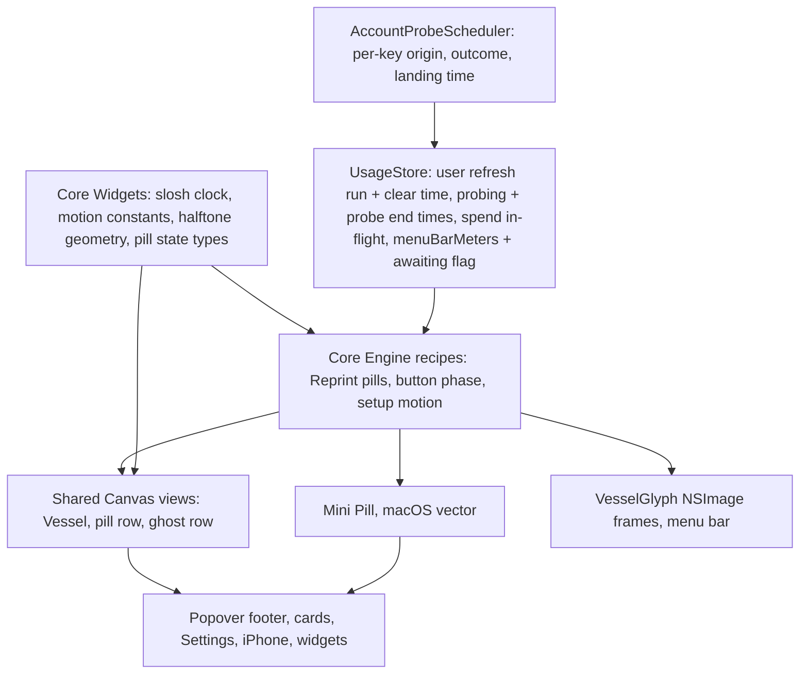
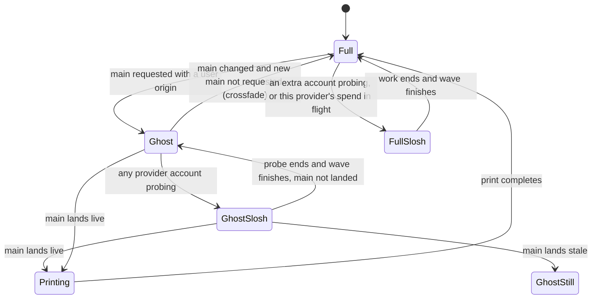

# Loading Language - Plan

## Goal Capsule

- **Objective:** Every loading or waiting moment in Headroom tells the user, at a glance, whether Headroom is working, waiting on them, or showing a number that is not current yet. It moves only when that is true. This holds on the Mac popover, Settings, menu bar, iPhone and widgets, for every provider and account.
- **Means:** One halftone vessel family with three motions, decided by pure Core recipes and rendered by shared views (KTD5, KTD7):
  - **Slosh** means Headroom is working.
  - **Drip** means it is waiting on the user.
  - **Ghost → print** means old or unknown, then fresh.
- **Authority:** The Product Contract's Key Decisions are Kyle's choices from `design/refresh-spinner-halftone-options.html` (Rounds 3–5) and from the plan review. On product behavior the R-IDs win. On mechanism within those constraints the KTDs win. Units override neither.
- **Stop conditions:** Stop and ask Kyle before any of these:
  - A live on-screen capture.
  - Any step that needs the real popover open or the menu bar clicked, including the CPU measurement and the menu-bar light/dark look (R12).
  - Shipping the row-size drip. Kyle approves its looping preview first (KTD10).

  Also stop if evidence shows a Key Decision cannot work as written. Do not quietly redesign it.
- **Execution profile:** Deep, in four phases. U1 → U2 → U3 run in order. After U3, four file-owned streams can run in parallel:
  - **Popover stream:** U5 → U4 → U7, in order. They share `PopoverView.swift` and `ProviderCardView.swift`.
  - **Settings stream:** U6.
  - **Menu-bar stream:** U8.
  - **iPhone and widgets stream:** U9.

  Each stream regenerates `Headroom.xcodeproj` with `xcodegen generate` after rebasing; nobody hand-merges the pbxproj. U10 runs last. A `ce-code-review` pass runs on the merged tree before the PR.
- **Tail ownership:** Ship the work through `ce-commit-push-pr` with babysitting off.

---

## Product Contract

### Summary

Replace Headroom's loading indicators with one vessel-based family:
- The Refresh button's system spinner becomes a row of halftone pills that mirror the menu bar. Pills being re-read fade, then print back in at the fresh level.
- Setup cards drip while the user is in Terminal and slosh while Headroom works.
- Small waits get a Mini Pill.
- Menu-bar pills with no reading yet show a ghost fill instead of a made-up level.
- The iPhone and widgets get matching ghost pills.
- Card-level Check Now checks only that card's account.
- The vendored Flicker spinner is deleted.

### Problem Frame

Headroom's loading moments speak several unrelated languages:
- A system spinner on Refresh.
- A vendored Flicker dot arc on two setup cards.
- System mini spinners in rows and Settings.
- Plain text where nothing moves.
- A solid 46% decorative fill in menu-bar pills that have no reading yet, which reads like a real number.

None of these say what is happening:
- They don't say whether the app is working or waiting on the user.
- They don't say which accounts have finished.
- They don't say whether a number is current.

The new website uses a halftone vessel language. Kyle wants the app's waits to share it, and to stay honest: motion only while work happens, no pulses.

### Requirements

**Refresh button (Reprint)**
- R1. While a user refresh runs, the popover footer's Refresh button shows a halftone pill row mirroring the menu bar's pills. The row has one to four pills, in menu-bar order, at their real levels. Automatic summary mode shows one pill, which prints to the same decorative level the menu bar draws.
- R2. A pill fades to a ghost of its level only while its provider's main account is part of the current refresh and has not landed. It prints back at the fresh level only when that account lands live.
- R3. A pill sloshes while any of its provider's accounts is being probed. When the work ends it finishes its current wave, then goes flat.
- R4. When the last requested account has landed and no other user work remains, the button holds the printed row for 0.5s, then turns back into "Refresh". The footer receipt hands back at the same moment.
- R5. Setup verification checks never fade or print pills. While only setup checks are running, the button stays "Refresh" and enabled.

**Waits on cards and in Settings**
- R6. A new account's "Fetching usage…" shows the halftone Vessel before the words. The Vessel sloshes only while that account is being probed.
- R7. Setup waiting surfaces for every provider show a Vessel on cards or a Mini Pill on rows and in Settings. The motion follows the setup phase:
  - It sloshes during Opening Terminal and Confirming/Checking.
  - It drips while waiting on the user.
- R8. Small waits in account rows and Settings use the Mini Pill. It moves only when work or a phase calls for it. "Waiting for Claude Code…" shows a still Mini Pill.
- R9. Removing an account shows the Mini Pill during removal. The pill drains from the account's level as the row leaves.
- R10. Check Now or Try Again on one account shows a sloshing Mini Pill on that account's identity row until its probe lands. A full Refresh does not show it. Where a Check Now button has no account identity row, the footer Reprint is the feedback.
- R11. API spend "Waiting for cost data" shows the Mini Pill beside the words. It sloshes only while spend is being fetched.

**Menu bar**
- R12. A menu-bar pill whose main account has no reading yet shows a halftone ghost fill instead of the solid decorative level, for every provider and in automatic mode. It sloshes while probed and prints solid when the first live reading lands.

**iPhone and widgets**
- R13. The iPhone status screen's "Checking…" shows a ghost pill row that sloshes during the check.
- R14. Widget and iPhone waiting placeholders show a static ghost pill row that cannot read as a usage value.

**Check Now routing**
- R18. Check Now and Try Again on a single-account card refresh only that account. Provider-level recovery re-checks every account of that provider. The footer Refresh remains the full refresh.

**System rules**
- R15. Under Reduce Motion there is no slosh, drip, or print travel. Ghost and full ink crossfade. The working and waiting stills keep distinct poses.
- R16. The vendored Flicker `DotMatrixSpinner` and its tests are deleted. The options doc is kept as the idea bank.
- R17. Every behavior applies to every provider and every account. API spend covers its providers (Anthropic, OpenAI).

### Key Decisions

All entries below are Kyle's choices, made in `design/refresh-spinner-halftone-options.html` or in the plan review.

- **Reprint (12d) is the Refresh indicator.** (session-settled: user-directed — chosen over ten halftone spinners, five Headroom-concept spinners and five other Pill Row variants: it shows which accounts are done and what a refresh achieves.) Governs R1, R2, R3, R4.
- **Pills mirror the real menu-bar pills and levels.** (session-settled: user-approved — chosen over fixed decorative levels: the fresh level printing in is the point of Reprint.) Governs R1, R2.
- **Automatic summary mode shows one pill (D2a), printing to the menu bar's decorative level.** (session-settled: user-approved — chosen over printing the tightest provider's real level: the button always matches the menu bar, even though that mode has no real level to show.) Governs R1.
- **Only pills whose number is re-read fade (D3a).** (session-settled: user-directed — chosen over every pill fading on any check: a single-account check must not make every number look stale.) Governs R2, R3.
- **The end hold is 0.5s (D4b, lengthened by Kyle from ⅓s).** (session-settled: user-directed — chosen over no hold: the last pill's print must finish.) Governs R4.
- **The button stays at rest during setup checks.** (session-settled: user-approved — chosen over showing Reprint for every setup check: a sign-in wait would otherwise flip the button every ~13s, which is a pulse.) Governs R5.
- **Slosh while Headroom works, drip while it waits on you (D5a).** (session-settled: user-directed — chosen over drip throughout: the user can tell whether they need to act.) Governs R7, R8.
- **"Waiting for Claude Code…" is still, not dripping.** (session-settled: user-approved — chosen over the drip: that state can last indefinitely and would loop on every affected row.) Governs R8.
- **Approved per-moment ideas.** (session-settled: user-directed — chosen over the denied L1a Wet Track, L2b Day Arc, L6 Reprint the Card and L8 Receipt Digits.)
  - L1b Vessel by the words (R6)
  - L2a Drip (R7)
  - L3 Mini Pill (R8)
  - L4 Drain (R9)
  - L6b Pill on the row (R10)
  - L8b Mini Pill + words (R11)
  - L5 Ghost Pill (R12)
  - L7 iPhone (R13)
  - L9 Ghost Still (R14)

  Governs R6–R14.
- **Card-level Check Now checks only its own account.** (session-settled: user-approved — chosen over keeping it a full refresh: otherwise the row pill never appears for single-account users, and one card's check fades every pill.) Governs R18.
- **Carry stays in the idea bank (D1a).** (session-settled: user-directed — chosen over Carry in Drain and Carry for long waits: the vocabulary stays at three motions.) Governs R16.
- **Delete the Flicker spinner.** (session-settled: user-directed — chosen over keeping it on the setup cards.) Governs R16.

### Success Criteria

- In separate-pill menu-bar mode, someone looking only at the Refresh button during a full refresh can say which providers have finished.
- No loading surface moves while no work is in flight for its subject. Waiting-on-user surfaces drip rather than slosh.
- With the popover open during a refresh on `--demo multi-20`, main-thread CPU stays within 2 percentage points of the native-spinner baseline on the same scenario, measured back to back.
- An idle popover with a pending account, and Settings with waiting rows, add no measurable CPU while their glyphs are still.

### Scope Boundaries

- Not built: Wet Track, Day Arc, Reprint the Card, Receipt Digits, Carry (they stay in the idea bank).
- Not changed: the iPhone Mirror's pull-to-refresh (`Sources/HeadroomIOS/Views/MirrorView.swift`, a system control), the iPhone pending-tile skeleton (`MirrorPresentation`), and the widget envelope schema (stays 3).
- No polling-cadence changes. The scheduler gains bookkeeping only. The one routing change is R18.

#### Deferred to Follow-Up Work

- Ghost fill for signed-out or all-unavailable menu-bar pills. They also show the solid decorative 46% today. Log in `BUGS.md`.
- Slosh for the automatic neutral menu-bar pill while it has no summary provider. Log in `BUGS.md`.
- A `docs/solutions/ui/` learning for NSImage menu-bar motion and the loading-language mapping, via `ce-compound` after landing.

---

## Planning Contract

### Key Technical Decisions

- KTD1. **The scheduler records each user run per key, and the store publishes it.**
  - `AccountProbeScheduler` keeps, for every key in user work, its origin (KTD2), its outcome (KTD3) and its landing time.
  - `UsageStore` publishes this as one observable user-refresh run.
  - The store keeps the finished run until `isRefreshing` has cleared and the 0.5s hold has passed, plus 0.2s. It publishes the time `isRefreshing` cleared with the run.
  - The store also publishes each key's last probe end time, for finish-the-wave (KTD6).
  - **Chosen over** deriving state from `RefreshProgress`. That struct carries only counts and one `lastLanded`, and it is set to nil in the same turn the last key lands (`UsageStore.schedulerUserWorkDidChange` follows `schedulerUserProgressDidChange` synchronously). The final landing would never be seen, and a slow API spend tail would outlive any fixed retention.
- KTD2. **Origins and precedence.** Each request carries one of three origins:
  - `fullRefresh`: the Refresh button, ⌘R, `refreshAll`, and launch.
  - `accountAction`: Check Now, Try Again, Make Main, Check Again, resume tracking, add account, and provider-level recovery (R18).
  - `setupCheck`: the `SetupSessionCoordinator` ladder, and setup verification checks via `SetupSessions`.

  Precedence:
  - A user origin (`fullRefresh`, `accountAction`) replaces `setupCheck`.
  - `setupCheck` never replaces a user origin.
  - Between the two user origins, the latest request decides.

  Reprint fades and prints only for user origins (R5). The row Mini Pill (R10) shows only for `accountAction` keys while no `fullRefresh` is active. Setup checks are excluded because the Claude interactive wait would otherwise ghost and print a pill every ~13s, which is a pulse.
- KTD3. **Outcomes.** `probe()` classifies the outcome after `schedulerMerge` returns:
  - accepted with a live snapshot → `live`
  - accepted otherwise → `stale`
  - rejected → `dropped`

  It passes the outcome into `finish(key, outcome:)`. `withdraw`, `unregister` and the ineligible-account guard pass `dropped`. Only `live` prints. A `stale` pill stops sloshing and stays ghost, matching the receipt, which already names stale accounts without a checkmark. A `dropped` key is re-evaluated against the current main (KTD19).
- KTD4. **Check Now routing (R18).**
  - A single-account card's Check Now and Try Again request only that account, with `accountAction` origin. Today they call `onRetrySetup: { store.refreshNow() }` in `Sources/HeadroomApp/UI/PopoverView.swift`.
  - Provider-level capability recovery on multi-account cards (`ProviderCardView`'s capability body, e.g. Check Now after installing a missing CLI) requests every account of that provider with `accountAction`. Each of them is re-checked instead of waiting out its capability-failure backoff.
- KTD5. **Pure Core recipes decide every state; views only render.** The recipes are SwiftUI-free and tested like `MeterRecipe`. They output:
  - Per pill: ink (full, ghost, or printing with a progress), sloshing, and level.
  - Per button: spinner, spend tail (KTD9), hold, or rest. A run whose keys are all `setupCheck` resolves to rest (R5). Rest also drives the button's enabled state, replacing `.disabled(isRefreshing)`.
  - For each setup phase and surface: the motion.

  Inputs are the meters, the user run (with its clear time), `probingAccounts` with probe end times, the spend in-flight set, the current main per provider, and a date. In automatic mode the single pill uses the meter's decorative level.
- KTD6. **The slosh phase comes from the wall clock.**
  - The phase is `floor(t / 0.1) mod 10`, and its constants move to Core.
  - `MenuBarSlosh` derives its frame from that phase instead of counting ticks.
  - The phase wraps every second, so finish-the-wave is stateless: a surface whose work ended keeps sloshing until the next whole-second wrap after its probe end time, then goes flat. This matches `MenuBarSlosh`'s rule.
  - Every surface computes the same phase, so the button and the menu-bar pills stay in step without sharing an instance. The `MenuBarSlosh` instance is owned by `MenuBarLabel`, which the popover can't reach.
- KTD7. **Where the code lives.** Both iOS targets compile `Sources/HeadroomCore/Widgets/` (except `WidgetSnapshotProjector.swift`). They do not compile `Engine/` or `Models/Account.swift`.
  - **Core Widgets (iOS-safe only):** `HalftoneGeometry` (the capsule dot field, dot fill 0.42 of pitch, dot radius from 32% to 100% of max, ink from coverage), the slosh-clock phase function, the motion constants (KTD21), the per-pill state and ink value types the views render, and the uniform ghost-row helper.
  - **Core Engine:** the Reprint derivation (it reads `MenuBarMeter`, `AccountKey` and the user run) and the setup-phase-to-motion mapping, beside `SetupWaitingPhase`. The widget-styles plan's KTD11 set this precedent: it moved a type out of an iOS-compiled file for the same reason.
  - **SwiftUI `Canvas` views:** `Sources/HeadroomWidgetSharedUI/`, public and behind `#if canImport(HeadroomCore)`. The HeadroomIOS target adds the whole `Sources/HeadroomWidgetSharedUI` folder in `project.yml`, as both widget extensions already do. The ghost views need `@HeadroomWidgetRendering` and `.headroomWidgetProbe()` from the primitives there.
  - **Mini Pill:** vector, macOS only, in `Sources/HeadroomApp/UI/`.
- KTD8. **Motion means real work.**
  - The Vessel sloshes only while a probe for its account is in `probingAccounts`.
  - The Mini Pill sloshes only while its subject's probe, removal or fetch is in flight, or while its setup phase is working.
  - The menu-bar ghost sloshes only while its main account is probed.
  - API spend gets a published in-flight set per provider. It sits beside the private `apiSpendInFlight` flag rather than replacing it, so the repeat-guard semantics of spend-only refresh stay as they are.

  Otherwise these glyphs are still. `.pending` can last indefinitely: a missing CLI, a capability failure, or a lane waiting its turn at the 20-account envelope.
- KTD9. **The spend tail keeps the button working.** Sometimes every subscription key has landed but `isRefreshing` stays true: `waitUntilLanesIdle`, the API spend fetch at the end of `refreshAll`, or a Settings spend-only refresh.
  - Printed pills whose provider has a spend fetch in flight slosh. The others stay printed and still.
  - If no shown pill qualifies, the whole row sloshes.
  - The 0.5s hold starts when `isRefreshing` clears.
  - **Chosen over** still pills, which read as frozen.
  - **Chosen over** enabling the button early: `refreshAll` has no re-entry guard, so ⌘R would start a second full CLI sweep.
- KTD10. **The Mini Pill's drip variant has a preview gate.** In waiting-on-user phases a vector drop falls into the 7×11 pill. (session-settled: user-approved — chosen over judging it from still frames: a still cannot show whether the loop reads as a drip or a pulse.)
  - Before U5 and U6 use it, U3 produces a looping preview of one full cycle from pinned-date frames, at 1× in light and dark.
  - Kyle approves it as "reads as a drip, not a pulse". A 1.2pt drop size stays the floor.
  - If he does not approve, the approved L3 slosh stands in for row-size waiting phases.
- KTD11. **Setup cards have no success print.** On `.connected` the card leaves, and the existing Connected payoff takes over (`setupSessionOwnsSurface` in `Sources/HeadroomApp/UI/ProviderCardView.swift`). Conflict call-out: the Drip pitch promised a fill on success, but the card is gone before it could play. Holding the card would fight the payoff's generation binding (`docs/solutions/logic-errors/setup-handoff-launch-and-connected-reset.md`).
- KTD12. **Drain is the row's exit transition in Settings › Accounts.**
  - It drains from the account's displayed level to empty over about 1.1s, the approved L4 timing.
  - It is not tied to how long `.removing` lasts. Removal is a short async directory delete, then a synchronous `detachAccount`.
  - The Mini Pill sloshes while `.removing` lasts.
  - Stop-tracking the built-in account has no `.removing` state. It shows the Mini Pill at the account's level at the start of the exit, then drains.
  - On a failed removal the pill stops with no drain.
  - Under Reduce Motion the row leaves instantly (BUGS.md M7A).
  - There is no minimum display time.
- KTD13. **Menu-bar ghost.**
  - **Flag:** `MenuBarMeter` gains an explicit awaiting-first-reading flag, true when the main snapshot is `.pending`. `fill == nil` also means neutral or signed-out, so it can't serve as the signal. In automatic mode the flag is true only when the summary is neutral and at least one main is `.pending`.
  - **Rendering:** `VesselGlyph` draws a halftone ghost fill of 3×6 dots and sloshes it on the existing wave frames.
  - **Print:** on the first `live` reading it plays a four-frame print at 10fps. Print sequences are keyed per meter: by provider ID, or a fixed key for the automatic pill, so a neutral automatic pill also detects its flag clearing. Any other first result clears the flag with no print.
  - **Cache:** the ghost uses one level bucket, and print frames sit in a bounded cache.
  - **Settings previews:** the preview pills (`MenuBarPreviewPill` in `SettingsPanes.swift` and `SettingsRows.swift`) show the static ghost through the same image path, with no slosh or print.
  - **Docs:** the M10A comment in `Sources/HeadroomApp/UI/MenuBarLabel.swift` and the AGENTS.md menu-bar gotcha are updated. Kyle approved L5 including the print.
- KTD14. **The iPhone status screen shows a sloshing ghost row, not a reprint.** That screen appears only without data, and its "Checking…" is a local iCloud/cache read with a 550ms minimum. The row sloshes ghost pills and finishes the wave after the read. Conflict call-out: L7 promised Reprint, but the screen has no levels to print.
- KTD15. **Widget and iPhone placeholder ghost.**
  - The row has three pills at an identical uniform level, so it can't read as data (WCW4, `Sources/HeadroomCore/Widgets/WidgetStatusCopy.swift`).
  - The status card's `HeadroomVesselMark` slot shows the ghost row where the family has room. Otherwise it shows one ghost vessel at the slot's geometry, following WCF7: drop whole elements before truncating.
  - The per-provider "Waiting for first reading" line gains one small ghost pill.
  - Monochrome and accented rendering fall back to an outline only, through `@HeadroomWidgetRendering`.
  - Every placed ghost carries `.headroomWidgetProbe()`.
  - It is view-only, so the envelope stays at schema 3.
- KTD16. **Rendering is deterministic, and the demo can show every phase.**
  - Motion views read an optional pinned date from the environment in place of the timeline date, so `--render-popover` captures fixed frames.
  - A new `--demo loading` scenario simulates:
    - Per-provider probe delays.
    - A spend delay.
    - One pending account.
    - One single-account Check Now.
  - It also configures a stub `SetupSessionCoordinator` with inert prepare and open closures: no Terminal and no scripts. It steps through preparing, waiting and verifying while issuing `setupCheck` requests, so the R5 and R7 phases are reachable.
  - The CPU measurement uses `--demo multi-20` on both builds, because that scenario already simulates probe time on `main`.
- KTD17. **Motion views own their timeline and pause it when still.** Each motion view runs its own `TimelineView(.animation(minimumInterval:paused:))`: the slosh phase stays stepped at 10fps, and drip and print draw at up to 30fps. It pauses whenever its recipe reports still, and stops when the view is off screen. Each view sits in its own subview, because `PopoverView` lives inside a 60-second `TimelineView`.
- KTD18. **Reprint state is derived from Core on every frame, not stored in view `@State`.** Reopening the popover mid-refresh shows the current state with no replayed prints.
- KTD19. **Pill state follows the current main.** A pill is ghost only while the current main is requested and has not landed live. If the main changes mid-run (Make Main, removing an extra that was main, stop-tracking the built-in), a new main that wasn't requested crossfades to full ink rather than printing, because nothing fresh arrived.
- KTD20. **Reduce Motion keeps working and waiting distinct.** A drip resolves to a still empty vessel. A slosh resolves to a still vessel at its level. A print resolves to a crossfade.
- KTD21. **Motion constants.** These live in Core Widgets and are cited by `DESIGN.md`'s drip carve-out from the looping-animation ban.

  | Motion | Constants |
  |---|---|
  | Slosh | 10 frames × 100ms, one wavelength across, travelling right |
  | Drip | one drop per 1.8s, a 0.45s fall, ~0.6s ripple |
  | Print | ~0.35s bottom-up, about 35ms per row (menu bar: four frames at 10fps) |
  | Ghost wipe | 0.2s top-down |
  | End hold | 0.5s |
  | Drain | ~1.1s |

### High-Level Technical Design

Data flow from probe to pixels:

One pill's lifecycle during a user refresh:

Motion by surface and condition (R7, R8, KTD8, KTD10):

| Surface | Headroom working | Waiting on user | Nothing in flight |
|---|---|---|---|
| Setup card (Claude, Codex) | Vessel slosh (Opening, Confirming) | Vessel drip | n/a (card absent) |
| Waiting row, every provider | Mini Pill slosh (Opening, Confirming) | Mini Pill drip (KTD10 gate, else slosh) | n/a |
| Settings sign-in waits | Mini Pill slosh (Opening, Confirming, Removing) | Mini Pill drip (KTD10 gate, else slosh) | n/a |
| Settings "Fetching…" | Mini Pill slosh while probing | n/a | Still Mini Pill |
| Settings "Waiting for Claude Code…" | n/a | Still Mini Pill | Still Mini Pill |
| New card "Fetching usage…" | Vessel slosh | n/a | Still Vessel |
| API spend waiting | Mini Pill slosh | n/a | Still Mini Pill |
| Menu-bar pill, no reading | Ghost slosh | n/a | Still ghost |
| Refresh button | Reprint (R1–R4) | n/a (setup checks: rest, R5) | "Refresh" label |

### Assumptions

None. Kyle confirmed the scope and every call-out interactively, and approved the review's recommendations.

### Risks & Dependencies

| Risk | Mitigation |
|---|---|
| The scheduler bookkeeping (U1) regresses polling or user-work release | Additive fields only. Extend the suspend/release tests in `Tests/HeadroomCoreTests/AccountProbeSchedulerTests.swift`. Leave cadence code untouched. |
| Halftone legibility at tiny sizes (menu-bar 3×6 ghost, 7×11 drip) | The looping drip preview gate (KTD10). The menu-bar look in light and dark goes in the one batched live shoot, which needs Kyle's go-ahead. Ghost contrast is 1.23–1.63:1 by design, so check that it doesn't read as an empty (0%) vessel. |
| `VesselGlyph` cache growth | One ghost bucket, and a bounded set of print frames (KTD13). |
| Popover CPU from 30fps canvases | Timelines pause when still and stop off screen (KTD17). Back-to-back measurement on `--demo multi-20` is a release gate. |
| iOS target membership | Add the whole SharedUI folder to HeadroomIOS. Keep Engine-only types out of Core Widgets (KTD7). Use the iOS Simulator builds as gates. |
| `MenuBarExtra` sizing | Every new view has an intrinsic ideal height (`docs/solutions/popover-scrollview-zero-height.md`). Window sizing is accepted only in the live window. |
| The widget status-card slot is sized for one 12×20 mark | KTD15's fallback to one ghost vessel where the row doesn't fit. The render sweep is the gate. |

### System-Wide Impact

- **Every provider and lane:** U1 changes what the scheduler reports for all four providers, the Claude/Grok/Cursor CLI lanes and Codex's concurrent HTTP lane. It changes no cadence.
- **Menu bar:** the always-visible surface gains a ghost state and a print (KTD13).
- **Card buttons:** R18 changes what card-level Check Now, Try Again and provider recovery refresh.
- **Widgets and iPhone:** view-only changes. The envelope stays at schema 3.

### Documentation Plan

- **AGENTS.md:**
  - The menu-bar motion gotcha becomes "slosh, plus a print on the first reading" (KTD13).
  - Add `--demo loading` to Commands.
  - Add a short loading-language note under Architecture.
- **DESIGN.md:**
  - Replace "Loading placeholder → SkeletonMeter; not spinners" with the loading-language table.
  - Add the drip's carve-out from the looping-animation ban, citing KTD21's cadence: one slow drop that travels and fades is not a pulse.
- **BUGS.md:** add the two deferred items from Scope Boundaries.
- **Options doc:** commit `design/refresh-spinner-halftone-options.html` as the idea bank (R16).
- **CONCEPTS.md:** keep the Loading entries (Slosh, Drip, Ghost, Reprint) added with this plan.

---

## Implementation Units

### U1. User refresh run record

- **Goal:** Publish, per key, which accounts are in the user's current run, why they were requested, and how each one ended. Also publish probe end times and API spend in flight, and route card-level checks per R18.
- **Requirements:** R2, R3, R4, R5, R10, R11, R17, R18. KTD1, KTD2, KTD3, KTD4, KTD6, KTD8, KTD19.
- **Dependencies:** none.
- **Files:**
  - `Sources/HeadroomCore/Engine/AccountProbeScheduler.swift`
  - `Sources/HeadroomCore/Engine/UsageStore.swift`
  - `Sources/HeadroomCore/Engine/UsageStoreAccountLifecycle.swift`
  - `Sources/HeadroomCore/Engine/SetupSessionCoordinator.swift`
  - `Sources/HeadroomApp/UI/SetupSessions.swift`
  - `Sources/HeadroomApp/UI/AccountsSettingsInteractions.swift`
  - `Sources/HeadroomApp/UI/PopoverView.swift`
  - `Sources/HeadroomApp/UI/ProviderCardView.swift` (capability-body recovery routing)
  - Tests: `Tests/HeadroomCoreTests/AccountProbeSchedulerTests.swift`, `Tests/HeadroomCoreTests/UsageStoreRefreshRunTests.swift` (new)
- **Approach:**
  1. Track a requested set beside `userPending`, plus a per-key origin with KTD2's precedence, an outcome and a landing date.
  2. Classify the outcome in `probe()` and pass it into `finish(key, outcome:)`. Every non-probe caller passes `dropped` (KTD3).
  3. Pass the run through the host protocol. The store publishes it with the `isRefreshing` clear time and retains it per KTD1. Publish each key's last probe end time.
  4. Give `refreshAll`, `refreshNow`, `refreshAccountNow` and the setup-check entry points an origin, with today's callers defaulting to their current meaning.
  5. Publish the spend in-flight set per provider beside the private guard (KTD8).
  6. Derive the user-checking keys for rows: `accountAction` keys in flight while no `fullRefresh` is active.
  7. Route single-account card checks and provider-level recovery per KTD4.
- **Patterns to follow:** `insertUserPending` and `finish` in the scheduler, and the `LaneProbe` suspend/release tests (`AccountProbeSchedulerTests`).
- **Test scenarios:**
  - A full refresh of three providers records three keys with `fullRefresh` origin. The run lists each as landed `live` in landing order.
  - With a 3s spend tail after the last landing, the run stays readable until `isRefreshing` clears plus 0.7s. The published clear time equals the moment `isRefreshing` went false.
  - A new request inside the retention window starts a fresh run.
  - A Check Now request for one key mid-run joins the same run, with `accountAction` origin for that key.
  - A request for a key that is already pending keeps one entry. Its origin follows KTD2's precedence.
  - A setup-ladder check on a key already pending from a full refresh leaves its origin as `fullRefresh`.
  - A full refresh requested while a setup check is pending on a key upgrades that key to `fullRefresh`.
  - A run made only of setup checks records only `setupCheck` origins.
  - A probe that merges a stale snapshot records `stale`. A key withdrawn when its provider is switched off records `dropped`. A key whose result is rejected at a reset boundary records `dropped`.
  - A request answered by a timer probe that was already in flight still records the key as landed.
  - With a timer probe running and no user run, the run is nil and `isRefreshing` stays false.
  - Each key's last probe end time is published when its probe ends, timer probes included.
  - The spend in-flight set contains a provider only during its fetch, including the fetch at the end of `refreshAll`. A Settings spend-only refresh still respects the existing repeat guard.
  - A single-account card's Check Now requests only that account. Other providers' probe logs are unchanged.
  - Provider-level recovery on a three-account Claude card requests all three Claude accounts and no other provider.
- **Verification:** the scheduler and store suites pass under `swift test`. No polling-cadence test changes.

### U2. Loading recipes, halftone geometry and slosh clock

- **Goal:** Decide every surface's loading state in pure Core code, placed so the iOS targets still compile.
- **Requirements:** R1–R9, R12–R15. KTD5, KTD6, KTD7, KTD9, KTD10, KTD13, KTD15, KTD19, KTD20, KTD21.
- **Dependencies:** U1.
- **Files:**
  - `Sources/HeadroomCore/Widgets/HalftoneGeometry.swift` (new)
  - `Sources/HeadroomCore/Widgets/LoadingMotion.swift` (new: clock, constants, pill state and ink types, ghost-row helper)
  - `Sources/HeadroomCore/Engine/ReprintRecipe.swift` (new)
  - `Sources/HeadroomCore/Engine/SetupMotion.swift` (new, beside `SetupWaitingPhase`)
  - `Sources/HeadroomCore/Engine/UsageStore.swift` (the awaiting-first-reading flag on `MenuBarMeter`)
  - Tests: `Tests/HeadroomCoreTests/HalftoneGeometryTests.swift`, `Tests/HeadroomCoreTests/ReprintRecipeTests.swift`, `Tests/HeadroomCoreTests/LoadingMotionTests.swift` (all new), `Tests/HeadroomCoreTests/UsageStoreTests.swift`
- **Approach:**
  1. **Core Widgets:** geometry, clock and constants, per KTD7 and KTD21. Nothing here may reference Engine or `Account` types.
  2. **Reprint recipe:** per-pill states and the button phase, per KTD5, KTD9 and KTD19. It handles one to four pills in meter order plus automatic mode. Finish-the-wave comes from probe end times (KTD6).
  3. **Setup motion:** maps setup phase and surface to slosh, drip or still (the HTD table). Reduce Motion follows KTD20.
  4. **Store flag:** `MenuBarMeter`'s awaiting-first-reading flag from the main snapshot's freshness (KTD13).
- **Patterns to follow:**
  - `MeterRecipe` and `WidgetStyleRecipe` (pure, tested, SwiftUI-free).
  - `WidgetVesselGeometry.swift`, the promoted 11:18 vessel.
  - The widget-styles plan's KTD11 move of `SetupWaitingPhase`.
- **Test scenarios:**
  - Full refresh, three pills, landings at 1.0s, 1.8s and 2.6s, `isRefreshing` clearing at 2.6s:
    - Each pill is ghost until its landing, printing for 0.35s, then full.
    - The button is in its spinner phase until 2.6s, holds until 3.1s, then rests.
  - The same refresh with one pill and with two pills keeps the menu-bar order. Four pills use the slim geometry.
  - Account-action check on Claude's main: only the Claude pill fades and prints. The others stay full and still.
  - A check on an extra Claude account: the Claude pill sloshes with no fade.
  - A run made only of setup checks: no pill fades, and the button phase is rest.
  - Main lands `stale`: the pill stops sloshing and stays ghost, and no print plays.
  - Main changes mid-run to an unrequested account: the pill crossfades to full at the new level, with no print.
  - Spend tail with Claude spend in flight: the Claude pill sloshes while the Grok pill stays still. With no shown pill's spend in flight, the whole row sloshes. The hold starts at the clear time.
  - A probe that ends at t = 4.3s keeps its pill sloshing until t = 5.0s, then flat.
  - Automatic mode: one pill. It ghosts when any main is requested, sloshes while any account probes, and prints to the decorative level.
  - Reduce Motion: no state reports sloshing or travelling. The drip still is an empty vessel and the slosh still sits at its level, so the two differ.
  - Slosh phase at t = 0.95s is 9 and at t = 1.0s is 0, matching `MenuBarSlosh`'s wrap.
  - Setup phases: `.openingTerminal` and `.confirming` map to slosh, `.waitingForUser` maps to drip, for every provider and for card, row and Settings surfaces.
  - The geometry for a 4×8 field in a 10×16 capsule contains exactly the dots inside the inner capsule. Coverage 0 gives the speck radius, and coverage 1 gives 0.42 × pitch.
  - A ghost row has identical levels on every pill.
  - `MenuBarMeter` reports awaiting-first-reading for a `.pending` main, and not for neutral signed-out or all-unavailable states.
- **Verification:**
  - The new Core suites pass under `swift test`.
  - `swift build` stays clean under strict concurrency.
  - The HeadroomIOS Simulator build still compiles Core Widgets.

### U3. Shared halftone views and the Mini Pill

- **Goal:** Build renderers that draw the U2 recipes on macOS, iOS and widgets.
- **Requirements:** R1, R6–R9, R12–R15. KTD7, KTD10, KTD16, KTD17, KTD20.
- **Dependencies:** U2.
- **Files:**
  - `Sources/HeadroomWidgetSharedUI/HalftoneVesselView.swift` (new)
  - `Sources/HeadroomWidgetSharedUI/HalftonePillRow.swift` (new)
  - `Sources/HeadroomWidgetSharedUI/LoadingClockEnvironment.swift` (new)
  - `Sources/HeadroomApp/UI/MiniPill.swift` (new)
  - `project.yml` (the HeadroomIOS target adds the whole `Sources/HeadroomWidgetSharedUI` folder)
  - `Headroom.xcodeproj/project.pbxproj` (regenerated)
  - Tests: `Tests/HeadroomAppTests/MiniPillTests.swift` (new)
- **Approach:**
  1. **Vessel:** renders slosh, drip, ghost, printing and still modes in one persistent view whose ink layer changes. This avoids branch-swapping the skeleton and live states (`docs/solutions/ui/swiftui-layout-owned-drag-position.md`).
  2. **Pill row:** renders a recipe's pill states for one to four pills in meter order.
     - One and two pills use the three-pill 4×8 density, centred in the label width.
     - Four pills use the slim 3×8 geometry.
     - The static ghost row has three pills.
  3. **Mini Pill:** vector `VesselGlyph` geometry at 7×11 in neutral ink, with slosh, drip, drain and still modes.
  4. **Clock:** each view reads the pinned date when present (KTD16) and pauses its timeline when its state is still (KTD17).
  5. **Reduce Motion:** read through `accessibilityReduceMotion`, because `HeadroomMotion` is macOS-only.
- **Patterns to follow:**
  - `DotMatrixSpinner`'s `TimelineView` + `Canvas` structure, before its deletion in U5.
  - `HeadroomWidgetStatusViews.swift`'s `#if canImport(HeadroomCore)` and public-type conventions.
  - The `HeadroomWidgetFamily` alias.
- **Execution note:** Before U5 and U6 use the drip, render a looping preview of one full Mini Pill drip cycle from pinned-date frames, at 1× in light and dark. Save it under `.context/` and ask Kyle to approve it per KTD10.
- **Test scenarios:**
  - The Mini Pill drip frame at a pinned date places the drop inside the pill's bounds, at least 1.2pt across.
  - The Mini Pill under Reduce Motion renders identical frames at two pinned dates, and its drip and slosh stills differ.
  - Drain mode at progress 0 shows the starting level, and at 1 shows an empty pill.
  - The pill row's layout for one, two, three and four pills stays inside the label width, in input order.
  - A still state reports its timeline as paused.
  - Harness check: at a fixed pinned date, `--render-popover` produces identical images across two runs.
- **Verification:**
  - `HeadroomAppTests` pass.
  - Both iOS Simulator builds succeed with the SharedUI folder added.
  - Two-run renders match.
  - Kyle has answered the drip preview.

### U4. Refresh button Reprint

- **Goal:** Replace the footer's system spinner with the Reprint row.
- **Requirements:** R1–R5, R15. KTD5, KTD9, KTD17, KTD18.
- **Dependencies:** U1, U2, U3. In the popover stream it runs after U5.
- **Files:**
  - `Sources/HeadroomApp/UI/PopoverView.swift` (footer overlay, button enablement, and `RefreshReceipt` handing back from the retained run)
  - Tests: `Tests/HeadroomAppTests/RefreshReceiptTests.swift`
- **Approach:**
  1. Keep the hidden "Refresh" label and the overlay. The native bezel draws its label as a still image, so the row stays an overlay sized to the label width.
  2. Drive visibility and the button's enabled state from the recipe's button phase, not `isRefreshing` alone (R5, KTD5).
  3. The receipt reads the retained run, so it and the row hand back together after the hold (R4).
  4. Keep the button disabled through the spend tail and the hold (KTD9).
- **Patterns to follow:** the existing opacity swap, `HeadroomMotion.resolved` for the crossfade, and the R2M8 ⌘R comment.
- **Test scenarios:**
  - The receipt still shows its last line during the 0.5s hold, then hands back to the stamp at the same instant the button returns.
  - The receipt during a 3s spend tail keeps the last landed line.
  - A new refresh during the hold continues from the printed state, with no flash to "Refresh".
  - During a run made only of setup checks, the button shows "Refresh", is enabled, and the receipt shows the stamp.
- **Verification:**
  - Pinned-clock popover renders at the spinner, ghost, printing, spend-tail and hold phases.
  - A two-pill render.
  - The demo walkthrough in U10.

### U5. Setup waits and deleting the Flicker spinner

- **Goal:** Make the setup cards and waiting rows show phase-correct motion for every provider, and delete the Flicker spinner.
- **Requirements:** R7, R8, R16, R17. KTD10, KTD11.
- **Dependencies:** U3, plus Kyle's answer on the drip preview. In the popover stream it runs first.
- **Files:**
  - `Sources/HeadroomApp/UI/ClaudeSetupViews.swift`
  - `Sources/HeadroomApp/UI/CodexSetupViews.swift` (take the waiting phase)
  - `Sources/HeadroomApp/UI/ProviderCardView.swift` (`CardRowWaitingLine`, and passing the phase to the Codex card)
  - Delete `Sources/HeadroomApp/UI/DotMatrixSpinner.swift`
  - Delete `Tests/HeadroomAppTests/DotMatrixSpinnerTests.swift`
  - `Headroom.xcodeproj/project.pbxproj` (regenerated)
  - `DESIGN.md`
  - Tests: `Tests/HeadroomAppTests/SetupWaitingMotionTests.swift` (new)
- **Approach:**
  1. The Claude and Codex waiting cards show the halftone Vessel in the title slot, with motion from the U2 phase mapping.
  2. `CardRowWaitingLine` shows the Mini Pill, which covers Grok, Cursor and every extra account. Its waiting-on-user phase uses the drip only if Kyle approved the preview (KTD10).
  3. No success print (KTD11).
  4. Remove both FlickerDot files and their MIT notice with them. Regenerate the project with XcodeGen rather than hand-editing the pbxproj.
- **Test scenarios:**
  - Codex card content in `.waitingForUser` resolves to drip, and in `.confirming` to slosh. The same holds for the Claude card.
  - A `CardRowWaitingLine` for a Grok account in `.openingTerminal` resolves to slosh.
  - After deletion, no Swift file references `DotMatrixSpinner`.
- **Verification:**
  - `HeadroomAppTests` pass.
  - `--render-popover` waiting, `codexWaiting` and `dualWaiting` renders show the Vessel.
  - `grep` finds no `DotMatrixSpinner`.

### U6. Settings waits and Drain

- **Goal:** Give Settings › Accounts waits the Mini Pill with phase-correct motion, and play the drain on removal.
- **Requirements:** R7, R8, R9, R15, R17. KTD8, KTD10, KTD12.
- **Dependencies:** U1, U3, plus Kyle's answer on the drip preview.
- **Files:**
  - `Sources/HeadroomApp/UI/AccountsSettingsTile.swift`
  - `Sources/HeadroomApp/UI/AccountsSettingsInteractions.swift`
  - Tests: `Tests/HeadroomAppTests/AccountsSettingsWaitTests.swift` (new)
- **Approach:**
  1. Map each wait:
     - Sign-in and device-code rows read `SetupSessions.waitingPhase(for:)` through U2's mapping: slosh for opening and confirming, drip for waiting on the user. This is the same rule the popover rows use.
     - "Waiting for Claude Code…" is a still Mini Pill.
     - "Fetching…" sloshes only while the account is probing, and is otherwise still.
     - "Removing…" sloshes.
  2. The removed row's exit plays the drain per KTD12.
- **Test scenarios:**
  - A Settings row in `.verifying` with no active handoff resolves to slosh.
  - A Settings row in `.waitingForUser` resolves to drip (or slosh under the KTD10 fallback).
  - "Waiting for Claude Code…" resolves to still.
  - A row in `.removing` resolves to slosh.
  - A failed removal resolves to still, with no drain.
  - "Fetching…" with the account in `probingAccounts` resolves to slosh, and without it to still.
  - Stop-tracking the built-in account starts the drain at the account's displayed level.
- **Verification:** `HeadroomAppTests` pass, plus a Settings check during the U10 live shoot.

### U7. New-card Vessel, Check Now row pill and API spend wait

- **Goal:** Make the remaining popover waits honest and on-family.
- **Requirements:** R6, R10, R11, R15, R17. KTD8.
- **Dependencies:** U1, U3. In the popover stream it runs after U4.
- **Files:**
  - `Sources/HeadroomApp/UI/ProviderCardView.swift` (`pendingSkeleton`)
  - `Sources/HeadroomApp/UI/ProviderCardIdentityRows.swift` (a trailing accessory on `IdentityRow`)
  - `Sources/HeadroomApp/UI/PopoverView.swift` (plumb the user-checking keys, probing state and spend in-flight set)
  - `Sources/HeadroomApp/UI/APISpendSectionView.swift`
  - `Sources/HeadroomApp/UI/AppearanceSpecimen.swift` (defaults)
  - Tests: `Tests/HeadroomAppTests/IdentityRowAccessoryTests.swift` (new)
- **Approach:**
  1. The pending skeleton puts the Vessel before "Fetching usage…" and keeps its meters. It sloshes only while probing.
  2. `IdentityRow` gains an optional trailing accessory that respects the L4B trailing edge (meter column). It shows the Mini Pill for user-checking keys (U1).
  3. Check Now hosts with no account identity row (the setup-failure notice above the guided connect cards, and both `CodexAccessRecoveryCard` variants) get no row pill. The footer Reprint is their feedback (R10).
  4. The API spend pending row shows the Mini Pill and "Waiting for cost data", sloshing only while spend is in flight.
  5. `ProviderCardView` holds no store, so pass the new inputs from `PopoverView`, with empty defaults for `AppearanceSpecimen`.
- **Test scenarios:**
  - The trailing accessory is visible for a key in the user-checking set, and hidden for the same key during a full refresh.
  - It is hidden when the key is checked only by a timer poll.
  - The spend row resolves to slosh while in flight, and still otherwise.
  - The pending skeleton's Vessel resolves to slosh only while its account probes.
- **Verification:**
  - `HeadroomAppTests` pass.
  - Pinned-clock renders of a pending card, a checked row and the spend row.

### U8. Menu-bar ghost pill

- **Goal:** Show a menu-bar pill with no reading as an honest ghost that prints on its first reading.
- **Requirements:** R12, R15, R17. KTD6, KTD13.
- **Dependencies:** U2.
- **Files:**
  - `Sources/HeadroomApp/UI/VesselGlyph.swift`
  - `Sources/HeadroomApp/UI/MenuBarSlosh.swift` (wall-clock phase, and the per-meter print frames)
  - `Sources/HeadroomApp/UI/MenuBarLabel.swift`
  - `Sources/HeadroomApp/HeadroomApp.swift`
  - `Sources/HeadroomApp/UI/SettingsPanes.swift` and `Sources/HeadroomApp/UI/SettingsRows.swift` (preview pills)
  - `AGENTS.md`
  - Tests: `Tests/HeadroomAppTests/MenuBarSloshTests.swift` (new), `Tests/HeadroomCoreTests/MenuBarLabelGeometryTests.swift`
- **Approach:**
  1. Add a ghost fill branch inside the liquid clip in `VesselGlyph.render`, using U2 geometry at 3×6 dots.
  2. Extend `ImageKey` with ghost and print frame.
  3. `MenuBarSlosh` derives its frame from the wall-clock phase. It runs a short print sequence, keyed per meter, when the awaiting flag clears on a live reading.
  4. The Settings preview pills render the static ghost.
  5. Palette resolution stays on the menu bar's own appearance (L1A).
- **Test scenarios:**
  - A pill whose meter is awaiting its first reading renders the ghost image key.
  - On a live first reading it steps through four print frames, then the solid key.
  - The automatic pill, neutral while awaiting, plays its print when the flag clears.
  - A stale first reading goes straight to its normal image, with no print frames.
  - Under Reduce Motion the ghost is still and there are no print frames.
  - The slosh frame at a given date equals U2's phase.
  - The print-frame cache holds no more than one sequence per palette.
- **Verification:**
  - `HeadroomAppTests` pass, and the Core geometry suite passes under `swift test`.
  - The menu-bar look in light and dark goes into the batched live shoot, after Kyle's go-ahead.
  - The AGENTS.md gotcha is updated.

### U9. iPhone checking and ghost placeholders

- **Goal:** Bring the language to the iPhone status screen and to the widget and iPhone waiting placeholders.
- **Requirements:** R13, R14, R15, R17. KTD14, KTD15.
- **Dependencies:** U3.
- **Files:**
  - `Sources/HeadroomIOS/Views/StatusScreen.swift`
  - `Sources/HeadroomWidgetSharedUI/HeadroomWidgetStatusViews.swift`
  - `Sources/HeadroomWidgetSharedUI/HeadroomWidgetStyledBody.swift` (the waiting line)
  - `Sources/HeadroomCore/DemoScreenshotData.swift` (pending fixtures, if the sweep needs status-card coverage)
  - Tests: `Tests/HeadroomCoreTests/WidgetStyleRecipeTests.swift`
- **Approach:**
  1. `StatusScreen`'s check shows the sloshing three-pill ghost row and finishes the wave after the 550ms read (KTD14).
  2. The status card for `macPending` and `iosWaitingForMac` shows the ghost per KTD15's slot rule.
  3. The per-provider "Waiting for first reading" line gains one small ghost pill.
  4. Under monochrome and accented rendering, use the outline-only fallback through `@HeadroomWidgetRendering`. Put `.headroomWidgetProbe()` on each ghost.
- **Test scenarios:**
  - The recipe for a waiting provider yields a ghost with the uniform level.
  - The monochrome rendering mode yields outline-only.
  - In a family too small for the row, the status card falls back to one ghost vessel.
  - The render sweep passes with ghosts placed in every style, family and fixture with a waiting provider.
- **Verification:**
  - `swift run Headroom --render-widgets <dir>` exits zero.
  - Both iOS schemes build for `generic/platform=iOS Simulator`.

### U10. Demo scenario, renders, measurement and live acceptance

- **Goal:** Make every loading state reproducible, prove its cost, and accept it in the real windows.
- **Requirements:** all. KTD16.
- **Dependencies:** U4–U9.
- **Files:**
  - `Sources/HeadroomCore/DemoFixture.swift` (`loading` scenario)
  - `Sources/HeadroomApp/PopoverRenderHarness.swift` (pinned clock, loading states)
  - The demo's setup wiring for the stub `SetupSessionCoordinator`. Locate where `--demo` skips `SetupSessions.configure`.
  - `AGENTS.md` (Commands)
  - `DESIGN.md`
  - `BUGS.md`
  - `design/refresh-spinner-halftone-options.html` (committed)
- **Approach:**
  1. **`loading` scenario:** add it per KTD16, including the stub setup coordinator.
  2. **Harness renders:** the harness renders each popover state at pinned dates.
  3. **Live session:** ask Kyle, then run one short batched session covering:
     - The popover in both appearances.
     - Settings › Accounts.
     - The menu bar on light and dark.
     - The CPU measurement:
       - Main-thread CPU through a Refresh on `--demo multi-20`, on the `main` build and this branch, back to back.
       - An idle popover with a pending account, and Settings with waiting rows.
- **Test scenarios:**
  - Test expectation: none -- demo and harness scaffolding. Proof comes from the renders, the measurement and the live session.
- **Verification:**
  - Renders exist for each state, including the Opening and Confirming phases.
  - The CPU delta is reported with numbers.
  - The live session is done with Kyle's go-ahead.
  - The docs are updated.

---

## Verification Contract

| Gate | Command or check | Units |
|---|---|---|
| Core build and tests | `swift build` and `swift test` | U1, U2, U8, U9 |
| App tests | `./Scripts/build-app.sh --deps-only && xcodebuild -project Headroom.xcodeproj -scheme HeadroomAppTests -destination 'platform=macOS' -derivedDataPath ./.xcode-derived test` | U3–U8 |
| Project regeneration | `xcodegen generate`; commit the regenerated `Headroom.xcodeproj/project.pbxproj` | U3, U5, U9 |
| iOS compile | `xcodebuild -project Headroom.xcodeproj -scheme HeadroomIOS -destination 'generic/platform=iOS Simulator' build`, and the same for `HeadroomIOSWidgets` | U2, U3, U9 |
| Drip preview | Looping preview of one Mini Pill drip cycle (1×, light and dark) approved by Kyle, or the slosh fallback in place | U3, U5, U6 |
| Widget sweep | `swift run Headroom --render-widgets <dir>` exits zero | U9 |
| Popover renders | `swift run Headroom --render-popover <dir>` at pinned dates. Two runs match. | U3–U7, U10 |
| CPU | Back-to-back main-thread CPU through a Refresh on `--demo multi-20`, `main` vs this branch, within 2 percentage points. Idle popover and Settings add nothing while still. Only inside Kyle's approved live session. | U10 |
| Live acceptance | `swift run Headroom --demo loading`: popover (both appearances), Settings, menu bar (light and dark). Only after Kyle's go-ahead. | U10 |
| Review | `ce-code-review` on the merged tree. Include the correctness reviewer for U1's scheduler change. | all |

---

## Definition of Done

- R1–R18 hold in the demo walkthrough and in the renders.
- Every gate in the Verification Contract passes, and its output is shown.
- No `ProgressView` remains at the five loading sites: footer, waiting row, the two Settings waits and iPhone status. No `DotMatrixSpinner` reference remains anywhere.
- Kyle has approved the drip preview, or the slosh fallback is in place.
- AGENTS.md, DESIGN.md and BUGS.md are updated per the Documentation Plan, and the options doc is committed.
- No abandoned-attempt code (experiments, unused modes, dead helpers) remains in the diff.
- Per unit: each unit's Verification line is met.
