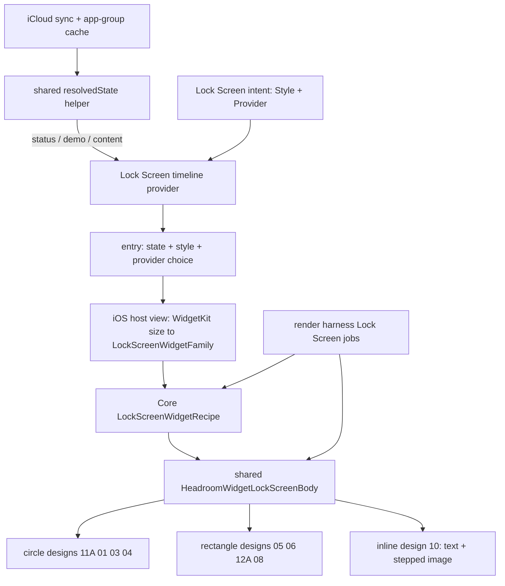
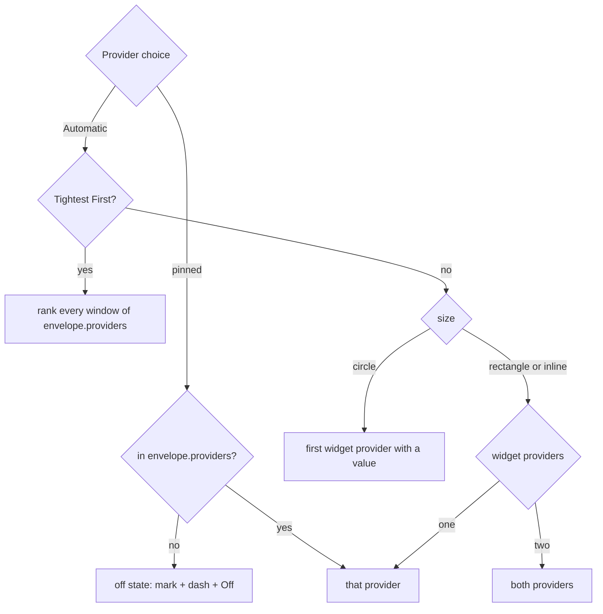

# Lock Screen Widgets - Plan

## Goal Capsule

- **Objective:** An iPhone or iPad user can put Headroom on the Lock Screen as a circle, a rectangle, or the line beside the date, and read the remaining usage of any provider at a glance without unlocking. The numbers stay as honest as on the Home Screen.
- **Means:** A second, separate widget in the iOS widget extension, configured by Style and Provider in Edit Widget, that draws pure Core recipes in the Lock Screen's one-ink rendering (KTD1, KTD3, KTD5).
- **Authority:**
  - Product Contract R-IDs win on behavior. KTDs win on mechanism within those R-IDs.
  - `design/lock-screen-widget-ideas.html` is the visual reference for the approved designs (01, 03, 04, 05, 06, 08, 10, 11A, 12A), including its `<script>` render functions. Where it and an R-ID disagree, the R-ID wins.
  - AGENTS.md and DESIGN.md apply throughout. The anchors in `docs/plans/2026-10-02-1247-feat-widget-styles-plan.md` (KTD2, KTD3, KTD4, KTD6, KTD7, KTD8, KTD10, R6, R10, R11) and `docs/plans/2026-09-11-001-feat-widget-craft-plan.md` (WCF7, WCM3, WCM4, WCD3, WCW1, WCW2) stay in force.
- **Stop conditions:**
  - Stop after the device spike (U2) and report to Kyle if the inline size cannot render the custom template image KTD9 needs, even when a system symbol renders. Kyle decides between system symbols only, a text-only line, and dropping inline from this release.
  - Stop if any change needs a widget envelope schema bump. Schema 3 is frozen.
  - Stop if the home widgets' render output changes: every image from a home sweep run before U3 must be byte-identical after it. Lock Screen fixtures live in their own list (U3), so the home job set does not grow.
- **Execution profile:**
  - Core recipes test-first under `swift test`.
  - Shared views checked by the extended render harness (U7) as they land.
  - iOS Simulator builds of both iOS schemes after U2, U5 and U6.
  - Device checks by Kyle: the spike (U2) and final acceptance (U9).
- **Tail ownership:** Kyle owns the device checks (U2, U9). The implementer owns `ce-code-review` on the merged tree, the commit and the PR.

---

## Product Contract

### Summary

Add a Headroom Lock Screen widget for iPhone and iPad in three sizes: circle, rectangle and inline. Edit Widget offers the same four Style names as the home widgets plus a Provider choice. Each style draws one approved design per size, in one ink, for Claude, Codex, Grok and Cursor. The home widgets, the Mac and the synced data format do not change.

### Problem Frame

Headroom's iPhone presence today is the companion app and Home Screen widgets. Both need the phone unlocked and a trip to the Home Screen. The Lock Screen is the surface people glance at most, and it has no Headroom readout. Two options rounds (`design/lock-screen-widget-ideas.html`, rounds 1 and 2) settled one design per style per size. The Lock Screen has hard limits that the home widgets don't: no colour, a 72 pt circle, a one-line inline slot, Always On, and a privacy mode. The design has to carry low limits, stale data and missing values through shape and words alone.

### Requirements

**Sizes and styles**

- R1. A new Headroom Lock Screen widget offers circle, rectangle and inline sizes on the iPhone and iPad Lock Screens. Home Screen widgets and the Mac are unchanged.
- R2. Each Style draws one design per size, laid out as in the design doc:
  - Nested Meter: Nested Badge (circle, 11A) and Nested Rows (rectangle, 05).
  - Vessel Hero: Vessel Badge (circle, 01) and Twin Vessels (rectangle, 06).
  - Tightest First: Tightest Gauge (circle, 03) and Gauge Pair (rectangle, 12A).
  - Liquid Level: Liquid Dial (circle, 04) and Liquid Strip (rectangle, 08).
- R3. Kyle's size changes hold. Tightest Gauge: 17 pt number, 15 pt mark in the gap, window name clear of the arc. Liquid Dial: 18 pt number, 15 pt marks, no bright surface line.
- R4. The inline size shows one line of text and one image beside the date (design 10). Tightest First shows the lowest limit and when it refills. The other three styles show each shown provider's main number. The line shortens before it truncates.

**Configuration**

- R5. Edit Widget offers Style (Nested Meter, Vessel Hero, Tightest First, Liquid Level; default Liquid Level) and Provider (Automatic, Claude, Codex, Grok, Cursor; default Automatic). There is no Color option.
- R6. Automatic resolves by size and style:
  - Circle: the first widget provider, unless it has no displayed value and the second one does (home R6).
  - Rectangle and inline: the two widget providers. With only one widget provider, the widget uses that provider's pinned layout.
  - Tightest First, any size: every provider in the synced data competes, not only the widget providers.
- R7. A pinned provider shows that provider's main account. When it is absent from the synced data (switched off on the Mac), the widget shows it as off and never substitutes another provider:
  - Circle: the mark in secondary ink, "—" and "Off".
  - Rectangle: the provider's slot shows the mark, the provider name and "Off" in secondary ink.
  - Inline: "<Provider> · Off" with the warning image.
  - A pinned Tightest First widget uses the same forms.

**States**

- R8. Every shown window takes the first state that applies, in this order. "Half ink" and "secondary ink" are opaque grays (R13).

  | Order | Condition | Number | Fill or level | Caption |
  |---|---|---|---|---|
  | 1 | Provider pending, no windows yet | "—" | none | "Waiting" |
  | 2 | Provider stale with no windows (for example signed out on the Mac) | "—" | none | "Sign in" |
  | 3 | Window unavailable | "—", never 0% | empty | window name |
  | 4 | Window or provider stale | half ink | half ink | warning glyph + window name |
  | 5 | Reset reached ("now") | secondary ink, no knockout | kept | window name |
  | 6 | Live and the Mac's severity is critical | knockout | full | window name |
  | 7 | Live | full ink | full | window name |

  The inline size draws every state in the system's own ink, because the system styles its text. Its one image carries the state (KTD9): the vessel at the lowest printed level, or the warning image for a pending, signed-out, stale or unavailable value. A missing number prints "—". A signed-out provider never shows another provider's data in any size.

- R9. Each status state (setup needed, waiting for the Mac, sync off, data can't be read, incompatible data, no providers) has a compact form per size. Circle: the status vessel mark and one word. Rectangle: title and a two-line message. Inline: "Headroom · " plus the title.
- R10. Demo data shows "Demo": as the circle caption, and as a prefix on rectangles and inline. In a circle, "Demo" takes the caption slot even for Cursor, because demo numbers are not real usage and can't be read as Cursor's total.
- R11. Cursor numbers always carry their pool name where the size shows text. A lone fallback window reads "Included". No surface prints a bare "Cursor N%".
  - Circles use "Models" and "Other" (the Cursor mark names the provider).
  - Rectangles use "Cursor Models" and "Other Models" when they fit, and the short names when they don't.
  - Inline has no mark, so it reads "Other Models 37%" when that fits and shortens to "Cursor Other 37%", which keeps "Cursor".
- R12. Gauge Pair shows "Only limit" only when the provider has exactly one window. When at least one other window or provider exists but none has a value, the second slot shows a "—" gauge. Otherwise it shows the next valued window.

**Rendering**

- R13. Everything draws in one ink, using opaque gray levels rather than white with opacity. It stays legible on dark and light wallpapers. Brand marks render as flat silhouettes.
- R14. On Always On, liquid fills fade and the knockout capsule becomes an outline. Nothing else changes.
- R15. Nothing overlaps or clips (WCF7). Whole elements drop first, then flexible text truncates. Numerals, marks, arcs, bars and vessels never shrink. Label type is capped below the home cap.
- R16. When the user hides Lock Screen widget content (privacy), fills, arcs and vessels draw empty along with the redacted text.
- R17. VoiceOver reads one element per widget: provider, window and value, in visual order. Gauge Pair and two-provider rectangles read one element per slot.

### Key Decisions

- **A separate Lock Screen widget with Style and Provider, and no Color** (session-settled: user-approved — chosen over adding the Lock Screen sizes to the current home widget: Edit Widget then shows only options that work on the Lock Screen, and the home widgets' placed-widget migration stays untouched). Governs R1, R5.
- **The approved design set** (session-settled: user-directed — chosen over Nested Rings, Tightest Triage, Refill Timer, labelled Nested Badge and Gauge + List: Kyle's two-round verdicts). Governs R2, R4.
- **Kyle's size changes to Tightest Gauge and Liquid Dial** (session-settled: user-directed — chosen over the round 1 sizes: the window name touched the arc, and the logos read too small). Governs R3.
- **Default style is Liquid Level** (session-settled: user-directed — chosen over Nested Meter, the home default, and Vessel Hero: Kyle picked the filling dial). Governs R5.
- **Knockout numeral as the low cue** (session-settled: user-approved — chosen over a warning glyph or no cue: it is the only cue that reads at a glance without colour). Governs R8.
- **Tightest First on Automatic compares every provider** (session-settled: user-approved — chosen over only the two widget providers: one circle can then cover everything). Governs R6.
- **Provider choice is Lock Screen only** (session-settled: user-approved — chosen over adding it to the home small Vessel Hero and Liquid Level now: that stays a separate parity call). Governs R5.
- **A pinned provider that is off shows as off and never falls back.** A silent fallback would draw Claude in a circle set to Grok. Governs R7.
- **Demo data is labelled "Demo" on the Lock Screen.** Without a label, demo numbers look real. In circles the label wins the caption over Cursor's pool name. Governs R10.
- **A signed-out provider shows "Sign in", never another provider.** Governs R8.

### Acceptance Examples

- AE1. Covers R6, R8.
  - **Given** the widget providers are Claude and Codex, all four providers are synced, and Cursor's Other Models pool is live at 8% with critical severity.
  - **When** a Tightest First circle is on Automatic.
  - **Then** it shows Cursor's mark, "Other" and a knockout "8%".
- AE2. Covers R7.
  - **Given** Grok is switched off on the Mac, so the synced data has no Grok entry.
  - **When** a circle is pinned to Grok.
  - **Then** it shows Grok's mark in secondary ink, "—" and "Off". It does not show any other provider.
- AE3. Covers R8.
  - **Given** Claude's weekly window is unavailable and its 5-hour window is live.
  - **When** a Liquid Dial is pinned to Claude.
  - **Then** it shows "—", an empty dial and the caption "Weekly". The main window stays weekly, as on the home widgets.
- AE4. Covers R12.
  - **Given** Claude has three windows and Fable is unavailable.
  - **When** a Gauge Pair is pinned to Claude.
  - **Then** the second slot is the lowest remaining window with a value. A "—" gauge appears only if no other window has a value. "Only limit" never appears.
- AE5. Covers R11, R4.
  - **Given** the widget providers are Grok (56%) and Cursor (Other Models 37%).
  - **When** the inline size runs on Automatic with Liquid Level.
  - **Then** it reads "Grok 56% · Other Models 37%" when that fits, and shortens to "Grok 56% · Cursor Other 37%". Both name the pool.
- AE6. Covers R8.
  - **Given** a live critical window whose reset time has passed (the Mac is asleep).
  - **When** a circle or rectangle shows it.
  - **Then** the number uses secondary ink with no knockout.

### Scope Boundaries

- No change to the home widgets' layouts, styles or kind, and no Mac change.
- No Control Center controls. Those stay in `design/control-center-readout-ideas.html` until Kyle reviews them.
- No widget envelope change (schema 3). The Lock Screen shows each provider's main account only, because the envelope carries main accounts only. This is the stated provider-parity exception: multi-account rows cannot reach any widget yet.
- No Apple Watch complication, although watchOS uses the same sizes.

#### Deferred to Follow-Up Work

Record each in BUGS.md:

- Lock Screen previews in Settings → Widgets & iPhone.
- Dimming numbers when the synced data is old. The existing deferred item now also covers the Lock Screen.
- A Provider choice for the home small Vessel Hero and Liquid Level.
- The home widgets caption a lone Cursor pool "monthly left" (`WidgetStyleCopy.leftCaption`), which reads as Cursor's whole allowance. Found during this planning.

### Sources

- `design/lock-screen-widget-ideas.html`: approved designs, the state and label rules, and Kyle's verdicts.
- `docs/plans/2026-10-02-1247-feat-widget-styles-plan.md` and `docs/plans/2026-09-11-001-feat-widget-craft-plan.md`: the anchors this plan builds on.
- Apple: HIG Widgets, `WidgetRenderingMode`, `AccessoryWidgetBackground`, `containerBackground(for:)`, `isLuminanceReduced`, WWDC22 "Complications and widgets: Reloaded", WWDC23 "Bring widgets to new places".

---

## Planning Contract

### Key Technical Decisions

- KTD1. **A second widget in the existing iOS widget bundle, with its own kind and intent.**
  - The widget joins `HeadroomIOSWidgets` (`Sources/HeadroomIOSWidgets/HeadroomIOSWidgets.swift`). The kind constant `"HeadroomIOSLockScreenWidget"` sits next to `HeadroomIOSWidgetConfiguration.kind`. A shipped kind can never change, because changing it orphans placed widgets.
  - It uses `AppIntentConfiguration` with its own `WidgetConfigurationIntent` and supports the three accessory sizes only. The intent lives in the iOS extension, because macOS has no Lock Screen.
  - The content sets `containerBackground(for: .widget)` with a clear background. `AccessoryWidgetBackground()` stays inside the content, where designs need it. Never set `containerBackgroundRemovable(false)`, which would hide the widget on the iPad Lock Screen.
  - Inherits the separate-widget Key Decision. Governs R1, R5.
- KTD2. **The Lock Screen choices are Core enums. The App Intent types only mirror them.**
  - A new `LockScreenWidgetFamily` (circle, rectangle, inline) lives in Core. It stays separate from Core `WidgetFamily`, which home sweeps, tokens and tests iterate exhaustively. WidgetKit's accessory families are unavailable on macOS, so only the iOS host maps them to the Core enum.
  - A new `LockScreenProviderChoice` has a stable raw value per case: `automatic` plus the `ProviderID` raw values. An unknown or missing value becomes `.automatic`.
  - The Lock Screen style default is Liquid Level, through its own fallback. `WidgetLayoutStyle.default` stays Nested Meter, since a test pins it.
  - Ad-hoc-signed builds can deliver nil parameters (widget-styles KTD2), so nil resolves to the defaults.
  - Each Lock Screen AppEnum case maps to its Core case through an exhaustive `switch` in the extension, so the compiler catches a missing or misspelt case. Raw-value round-tripping is not used: a misspelt raw value would fall back to Automatic and show the wrong provider (R7). The BUGS.md "AppEnum options mirror Core by hand" item is extended to cover a Core case with no AppEnum case.
- KTD3. **One pure Core recipe drives every Lock Screen view.**
  - `LockScreenWidgetRecipe` takes the style, size, provider choice, the `IOSWidgetSnapshotState` (status, demo or content) and `now`. The snapshot state is already compiled into Core and both iOS targets.
  - It returns either a status form (R9, from the status cases) or one or two provider slots, labelled "Demo" when the state is `.demo` (R10). Each slot carries the provider, its window or windows, the R8 state, number text, caption text, fill fraction and accessibility text. The inline size also gets its ordered text candidates and image level.
  - Views only lay out recipe output (widget-styles KTD3).
  - The home R6 one-provider pick (`WidgetStyleRecipe.init`) and the cross-provider ranking become shared Core helpers. Home and Lock Screen then use one rule. Home behavior must not change, and the existing `WidgetStyleRecipeTests` prove it.
  - Tightest First on Automatic ranks windows from `envelope.providers` with `WidgetWindowRanking`. Model rows and Spark compete, as on the home widgets (R3 of the widget-styles plan).
- KTD4. **The R8 state order is computed in Core from the Mac's data.**
  - Critical uses the window's `severity`, not a fresh 15% check, so the Mac stays the single source of truth.
  - "Reset reached" uses the shared reset schedule (WCD3).
  - Provider-level staleness demotes every window (`demotedToStale`, WCM5).
- KTD5. **The one-ink palette is opaque gray levels, held as Core tokens.**
  - Apple's vibrant guidance asks for opaque grays rather than white with opacity, because the system maps each gray's lightness to how strongly the frosted material shows.
  - New Core tokens hold every Lock Screen value:
    - ink levels: full, secondary, half (stale), track, and wash top and bottom
    - Always On wash level
    - numeral sizes per design, mark slots
    - bar heights and widths, arc radius, stroke and sweep
    - the label Dynamic Type cap
  - The mock's alpha values become the same-looking gray levels. Kyle's device look (U9) is the final judge. DESIGN.md gains a row for these tokens.
- KTD6. **Lock Screen views are new shared-UI views. They never touch the home style bodies.**
  - One public entry, `HeadroomWidgetLockScreenBody`, takes the recipe plus injected mark and inline-image closures. The closures exist because the Mac harness has no asset catalog.
  - The views always draw the one-ink palette and ignore `HeadroomWidgetRenderingContext`. They read `isLuminanceReduced` (R14) and `redactionReasons` (R16) from the environment.
  - Palette-free pieces are reused: `WidgetVesselGeometry`, digit-ink sizing (`HeadroomWidgetFontMetrics.digitInk`), bar shapes and the overflow probe.
  - Shared UI never names a WidgetKit accessory family, because those names don't compile for macOS.
- KTD7. **Brand marks render as template silhouettes.** The existing `BrandIcons.xcassets` imagesets render with template rendering, so holes in the artwork (Codex's prompt glyph) survive. They are sized by `HeadroomBrandMark.markSize`. No new mark artwork is needed.
- KTD8. **The knockout numeral is a true cut-out.**
  - The number is cut out of a filled capsule inside a compositing group, so the wallpaper shows through it in vibrant rendering.
  - On Always On the capsule draws as a stroke (R14), following Apple's "stroke large filled shapes" advice.
- KTD9. **The inline image is a stepped set of template images, generated from Core geometry.**
  - A hidden `swift run Headroom --generate-lock-screen-vessels <asset-dir>` mode, next to `--render-widgets`, draws 11 vessel levels from `WidgetVesselGeometry` into a new `Sources/HeadroomIOSWidgets/LockScreenAssets.xcassets` as template images. A standalone script can't import Core, and the mode shares its vessel drawing with the harness's inline stand-in (U7). The new catalog is picked up by the target's existing source path when the project is regenerated, and stays out of the Mac targets. A system warning symbol covers stale or missing data.
  - The level is the lowest value printed in the text. Any value above zero shows at least the first step.
  - The device spike (U2) proves the inline size renders a custom template image before this lands.
- KTD10. **The Lock Screen timeline reuses the home resolution path.**
  - `resolvedState()` moves into a helper both timeline providers call. Entries carry the style and provider choice.
  - The placeholder is a neutral entry with no level, because privacy redaction shows the placeholder (R16).
  - In demo mode the Lock Screen widget reads the `fourProviders` demo envelope, so every pinned provider has data.
  - `IOSCompanionView` demo enter and exit call `reloadAllTimelines`, so both kinds refresh.
- KTD11. **Reset wording uses the shared formatters (WCW1).** "Refills in …" and "resets …" come from `MeterResetLine` and `ResetClockFormatter`. `ResetClockFormatter.swift`, and any Core Models file it needs, joins both iOS source lists in `project.yml`.
- KTD12. **The render harness gains Lock Screen jobs.**
  - `--render-widgets` adds Lock Screen jobs:
    - style × size × provider choice × fixture × Always On
    - at three phone geometries: 68, 153 × 68 and 225 × 26 for the smallest supported phones (375-pt-wide, such as iPhone SE); 72, 160 × 72 and 234 × 26 for 6.1″; 76, 172 × 76 and 257 × 26 for Pro Max
    - on a wallpaper backdrop, with the overflow probe
  - Home jobs stay as they are. iPhone 17 and iPad sizes are unpublished, so layouts flex instead of using fixed frames, and the three geometries bound the published range.
  - Renders are geometry evidence only. They carry macOS type metrics, and `ImageRenderer` ignores Dynamic Type.
- KTD13. **What happens before the first unlock is settled by the spike.** If the cache read fails while the phone is locked before its first unlock, a file-protection read error maps to a neutral "Unlock to update" status, not "can't read the data". This only lands if U2 reproduces the failure.
- KTD14. **The inline fallback is settled by the spike.** If the inline size can't be configured, it renders the intent defaults (Liquid Level, Automatic). AGENTS.md and BUGS.md then record that Tightest First inline is unreachable. No other part of the plan changes.

### High-Level Technical Design

Data flow from the synced envelope to a placed widget:

Which providers a slot shows (R6, R7):

The state order for every window is the R8 table.

### System-Wide Impact

- **Home widgets:** U3 extracts the R6 pick and cross-provider ranking out of `WidgetStyleRecipe`. Home output must stay identical, guarded by the existing tests and the before/after home render comparison.
- **Companion app:** demo enter and exit change from a single-kind reload to `reloadAllTimelines` (KTD10). Home widgets reload exactly as before, and the Lock Screen widget now reloads too.
- **Build graph:** `project.yml` gains `ResetClockFormatter.swift` in both iOS source lists, and `Headroom.xcodeproj` is regenerated and committed. A new iOS asset set holds the inline vessel images.
- **Widget budget:** a second kind gets its own refresh budget, so it doesn't dilute the home widgets' refreshes.
- **Mac:** no runtime change. The shared UI module still compiles into the Mac app and the Mac widget extension, so the new views must compile for macOS (KTD6).

### Risks & Dependencies

| Risk | Mitigation |
|---|---|
| The inline size may not render a custom image | U2 spike first. The stop condition covers a total failure. |
| The inline size may not be user-configurable | KTD14 fallback. Spike in U2. |
| Opaque-gray values chosen from the mock may read differently on a device | Tokens in Core (KTD5). U9 device look on dark, light and photo wallpapers, normal and Always On. |
| iPhone 17 and iPad sizes are unpublished | Flexible layouts and two harness geometries (KTD12). The device look covers a current phone. |
| The cache may be unreadable before the first unlock | KTD13, decided by the U2 spike. |
| Extracting the R6 and ranking helpers could shift home behavior | Existing recipe tests, plus a home render sweep comparison before and after U3 (stop condition). |
| The local Xcode may not be the 26.6 that AGENTS.md names (research saw Xcode 27.0 installed) | Use the installed toolchain for builds. Note any SDK difference in the PR. Don't change the documented requirement in this work. |

### Sources & Research

- **iOS widget host:**
  - `Sources/HeadroomIOSWidgets/HeadroomIOSWidgets.swift`, `HeadroomIOSTimelineProvider.swift`, `Views/HeadroomIOSWidgetView.swift`: the bundle, the resolution path and the host family mapping.
  - `Sources/HeadroomWidgets/HeadroomWidgetConfigurationIntent.swift`: the intent pattern, `static let` metadata and Core-backed AppEnums.
- **Core recipes:**
  - `Sources/HeadroomCore/Widgets/WidgetStyleRecipes.swift`: the R6 pick inside `WidgetStyleRecipe.init`, and ranking over widget providers only.
  - `WidgetWindowRanking.swift` (KTD4 ranking), `WidgetLayoutStyle.swift` (default and fallback), and `WidgetSnapshotModels.swift` (`widgetProviders`, `primarySubscriptionWindow`, `widgetDisplayLabel`).
- **Shared UI:** `Sources/HeadroomWidgetSharedUI/HeadroomWidgetStylePrimitives.swift`. Vibrant maps to `.monochrome`, and the existing monochrome inks are `.primary` opacities that the Lock Screen views replace.
- **Harness:** `Sources/HeadroomApp/WidgetRenderHarness.swift`, which holds the geometry tables, the job builder and the probe sweep.
- **Demo reloads:** `Sources/HeadroomIOS/Views/IOSCompanionView.swift`. `enterDemo` and `exitDemo` reload only the home kind.
- **Tests:** `Tests/HeadroomCoreTests/WidgetStyleRecipeTests.swift` (the `StyleFixture` builder), plus `WidgetWindowRankingTests.swift` and `WidgetLayoutStyleTests.swift`, all Swift Testing.
- **Learnings:**
  - `docs/solutions/logic-errors/claude-partial-usage-window-freshness.md`: state is per window.
  - `docs/solutions/cursor-agent-usage-feasibility.md`: `Included` is never a total.
  - `docs/solutions/ui/spend-identity-row-width-budget.md`: measure widths, don't trust renders.
- **Apple:**
  - The HIG widget size table and the vibrant guidance ("opaque grayscale values, rather than opacities of white").
  - `AccessoryWidgetBackground` renders only in circular and rectangular widgets.
  - `containerBackground(for: .widget)` is required on iOS 17 and later.
  - `isLuminanceReduced` flips on the same timeline entry.
  - Lock Screen content shows while locked by default, and privacy mode shows the redacted placeholder.

---

## Implementation Units

### U1. Core Lock Screen choices and tokens

- **Goal:** Core holds the Lock Screen size, provider choice, style default and every Lock Screen token.
- **Requirements:** R3, R5, R13, R15; KTD2, KTD5.
- **Dependencies:** none.
- **Files:**
  - Create `Sources/HeadroomCore/Widgets/LockScreenWidgetChoices.swift`: `LockScreenWidgetFamily`, `LockScreenProviderChoice`, the Lock Screen style default and fallback.
  - Create `Sources/HeadroomCore/Widgets/LockScreenWidgetTokens.swift`.
  - Test `Tests/HeadroomCoreTests/LockScreenWidgetChoicesTests.swift` and `Tests/HeadroomCoreTests/LockScreenWidgetTokensTests.swift`.
- **Approach:**
  - Keep both files Foundation-only. `Core/Widgets` is compiled whole by both iOS targets, so `project.yml` needs no change here.
  - Token values come from the design doc's approved renders, with the mock's alphas converted to gray levels (KTD5).
  - Every literal carries a WHY comment citing this plan's anchors (DESIGN.md rule 1).
- **Patterns to follow:** `WidgetLayoutStyle` (raw values, unknown-value fallback), `WidgetStyleTokens` and `WidgetVesselGeometry`.
- **Test scenarios:**
  - The Lock Screen style fallback returns Liquid Level for nil, empty and unknown stored values.
  - `WidgetLayoutStyle.default` is still Nested Meter.
  - The provider choice round-trips every case through its raw value. An unknown raw value resolves to `.automatic`.
  - Each provider case's raw value equals the matching `ProviderID` raw value.
  - Tokens pin the approved numbers: Tightest Gauge number 17 and mark 15, Liquid Dial number 18 and marks 15, Vessel Badge number 19, Nested Badge number 18 with a 34 pt bar of 4 pt parent and 2 pt rails.
  - Ink levels are ordered: full > secondary > half > track. The Always On wash level is weaker (a darker gray) than the normal wash bottom, matching the R14 fade.
  - At the smallest circle (68 pt), the vessel built from the Vessel Badge numeral keeps at least the 1.5 pt hero stroke floor.
- **Verification:** `swift test` passes with the new suites, and the home token and style tests are unchanged.

### U2. Lock Screen widget scaffold and device spike

- **Goal:** A placeable Lock Screen widget exists in all three sizes with working Style and Provider options. Kyle has answered the four device questions.
- **Requirements:** R1, R5, R10; KTD1, KTD2, KTD10, KTD13, KTD14.
- **Dependencies:** U1.
- **Files:**
  - Modify `Sources/HeadroomCore/Widgets/HeadroomIOSWidgetConfiguration.swift` (new kind constant) and `Sources/HeadroomIOSWidgets/HeadroomIOSWidgets.swift` (second bundle entry).
  - Create `Sources/HeadroomIOSWidgets/HeadroomLockScreenWidget.swift` (the widget and intent with its Style and Provider AppEnums) and `Sources/HeadroomIOSWidgets/HeadroomLockScreenTimelineProvider.swift`.
  - Create `Sources/HeadroomIOSWidgets/Views/HeadroomLockScreenWidgetView.swift`, the host.
  - Modify `Sources/HeadroomIOSWidgets/HeadroomIOSTimelineProvider.swift` to share `resolvedState()`.
  - Modify `Sources/HeadroomIOS/Views/IOSCompanionView.swift` for the demo reloads.
  - Create `Sources/HeadroomIOSWidgets/LockScreenAssets.xcassets` with a test template image for the inline image check.
  - Create `docs/qa/2026-10-04-lock-screen-spike.md`.
  - Test `Tests/HeadroomCoreTests/LockScreenWidgetChoicesTests.swift` (nil and unknown parameter fallbacks).
- **Approach:**
  1. Add the kind, intent and provider, reusing the home resolution path through the shared helper (KTD10).
  2. The host maps WidgetKit's accessory sizes to `LockScreenWidgetFamily`. It never defaults an unknown size to a home family.
  3. The scaffold views draw plain text: provider, window and number. The inline view tries the test template image. The real bodies replace these views in U6.
  4. Kyle installs a device build and records in the spike doc:
     - whether the inline size offers Edit Widget
     - whether the inline template image renders
     - what the widget shows after a reboot before the first unlock
     - whether privacy redaction blanks drawn shapes or only text
  5. Apply KTD13 and KTD14 from the answers. Stop per the Goal Capsule if no inline image renders.
- **Execution note:** Hold U5 and U6 view work until the spike doc has answers; U3 and U4 can proceed in parallel.
- **Patterns to follow:** `HeadroomIOSUsageWidget` and `HeadroomIOSTimelineProvider`. Use `HeadroomWidgetFamily` in any file that imports WidgetKit.
- **Test scenarios:**
  - The extension's AppEnum-to-Core mapping is an exhaustive `switch` with no `default`, so the iOS Simulator build fails if a case is added on either side (KTD2).
  - Nil Style and nil Provider parameters resolve to Liquid Level and Automatic.
- **Verification:** Both iOS schemes build for the Simulator. The widget appears in the Lock Screen gallery on a device in all three sizes. The spike doc records all four answers.

### U3. Core Lock Screen recipe

- **Goal:** One tested Core recipe decides everything every Lock Screen view draws.
- **Requirements:** R2, R4, R6, R7, R8, R9, R10, R11, R12, R17; KTD3, KTD4, KTD11.
- **Dependencies:** U1.
- **Files:**
  - Create `Sources/HeadroomCore/Widgets/LockScreenWidgetRecipe.swift`.
  - Modify `Sources/HeadroomCore/Widgets/WidgetStyleRecipes.swift`: extract the R6 pick and the cross-provider ranking into shared helpers. Home output is unchanged.
  - Modify `Sources/HeadroomCore/Widgets/WidgetStatusCopy.swift` (compact status words) and `Sources/HeadroomCore/Widgets/DemoScreenshotData.swift` (fixtures listed below).
  - Modify `project.yml`: add `ResetClockFormatter.swift` and its Models dependencies to both iOS source lists, then regenerate `Headroom.xcodeproj`.
  - Test `Tests/HeadroomCoreTests/LockScreenWidgetRecipeTests.swift`.
- **Approach:**
  - Build provider resolution first (R6, R7).
  - Then the per-window state (R8, KTD4).
  - Then copy: captions, Cursor pool names (R11), "Only limit" (R12), status forms (R9), the demo label (R10), reset and refill wording through the shared formatters (KTD11), and accessibility text (R17).
  - Last, the inline text candidates (longest first) and the image level (KTD9).
  - Add fixtures to a separate `lockScreenFixtureNames` list that only Lock Screen jobs read, so `styleFixtureNames` and the home job set stay unchanged:
    - Tightest First's lowest window belongs to a third provider outside the widget providers.
    - A pinned provider is absent.
    - A lone Cursor pool, and Cursor `Included` only.
    - A critical window past its reset time.
    - A provider signed out on the Mac (stale, no windows), reusing the existing `signedOut` style fixture.
- **Execution note:** Implement test-first. Run the home render sweep before the helper extraction and again after, and compare (stop condition).
- **Patterns to follow:** `WidgetStyleRecipe`, the `StyleFixture` builder in `WidgetStyleRecipeTests.swift`, and `WidgetWindowText`.
- **Test scenarios:**
  - Covers AE1. Tightest First on Automatic picks Cursor Other at 8% when Cursor is outside the widget providers. The number state is knockout.
  - Covers AE2. Pinned Grok absent from the envelope gives the off state, with no other provider in the slot.
  - Covers AE3. Pinned Claude with weekly unavailable keeps weekly as the main window. The number is "—", the fill is 0 and the caption is "Weekly".
  - Covers AE4. Gauge Pair pinned to Claude with Fable unavailable shows the next valued window, never "Only limit". Grok shows "Only limit". Pending second provider on Automatic shows a "—" slot.
  - Covers AE5. Inline Automatic with Grok and Cursor gives "Grok 56% · Other Models 37%" first and "Grok 56% · Cursor Other 37%" as the shorter candidate.
  - Covers AE6. A live critical window past its reset time gets the reset-reached state, not knockout.
  - Circle Automatic skips a first widget provider that has no value when the second has one, and matches the home R6 result for the same envelope.
  - Rectangle Automatic with one widget provider returns the pinned single-provider layout.
  - Provider-level stale demotes every window to half ink with a warning caption.
  - A signed-out provider (stale, no windows) gives "—", no fill and "Sign in" in every size, and never another provider's data.
  - A pinned provider absent from the envelope gives the off form for circle, rectangle and inline (R7).
  - A demo-state Cursor circle captions "Demo", not the pool name (R10).
  - The recipe returns each R9 status form from the matching `IOSWidgetSnapshotState` status case.
  - A pending provider gives "Waiting" with no fill.
  - Each status state gives its compact circle word, rectangle title and message, and inline line. An enabled envelope with no providers gives the sync-off form.
  - Demo state prefixes or captions "Demo" in every size.
  - Cursor never yields a number without a pool name in any size, including stale captions.
  - The inline image level follows the lowest printed value. 3% maps to the first non-empty step, and stale data maps to the warning image.
  - Model rows and Spark compete in Tightest First ranking, matching home behavior.
  - The existing `WidgetStyleRecipeTests` stay green after the helper extraction.
- **Verification:** `swift test` passes. The home render sweep output is unchanged. `swift build` passes.

### U4. One-ink shared primitives

- **Goal:** The shared UI has the Lock Screen building blocks, drawn in opaque grays.
- **Requirements:** R8, R13, R14, R15, R16; KTD5, KTD6, KTD7, KTD8.
- **Dependencies:** U1.
- **Files:**
  - Create `Sources/HeadroomWidgetSharedUI/HeadroomWidgetLockScreenPrimitives.swift`. It holds:
    - template brand mark, knockout numeral and caption
    - open-arc gauge, nested bars and Lock Screen wash
    - the Lock Screen vessel, using `WidgetVesselGeometry`
  - Modify `Sources/HeadroomWidgetSharedUI/HeadroomWidgetStylePrimitives.swift`: correct the rendering-context comment, which says `.stripped` covers the Lock Screen when vibrant actually maps to `.monochrome`.
- **Approach:**
  - Every primitive reads the KTD5 tokens, `isLuminanceReduced` and `redactionReasons`.
  - Each carries `.headroomWidgetProbe()`.
  - Every new name has the `HeadroomWidget…` prefix, because the shared UI compiles into the Mac app.
- **Patterns to follow:** `HeadroomWidgetVessel`, `HeadroomWidgetVesselNumeral`, `HeadroomWidgetNestedBars` and `HeadroomWidgetProviderIcon`.
- **Test scenarios:** These are render checks, not `swift test` cases; shared UI is render-verified in this repo. Each runs through the U7 job path:
  - The knockout numeral on a critical window shows the backdrop through the digits, not a gray fill.
  - On Always On, the knockout capsule renders as an outline and the wash at the Always On level.
  - With privacy redaction set, the arc, wash, bars and vessel render empty.
  - The four template marks render at matched visual weight. Codex's prompt glyph stays a hole.
  - The stale caption renders the warning glyph before the window name, in half ink.
- **Verification:**
  - `swift build` passes.
  - A minimal harness render of each primitive shows the knockout cut-out, the Always On outline and the empty privacy fill. It runs from the U7 job path, or a temporary harness call removed before merge.

### U5. Circle and rectangle bodies

- **Goal:** The eight approved circle and rectangle designs render from the recipe.
- **Requirements:** R2, R3, R6, R8, R12, R13, R15, R17; KTD3, KTD6.
- **Dependencies:** U3, U4, U7 (scaffold); U2 spike answers.
- **Files:**
  - Create `Sources/HeadroomWidgetSharedUI/HeadroomWidgetLockScreenBody.swift`, with the public `HeadroomWidgetLockScreenBody` dispatch.
  - Create `Sources/HeadroomWidgetSharedUI/HeadroomWidgetLockScreenCircles.swift`: Nested Badge, Vessel Badge, Tightest Gauge and Liquid Dial.
  - Create `Sources/HeadroomWidgetSharedUI/HeadroomWidgetLockScreenRectangles.swift`: Nested Rows, Twin Vessels, Gauge Pair and Liquid Strip.
- **Approach:**
  - Layouts follow the design doc's render functions.
  - Fit uses `ViewThatFits` rungs (R15). Drop secondary detail lines first, then truncate names. Numerals, marks and meters never drop.
  - Gauge Pair reuses the Tightest Gauge view twice.
  - Liquid Strip and the circles that need a backdrop use `AccessoryWidgetBackground()`. Nested Rows, Twin Vessels and Gauge Pair stay backgroundless, like Apple's own rectangles.
- **Patterns to follow:** `HeadroomWidgetStyledBody` dispatch and the WCF7 ladders in the home style bodies.
- **Test scenarios:** Render checks through the U7 sweep; the decisions they draw are already tested in U3:
  - Every circle and rectangle job fits its frame with zero probe overflow at both geometries.
  - "100%" fits in each Twin Vessels half and each Gauge Pair gauge without clipping.
  - Tightest Gauge's window name clears the arc, and its mark sits inside the gap (R3).
  - Liquid Dial shows no bright surface line, and Liquid Strip draws one fill per half with a divider.
  - Nested Badge draws two equal bars for Cursor and a single bar for Grok.
  - A one-provider Automatic rectangle renders the pinned layout, not a half-empty pair.
  - Each status form renders in each size without overflow.
- **Verification:** The U7 sweep renders every circle and rectangle job with zero overflow. Side by side, the renders match the approved designs in the design doc.

### U6. Inline readout and host wiring

- **Goal:** The inline line renders with its stepped image. The placed widget draws the real bodies in every size.
- **Requirements:** R4, R11, R13, R16; KTD9, KTD10.
- **Dependencies:** U2, U3, U5, U7 (scaffold).
- **Files:**
  - Create `Sources/HeadroomWidgetSharedUI/HeadroomWidgetLockScreenInline.swift`.
  - Add the `--generate-lock-screen-vessels` mode next to `Sources/HeadroomApp/WidgetRenderHarness.swift` (KTD9), plus the generated template images in `Sources/HeadroomIOSWidgets/LockScreenAssets.xcassets`.
  - Modify `Sources/HeadroomIOSWidgets/Views/HeadroomLockScreenWidgetView.swift`: replace the scaffold views with `HeadroomWidgetLockScreenBody`, inject the template mark and the inline image lookup.
  - Remove the U2 test image.
- **Approach:**
  - The inline view is a single label of text and image, with `ViewThatFits` over the recipe's candidates.
  - The generator reads `WidgetVesselGeometry` proportions, so the inline vessel matches the widget vessel.
  - The host applies the label Dynamic Type cap from the tokens.
- **Patterns to follow:** `HeadroomIOSWidgetView` (host responsibilities, container background) and the injected-mark closures in `HeadroomWidgetStyledTile`.
- **Test scenarios:**
  - The generator produces 11 template images whose vessel proportion matches `WidgetVesselGeometry` (11:18).
  - Render check: the inline line falls back through its candidates. A long Automatic line drops provider names before it truncates.
  - Render check: stale or missing data shows the warning image, not a vessel.
  - Device check, inside U9: each size draws the real body for Automatic and each pinned provider.
- **Verification:** Both iOS schemes build for the Simulator. The inline jobs pass the U7 sweep. The device check of each size is performed in U9.

### U7. Render harness Lock Screen sweep

- **Goal:** One harness command renders every Lock Screen job and fails on any overflow, without changing home jobs.
- **Requirements:** R13, R14, R15, R16; KTD12.
- **Dependencies:** U3, U4. U7 lands before U5 so the bodies are checked as they land; U5 and U6 each add their own jobs to it.
- **Files:** Modify `Sources/HeadroomApp/WidgetRenderHarness.swift`.
- **Approach:**
  - Land the scaffold first: Lock Screen geometry tables for the three sizes (KTD12), the wallpaper backdrop, the probe sweep, the `--widget-family lock` filter, and jobs for the U4 primitives.
  - U5 and U6 add the circle, rectangle and inline jobs as they land.
  - The full matrix is the closing check: style × size × provider choice (Automatic plus each pinned provider) × the Lock Screen fixtures × normal and Always On, plus a privacy pass on two fixtures.
  - Draw on a wallpaper backdrop.
  - Marks are silhouettes, through `ProviderLogoView` shown as a template, because the Mac app has no asset catalog.
  - Inline renders use a vessel drawn from the same geometry in place of the asset images.
  - Contact-sheet sections are labelled per size. Exit non-zero on any probe overflow.
- **Patterns to follow:** the existing `Geometry`, `Job` and `buildJobs` structure and the overflow check.
- **Test expectation:** none in `swift test`. The harness is the test, and its exit code is the gate.
- **Verification:**
  - `swift run Headroom --render-widgets <dir>` exits 0, with Lock Screen sections in the contact sheet.
  - Every home image from a pre-change run is byte-identical.

### U8. Documentation

- **Goal:** AGENTS.md, DESIGN.md and BUGS.md describe the Lock Screen widget and its deferred items.
- **Requirements:** R1, R5; Scope Boundaries.
- **Dependencies:** U5, U6, U7.
- **Files:** Modify `AGENTS.md`, `DESIGN.md` and `BUGS.md`.
- **Approach:**
  - **AGENTS.md** gets a "Lock Screen widgets (Oct 2026)" paragraph. It covers:
    - the separate kind and intent
    - the Core recipe and tokens, and the one-ink rule
    - the Automatic rules and the main-account-only parity exception
    - the harness command
    - if the U2 spike applied KTD14, that Tightest First inline is unreachable
  - **AGENTS.md Gotchas** add three rules:
    - Never name WidgetKit accessory sizes in shared UI.
    - Never default the Lock Screen style through `WidgetLayoutStyle.default`.
    - Use opaque grays, not opacities.
  - **DESIGN.md** gets a token-home row for `LockScreenWidgetTokens` and a component row for `HeadroomWidgetLockScreenBody`.
  - **BUGS.md** records the four Deferred to Follow-Up Work items, extends the AppEnum-mirror, vibrant-measurement and old-data-dimming entries, and records the U2 spike outcomes (KTD13, KTD14) when they apply.
- **Test expectation:** none, documentation only.
- **Verification:** Each new rule cites this plan's anchors. Nothing duplicates a rule already owned elsewhere in AGENTS.md.

### U9. Device acceptance

- **Goal:** Kyle confirms the Lock Screen widget reads well on a real phone.
- **Requirements:** R1–R17.
- **Dependencies:** U1–U8.
- **Files:** Modify `docs/qa/2026-10-04-lock-screen-spike.md`, adding an acceptance section.
- **Approach:** Kyle checks each item on a device build:
  1. Each style in each size, on Automatic and pinned to each provider.
  2. Dark, light and photo wallpapers.
  3. Always On.
  4. Privacy mode with "Allow access when locked" off.
  5. Largest Dynamic Type.
  6. An iPad Lock Screen if one is available.
  7. Edit Widget defaults on a newly placed widget.
  8. Demo mode.
  9. A provider switched off on the Mac.
- **Test expectation:** none, manual acceptance.
- **Verification:** The QA doc lists every checklist item as passing, or each failure as a fix or a BUGS.md entry, before the PR merges.

---

## Verification Contract

| Gate | Command or check | Applies to |
|---|---|---|
| Core tests | `swift test` (Swift Testing suite counts are the real number) | U1, U3 |
| Package build | `swift build` | U1, U3, U4, U5 |
| iOS compile | Regenerate `Headroom.xcodeproj` with xcodegen as `Scripts/build-app.sh` does. Then run `xcodebuild -project Headroom.xcodeproj -scheme HeadroomIOS -destination 'generic/platform=iOS Simulator' build`, and the same for `HeadroomIOSWidgets` | U2, U5, U6 |
| macOS app tests | `./Scripts/build-app.sh --deps-only && xcodebuild -project Headroom.xcodeproj -scheme HeadroomAppTests -destination 'platform=macOS' -derivedDataPath ./.xcode-derived test`, with no Headroom.app running | U3, U7 |
| Render sweep | `swift run Headroom --render-widgets <dir>` exits 0. The Lock Screen sections render, and every home image from the pre-change run is byte-identical | U3, U4, U5, U6, U7 |
| Device spike | `docs/qa/2026-10-04-lock-screen-spike.md` answers the four spike questions | U2 |
| Device acceptance | The U9 checklist passes | U9 |
| Review | `ce-code-review` on the merged tree before the PR | all |

---

## Definition of Done

- R1–R17 hold, and AE1–AE6 are covered by passing recipe tests.
- Every gate in the Verification Contract passes, and the outputs are shown in the PR.
- The home widgets' render output is unchanged, and the envelope schema is still 3.
- The U2 spike answers are recorded, and KTD13 and KTD14 are applied or noted as not needed.
- AGENTS.md, DESIGN.md and BUGS.md are updated per U8.
- `ce-code-review` has run on the merged tree, and its findings are resolved or recorded.
- No scaffold views, spike images, temporary harness calls or abandoned code remain in the diff.
- Per unit: U1, U3 when their tests pass. U2 when the gallery shows the widget and the spike doc is complete. U4–U7 when the sweep passes with zero overflow. U8 when the docs land. U9 when Kyle signs off the checklist.
