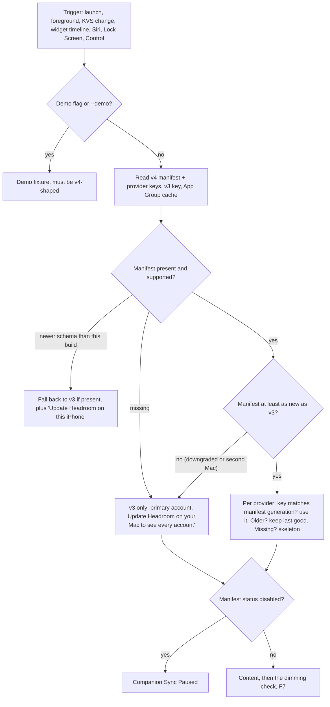
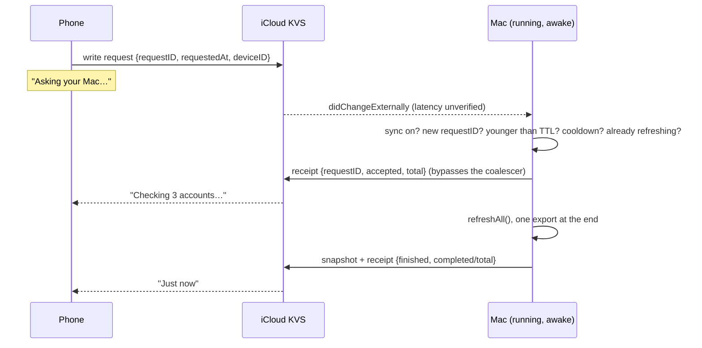

# Spec-flow analysis: iPhone & iPad parity round (2026-10-04)

Scope: the settled decisions in `.context/ios-parity/PLANNING-CONTEXT.md`, with the approved option
text read from `design/ios-parity-options.html`. Grounded in the repo at `06d082af` plus the working
tree. Read-only. Code claims cite `file:line`; "unverified" marks inference. Paths are under
`Sources/` unless they start with `Tests/`, `docs/` or `.context/`.

---

## 0. Headline findings

1. **The dual-publish rationale does not hold for any shipped phone.** The public App Store build
   1.0 (24) was built on 2026-07-20 at commit `1f4acb53` (`docs/release/1.1-release-evidence.md:74-85`).
   At that commit, the phone's decoder fully decodes the tree and then requires
   `snapshot.schemaVersion == 1` (`git show 1f4acb53:Sources/HeadroomCore/Sync/SyncedWidgetSnapshotModels.swift`,
   `decode`). Its `WidgetWindowSummary` uses synthesized `Codable` with a required `resetsAt: Date`
   (`git show 1f4acb53:…/WidgetSnapshotModels.swift:187`). Today's schema-3 windows encode
   `resetKind`/`resetDeadline` and never `resetsAt` (`HeadroomCore/Widgets/WidgetSnapshotModels.swift:395-418`).
   So build 24 decodes every current Mac payload as `.corrupt`. Depending on its cache, it shows
   "Snapshot Unreadable" or a snapshot frozen from before Mac 1.1.2 (Jul 28), the first schema-2 Mac.
   No iOS build from 25 to 33 was ever uploaded (`docs/release/ios-app-review-testflight.md:4,159`;
   PLANNING-CONTEXT: build 33 is "archived for TestFlight").
   **Consequence:** keeping the v3 payload "so un-updated phones don't show Update Needed" protects
   only build-33 TestFlight testers (R1-A). The decision still works. Only its benefit is smaller
   than stated. Kyle's own phone (1.0/24) probably can't read his Mac today. That would be a second
   root cause next to the entitlement one in `BUGS.md:415-435`. This is derived from code and hasn't
   been seen on a device.
2. **The size safeguards and the pull-to-refresh receipt work against each other.**
   - U4: "publish at most about once a minute".
   - U5-B approved the streamed receipt "Checking 3 accounts… → ✓ Work · 2 of 3 → Just now".
   - `refreshAll()` exports once, at the end (`Engine/UsageStore.swift:772-791`).
   - `refreshNow()` has no in-flight guard (`UsageStore.swift:394-396`).
   - A full user refresh skips the duty-cycle gate and spawns one `claude` process per account
     (AGENTS.md, polling gotcha).
   So with no request protocol, a phone becomes a remote way to start CLI storms, and the receipt
   it waits for can sit behind the coalescer.
3. **Splitting the payload into several keys creates a consistency problem.**
   - The manifest, the per-provider keys and the v3 key each sync on their own schedule.
   - The iOS widget extension reads KVS itself (`HeadroomIOSWidgets/HeadroomIOSTimelineProvider.swift:46-62`).
   - Siri, Lock Screen and Control will too.
   So the assembly and resolution rules have to live in one tested Core resolver, not in the app.
   A downgraded Mac, or a second Mac on 1.4.1, keeps writing v3 while the v4 keys stop changing.
   Newest-wins therefore has to work across both formats.
4. **"Per-device choice" for CloudKit reminders may not be possible with a plain private-database
   subscription.** Private-database subscriptions belong to the iCloud user. A visible push most
   likely reaches every device of that user that registered for notifications (unverified; the
   spike must check). The Mac side has two traps too:
   - `NotificationCoordinator` evaluates only while the Mac's reminder switch is on
     (`Notifications/NotificationCoordinator.swift:81`).
   - It writes a ledger only after the poster accepts (`:102`, `:127`).
   So a CloudKit channel needs its own idempotency key and its own enable rule. Otherwise a Mac
   with notifications denied would re-send the same reminder to the phone on every merge.
5. **Privacy promises are already looser than the copy.**
   - Account labels are free text up to 40 characters (`Settings/AccountRegistry.swift:236-240`),
     so a user can name an account with their email address. "Never emails" can't be promised
     literally.
   - The privacy policy lists only "provider names, percentages remaining, reset times, and
     freshness timestamps" (`docs/release/privacy-policy.md:22-26`). Plan names and API spend
     amounts already sync.
   - Turning sync off has to delete the new per-provider keys, not just publish a "disabled" status.

---

## 1. User flows

### F1. The phone resolves what to show (app launch, foreground, KVS change, widget timeline, intent)

Today the app re-resolves on appear, on `scenePhase == .active`, on `onOpenURL`, and on
`didChangeExternallyNotification` (`HeadroomIOS/Views/IOSCompanionView.swift:47-63`). Widgets
re-resolve on each timeline, every 15 minutes at best (`WidgetSnapshotModels.swift:600-629`). The
diagram below is the flow the new data version implies. Every box is unspecified today.

- **Terminal states:** content, paused, setupNeeded (iCloud unavailable), waitingForMac, corrupt,
  update needed (this iPhone vs your Mac), demo.
- **Today's precedence rule to revisit.** Any `.incompatibleSchema`, in the cache or in sync, beats
  usable content (`Sync/IOSWidgetTimelineMapping.swift:56-58`; `SyncedWidgetSnapshotModels.swift:82`).
  Once v3 and v4 are read side by side, an unreadable v4 must not hide a readable v3.

### F2. Mixed versions during the rollout window

| Mac | Phone | Phone app shows | Phone widgets | Mac widgets |
|---|---|---|---|---|
| ≤ 1.4.1 (v3 only) | 1.0 (24), public | "Snapshot Unreadable", or a frozen pre-Jul-28 cache (finding 1) | Same | Unchanged (local file) |
| 1.5 (v3 + v4) | 1.0 (24) | Same as above. Dual-publish doesn't help | Same | Unchanged |
| 1.5 | Build 33, TestFlight (v3 reader) | Main account only, July design | v3 | Unchanged |
| ≤ 1.4.1 | 1.5 | v3 fallback. Every v4 feature has to degrade (I9) | v3 fallback through the same resolver | Unchanged |
| 1.5 | 1.5 | v4, assembled per F1 | v4 through the shared resolver | Should stay v3 (INVENTORY D4) |
| 1.5, downgraded to 1.4.1, or a second Mac on 1.4.1 | 1.5 | v4 keys stop changing while v3 keeps moving. Must pick v3 by `generatedAt` (C1) | Same | n/a |
| 1.6+ (v3 retired) | Build 33 | Stays frozen on the last v3 forever, unless retirement writes an "incompatible" marker to the old key (C4) | Same | n/a |

### F3. Multi-account on the phone (U3-A stacked, U4-C data)

- **Entry:** F1 content. Each provider card lists its accounts, main first, then the Mac's order
  (`PopoverView.swift:61-63`).
- **Decision points:**
  - 0, 1 or many accounts per provider.
  - The surface-wide flip to account rows when any provider has 2 or more accounts
    (`Models/IdentityRowResolver.swift:5-9`).
  - Per-account state: live, stale, pending, signed out, or a capability problem.
  - The widget glyph on the account the widgets follow (U3-A note).
- **Mac-side events that must reach the phone:**

  | Mac event | Exports today? |
  |---|---|
  | Add account | No (`UsageStoreAccountLifecycle.swift:60-80`) |
  | Rename account | No (`:82-88`) |
  | Make Main | Yes (`:102-112`) |
  | Remove account or stop tracking the built-in one | Yes, through `detachAccount` (`:190-211`) |
  | Resume tracking | Yes (`:172-183`) |
  | An extra account's reading | No: only the primary account's merge exports (`UsageStore.swift:1282-1293`) |

- **Terminal states:** each account renders live, stale ("Last known"), pending (skeleton),
  unavailable ("—"), or attention ("Sign in to Work on your Mac").

### F4. Check now from the phone (U5-B)

Unhappy branches:
- **Mac asleep, quit, or offline:** no acknowledgement arrives, so the phone needs a timeout and
  honest copy.
- **Acknowledged, never finished:** the Mac slept mid-refresh, or KVS throttled.
- **Request arrives hours later:** after the Mac wakes, or on its first launch. The `InitialSyncChange`
  reason will deliver old keys.
- **Two phones or an iPad write the same key:** the last write wins and one request is lost.
- **Repeated pulls.**
- **Old Mac:** it never answers.
- **Sync paused:** there's no envelope to update.
- **Demo mode:** must never write.

### F5. Meter style "Same as Mac", with a phone override (U2-C, S2)

- **Entry:** Settings › Appearance.
- **Decisions:**
  - Match my Mac on or off. The approved text applies the same rule to percentages and to
    account-name ink. Theme stays phone-only.
  - The Mac's display preferences may be missing (old Mac) or present.
  - The Mac changes style while the phone overrides it.
  - The user switches back to "Same as Mac".
- **Today:** the Mac setters don't export (`UsageStore.swift:457-472`), so a change on the Mac
  reaches the phone only at the next export of the main account.

### F6. Reminders through CloudKit (S5-C, gated on a spike)

- **Path:** the Mac evaluates on a fresh live merge, writes a CloudKit record, the subscription
  fires, and the phone shows the banner.
- **Decisions:**
  - Per-device choice.
  - Phone permission granted or denied.
  - CloudKit account available on each device.
  - The Mac's own reminder switch and its notification permission.
  - Sync on or off.
  - The spike passes or fails.
- **Terminal states:** delivered once; never delivered (and the phone says why); delivered twice
  (Mac and phone, by choice); repeated (a bug to prevent).

### F7. Old-data dimming (batch item, BUGS "Old data is not dimmed")

- **Entry:** every render and every widget timeline entry.
- **Decisions:**
  - What the threshold is measured from: Mac heartbeat or reading time.
  - The Mac's chosen interval (2–60 minutes; `HeadroomApp/UI/SettingsPanes.swift:72`) and its
    effective interval, which stretches under the duty-cycle gate
    (`Engine/LaneSchedule.swift:292-304`).
  - A reset deadline that passed while the Mac was asleep.
  - Clock skew between Mac and phone.
  - The phone being offline.
- **Terminal states:** normal; whole surface dimmed with "No update from your Mac since 2:14 pm";
  a single row stale ("Last known"); a row past its reset.

### F8. Demo mode and App Store screenshot mode

- **Entry:**
  - Explore Demo (App Group flag) or the `--demo` launch argument (`Widgets/DemoScreenshotData.swift:15`).
  - Variants come only from App Group defaults (`:20-23`); there's no launch argument for them yet
    (APPSTORE §6.1).
- **New layouts that need demo data:**
  - Accounts
  - The plan capsule with banked resets
  - Display preferences
  - Receipts
  - iPad masonry
  - The widget wall
  - Siri answers

### F9. iPad masonry (U8-A)

- **Entry:** iPad at any width: portrait, landscape, Stage Manager, or a narrow window.
- **Decisions:**
  - Column count by width: 2 in portrait, 3 in landscape.
  - 1 to 4 providers, 1 to 20 accounts each, spend card or none.
  - Rotation or resize while open.
  - Dynamic Type size.
  - The iPhone also allows landscape (`HeadroomIOS/Info.plist`, `UISupportedInterfaceOrientations`).

### F10. Siri and Shortcuts (W9)

- **Entry:** "How much Claude is left?", the Shortcuts app, or Spotlight.
- **Decisions:**
  - Data state: content, stale, dimmed, pending, waiting for Mac, paused, iCloud unavailable,
    update needed, or demo.
  - Which account answers.
  - Which window answers.
  - Whether the provider is tracked.
  - Whether the device is locked.

### F11. Lock Screen widgets and the Control Center control (separate design session; this plan adds an empty stream)

- **Entry:** WidgetKit or ControlWidget asks for a value.
- **Decisions:**
  - Same resolver and same dimming as F1/F7.
  - Main account only.
  - Demo flag.
  - Reload hooks when the app adopts a new snapshot.
  - Whether macOS 26 accepts third-party controls (parity rule).

### F12. Sync turned off, and what syncs

- **Entry:** the Mac switch "Sync usage to iPhone". It's off by default
  (`Settings/Preferences.swift:232-235`). Its copy is "Sends only your usage numbers through iCloud.
  Sign-ins are never synced." (`HeadroomApp/UI/WidgetSettingsSection.swift:75-76`).
- **Decisions when it's turned off:**
  - What gets deleted from iCloud.
  - What the phone shows.
  - Whether check-now requests and CloudKit reminders still flow.

---

## 2. Gaps by severity

### Critical: blocks implementation or creates data or privacy risk

**C1. The v4 assembly and resolution contract is undefined.**
- **Missing:**
  - A generation (or `generatedAt`) shared by the manifest and each provider key.
  - The rule for a provider key that is older than, newer than, or missing from the manifest.
  - Removed providers: their keys stay in KVS until the Mac deletes them.
  - Newest-wins between v3 and v4 (F2, downgrade row).
  - Which cache file v4 writes.
  - The order in which the app, the widget extension, Siri, Lock Screen and Control reach their
    answer.
- **Why it matters:**
  - Without a generation rule, a card can briefly show three accounts from one export and two
    from another.
  - The surface-wide account-row flip (`IdentityRowResolver.swift:5-9`) can flip back and forth
    while keys arrive.
  - A downgraded Mac freezes a 1.5 phone on old v4 data.
- **Pattern:** today's newest-valid-wins resolver (`Sync/IOSWidgetTimelineMapping.swift:48-75`) and
  `SyncedWidgetSnapshotResolution.newestValid` (`Sync/SyncedWidgetSnapshotModels.swift:77-89`) are
  pure Core with tests. Extend that rather than writing resolution in the views.
- **Cache trap:** `WidgetSnapshotCache.write` refuses to write while any incompatible payload sits in
  the cache file (`Widgets/WidgetSnapshotCache.swift:110-113,146-155`). If the v4 envelope goes into
  `widget-snapshot.json`, reinstalling an older TestFlight build is stuck on "Update Needed".
  Use a separate cache file for v4.

**C2. The check-now protocol is undefined (F4).** The pieces it needs:
- **Request identity:** request ID, `requestedAt`, a device ID.
- **One key per device.** One shared key makes two devices overwrite each other, and one
  request is lost.
- **A time limit.** The Mac ignores requests older than a few minutes, so a request written
  overnight doesn't fire when it wakes.
- **Dedupe** by request ID.
- **Attach** to a refresh that's already running.
- **A cooldown** between phone-initiated full refreshes.
- **Gating:** only when "Sync usage to iPhone" is on.
- **A receipt shape**, and a rule that receipt writes skip the once-a-minute coalescer.
- **Phone-side timeouts** with copy.
- **Old-Mac detection,** so the phone doesn't promise a check it can't get.
- **What the phone does with a receipt for another device's request.** It should accept any Mac
  refresh that started after its own request.

Why it matters:
- `refreshNow()` → `refreshAll()` has no guard (`UsageStore.swift:394-396,772`).
- A full refresh drains every account one after another and skips the duty-cycle gate.
- At the tested 20 accounts per provider, one Claude lane pass is about 1–2 minutes on the print
  path (3–5 s per probe) and up to about 10 minutes on the PTY fallback (20–30 s each, AGENTS.md).
- Every pull would spawn that.
- The export happens only at the end (`UsageStore.swift:786-790`), so with no receipt the phone
  sees nothing for minutes.

Pattern: `refreshOnPopoverOpen` already gates on the age of the oldest live reading
(`UsageStore.swift:404-417`), which is a precedent for a "nothing to do" acknowledgement.

**C3. The CloudKit reminder channel has no delivery, idempotency or enable semantics.**
- **Per-device choice.** The plan has to say how "this iPhone only" works if subscriptions fan out
  to every device (finding 4). Options:
  - The Mac writes one record per enrolled device, and the predicate matches that device's ID.
  - Rely on iOS notification permission per device, and say so.
- **Idempotency.** Use a deterministic record name, e.g. hash(account, window, reset deadline, rule),
  so a second save never fires a second push.
- **A separate ledger for the CloudKit channel.** Today's ledger is written only when the
  local-banner poster accepts (`NotificationCoordinator.swift:102,127`).
- **Evaluation when the Mac banner is off.** Today the whole evaluation is skipped when the Mac
  switch is off (`:81`).
- **Gating.** Writes only while sync is on.
- **Record cleanup.**
- **Banked-reset notices.** The approved option text talks only about "use it up" reminders.
  Parity says both kinds.
- **Environment trap.** Xcode-run Mac builds write to the CloudKit Development environment while
  App Store and TestFlight phones read Production, so pushes "don't work" in testing. The schema
  must be deployed to Production before release.
- **Entitlements.**
  - Mac: `icloud-container-identifiers` is an empty array (`HeadroomApp/HeadroomApp.entitlements`).
  - iOS: no `aps-environment`, and no CloudKit services key in either iOS entitlements file
    (`HeadroomIOS/HeadroomIOS.entitlements`).
  - Developer ID plus CloudKit provisioning is the unverified part the spike exists for.

**C4. The v3 compatibility claim needs a retirement step and a test of the actual old decoder.**
- **Finding 1:** dual-publish protects only build 33.
- **Retirement:** when a later Mac stops writing v3, readers of the old key see data that silently
  stops updating. They never see "Update Needed" because nothing changes. Retirement should write a
  payload to the old key with a higher inner schema, which v3 readers turn into "Update Needed".
- **Tests use today's decoder, not the shipped one.** "Old phones ignore it" is tested against the
  current code (`Tests/HeadroomCoreTests/SyncedWidgetSnapshotModelsTests.swift`). The v3 decoder
  throws on unknown enum strings, for example an unknown `resetReason`
  (`WidgetSnapshotModels.swift:374-386`). So the v3 projection must never emit a value build 33
  can't parse. A frozen copy of the build-33 decoder, or a golden JSON from it, is the only honest
  test.

**C5. Privacy when sync is off, and what actually syncs.**
- When sync is off, the Mac publishes a `disabled` envelope with no providers
  (`UsageStore.swift:1082-1085`). That works because one key is overwritten.
- With per-provider keys, account names stay in iCloud unless the Mac deletes those keys
  (`NSUbiquitousKeyValueStore.removeObject`).
- The same goes for any stored CloudKit reminder records. Copy and policy are covered in I13.

### Important: affects UX, or developers will resolve it inconsistently

**I1. Export triggers and heartbeat.**
- **Need to export:**
  - `addAccount` and `renameAccount` (`UsageStoreAccountLifecycle.swift:60-88`).
  - The display setters (`UsageStore.swift:457-472`).
  - `reschedulePolling` (`:447`), so the phone's dimming threshold learns the new interval.
  - `setWidgetPrioritySource` (`:485-490`, already in BUGS).
  - `setShowCodexSparkCountersInApp` (`:610`).
  - Reminder settings, if the phone shows them.
  - An extra account's merges (D5).
- **Coalescer rules:**
  - Write a provider key only when its content changed, ignoring timestamps.
  - Write the manifest every time, as the heartbeat.
  - Keep a heartbeat at least once per chosen interval even when nothing changed, so dimming
    doesn't fire on a healthy idle Mac.
  - Bypass it for receipts and for "sync off".
- **Unknowns:** KVS write-throttling thresholds (Apple doesn't document numbers). The spike
  should measure them.

**I2. The dimming threshold (F7).**
- **What to measure from.** Using per-window `observedAt` would dim healthy data: with 20 Claude
  accounts, the gate legitimately stretches the effective interval past the chosen one
  (`LaneSchedule.swift:292-304`). The threshold should key off the Mac's heartbeat (the manifest's
  `generatedAt`) and the largest effective interval among enabled providers, sent in the manifest.
- **Clock skew.** A Mac clock running ahead makes "just now" stick, because the label clamps at 0
  (`Models/Countdown.swift:117-127`). Use min(`generatedAt`, the phone's first-seen time for that
  generation).
- **Copy.** The phone can't tell an asleep Mac from an offline phone or an iCloud outage. The line
  should read "No update from your Mac since 2:14 pm", never "Your Mac is asleep".
- **Resets that pass while the Mac is asleep.** The countdown holds "now" past the deadline by
  design, because on the Mac a fresh reading lands about 30 s later (`Countdown.swift:68-84`;
  `PollPhasing.postResetGrace`). On a phone whose Mac is asleep, a red "3% left · now" can persist
  for hours while the real value is 100%. The phone needs a past-reset rule, e.g. after deadline
  plus 10 minutes with no newer reading, hide the number and say "Reset at 2:00 pm · waiting for
  your Mac".
- **No double dimming.** A whole-surface dim and a per-row stale must not stack opacity.
- **Widgets.** The timeline already has an entry every minute (`WidgetSnapshotModels.swift:600-625`),
  so widgets can cross the threshold on their own. Lock Screen and Control (I12) need the same rule.

**I3. Typed attention mapping.**
- `ProviderSetupOutcome` has about 28 cases (`Models/ProviderSetup.swift:81-156`) plus
  `FailureReason` (`UsageModels.swift:353-388`) and `ProviderCapabilityState`. INVENTORY D2 proposes
  8 attention values.
- The plan needs a complete many-to-one table, including:
  - Cursor trust and MCP approval
  - `codexStorageMismatch`
  - `versionUnreadable`
  - `neverOnboardedExtraAccount`
  - Claude's "Update Claude Code" floor
  - A sign-in still in progress (a Terminal handoff is open, so the phone should say "Finishing
    sign-in on your Mac…", not "Sign in to Work on your Mac").
- New phones must decode an unknown attention value as a generic fallback ("Needs attention on your
  Mac"), not throw. Otherwise every later case added inside v4 forces another schema bump.
  `WidgetLayoutStyle`'s unknown-value fallback is the pattern.
- Capability failures are withheld from snapshots (AGENTS.md), so they need a provider-level field.
  The account row alone won't carry them.

**I4. De-duplicating titles without emails.**
- On the Mac, duplicate or default labels are told apart by email
  (`IdentityRowResolver.swift:30-43`). The phone can't do that.
- **Duplicate labels** (two "Work" accounts): a suffix like "Work · 2" has to be stable across
  Make Main. Number it by the account's registry order, not its display order, or the "· 2" jumps
  between accounts.
- **Default labels** "Main" and "Account 2" (`Models/Account.swift:34,64-66`) aren't duplicates, but
  they can't be told apart on the phone. Decide whether the plan chip is enough.
- **Surface-wide flip.** The Mac must send the resolved title, and the phone computes the flip from
  the accounts it actually rendered (C1).

**I5. "Same as Mac": the unspecified parts.**
- Whether it's one "Match my Mac" switch or one per setting (style, percentages, ink).
- **Seeding the override.** When the user first turns Match off, the override should start from the
  Mac's current values, so nothing jumps.
- Whether the override is remembered after switching back to Match.
- **Old Mac (no display preferences):** "Same as Mac" resolves to the default `micro.chip.event`.
  Settings should say so instead of claiming to match.
- **"Used" mode makes the app and widgets disagree on one device.** The app shows "38% used" while
  the widgets always show what's left (`BUGS.md` WCD1 and "Envelope schema stays at 3"). Siri
  wording is the same question (I7).
- **Codex Spark rows.** The phone's "Spark rows in the app" switch only works if v4 always carries
  Spark rows, flagged as such. Today the projector filters them by the Mac's *widgets* switch
  (`UsageStore.swift:1098`; INVENTORY P55). Widgets then filter by that switch themselves.

**I6. Demo and App Store screenshot mode.**
- **Research docs disagree with the code.** APPSTORE §6.1 item 5 says `--demo` "already hides the
  DEMO badge". The code only hides the Exit button. The banner still shows
  (`IOSCompanionView.swift:148-150`; `MirrorView.swift:24-31`), and the subtitle reads "Sample data ·
  No account connected" (`MirrorView.swift:79`). The iOS widgets draw a DEMO badge with a 14pt
  inset (`HeadroomIOSWidgets/Views/HeadroomIOSWidgetView.swift:40-43`).
- **Fixtures are v3-shaped** (`DemoScreenshotData.swift`). The multi-account, banked-reset,
  display-preference and receipt states need v4 fixtures plus a `--demo-variant` argument.
- **Check-now in demo must never write KVS.** It should either replay a local receipt for the
  screenshot or say demo data doesn't refresh.
- **Entrance, arrival and digit-roll motion (U7-B) against `sleep 8` captures.** Screenshot mode
  needs motion settled, or an XCUITest wait.
- The DEBUG `CompanionPreviewSeed` path writes the real App Group cache
  (`IOSCompanionView.swift:198-206`). Keep v4 out of the real cache in previews too.

**I7. Siri and Shortcuts answers.** Unspecified:
- **Which account:** main is the obvious default; does it mention a tighter extra account?
- **Which window:** the approved mock answers with weekly. CONCEPTS.md "Closest to limit" suggests
  the tightest window.
- **Phrasing for:**
  - Stale: "As of 2:14 pm…"
  - Dimmed: "No update from your Mac since…"
  - Pending
  - Unavailable windows
  - An untracked provider
  - Paused sync
  - Waiting for Mac
- **Lock state.** Whether to answer with account titles while the phone is locked.
- **Demo mode.**
- **Account entities.** A Shortcut built for "Claude Work" whose account was later removed on
  the Mac.
- **Used/left.**

**I8. iPad masonry.**
- **Column assignment.** If columns re-pack whenever a card's height changes (receipt line, plan
  capsule opening, an account added on the Mac), cards jump between columns. Assign columns only
  when the width or the provider/account set changes.
- **VoiceOver order** must follow provider order, not visual position.
- **Column count must be width-based,** not size-class-based: Stage Manager windows and narrow
  windows fall back to 1 column. At larger Dynamic Type, the minimum card width grows.
- **iPhone landscape is allowed.** Does it get 2 columns?
- **One provider with no spend:** one card, still mostly empty (the honest caveat in U8).
- **Rotation and resize** reflow positions without replaying the entrance (U7-B).

**I9. Old Mac with a new phone: per-feature behavior when only v3 exists.**
- **Accounts:** main account only, plus "Update Headroom on your Mac to see every account".
- **Check now:** pull only re-reads, with a one-line note.
- **Display preferences:** defaults.
- **Typed attention:** today's generic line.
- **Banked resets:** hidden.
- **Dimming:** a fixed default threshold.
- **Receipts:** none.

None of this is specified.

**I10. Receipts within the coalescer and KVS latency.**
- Progress updates may arrive late, out of order, or all at once.
- They should only ever move forward; a lower `completed` is ignored.
- If the finished snapshot arrives before the progress, skip straight to "Just now".
- Each receipt names its request ID, so another device's receipt still satisfies "a refresh started
  after mine".

**I11. Reminder state seen from the phone.**
- If the phone's reminders are on but the Mac's rules are off, nothing ever arrives. The phone
  needs the Mac's reminder summary in the manifest to say so.
- The phone also has to show:
  - Permission denied (link to iOS Settings).
  - CloudKit account unavailable.
  - The spike failed: S5-A copy "Reminders come from Headroom on your Mac". This build path must be
    plannable on its own, and App Store copy must not claim phone reminders (APPSTORE §5.6).

**I12. The Lock Screen and Control data contract.**
- **No spec in this repo.** Searched `design/` and `.context/`. This plan has to pin the contract
  that stream will consume:
  - The shared resolver (C1)
  - Main account only
  - The dimming rule (I2)
  - The demo flag
  - Reload hooks: `WidgetCenter.reloadAllTimelines` for accessory widgets, and the
    ControlCenter reload API for controls, both on snapshot adoption.
- **The Control's value goes stale.** It refreshes only when the system or app asks (W6
  unverified), so a stale "Claude · 38% left" needs a visible dimmed or "as of" treatment.
- **macOS 26.** WWDC25 brought controls to macOS (unverified for this project). Under the parity
  rule, the plan has to say whether the Mac gets one or why not.

**I13. Privacy copy now that account titles sync.**
- **The Mac line** "Sends only your usage numbers…" (`WidgetSettingsSection.swift:76`) becomes false.
- **The privacy policy** lists less than what already syncs (`docs/release/privacy-policy.md:22-26`).
- **The App Store privacy paragraph and review notes** need the same update.
- **The new list of what syncs:**
  - Account names you chose (which can be anything; finding 5)
  - Plan names
  - API spend amounts
  - Display preferences
  - Check-now requests from the phone
  - Reminder text through CloudKit, in your private iCloud database
- **Account names leave the phone screen** through Siri, notification previews and Lock Screen
  widgets.
- The App Privacy label ("Data Not Collected") most likely stays valid, since it all lives in the
  user's own iCloud (unverified against Apple's definitions; confirm in the release pass).

### Minor: has a reasonable default

- **M1. iCloud account change on the phone.** The App Group cache keeps the previous Apple ID's
  usage and account names. Clear the cache on `NSUbiquitousKeyValueStoreAccountChange`.
- **M2. Multiple Macs are deferred** (`docs/plans/2026-07-04-002-feat-ios-companion-widget-icloud-plan.md:87,485`),
  but this round makes them worse:
  - Split keys can interleave two Macs' providers.
  - Both Macs answer check-now.
  - Both send pushes.
  Default: the manifest names its source, and the phone assembles only that source's keys.
- **M3. Empty states.** With zero providers and no spend, the phone renders a blank screen
  (`MirrorView.swift:31-47`). Needs a line like "Your Mac isn't tracking any subscriptions".
- **M4. The widget glyph (U3-A) on a provider the widgets don't show.** Only two providers appear
  in widgets (`WidgetSnapshotModels.swift:94-111`). Show the glyph only on providers in the widget
  selection.
- **M5. The banked-reset reveal memory is phone-local** (U6-A). The first install shows no reveal
  for counts that already exist. That's acceptable; state it.
- **M6. 20 accounts × 3 rows in one Claude card.** That's about 60 meters entering and rolling at
  once. Cap the arrival stagger and keep the arrival registry per account (INVENTORY M3).
- **M7. The Mac's KVS observer.** It hops to the main actor and filters by changed keys
  (`NSUbiquitousKeyValueStoreChangedKeysKey`). It treats `InitialSyncChange` as "evaluate requests
  against the time limit" and never as "act on everything".
- **M8. A "Designed for iPad" Headroom already installed on a Mac** reads and writes the same KVS
  store and could send requests. A5-A stops new installs; whether existing ones stay is
  unverified (APPSTORE §7).
- **M9. Siri on the Mac.** App Intents work on macOS and the Mac has live data. Parity could add
  them cheaply. Record the decision either way.
- **M10. ⌘R on an iPad hardware keyboard** could map to check-now, mirroring the Mac shortcut.

---

## 3. Questions, by priority

1. **Dual-publish:** keep it, drop it, or redirect it?
   - Stakes: no shipped phone reads v3 (finding 1). Keeping it serves only build-33 testers and
     adds a retirement step. Dropping it simplifies the Mac.
   - Default: keep it (cheap insurance while build 33 is on TestFlight), but fix the rationale in
     the plan and add the C4 retirement marker and a frozen build-33 decoder test.
2. **Check-now rules:** time limit, cooldown, what gets refreshed, timeouts, progress cadence.
   - Stakes: CLI storms, phone spinners that never stop, dishonest receipts.
   - Default:
     - Requests older than 10 min are ignored.
     - One phone-initiated full refresh per 60 s. Inside that window, acknowledge as "Your Mac
       checked a moment ago".
     - Attach to an in-flight refresh.
     - Same work as the Mac's Refresh button (`refreshAll`).
     - Phone acknowledgement timeout 60 s, then "Your Mac hasn't answered. It may be asleep, or
       Headroom isn't open." Keep listening until the time limit.
     - Finish timeout = acknowledgement + max(3 min, 30 s × accounts).
     - Receipt writes at accept, at most every 15 s while running, and at finish, all skipping the
       coalescer.
     - The pull spinner releases after the write; status shows in a line under the title.
     - The spike supplies real p50/p95 KVS latency to replace these numbers.
3. **Requests while sync is off?**
   - Stakes: privacy intent, and wasted CLI runs.
   - Default: the Mac ignores them, and the paused phone doesn't offer pull-to-check.
4. **Per-device reminders under CloudKit fan-out:** device-targeted records, or iOS permission per
   device?
   - Stakes: an iPad buzzing when the user chose iPhone only; build size.
   - Default: the spike confirms fan-out. If confirmed, "this device" maps to the device's own
     notification permission, and Settings says so. Device-targeted records are a follow-up.
5. **Who turns phone reminders on?**
   - Stakes: the Mac must evaluate and write even when its own banner is off.
   - Default: the Mac's rules stay the source of truth. Add a Mac switch "Also send to iPhone and
     iPad", off by default. The phone shows the Mac's rules read-only plus its own permission.
     Banked-reset notices are included (parity).
6. **"Match my Mac": one switch or three?**
   - Stakes: Settings layout and the states to design.
   - Default: one switch covering style, percentages and name ink. The override starts from the
     Mac's current values and is remembered.
7. **Dimming formula and the past-reset rule.**
   - Stakes: honesty of the numbers, the round's top principle.
   - Default:
     - Dim the whole surface when now − min(manifest `generatedAt`, first-seen) >
       max(15 min, 2 × the largest effective interval).
     - Copy: "No update from your Mac since 2:14 pm".
     - Past-reset: deadline + 10 min with no newer reading → hide the number, "Reset at 2:00 pm ·
       waiting for your Mac".
     - Widgets, Lock Screen, Control and Siri all use the same Core rule.
8. **Title de-duplication.**
   - Default: the Mac sends a resolved title. Duplicates get " · 2" by registry order. Default
     labels are sent as-is. Never an email field. Labels that look like emails go through
     unchanged, and the copy says "account names you chose".
9. **Siri: which account and which window answer?**
   - Default: the main account and its tightest window, plus the weekly if different, plus a
     mention of any other account that's tighter.
   - Every answer carries its age, and the dimmed state changes the opening phrase.
   - Demo: "Headroom is showing demo data."
   - Locked: answer without account titles.
10. **iPad and iPhone landscape column rules.**
    - Default: width-based on every device. Column assignment is recomputed only when the width or
      the provider/account set changes.
11. **Old Mac with a new phone:** show pull-to-check at all?
    - Default: no. Pull re-reads, plus one line "Update Headroom on your Mac to check from here and
      see every account".
12. **Widgets and "used" mode.**
    - Default: widgets stay "left" (WCD1). A phone Settings note says "Widgets always show what's
      left." Siri says "left".
13. **What to drop first when iCloud quota is hit.**
    - Default: slim rows (already planned) → drop extra accounts' model rows → cap with "N more on
      your Mac". Only on an observed quota violation, never preemptively. The Mac publish path stops
      swallowing errors (`iCloudSnapshotSync.swift:93,109-112`).
14. **Multiple Macs:** still out of scope?
    - Default: yes, but the manifest carries a source ID, and the phone never assembles across
      sources.
15. **Screenshot mode.**
    - Default: `--demo` hides the banner, uses a fixture stamp ("Updated just now"), settles motion
      before capture, and hides the widget DEMO badge in screenshot launches only. Explore Demo keeps
      its neutral banner.
16. **macOS 26 Control Center parity.**
    - Default: verify support. If it's supported, record "Mac already has the menu bar pill" as the
      reason not to build one this round.

---

## 4. Verification scenarios

Each needs a Core test, a two-device check, or both. "2-device" means a real Mac plus an iPhone on
the same Apple ID. A simulator doesn't sync KVS reliably (unverified).

**Data and compatibility**
- **V1.** A golden build-33 decoder (frozen copy or JSON fixture) decodes the new Mac's v3 output for
  every demo scenario, including Grok/Cursor billing pools, unresolved resets and spend
  (`SyncedWidgetSnapshotModelsTests` pattern).
- **V2.** A 1.5 phone with only a v3 key: main account only, the I9 degrades, no check-now offered.
- **V3.** A v4 manifest older than v3 (downgrade): the phone shows v3. Then a newer manifest: back
  to v4.
- **V4.** Provider keys out of order:
  - The manifest is generation 12, Claude's key is 11 → Claude stays on 11, no mixed accounts.
  - Codex's key is missing → skeleton.
  - The manifest drops Grok but its key remains → Grok hidden.
- **V5.** A future schema in v4 with v3 present → v3 content plus "Update Headroom on this iPhone",
  not a blocking "Update Needed".
- **V6.** v4 goes into a separate cache file. Reinstalling build 33 afterwards still decodes the
  old-format file (C1 cache lock).
- **V7.** Turning sync off removes every per-provider key. The phone goes to Paused, and no account
  title remains in KVS (dump with `--dump-phone-sync`, extended to list keys).
- **V8.** Encoded v4 has no `email`/`accountEmail` keys and no config paths. Extend
  `encodedPayloadContainsNoKnownSecretStrings`.
- **V9.** 20 accounts per provider, with slim rows: the per-key byte counts are measured in Swift
  and stay under the chosen budget. A simulated quota-violation notification triggers the degrade
  order.

**Multi-account**
- **V10.** Add, rename, remove, Make Main, stop tracking and resume tracking on the Mac, each
  reaches the phone within the coalescing window. Rename and add are covered (they don't export
  today).
- **V11.** A stop-tracked built-in account: the phone shows the first extra account as main, and
  the widget glyph moves to it.
- **V12.** A never-signed-in extra account: "Sign in to Account 2 on your Mac", no skeleton forever.
  A sign-in still in progress shows the in-progress line.
- **V13.** Two accounts named "Work": "Work" and "Work · 2". Make Main swaps their order but not
  their suffixes.
- **V14.** The surface-wide flip: one provider grows from 1 to 2 accounts while the other providers'
  keys are older. Titles flip once, with no flicker.
- **V15.** Every `ProviderSetupOutcome` and capability state maps to an attention value. An unknown
  string decodes to the fallback.

**Check now**
- **V16 (2-device).** Mac awake: pull → acknowledgement → progress → "Just now". Record latencies
  (the spike).
- **V17 (2-device).** Mac asleep or quit: acknowledgement timeout copy at 60 s. Waking the Mac
  inside the time limit later acknowledges and finishes. Outside the limit, it doesn't fire.
- **V18.** Five pulls in 10 s → one request ID on the phone and one refresh on the Mac (count the
  `claude` spawns in a mocked lane).
- **V19.** iPhone and iPad pull 2 s apart → one Mac refresh, and both devices finish.
- **V20.** A pull during a Mac-initiated refresh: attaches to it, no second fleet.
- **V21.** A pull with sync paused or in demo: no KVS write.
- **V22.** The Mac quits after acknowledging → the phone's finish-timeout copy appears, and the next
  normal export clears it.

**Display preferences**
- **V23.** The Mac changes its meter style with Match on: the phone dissolves to the new style. With
  Match off: no change. Switching Match back on → the Mac's style.
- **V24.** Old Mac with Match on → default style, plus the explanatory note.
- **V25.** Used/left and name ink follow the same rule. Widgets keep "left".
- **V26.** The Spark in-app switch on the phone works while the Mac's widget Spark switch is off.

**Reminders (only if the spike passes)**
- **V27 (2-device).** One reminder → exactly one push per device. A re-save of the same record
  sends no second push.
- **V28.** Mac notifications denied plus phone delivery on → the phone still gets exactly one.
- **V29.** Phone permission denied → Settings shows it, with a link to iOS Settings.
- **V30.** The phone has no iCloud account → Settings says why.
- **V31.** Xcode-built Mac (Development) with a TestFlight phone (Production) → document the
  mismatch in the spike notes.

**Dimming**
- **V32.** Mac asleep 30 minutes at a 5-minute interval: app, widgets, Lock Screen and Control dim
  together, with the "since" copy.
- **V33.** A 60-minute interval with a stretched Claude lane: no false dimming.
- **V34.** A reset deadline passes during sleep: the number is hidden after the grace period.
- **V35.** Mac clock 10 minutes ahead: dimming still fires (first-seen rule).

**Demo and screenshots**
- **V36.** `--demo --demo-variant multi-4` on iPhone and on iPad portrait and landscape: no banner,
  motion settled, no DEMO badge on the widget wall.
- **V37.** Explore Demo, then pull: no KVS write. Siri answers with the demo phrasing.

**iPad**
- **V38.**
  - 1, 2, 3 and 4 providers, with and without spend, in portrait (2 columns) and landscape
    (3 columns).
  - Stage Manager at the minimum window width → 1 column.
  - Rotation keeps the top card anchored and replays no entrance.
  - A receipt line appearing doesn't move cards between columns.
  - VoiceOver order equals provider order.

**Siri and privacy**
- **V39.** Siri for every state in F10. An account entity removed on the Mac → "That account isn't
  on your Mac anymore". Locked device → no account titles.
- **V40.** The privacy strings (Mac footnote, phone Settings, privacy policy, App Store description,
  review notes) match what V8 shows is on the wire.

---

## 5. Recommended next steps

1. **Settle Q1 (dual-publish) before planning the data stream.** Write the finding into the plan's
   risks. If Kyle's phone is still on 1.0 (24), check it on his device once: it's expected to show
   "Snapshot Unreadable" or a frozen July snapshot. That separates "entitlement" from "schema" in
   the existing BUGS entry.
2. **Write the v4 wire contract as one plan section before any stream starts:**
   - Manifest fields:
     - Source ID and app version
     - Generation and `generatedAt`
     - Status
     - Provider order and per-provider generation
     - Widget selection
     - Display preferences
     - Largest effective interval
     - Reminder summary
     - Receipt
   - Provider key shape
   - Deletion rules
   - Resolution order
   - The separate cache file
   This answers C1, C5, I1, I2 and I9. Put the resolver in Core so the app, widgets, Siri, Lock
   Screen and Control share it (C1). Parallel streams must code against this one written contract
   (CLAUDE.md "parallel streams" rule).
3. **Extend the KVS spike from latency only to the full check-now protocol** (Q2, Q3, V16-V22):
   - Measure p50/p95 for phone→Mac and Mac→phone.
   - Check write-throttle behavior under a burst.
   - Confirm the macOS menu bar app receives `didChangeExternally` while in the background.
   Feed the numbers into the timeouts.
4. **Have the CloudKit spike answer three yes/no questions, not one:**
   - Does a Developer ID Mac write to a private database?
   - Do private-database subscriptions fan out to every device (Q4)?
   - Can the alert text come from record fields so the copy stays on the Mac?
   If any answer is no, take the S5-A copy path and keep the reminders stream behind its own gate
   (I11).
5. **Add the missing export triggers and the coalescer heartbeat** as one Mac task with its own
   tests (I1). Fix `setWidgetPrioritySource` in the same task (it's already in BUGS).
6. **Write three copy tables before UI work:** attention values (I3), check-now states (Q2), and
   dimming plus past-reset (Q7).
7. **Correct APPSTORE.md §6.1 item 5:** the `--demo` banner is not hidden today. Add v4 demo
   fixtures and the `--demo-variant` argument to the screenshot stream (I6).
8. **Hand the Lock Screen/Control session a short data contract** (I12): resolver, main account,
   dimming, reload hooks, demo flag. Also the macOS 26 controls parity note.
9. **Update the privacy strings in one pass** with the release (I13, V40). Cover
   `WidgetSettingsSection.swift:76`, `docs/release/privacy-policy.md`, the App Store description,
   the review notes, and phone Settings.
10. **Add the deferred items to `BUGS.md` when planning lands:** M1, M2, M8, and finding 1's second
    root cause. The parent session owns that edit; this agent is read-only.
