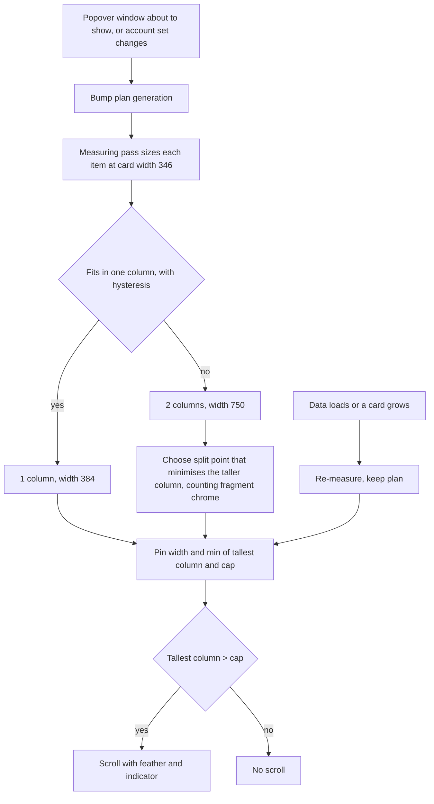

# Popover Account Layout - Plan

## Goal Capsule

- **Objective:** A person tracking many accounts (the motivating case: 7 Claude + 1 Codex) sees every account in the Mac popover at once without scrolling, up to the 20-per-provider tested envelope where practical. A person with a few accounts sees no change.
- **Means:** One Settings → Appearance picker, **Account layout: Standard / Compact**. Both share one automatic column rule: one column until the cards would pass the height cap, then two (KTD1, KTD2).
- **Authority:** Product decisions come from the 2026-10-08 conversation and `design/popover-columns-layout-options.html` (HC-C, HC-D, HC-E, HD-1 to HD-8). On product behavior the R-IDs win. On mechanism within those constraints the KTDs win. Units override neither.
- **Stop conditions:** Stop and ask Kyle before any of these:
  - Any live on-screen check: the U1 anchoring spike and the U9 acceptance pass. Both drive the real menu bar.
  - Continuing with the two-column work (U5, and U6's two-column case) if a 750pt `MenuBarExtra` window does not anchor and stay on-screen acceptably. That result changes the plan; single-column Compact can still ship.
  - Shipping Compact's dense row sizes. They are proposals from the options doc, not tokens.

  Also stop if evidence shows a Key Decision cannot work as written. Do not quietly redesign it.
- **Execution profile:** Standard. U1 first (gated). U2, U3 and U4 can run in parallel with U1 (Core, file-owned). U6's single-column path needs only U2 and U4. U5 waits for U1's approval. U5 and U6 run in order because they share `PopoverView.swift` and `ProviderCardView.swift`; U6's two-column case lands after U5. U7 follows U6 because the specimen needs the Compact row. U8 follows U6. U9 last. A `ce-code-review` pass runs on the merged tree before the PR, per the parallel-streams rule.
- **Tail ownership:** The implementer ships through `ce-commit-push-pr` with `babysit:off`.

---

## Product Contract

### Summary

Add an **Account layout** picker to Settings → Appearance with two values. **Standard** keeps today's provider cards. When they would not fit under the cap, accounts flow into a second column, down then across. **Compact** shows one dense row per account and uses the same column rule. The popover widens only when it needs a second column.

### Problem Frame

A user with seven Claude accounts reported that the popover "fits like 5 accounts well but would be nice to see more without scrolling." The cards are height-capped at 640pt and scroll past that. `multi-5` (5 Claude + 3 Codex) already scrolls. The user also could not tell which account was which on the phone; that is a separate plan (email as title).

`MenuBarExtra(.window)` offers no resize handle, so "drag the bottom to resize" is not available. Wider content is the remaining direction.

### Requirements

**Layout picker**

- R1. Settings → Appearance offers **Account layout** with two values, Standard (default) and Compact.
- R2. The choice persists across launches and applies to every provider and every account (Claude, Codex, Grok, Cursor).
- R3. The choice is Mac-only. The phone, widgets and menu bar label do not change (see KTD8).

**Column rule (shared by both layouts)**

- R4. The popover shows one column while the single-column content fits under the cards-height cap. Past the cap it shows two columns. It never shows more than two.
- R5. Content reads down the first column, then down the second. The first provider's main account is top-left. The API spend card is the last item in the flow.
- R6. The column count is decided when the popover opens and when the account set changes. It does not change because data loads, a card grows, or a value updates while the popover is open.
- R7. With two columns, the popover is exactly two card widths plus one gap wide. It is never a width between one and two columns.
- R8. When two columns still exceed the cap, the popover scrolls as today, with the existing feather and scroll indicator.

**Standard**

- R9. Standard uses today's account sections unchanged. A provider whose accounts span both columns is drawn as two card fragments. In capability recovery, only the first fragment carries the provider header row and the notice. Otherwise fragments add no header; each account row already carries its provider mark.
- R10. Every per-account decision that depends on the whole provider is unchanged by splitting: row titles, persistent emails, the menu-bar account marker, setup and Stop Waiting rows.

**Compact**

- R11. Compact shows one row per account: identity (title, with email when today's rules show it) and up to two compact meters, each with a short visible window label and its value.
- R12. A provider with more windows than fit shows a "+N" count. The full list is available in the row's tooltip and to VoiceOver.
- R13. Reset times move to the tooltip and to the VoiceOver value. They are never dropped.
- R14. Compact meters draw as the Micro twin of the user's meter style.
- R15. An account that is not showing live or stale usage (signed out, waiting on setup, capability failure, recovery) shows its Standard account section in place. Compact never hides an action.

### Key Decisions

- **Two layouts, one picker: Standard (HC-E over HC-C) and Compact (HC-D).** (session-settled: user-directed — chosen over provider columns HC-A and in-card grid HC-B: Kyle picked E and D as user-selectable options.) Governs R1, R9, R11.
- **Both layouts add columns automatically; there is no separate "Single column" setting.** (session-settled: user-approved — chosen over HD-1's Automatic + "Single column" option: users under the cap never see a change, so the extra option adds nothing.) Governs R4, R6.
- **Maximum two columns.** (session-settled: user-approved — chosen over three: three columns is 1116pt, wider than is comfortable on a 13" Air.) Governs R4, R7.
- **"Fit all accounts" height setting is deferred.** (session-settled: user-approved — chosen over shipping it now: two columns plus Compact may remove the need.) Governs R8.
- **Email-as-title is a separate plan.** (session-settled: user-approved — chosen over bundling: it changes what syncs to the phone and needs its own privacy review.)

### Success Criteria

- `--demo multi-7` (7 Claude + 1 Codex) fits without scrolling in both layouts (options doc measured Standard 750 × 436, Compact 384 × 344).
- `multi-5` fits without scrolling in both layouts.
- One-provider, one-account users see a popover identical to today's in Standard.
- No regression in `--bench-ui popover` and `counts` at single, multi5 and multi20 against a back-to-back baseline.

### Scope Boundaries

- No popover drag-reorder. Make Main stays in Settings → Accounts.
- No three-column layout and no manual column count.
- No phone, iPad, widget or menu-bar change.

#### Deferred to Follow-Up Work

- "Fit all accounts" height setting.
- "Use account email as title" (separate plan).
- Render harness: Grok/Cursor and spend card in the multi path (`BUGS.md`, "The harness's multi-account path renders neither Grok/Cursor nor the spend card").

---

## Planning Contract

### Key Technical Decisions

- KTD1. **A new pure Core planner partitions items column-major.** `AccountColumnsPlanner` (Core `Models/`) takes an ordered item list with measured heights and the cap, and returns column count and a contiguous split point. Items are accounts plus one optional spend item. Its height model matches `ProviderCardView`: 13pt top and bottom padding per card or fragment, a 20pt gap between cards, and a 26pt gap between accounts in the same card, dropped at a split. The first item of a provider in capability recovery also carries the header-plus-notice height. It picks the split that minimizes the taller column. `FlowingColumnsPlanner.assign` is shortest-column masonry and cannot give down-then-across order (R5), so it is not reused. Reuse `FlowingColumnsGeometry`-style column x math and `placement(heights:)`'s tallest-column `contentHeight`.
- KTD2. **Column count comes from the single-column natural height, and the plan is kept until a replan trigger.** Count = 1 if the sum of single-column heights ≤ cap, else 2, with hysteresis: when the previous plan had two columns, it stays at two until the single-column sum is at or below the cap minus one account-row allowance (the tallest single account section in the current item list). This stops the width flipping between opens as row heights shift near the cap. Replan triggers: a popover-open generation token, a change to the ordered item ID list, and a layout preference change. Height changes alone never replan, matching the iPad rule (`FlowingColumnsPlan.replanReason`, heights excluded from plan identity). A Make Main reorder while open changes the ID list, so it re-partitions; it may move an account between columns but recomputes count by the same rule.
- KTD3. **The plan is resolved before the view tree is built; placement within it is layout-owned.** A SwiftUI `Layout` cannot split a `ProviderCardView` into fragments or widen the window that contains it, so the plan cannot live only in a layout cache. The flow:
  1. A hidden measuring pass in `PopoverView` measures each account section and the spend card at card width 346. Measure through a `Layout` that reports sizes without placing anything visible, not a geometry-to-`@State` loop per item.
  2. `AccountColumnsPlanner` turns those heights into an `Equatable` plan. The plan is stored in a small `@Observable` model owned by `PopoverView`, written only when it changes (KTD10).
  3. `PopoverView`'s body builds the fragments and pins the shell width from the stored plan (KTD4, KTD6).
  4. A Mac-only `PopoverColumnsLayout` (`Sources/HeadroomApp/UI/PopoverColumnsLayout.swift`) places the fragment views into their columns.

  The first open after a change may render one pass with the previous plan before the new one lands. U1 measures whether that pass is visible. No `.offset`, and no `if/else` swap of the layout container between Standard and Compact. A per-account content change inside a card (Compact row versus Standard section, R15) is allowed; each account keeps its account key as its view identity. This follows `docs/solutions/ui/swiftui-layout-owned-drag-position.md` and `FlowingColumnsLayout`.
- KTD4. **Width and height are both pinned explicitly in `PopoverView`.** `MenuBarExtra(.window)` sizes to the content's ideal size (`docs/solutions/popover-scrollview-zero-height.md`). Add `PopoverCardMetrics.shellWidth(columns:)` (384 or 750) and promote the bare 640 literal to `PopoverCardMetrics.cardsHeightCap`. Read the layout preference and the plan only inside `PopoverView`, never in `HeadroomApp.body` (`docs/solutions/ui/menubarextra-window-closures-run-in-app-body.md`).
- KTD5. **No implicit animation on the columns container, the width or the column count.** The count and width change from a stored plan, outside any animation transaction. An `.animation(_:value:)` scope would grow the popover on every open (`docs/solutions/ui/popover-feather-animation-scope-grew-card-list.md`). A Standard ↔ Compact switch made in Settings needs no animation because the popover is closed.
- KTD6. **Card fragments receive the full provider entry list plus their own slice.** `isMultiAccount`, `rowTitle`, `showsPersistentEmail`, `isMenuBarAccount` and `activeSetupAccount` read the full list. Only the first fragment draws the capability-recovery header and notice (R9). Each fragment keeps the per-card `.id(meterRecipeKey)` ZStack wrapping, so a meter-style crossfade does not spike the measured height.
- KTD7. **Compact's content is decided by a pure Core recipe.** `CompactAccountRowRecipe` takes a snapshot, its freshness and the meter style. It returns: the two windows shown (5-hour then weekly for Claude and Codex; the two billing-period pools for Cursor; the billing period for Grok; slot order as the fallback), a short visible label per shown window ("5h", "wk", or the Cursor pool and Grok period short names; R11), the overflow count, the Micro twin style, and whether to fall back to the Standard section (R15). The Micro twin uses `shape.resolved(for: style.format)`, so a stored Full + Tube shows as the Chip the user sees today, matching `InAppDisplayTile`.
- KTD8. **The setting is Mac-only and does not sync.** It controls the Mac popover's cap and window width, which have no phone equivalent; the iPad already flows whole cards with `FlowingColumns`. Its setter does not call `exportPhoneSyncSnapshot()`, and `CompanionDisplayBlock` is unchanged. Provider parity holds on the Mac (R2). This is the stated platform-parity exception.
- KTD9. **The open generation fires before the popover's first frame.** `MenuBarExtra` may reuse the window and its view state across opens. The content `.task` that calls `store.refreshOnPopoverOpen()` runs after the view appears and first awaits `store.start()`, so a generation bumped there would show last time's width, then jump. Bump the generation from the popover window's become-key or will-appear signal, observed where `configurePopoverWindow` in `PopoverView.swift` already configures that window. Keep the generation in `PopoverView`'s plan model, not in the store or `HeadroomApp.body`. If U1 shows the content view is rebuilt on every open, a generation in `PopoverView`'s own `onAppear` is enough.
- KTD10. **Per-item heights stay out of root `@State`.** Heights from the measuring pass (KTD3) feed the planner directly. Only the resolved, `Equatable` plan (count and split) reaches the root's plan model, and only when it changes (`docs/solutions/ui/popover-scroll-geometry-state-rerendered-whole-popover.md`). The root keeps `cardsHeight` as the tallest column.

### High-Level Technical Design

Decision flow for one popover open:

Item stream (directional): `[Claude.main, Claude.2 … Claude.7, Codex.main, …, Grok…, Cursor, Spend?]` in `store.providerOrder` then Make Main order. A split inside Claude yields fragment A (accounts 1–k) in column 1 and fragment B (accounts k+1…) at the top of column 2.

### Assumptions

- `MenuBarExtra(.window)` anchors a 750pt window under the status item and keeps it on-screen. Unverified; U1 checks it before any other unit lands.
- The options doc's measured heights are within ±2pt of SwiftUI, enough to trust the success-criteria fixtures.
- Compact's 26pt row and its meter sizes are proposals. U6 confirms them against the Micro geometry in `MeterStyle.swift` and the identity-row width budget (`docs/solutions/ui/spend-identity-row-width-budget.md`).

### Risks & Dependencies

| Risk | Mitigation |
|---|---|
| Wide window anchors badly or jumps when the count changes while open | U1 spike first. R6 limits width changes to open and account-set changes. |
| The planner flaps between 1 and 2 columns as skeletons turn into data | KTD2: heights never replan. A first open with skeletons may scroll until the next open; accepted. |
| Fragment splitting breaks a whole-provider rule | KTD6 plus App tests that compare fragment rows to unsplit rows. |
| Re-render cost grows at multi20 | KTD10, `BenchCounters.hit` in new views, back-to-back bench. |
| Render harness can't prove two columns (fixed 432pt frame; multi-20 timing) | U8 fixes width and timing. Live U9 remains final evidence. |

### System-Wide Impact

- Performance: the popover root and `ProviderCardView` are hot paths at multi20 (~240ms per refresh today). New views must not pass fresh closures or `Date()` into children.
- Accessibility (best-effort per AGENTS.md): VoiceOver order follows R5 via `.accessibilitySortPriority`. Compact keeps reset times in the accessibility value.

---

## Implementation Units

### U1. Wide-popover anchoring spike (gated)

- **Goal:** Confirm a 750pt `MenuBarExtra(.window)` popover anchors under its status item and stays on-screen.
- **Requirements:** R7.
- **Dependencies:** none. Needs Kyle's go-ahead before it runs.
- **Files:** throwaway local change to `Sources/HeadroomApp/UI/PopoverView.swift` (not committed).
- **Approach:**
  1. Pin the shell width to 750 under `--demo multi-20`.
  2. Open the native popover with the status item near the right edge, then near the centre, of a 13"-class screen.
  3. Record placement, any jump on open, and what happens when the width changes from 384 to 750 while open. Demo account management is inert, so drive the change with a temporary toggle in the spike code.
  4. Record whether the popover's content view and its `@State` survive close and reopen (decides KTD9's trigger), and whether a one-pass stale plan on open (KTD3) is visible.
  5. Revert the change and record findings in the plan's Assumptions.
- **Test expectation:** none — throwaway spike; the evidence is the recorded observation.
- **Verification:** Kyle approves the observed placement, or the plan is revised.

### U2. Account layout preference and store mirror

- **Goal:** Persist Standard / Compact and expose it to the popover and Settings.
- **Requirements:** R1, R2, R3.
- **Dependencies:** none.
- **Files:**
  - `Sources/HeadroomCore/Models/UsageModels.swift` (new `AccountLayout` enum beside `AccountTitleInk`)
  - `Sources/HeadroomCore/Settings/Preferences.swift`
  - `Sources/HeadroomCore/Engine/UsageStore.swift`
  - `Sources/HeadroomApp/HeadroomApp.swift` (`--account-layout <standard|compact>` demo token, validated with `--demo` like `--account-title-ink`)
  - `Tests/HeadroomCoreTests/PreferencesTests.swift`
  - `Tests/HeadroomAppTests/DemoLaunchTokenTests.swift`
- **Approach:** Follow the `accountTitleInk` pattern: `String` raw values, `CaseIterable`, typed getter with unknown-value fallback, `nonmutating set`, store setter with equality guard. The setter does not call `exportPhoneSyncSnapshot()` (KTD8). Write the docstring accurately; the existing `accountTitleInk` comments wrongly say no phone projection reads it.
- **Patterns to follow:** `Preferences.accountTitleInk`, `UsageStore.setAccountTitleInk`.
- **Test scenarios:**
  - Default is Standard when the key is absent.
  - Setting Compact persists and reads back.
  - An unknown stored raw value reads as Standard.
  - The store setter with the current value does not publish a change.
  - The store setter does not mark the phone path dirty.
  - `--account-layout compact` under `--demo` seeds the preference; without `--demo` it is rejected like the other demo tokens.
- **Verification:** Core and App tests pass; `swift build` clean.

### U3. Account columns planner

- **Goal:** The pure partition decision for R4–R6 (KTD1, KTD2).
- **Requirements:** R4, R5, R6, R8.
- **Dependencies:** none.
- **Files:**
  - `Sources/HeadroomCore/Models/AccountColumnsPlan.swift`
  - `Tests/HeadroomCoreTests/AccountColumnsPlanTests.swift`
- **Approach:** Input: ordered items (ID, provider ID, height, isSpend), cap, gap 20, card padding 13, generation. Output: `Equatable` plan with count, split index, per-column placements and `contentHeight`. Keep to Foundation and `Double` because iOS targets compile `Models/` whole (KTD4 of the iOS parity plan).
- **Patterns to follow:** `FlowingColumnsPlan.swift` and `FlowingColumnsPlanTests.swift` (`aHeightChangeKeepsTheAssignment`, `addingACardReplansOnce`, `floatingPointNoiseDoesNotReplan…`).
- **Test scenarios:**
  - Total height under the cap → one column, no split.
  - Total exactly at the cap → one column.
  - 7 Claude + 1 Codex at Standard heights → two columns, Claude main in column 1 row 1, split inside Claude.
  - A split inside a provider adds fragment chrome to both columns' heights and drops the 26pt account gap at the split.
  - The single-column total for multi-5 equals today's measured `cardsHeight` for multi-5.
  - A provider in capability recovery counts its header-plus-notice height on its first item.
  - Spend item always lands last in column 2 when present; absent spend changes nothing.
  - 20 accounts per provider → two columns, `contentHeight` > cap (scroll case).
  - Never returns more than two columns.
  - A height change with the same IDs and generation keeps the split.
  - Adding or removing an item replans once.
  - Reordering (Make Main) replans and keeps the main top-left.
  - A new open generation replans with current heights.
  - Hysteresis: with a previous two-column plan, a single-column sum just under the cap stays at two columns; a sum below the cap minus one account-row allowance drops to one.
  - Heights hovering around the cap across successive open generations do not alternate the count.
  - Floating-point noise in heights does not replan.
  - A single item taller than the cap → one column, scrolls.
- **Verification:** `swift test` passes the new suite.

### U4. Compact account row recipe

- **Goal:** Decide every Compact row's content in Core (KTD7).
- **Requirements:** R12, R13, R14, R15, R2.
- **Dependencies:** none.
- **Files:**
  - `Sources/HeadroomCore/Models/CompactAccountRowRecipe.swift`
  - `Tests/HeadroomCoreTests/CompactAccountRowRecipeTests.swift`
- **Approach:** Pure function from `UsageSnapshot` windows, per-window freshness, account state and `MeterStyle`. Uses `UsageWindow.resetSchedule` text for tooltip and accessibility strings (shared semantic formatter rule).
- **Patterns to follow:** `MeterRecipe`, `WidgetStyleRecipe`, `WidgetWindowRanking`.
- **Test scenarios:**
  - Claude with session, weekly and Weekly (Fable) → shows 5-hour and weekly, overflow 1.
  - Codex `prolite` with only a weekly window → one meter, overflow 0.
  - Cursor with Cursor Models and Other Models pools → both pools, overflow 0.
  - Cursor with only `Included` → one meter.
  - Grok billing period → one meter.
  - A stale window keeps its stale freshness; an unavailable window shows no value.
  - Full + Tube stored → Micro twin with Chip shape; Micro + Tube → Tube.
  - Signed-out, setup-waiting, capability-failure and recovery states → fall back to Standard.
  - Pending first reading → compact skeleton, not fallback.
  - Tooltip and accessibility strings include every window's reset text, including overflowed ones.
  - Each shown window carries its short label: "5h" and "wk" for Claude and Codex, the pool short names for Cursor, the period short name for Grok.
- **Verification:** `swift test` passes the new suite.

### U5. Standard columns in the popover

- **Goal:** Render Standard through the planner with pinned width and height.
- **Requirements:** R4–R10.
- **Dependencies:** U1 (approved), U2, U3.
- **Files:**
  - `Sources/HeadroomApp/UI/PopoverColumnsLayout.swift` (new)
  - `Sources/HeadroomApp/UI/PopoverView.swift`
  - `Sources/HeadroomApp/UI/ProviderCardView.swift` (fragment parameters)
  - `Sources/HeadroomApp/UI/PopoverPlanModel.swift` (new; the `@Observable` plan model, KTD3)
  - `Tests/HeadroomAppTests/PopoverColumnsSizingTests.swift` (new)
- **Approach:**
  1. Add `shellWidth(columns:)` and `cardsHeightCap` to `PopoverCardMetrics` (KTD4).
  2. Replace the inner card `VStack` with `PopoverColumnsLayout`. Keep the outer `onGeometryChange`, ScrollView, feather and indicator.
  3. Flatten providers into account items; build fragments per KTD6.
  4. Keep the reorder and NB1 animation scopes on the layout's inputs, not the container frame (KTD5).
  5. Add `BenchCounters.hit` to new view bodies.
- **Patterns to follow:** `FlowingColumnsLayout` (cache, `placeSubviews`-only writes, layout value IDs, accessibility sort priority).
- **Test scenarios:**
  - Hosted popover with one provider and one account reports width 384 and today's height.
  - Hosted popover with 7 Claude + 1 Codex reports width 750 and a height under the cap.
  - Hosted popover at multi-20 reports width 750 and height equal to the cap.
  - A split Claude provider in normal mode shows no provider header in either fragment; in capability recovery the header and notice appear only in the first.
  - Row titles, persistent emails and the menu-bar marker in fragments match the unsplit card for the same accounts.
  - A Stop Waiting row stays with its account when that account lands in column 2.
  - A data-driven height change with the popover open does not change the width.
- **Verification:** App tests pass; `--bench-ui popover` viewport probe shows width and height reach their final values within the measuring pass plus at most one more layout pass on open, with no intermediate visible width.

### U6. Compact rows

- **Goal:** Render Compact through the same layout.
- **Requirements:** R11–R15.
- **Dependencies:** U2, U4 for the single-column path; U5 for the two-column case.
- **Files:**
  - `Sources/HeadroomApp/UI/CompactAccountRow.swift` (new)
  - `Sources/HeadroomApp/UI/PopoverView.swift`
  - `Sources/HeadroomApp/UI/ProviderCardView.swift` (Compact branch inside the card)
  - `Tests/HeadroomAppTests/PopoverColumnsSizingTests.swift`
- **Approach:** Rows sit inside provider cards so provider headers and capability notices stay. Meters render through `UsageBarView` or a compact sibling in the same file family so arrival and value motion (`land()`) are reused, not `MeterGauge` bare. Fallback rows use `AccountSectionView` unchanged. Avoid `ViewThatFits` in rows (snappiness checklist #8). Keep account view identity stable across Standard and Compact (KTD3).
- **Patterns to follow:** `UsageBarView` Micro `.help` and accessibility value; `IdentityRow` truncation.
- **Test scenarios:**
  - 7 Claude + 1 Codex in Compact reports width 384 and no scroll.
  - multi-20 in Compact reports width 750.
  - A signed-out account in Compact renders the Standard section with its action.
  - The row's accessibility value contains both windows' reset text.
- **Verification:** App tests pass. Headless Compact stills are U8's evidence.

### U7. Settings picker and specimen

- **Goal:** Expose the picker in Appearance and preview it.
- **Requirements:** R1.
- **Dependencies:** U2, U6.
- **Files:**
  - `Sources/HeadroomApp/UI/InAppDisplayTile.swift`
  - `Sources/HeadroomApp/UI/SettingsView.swift`
  - `Sources/HeadroomApp/UI/SettingsPanes.swift`
  - `Sources/HeadroomApp/UI/AppearanceSpecimen.swift`
- **Approach:** Add a swatch row in `InAppDisplayTile` beside the existing rows (HD-2). `SettingsView` owns the root state and loads it in `onAppear` (LP1). The specimen gains a Compact branch and stays one inert card.
- **Patterns to follow:** `InAppDisplayTile.swatchRow`, `selectionChrome`, `.accessibilityRepresentation { Picker }`.
- **Test scenarios:**
  - Choosing Compact writes the preference and the store mirror.
  - The specimen redraws as a Compact row with the current meter style.
- **Verification:** `--render-popover <dir>` Settings captures show both swatches; `--bench-ui settings` shows no regression.

### U8. Harness and bench support

- **Goal:** Make headless evidence possible for two columns and Compact.
- **Requirements:** R4, R7 (evidence).
- **Dependencies:** U2, U5, U6.
- **Files:**
  - `Sources/HeadroomCore/DemoFixture.swift`
  - `Sources/HeadroomApp/PopoverRenderHarness.swift`
  - `Sources/HeadroomApp/UIBenchHarness.swift`
  - `Sources/HeadroomApp/UIBenchModel.swift`
  - `BUGS.md`
- **Approach:**
  1. Add a `multi-7` scenario (7 Claude + 1 Codex) to `DemoFixture.MultiAccountScenario` and a matching bench scenario.
  2. Replace the fixed 432pt snapshot frame with the shell width.
  3. Honour `--account-layout` in the harness and bench.
  4. Wait for the demo store to settle before the multi capture, and remove the multi-20 timing entry from `BUGS.md`.
  5. Add a Compact bench scenario so `benchScroll` keeps a scrolling case.
- **Test expectation:** none — harness tooling; proven by its own output.
- **Verification:** `--render-popover` multi-20 capture shows live data at 750pt in both layouts.

### U9. Live acceptance and docs (gated)

- **Goal:** Final evidence and durable notes.
- **Requirements:** all.
- **Dependencies:** U5–U8. Needs Kyle's go-ahead for the live pass.
- **Files:**
  - `AGENTS.md` (architecture note on the popover layout)
  - `DESIGN.md` (cap and width tokens; Compact row tokens)
  - `docs/solutions/ui/popover-account-columns.md` (new)
- **Approach:** One batched live run per AGENTS.md's meter-acceptance rule: `--demo multi-5`, `multi-7` and `multi-20`, Standard and Compact, light and dark, with a non-default `--meter-style`.
- **Test expectation:** none — acceptance and docs.
- **Verification:** Kyle approves the live captures.

---

## Verification Contract

| Gate | Command | Applies to |
|---|---|---|
| Build | `swift build` | every unit |
| Core and unit tests | `swift test` | U2, U3, U4 |
| App tests | `./Scripts/build-app.sh --deps-only && xcodebuild -project Headroom.xcodeproj -scheme HeadroomAppTests -destination 'platform=macOS' -derivedDataPath ./.xcode-derived test` | U2, U5, U6, U7 |
| iOS build (Core `Models/` is compiled by iOS targets) | `xcodebuild -project Headroom.xcodeproj -scheme HeadroomIOS -destination 'platform=iOS Simulator,name=iPhone 17 Pro,OS=26.5' build` | U2, U3, U4 |
| Headless renders | `swift run Headroom --render-popover <dir> --account-layout <standard\|compact>` | U6, U7, U8 |
| Bench, back to back against main | `swift build -c release -Xswiftc -DHEADROOM_BENCH && .build/release/Headroom --bench-ui all --scenario <single\|multi5\|multi20>` | U5, U6, U7 |
| Live acceptance (ask first) | `swift run Headroom --demo <scenario> --account-layout <value> --meter-style <style>` | U1, U9 |
| Review | `ce-code-review` on the merged tree | before PR |

## Definition of Done

- Every R-ID is met and every unit's Verification holds.
- Success Criteria hold on the native popover in U9.
- Bench shows no regression at multi20 for `popover` and `counts`.
- No phone-sync key or display-block field changed.
- Spike code from U1 is reverted; no abandoned-attempt code remains in the diff.
