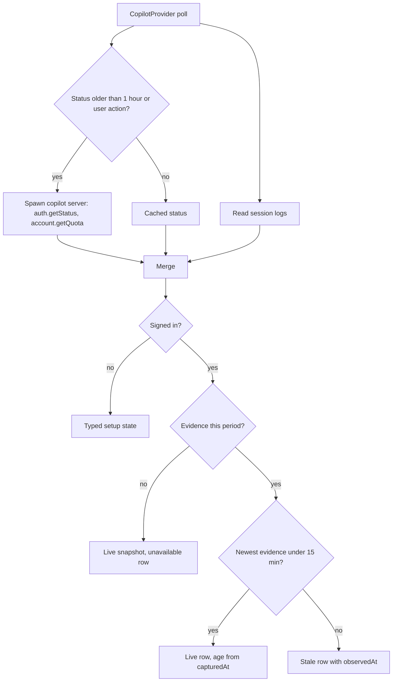

# GitHub Copilot Provider - Plan

## Goal Capsule

- **Objective:** A Headroom user with GitHub Copilot sees how much of their monthly AI credit allowance is left beside Claude, Codex, Grok and Cursor, on the Mac and on an updated iPhone, and can tell how old that number is.
- **Means:** Read credit use from the official Copilot CLI's local session logs and allowance from its local server (KD1, KTD1, KTD2).
- **Authority:** `AGENTS.md` rules win over this plan on conflict. Within this plan, R-IDs own product behavior and KTDs own mechanism.
- **Execution profile:** Two PRs against `kylezantos/headroom`. PR1 has no user-visible change. PR2 makes Copilot appear.
- **Who finishes:** `ce-work` builds and verifies on a Mac that meets the Xcode prerequisite in Risks & Dependencies. PR1 needs the U3 acceptance run on a real Copilot account, and PR2 needs the signed-app run in the Verification Contract.
- **Stop conditions:**
  - The account's own usage page and Headroom differ by more than 5% in the U3 acceptance run.
  - A Copilot CLI update removes `session.usage_record` or `copilotUsage.totalNanoAiu`.
  - Kyle rejects reading session logs on `AGENTS.md` grounds.

---

## Product Contract

### Summary

Add GitHub Copilot as a fifth subscription provider with one signed-in account and one monthly AI credit meter. Credit use is estimated from what the Copilot CLI records on this Mac, and the reading's age is shown rather than hidden. Sign-in stays a Terminal handoff to `copilot login`.

### Problem Frame

Headroom exists so people can answer "how much room do I have left?" at a glance, and Copilot users cannot. GitHub moved monthly Copilot plans to metered AI credits on June 1, 2026, so a heavy agent session now spends a visible share of a monthly pool. Live testing on 2026-11-02 spent 284 of 20,000 credits, and the setup chats alone cost 104.

No official source is both live and correct. Copilot CLI 1.0.105's `account.getQuota` reports GitHub's count rounded to the nearest 0.5% of the allowance and cached for up to an hour, so it read 0 against a true 104 to 284 and later 300 against 285, and its reset date holds the reading's time. The session logs are correct but advance only when the CLI runs. The exact private endpoint falls under the rule `AGENTS.md` sets for Cursor.

### Key Decisions

- **KD1. Use only official client output, never a private endpoint.** Headroom reads files and server replies the official CLI produces. Governs R1, R2, R8. (session-settled: user-approved — chosen over `copilot_internal/user`: it is exact and live but undocumented, and `AGENTS.md` refuses private endpoints for Cursor.)
- **KD2. Copilot means GitHub Copilot and the `copilot` CLI.** Microsoft 365 Copilot is excluded. Governs R1. (session-settled: user-approved — chosen over including Microsoft 365 Copilot: the request names the installed CLI.)
- **KD3. Copilot ships with one account and states the parity exception.** Governs R10. A Headroom-owned `COPILOT_HOME` never receives session logs, so an extra account would stay unavailable forever.

### Requirements

**Reading usage**

- R1. Headroom shows one monthly AI credit meter for the GitHub Copilot account signed in to the official CLI's default home.
- R2. Polling never sends a prompt, creates a session, or reads a Copilot or `gh` token.
- R3. The used number counts every model call the CLI recorded this billing period, in interactive and `-p` sessions.
- R4. Live acceptance shows the used number within 5% of the account's own usage page.
- R5. A reading more than 15 minutes old shows as last known with its age, and never as current.
- R6. A signed-in account with no recorded use this period shows unavailable, never 100% left.
- R7. A reading from before the current period's reset is never shown as this period's value.

**Sign-in and failure**

- R8. Sign-in and recovery hand off to the official CLI in Terminal, and Headroom never sees credentials.
- R9. A missing CLI, a signed-out account and an unreadable log each show a distinct typed state with a next step.

**Surfaces and parity**

- R10. Copilot appears on every surface a provider appears on, with its stated exceptions recorded in the PR and `AGENTS.md`.
- R11. Older iPhone builds keep working, omitting Copilot or drawing it with generic art.
- R12. Five providers fit the Settings pill shelf and the popover Refresh row without dropping one.

### Acceptance Examples

- AE1. **Covers R3.** Given 15 calls in a `-p` session and no quota snapshot in that session, when Headroom reads the logs, then those 15 calls count toward used.
- AE2. **Covers R3, R7.** Given a snapshot of 100 used at 01:15 and calls worth 191 credits after it, when Headroom reads the logs, then used is 291.
- AE3. **Covers R5.** Given a last recorded call 16 minutes ago, when Headroom polls, then the row reads last known with that age and the footer stamp does not move backward.
- AE4. **Covers R6.** Given a fresh sign-in with no session logs, when setup verifies, then setup completes and the meter shows unavailable.
- AE5. **Covers R7.** Given a reading from October and a clock in November, when Headroom polls, then October's used number is hidden.

### Scope Boundaries

Considered and not built:

- **Chat and completions meters.** They are unlimited and carry no headroom. Revisit if a plan makes them finite.
- **Overage UI.** No non-zero overage capture exists, matching the Grok rule in `docs/solutions/grok-build-usage-feasibility.md`.
- **Plan tier label.** `planTier` is only on `session.quota.get`, which requires creating a session, and R2 forbids that. Revisit if a server-scope method returns it.
- **Extra accounts through a launch command.** Teaching `COPILOT_HOME=<path> copilot` asks users to change how they run their CLI for a meter. Revisit if Copilot exposes per-home usage without local sessions.
- **Widening use-it-up reminders to stale rows.** That reverses AE4 of the notifications plan and could announce an out-of-date percentage. Copilot reminders fire only near a fresh reading.
- **API spend row.** Copilot has no spend source.

#### Deferred to Follow-Up Work

- Reading live usage from other clients, if GitHub publishes a user-scoped usage API or fixes `account.getQuota`.
- A live source through `gh api`, only if Kyle wants it.

### Sources

- [GitHub Copilot is moving to usage-based billing](https://github.blog/news-insights/company-news/github-copilot-is-moving-to-usage-based-billing/)
- [Copilot SDK usage and billing](https://raw.githubusercontent.com/github/copilot-sdk/main/docs/features/usage-and-billing.md)
- `docs/solutions/grok-build-usage-feasibility.md`, `docs/solutions/cursor-agent-usage-feasibility.md`
- `docs/solutions/logic-errors/claude-partial-usage-window-freshness.md`
- `docs/solutions/architecture-patterns/per-account-polling-measured-duty-cycle.md`

---

## Planning Contract

### Key Technical Decisions

- KTD1. **Used is the last in-period snapshot plus credits recorded after it.** `quotaSnapshots` appears only in interactive sessions, while `session.usage_record` carries `usage.copilotUsage.totalNanoAiu` in every mode. Each record is deduplicated on `usage.accounting.usageId`, and 10^9 nanoAIU is one credit. Measured on 2026-11-02 against a server count of 284: ledger alone 275.2 (3.1% low), snapshot plus later records 291.5 (2.6% high). The snapshot form is chosen because it picks up use from other clients whenever an interactive session reports it. With no snapshot in the period, used is the ledger sum. This instantiates KD1 and refines it: a snapshot-only reader would have stayed at 100 while the true count reached 284.
- KTD2. **Allowance comes from `account.getQuota`, and its count only raises the logs' figure.** Its `usedRequests` follows GitHub's percentage rounded to the nearest 0.5% and cached, and its past `resetDate` is the reading's time. Half a rounding step below the reading, plus records after its time, replaces the KTD1 figure only when higher. That catches use from other clients without adding the rounding error. A zero, a reading from another month, or a future `resetDate` never anchors. (Revised during implementation on 2026-11-02, when the reading moved from 0 to 300.)
- KTD3. **The server runs only when status is needed.** Log reads run on every poll. The server is spawned at most once an hour and on user actions (Check Now, setup checks). `UsageProvider.fetchResult()` takes no arguments and `AccountProbeScheduler` drops the origin, so the scheduler sets a task-local user-request flag around that call for keys drained from its user-pending set. Each spawn writes a file to `~/.copilot/logs`, and the Claude probe record warns against short-lived auth processes on every poll. A signed-out account can therefore take up to an hour to appear on a timer.
- KTD4. **Only token-billed accounts use the ledger.** When `tokenBasedBilling` is false, nanoAIU does not measure the allowance, so used comes from snapshots alone. Annual legacy plans stay on premium requests.
- KTD5. **The billing period is the calendar month in UTC for ledger bounds.** Every observed snapshot reset was `YYYY-MM-01T00:00:00Z`. The reset shown to the user comes only from a snapshot with a future `resetDate`. Otherwise the schedule is `.unresolved(.absent)`, because `AGENTS.md` requires genuine evidence for a shown deadline. `UsageContinuityPolicy` expires an unresolved Copilot window at the first UTC instant of the month after its `observedAt`, so a failed poll cannot retain last month's number for 30 days.
- KTD6. **`capturedAt` stays the poll time, and only a stale window carries the reading's age.** The window is `.live` with `observedAt` nil while the newest record or snapshot time is under `CompanionFreshnessRule.minimumThreshold` old, and `.stale(observedAt:)` with that time after. A live `observedAt` would become the shared footer's anchor, because `FreshnessStamp.Anchors` prefers it and takes the oldest across accounts. Setting `capturedAt` to log time would fire a probe on each popover open and freeze the phone's stamp (`UsageStore`, `CompanionPublisher`).
- KTD7. **No reading is a `.live` snapshot with one `.unavailable(since:)` row.** This covers no evidence this period, entitlement 0 and `isUnlimitedEntitlement: true`. Setup completes only on `.live`, so a fresh sign-in must not read as stale. `since` is the period start, keeping it stable between polls so the sync key does not rewrite. `windows: []` was rejected because Lock Screen reads it as pending.
- KTD8. **The window is `.billingPeriod("Monthly", 30d)` from `BillingPeriodWindowClassifier`.** Passing real month lengths would change `WindowKind` identity between months.
- KTD9. **Copilot joins `.serial("copilot-cli")`.** Server spawns are CLI work, and the duty-cycle gate only runs on serial lanes.
- KTD10. **The reader decodes only needed fields, and only from files changed this period.** `events.jsonl` holds prompts and tool output. Lines are filtered by event type before decoding. A per-file memo keyed by size and modification time avoids rereading unchanged sessions; session files reached 900 KB in testing.
- KTD11. **A login change shows unavailable until a later snapshot anchors used.** `session.start` carries no login, so logs cannot be attributed, and the new account may already have spent credits. Headroom stores the last login seen from `auth.getStatus`. After a change it returns the KTD7 row until an in-period snapshot observed after the change, then uses snapshot plus later records. The next period starts clean.
- KTD12. **The publisher's flush bound rises to seven keys.** Five provider keys, the manifest and v3 make seven in one flush, up from the six `CompanionPublisherTests` asserts. The per-minute average stays the target and the budget is unaffected at an estimated 32,700 of 64,000 bytes.
- KTD13. **`CompanionLastLanded` uses `isKnownProvider` instead of its second literal list.** Otherwise check-now silently drops Copilot rows.

### High-Level Technical Design

### Assumptions

- GitHub's usage page uses the same credits the endpoint reported. U3 checks this.
- The CLI does not prune current-period sessions. An undercount would show up in the U3 comparison.

### Risks & Dependencies

| Risk | Mitigation |
|---|---|
| The default toolchain on this Mac is Xcode 26.6 and Swift 6.3.3, while `AGENTS.md` requires Xcode 27 and Swift 6.4. Under the default, `swift test` fails compiling `CompanionPublisherTests.swift`. | Run every gate with `DEVELOPER_DIR=/Applications/Xcode-beta.app/Contents/Developer`, which is Xcode 27.0 and Swift 6.4. Do not change the global `xcode-select`. |
| Session logs and `--headless` are undocumented and may change. | Pin the verified CLI version in the feasibility doc. An unknown shape fails stale, and `--probe-copilot` diagnoses it. |
| Use from VS Code or github.com is invisible until an interactive CLI session reports a snapshot. | R5's age treatment and the README state this. Do not hide it. |
| The totals hide larger offsetting errors, cause unknown. Records before the snapshot sum to 83.7 against 100 (about 16% low), and records after it sum to 191.5 against a server rise of 184 (about 4% high). The ledger-only path may miss R4. | The U3 acceptance run measures ledger-only and snapshot-anchored values separately against R4, and the feasibility doc records the cause of the pre-snapshot gap. |

### System-Wide Impact

Older phones are safe: v4 builds skip unknown provider keys, and build 33 draws Copilot with generic art. Do not raise `minimumReaderVersion`. `ProviderID` is an open struct, so most missed registrations compile silently, including `ProviderSetupOutcome.isPermanent`, which defaults to true. `docs/plans/2026-10-04-ios-parity-sync-field-contract.md` needs the new known provider.

### Deferred to Implementation

- Whether a GitHub username can fill the identity row, since `AccountEmail` expects an email. If not, Copilot omits it and the PR states the exception.
- The final Refresh row geometry for five pills, which needs `DESIGN.md` and a live look.
- Whether `copilot login` needs `requiresExclusiveLoginSlot`, once its callback behavior is observed.
- Which token variables the sign-in script and `CopilotStatusSource` must clear, starting from `COPILOT_GITHUB_TOKEN`, `GH_TOKEN` and `GITHUB_TOKEN`, which override stored logins per `copilot help environment`.

---

## Implementation Units

### PR1: Copilot reading core

Waits on: nothing.

### U1. Session log credit ledger

- **Goal:** Compute used, reset evidence and newest evidence time from session logs.
- **Requirements:** R2, R3, R7; KD1, KTD1, KTD4, KTD5, KTD10, KTD11
- **Dependencies:** None
- **Files:** Create `Sources/HeadroomCore/Providers/CopilotUsageLedger.swift`, `Tests/HeadroomCoreTests/CopilotUsageLedgerTests.swift`, and synthetic fixtures under `Tests/HeadroomCoreTests/Fixtures/`.
- **Approach:** Take the home directory and `now` as seams. Scan `session-state/*/events.jsonl` under KTD10. Never retain prompt or tool content.
- **Patterns to follow:** `Sources/HeadroomCore/Providers/ClaudeUsageParser.swift` for failing safe.
- **Test scenarios:**
  - Covers AE1. Records with no snapshot sum to used.
  - Covers AE2. Snapshot 100 plus 191 credits after it gives 291.
  - The same `usageId` twice counts once.
  - Records from the prior UTC month are excluded.
  - A snapshot whose `resetDate` is past is ignored as a reset and as an anchor.
  - A truncated final line, as in a running session, is skipped and earlier lines still count.
  - After a login change, no used value is returned until a snapshot observed after the change, then snapshot plus later records.
  - With `tokenBasedBilling` false, records are ignored and the snapshot is used.
  - An unchanged file is not reread.
  - A missing `session-state` directory returns no evidence and no failure.
- **Verification:** A fixture of 88 records reproduces the measured total, and no test reads the real home.

### U2. CLI status source

- **Goal:** Read sign-in state and allowance from the official CLI without a session.
- **Requirements:** R2, R9; KTD2, KTD3
- **Dependencies:** None
- **Files:** Create `Sources/HeadroomCore/Providers/CopilotStatusSource.swift`, `Tests/HeadroomCoreTests/CopilotStatusSourceTests.swift`. Modify `Sources/HeadroomCore/Providers/GrokUsageSource.swift` only to extract shared process helpers. Modify `Sources/HeadroomCore/Engine/AccountProbeScheduler.swift` for the KTD3 flag, with scheduler tests beside the existing ones.
- **Approach:**
  - Spawn `copilot --headless --stdio --no-auto-update` with Content-Length framed JSON-RPC.
  - Call `ping`, `auth.getStatus`, `account.getQuota`, then end the process group.
  - Remove an inherited `COPILOT_HOME` and the token variables from Deferred to Implementation, so the account always means `~/.copilot`.
  - Bypass the hourly cache when the KTD3 flag is set.
- **Patterns to follow:** `GrokACPUsageSource` for deadline and kill. `CLIExecutableResolver` with Homebrew and npm fallback paths.
- **Test scenarios:**
  - An authenticated reply returns login and entitlement.
  - `isAuthenticated: false` returns signed out without calling the quota method's result.
  - The raw `usedRequests` and `resetDate` reach the result uninterpreted.
  - `isUnlimitedEntitlement: true` returns no metered allowance.
  - A non-responding fake CLI hits the deadline and the group is killed.
  - An unknown protocol version returns a transient failure.
  - The source caches for an hour and a user action bypasses the cache.
  - Setup-check and full-refresh origins set the flag, while timer probes and popover-open `dispatchDue` do not.
  - Inherited `COPILOT_HOME`, `COPILOT_GITHUB_TOKEN`, `GH_TOKEN` and `GITHUB_TOKEN` never reach the spawned process.
- **Verification:** Tests use a fake executable. Only `ping`, `auth.getStatus` and `account.getQuota` are ever sent.

### U3. Copilot provider and diagnostic

- **Goal:** Turn ledger and status into a `UsageSnapshot`, with a diagnostic that proves it live.
- **Requirements:** R1, R4, R5, R6, R7, R9; KTD6, KTD7, KTD8, KTD9
- **Dependencies:** U1, U2
- **Files:**
  - Create `Sources/HeadroomCore/Providers/CopilotProvider.swift`, `Tests/HeadroomCoreTests/CopilotProviderTests.swift`, `docs/solutions/copilot-cli-usage-feasibility.md`.
  - Modify `Sources/HeadroomCore/Models/ProviderID.swift`, `Sources/HeadroomCore/Models/ProviderSetup.swift`, `Sources/HeadroomCore/Engine/CompanionAttentionMapping.swift`, `Sources/HeadroomCore/Settings/SessionReliabilityRecord.swift`, `Sources/HeadroomSharedUI/StatusSentence.swift`, `Sources/HeadroomApp/HeadroomApp.swift`, `Sources/HeadroomCore/Engine/UsageContinuityCache.swift`, `Headroom.xcodeproj/project.pbxproj`, `Tests/HeadroomCoreTests/ProviderSetupOutcomeTests.swift`.
- **Approach:** Add `ProviderID.copilot` here, along with setup outcomes for CLI missing, signed out and unreadable. Set `isPermanent` explicitly for each. Add `--probe-copilot` printing parsed values only, with no login or raw logs, and with the ledger sum and the snapshot-anchored value on separate lines. Run `xcodegen generate` so the app target builds the new Core files.
- **Patterns to follow:** `GrokProvider`, and `--probe-grok` in `HeadroomApp.swift`.
- **Test scenarios:**
  - Fresh evidence gives a live window with utilization used over entitlement.
  - Covers AE3. Evidence 16 minutes old gives `.stale(observedAt:)`, while `capturedAt` is `now`.
  - Evidence exactly 15 minutes old stays live.
  - A live window 14 minutes behind its evidence still resolves `FreshnessStamp` to the poll time.
  - Covers AE4. Signed in with no evidence gives a `.live` snapshot and one unavailable row, and no surface prints 100.
  - Covers AE5. October evidence in November gives the unavailable row.
  - A failed poll and a launch restore in November both hide an October reading.
  - Entitlement of 0 and an unlimited entitlement each give the KTD7 result, complete setup and print no percentage.
  - An unreadable session log returns the unreadable outcome with its next step and keeps the cached reading.
  - A missing CLI with logs present gives the CLI missing outcome.
  - Used above entitlement clamps the same way other providers do.
- **Verification:** `swift run Headroom --probe-copilot` under `PATH=/usr/bin:/bin` reports ledger-only and snapshot-anchored values, each compared with the account's usage page against R4. The feasibility doc records the CLI version, both comparisons and the cause of the pre-snapshot gap.

### PR2: Copilot in the product

Waits on: PR1, merge order. Build U5 before U4, and run `xcodegen generate` after the last new file.

### U4. Sign-in handoff

- **Goal:** Let a user install guidance, sign in and recover through Terminal.
- **Requirements:** R8, R9
- **Dependencies:** U3, U5
- **Files:**
  - Create `Sources/HeadroomCore/Providers/CopilotConnection.swift`, `Tests/HeadroomCoreTests/CopilotConnectionTests.swift`.
  - Modify `Sources/HeadroomApp/UI/SetupSessions.swift`, `Sources/HeadroomApp/UI/ProviderCardIdentityRows.swift`, `Sources/HeadroomCore/Engine/SetupSessionCoordinator.swift`, `Tests/HeadroomCoreTests/SetupSessionCoordinatorTests.swift`.
- **Approach:** Mirror `GrokCLI` without device-code or home routing. Clear the token variables noted in Deferred to Implementation. Use the 3/7/15/30 second ladder.
- **Patterns to follow:** `GrokConnection.swift`, `docs/solutions/logic-errors/setup-handoff-launch-and-connected-reset.md`.
- **Test scenarios:**
  - The script resolves the executable and runs `login`.
  - A missing executable prints install guidance and exits 127.
  - The clipboard fallback names the resolved path.
  - A live result after sign-in completes setup.
  - Signed-out state routes to connect and CLI missing routes to the docs URL.
  - The unreadable outcome routes to Check Again, which re-reads the logs and offers no Terminal sign-in.
- **Verification:** A generated script runs against a fake CLI. A real sign-in then reaches the connected state.

### U5. Registration and sync

- **Goal:** Make Copilot a first-class provider everywhere except stated exceptions.
- **Requirements:** R10, R11; KD3, KTD12, KTD13
- **Dependencies:** U3
- **Files:**
  - Modify `Sources/HeadroomCore/Models/UsageModels.swift`, `Sources/HeadroomApp/HeadroomApp.swift`, `Sources/HeadroomCore/Sync/CompanionSyncModels.swift`, `Sources/HeadroomCore/Widgets/LockScreenWidgetChoices.swift`, `Sources/HeadroomIOSWidgets/HeadroomLockScreenWidget.swift`, `Sources/HeadroomIOS/Intents/ProviderAppEnum.swift`, `Sources/HeadroomApp/UI/SetupSessions.swift`, `Headroom.xcodeproj/project.pbxproj`.
  - Test `Tests/HeadroomCoreTests/CompanionPublisherTests.swift`, `Tests/HeadroomCoreTests/CompanionPayloadBudgetTests.swift`, `Tests/HeadroomCoreTests/Build33DecoderGoldenTests.swift`, `Tests/HeadroomCoreTests/LockScreenWidgetChoicesTests.swift`, `Tests/HeadroomCoreTests/ProductionProviderConfigurationTests.swift`.
- **Approach:**
  1. Add `copilotSubscription` to `UsageSurface`, default off.
  2. Register capacity 1 as Cursor does, and add `makeCopilotProvider`.
  3. Add Copilot to `knownProviderIDs` and apply KTD13.
  4. Update the banned-strings list with `COPILOT_HOME`.
- **Test scenarios:**
  - Copilot defaults off and turning it on starts polling.
  - A v4 envelope with a Copilot key is ignored by the known-provider filter of an older reader.
  - The frozen build 33 reader decodes the v3 key with Copilot.
  - A multi-20 envelope with Copilot stays under 64,000 bytes at level 0.
  - A flush with five provider keys writes at most seven keys.
  - `CompanionLastLanded` accepts Copilot.
  - A pinned Lock Screen Copilot with no synced provider shows Off.
- **Verification:** Build33 golden JSON is unchanged. The iOS scheme builds.

### U6. Brand and five-provider layout

- **Goal:** Give Copilot its mark and make the UI hold five providers.
- **Requirements:** R10, R12
- **Dependencies:** U5
- **Files:**
  - Create `Sources/HeadroomApp/Resources/BrandIcons/copilot-light.svg`, `copilot-dark.svg`, `Sources/HeadroomSharedResources/BrandIcons.xcassets/CopilotBrandIcon.imageset`.
  - Modify `Sources/HeadroomApp/Resources/BrandIcons/SOURCES.md`, `Sources/HeadroomCore/Models/BrandColorValues.swift`, `Sources/HeadroomSharedUI/ProviderStyle.swift`, `Sources/HeadroomWidgetSharedUI/HeadroomWidgetSharedUI.swift`, `Sources/HeadroomIOS/DesignSystem/ProviderLogoView.swift`, `Sources/HeadroomWidgetSharedUI/HalftonePillRow.swift`, `Sources/HeadroomCore/Engine/ReprintRecipe.swift`, `Sources/HeadroomApp/UI/MenuBarPillArranger.swift`, `Sources/HeadroomApp/PopoverLoadingRenderHarness.swift`.
  - Test `Tests/HeadroomCoreTests/BrandColorValuesTests.swift`, `Tests/HeadroomAppTests/BrandMarkInkTests.swift`, `Tests/HeadroomCoreTests/ReprintRecipeTests.swift`, `Tests/HeadroomAppTests/MiniPillTests.swift`, `Tests/HeadroomAppTests/MenuBarPillArrangerTests.swift`.
- **Approach:** Start from `DESIGN.md`. Five shelf cards need 470pt against a tested 436pt, so reduce the card minimum until five fit. The Refresh row clamps at four and must draw five.
- **Test scenarios:**
  - `HalftonePillRow` draws five pills and drops none.
  - `ReprintRecipe` geometry holds at five.
  - Five cards fit the tested shelf width.
  - The Copilot mark's ink aspect matches its measured SVG.
  - The Copilot accent passes the existing contrast checks in both appearances.
- **Verification:** The `--bench-ui` before and after shows no regression, and the live `MenuBarExtra` popover looks right in both appearances.

### U7. Demo, widgets and docs

- **Goal:** Keep demos, renders and docs honest about five providers.
- **Requirements:** R10
- **Dependencies:** U5, U6
- **Files:**
  - Modify `Sources/HeadroomCore/DemoFixture.swift`, `Sources/HeadroomCore/Widgets/DemoScreenshotData.swift`, `Sources/HeadroomCore/Widgets/CompanionDemoData.swift`, `Sources/HeadroomApp/PopoverRenderHarness.swift`, `Sources/HeadroomApp/LoadingDemoController.swift`, `Sources/HeadroomApp/WidgetRenderHarness.swift`.
  - Modify `AGENTS.md`, `README.md`, `BUGS.md`, `PRODUCT.md`, `docs/plans/2026-10-04-ios-parity-sync-field-contract.md`, `docs/release/privacy-policy.md`.
  - Test `Tests/HeadroomCoreTests/DemoScenarioParityTests.swift`, `Tests/HeadroomCoreTests/DemoFixtureTests.swift`.
- **Approach:** `multi-5` already means five accounts, so add a new scenario name. Record every parity exception in `AGENTS.md`: single account, no spend, no plan label, reminders only near a fresh reading, no use from other clients until a snapshot. Update the privacy policy and README's Copilot entry: Headroom scans Copilot CLI session logs on the Mac, those logs also hold prompts and tool output, and Headroom decodes only usage records and keeps no prompt or tool content. Update the policy's effective date.
- **Test scenarios:**
  - The new scenario's envelope matches `registeredProviderOrder`.
  - A demo row shows the unavailable state without printing 100.
  - `everyDemoScenarioProjectionDecodesInTheFrozenReader` passes with Copilot.
- **Verification:** `--render-widgets` exits zero, and the README troubleshooting matrix covers Copilot.

---

## Verification Contract

| Gate | Applies to | Proof |
|---|---|---|
| `swift build`, `swift test` | Both PRs | Pass on Xcode 27 and Swift 6.4 |
| `xcodebuild` scheme `HeadroomIOS` on the iPhone 17 Pro simulator | Both PRs | Builds |
| `./Scripts/build-app.sh --deps-only`, then `xcodebuild` scheme `HeadroomAppTests` | Both PRs | Passes |
| `swift run Headroom --render-widgets <dir>` | PR2 | Exits zero |
| `--probe-copilot` under `PATH=/usr/bin:/bin` | U3 | Ledger-only and snapshot-anchored values each compared with the account's usage page, per R4 |
| `--demo` on the live `MenuBarExtra` in both appearances | U6, U7 | Five providers draw and none is dropped |
| `--bench-ui` before and after | U6 | No regression |
| Signed Headroom.app, real `copilot login`, one `-p` run and one interactive run | PR2 | Meter moves after each run, and session and log counts match what those runs created |

---

## Definition of Done

- Every R has a passing test or a recorded live check.
- Polling sends no prompt, verified by session counts staying flat across a day of polling.
- Parity exceptions appear in the PR description and `AGENTS.md`.
- `docs/solutions/copilot-cli-usage-feasibility.md` records the CLI version, the measured error by path, and the `account.getQuota` defect.
- PR2's description states that `headroom-site` must publish the updated privacy policy before any release containing Copilot.
- Test fixtures are synthetic and contain no real login, prompt or token.
- Abandoned-attempt code is removed from the diff.

---

## Appendix

Measurements on 2026-11-02, Copilot CLI 1.0.105, Max plan, 20,000 credits:

| Source | Used | Reset | Notes |
|---|---|---|---|
| `copilot_internal/user`, reference only | 284 | 2026-12-01 | Exact, never shipped per KD1 |
| `account.getQuota`, `session.quota.refresh` | 0, later 300 | Reading time | Rounded to 0.5% and cached |
| Latest `quotaSnapshots` in logs | 100 | 2026-12-01 | Stopped at 01:15, absent from `-p` sessions |
| Sum of `session.usage_record` | 275.2 | None | 88 records, every mode |
| Snapshot plus later records | 291.5 | 2026-12-01 | Chosen, KTD1 |

Records before the 100 snapshot sum to 83.7, and records after it sum to 191.5 while the server rose 184.

A fresh `COPILOT_HOME` reports not authenticated and `account.getQuota` fails closed. Read-only server probes ran in about one second under `PATH=/usr/bin:/bin` and created no sessions.

---

## Deferred / Open Questions

These are review items left for the author. They do not block implementation.

### From 2026-11-02 review

- **Maintainer ruling on session logs comes only after the work** - Goal Capsule stop conditions with KD1, the official-output decision (P1, adversarial, confidence 75)

  A rejection after PR1 discards the ledger, the provider and the feasibility work, while asking first costs one message. `AGENTS.md` forbids reading Cursor's local `state.vscdb` in the same sentence that forbids private endpoints, and undocumented Copilot `events.jsonl` files are the nearest analogue, so KD1 does not decide this alone.

- **The meter can overstate room left for people who also use VS Code or github.com** - R1, the monthly meter, and R5, the age treatment (P1, adversarial and coherence, confidence 75)

  One fresh CLI call marks the row live while use from other clients is missing, so the error always runs toward false reassurance. The README caveat does not reach someone reading the row, and a CLI-only acceptance account can pass every check while this stays true.

- **Annual legacy plans have no defined meter** - R1, the monthly credit meter, and KTD4, token-billed accounts only (P2, coherence, scope-guardian, design-lens, Codex whole-doc, confidence 75)

  R1 promises AI credits, while KTD4 keeps those accounts on premium requests from snapshots alone. No test account exists, so the branch would ship unmeasured.

- **The plan says a user-scoped usage API does not exist, and GitHub documents one** - Problem Frame and Deferred to Follow-Up Work (P2, adversarial, confidence 75)

  `GET /users/{username}/settings/billing/ai_credit/usage` is published for self-purchased plans and excludes organization seats. The claim that no official source is both live and correct was never tested against it, so the `gh api` follow-up would be judged on a wrong premise. A read-only call on 2026-11-02 returned 404 because the local `gh` login lacks the `user` scope, so its data and lag are unmeasured.

  Change: Rewrite the follow-up bullet to name this endpoint as published and unevaluated, excluding organization seats, and narrow the Problem Frame claim to sources tested so far.
