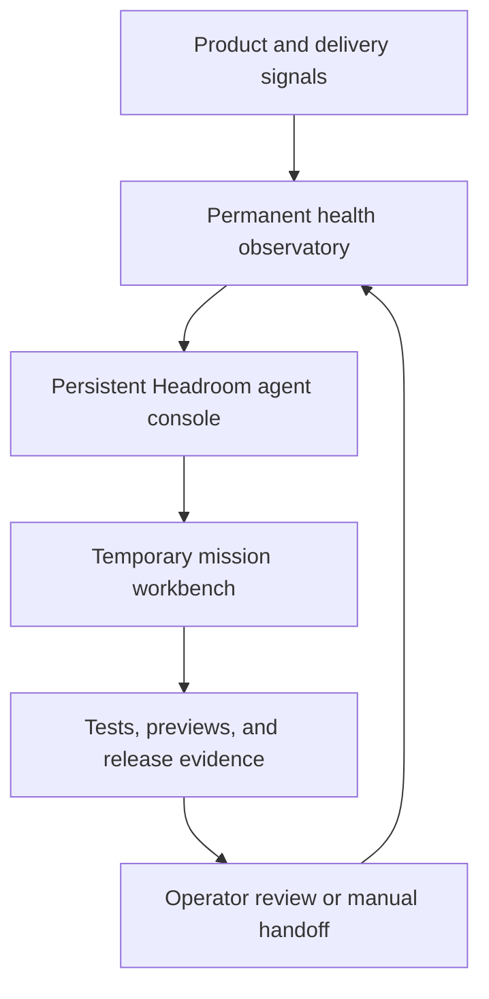

# Headroom TerminalGraph Control Room

## Summary

Create an agent-first Headroom control room in TerminalGraph: a permanent,
health-focused observatory surrounded by temporary mission workbenches for
investigating, changing, verifying, and shipping the product.

---

## Problem Frame

Managing Headroom currently requires context spread across PostHog, GitHub, the
public website, the macOS release pipeline, App Store Connect, local terminals,
editors, and browser windows. The operator already delegates most implementation
and release work to agents, but still has to assemble the relevant signals,
working directories, source views, and review evidence for each task.

Headroom also spans two repositories and two distribution systems. The application
repository owns the macOS and iOS products, while the portfolio repository owns
`headroom.zantos.co` and its published Sparkle assets. macOS publication, Sparkle
acceptance, TestFlight upload, TestFlight availability, device acceptance, and App
Review submission are distinct states; a useful control room must preserve those
distinctions.

---

## Actors

- A1. **Headroom operator:** Assesses product health, directs agents, reviews
  evidence, and performs user-only approvals or device handoffs.
- A2. **Headroom agent:** Receives free-form or signal-specific tasks, works in the
  relevant repository context, and reports progress, evidence, and blockers.
- A3. **Source systems:** PostHog, GitHub, the live website and Sparkle feed, App
  Store Connect/TestFlight, and local development/release tooling remain the
  authoritative sources for their respective states.

---

## Key Flows

- F1. **Check Headroom health**
  - **Trigger:** A1 opens or returns to the TerminalGraph workspace.
  - **Actors:** A1, A3
  - **Steps:** The observatory refreshes its curated readout, identifies unavailable
    or stale sources, keeps healthy systems visually quiet, and offers nearby source
    views for investigation.
  - **Outcome:** A1 can tell whether Headroom is operationally healthy and which
    exceptions need attention.
  - **Covered by:** R2, R4, R5, R6, R7, R8, R9

- F2. **Delegate from a signal**
  - **Trigger:** A1 chooses a PR, failed check, stale metric, website problem, or
    release-state exception.
  - **Actors:** A1, A2, A3
  - **Steps:** The selected signal becomes task context, A2 receives it, and a
    mission workbench is created with the relevant repository and verification
    surfaces.
  - **Outcome:** Investigation starts without A1 manually rebuilding the source
    context.
  - **Covered by:** R10, R11, R12, R13

- F3. **Delegate a free-form task**
  - **Trigger:** A1 describes a Headroom task in the persistent agent console.
  - **Actors:** A1, A2
  - **Steps:** A2 clarifies only material ambiguity, creates or reuses a mission
    workbench, performs the work, and returns reviewable evidence.
  - **Outcome:** A1 can direct unplanned work without leaving the control room.
  - **Covered by:** R10, R12, R13

- F4. **Review and close a mission**
  - **Trigger:** A2 reports completion, a blocker, or a user-only handoff.
  - **Actors:** A1, A2, A3
  - **Steps:** A1 reviews evidence, completes or declines required approvals, and
    either returns the mission to A2 or accepts the result. The workbench is then
    retained for follow-up or removed without affecting the observatory.
  - **Outcome:** Work closes with explicit evidence and authoritative source state.
  - **Covered by:** R3, R13, R14, R15

---

## Requirements

**Workspace organization**

- R1. All documentation and plans whose audience is the TerminalGraph control room
  must live under `docs/terminalgraph/`; TerminalGraph runtime assets must remain
  under `.terminalgraph/` so they cannot be confused with Headroom product code or
  product plans.
- R2. The default canvas must use the control-room model: one permanent observatory
  plus temporary mission workbenches.
- R3. Mission workbenches must be independently creatable and removable without
  disturbing the permanent observatory or another active mission.

**Health observatory**

- R4. The observatory must prioritize operational health and exceptions over growth
  metrics, while keeping growth context available as a secondary layer.
- R5. The observatory must combine a curated, at-a-glance readout with nearby live
  source views or links for drill-down.
- R6. PostHog must provide website behavior and download-conversion context without
  moving ownership of those metrics out of PostHog.
- R7. GitHub must show actionable repository state, including open pull requests,
  review/check status, recent workflow failures, and release activity.
- R8. Website and macOS distribution health must cover the live
  `headroom.zantos.co` surface, published version metadata, Sparkle feed state, and
  the distinct publication and installed-update acceptance states.
- R9. iOS distribution health must cover App Store Connect and TestFlight states,
  including build processing, availability, device acceptance, and App Review
  submission without collapsing them into a generic released state.

**Agent control loop**

- R10. The permanent control room must include an agent console that accepts
  free-form Headroom work.
- R11. Actionable observatory signals must support contextual delegation so an agent
  can receive the selected signal and its source context.
- R12. A mission workbench must be able to contain the agent terminal, relevant
  repository context, files, browser preview, command/test output, and working notes
  needed for that task.
- R13. Agent work must expose progress, failures, verification evidence, and
  user-only handoffs rather than appearing as an opaque running process.
- R14. The workspace must rely on agents for development and release execution
  instead of maintaining a duplicate panel of low-level build, merge, deploy, and
  publish controls.

**Trust and safety**

- R15. Source failures, missing credentials, stale data, and incomplete release
  chains must be represented honestly; the control room must never convert unknown
  state into a healthy state or a partial release into a completed release.
- R16. Secrets, provider response bodies, credentials, and personal data must not be
  persisted in repository files, generated dashboards, TerminalGraph notes, agent
  prompts, screenshots, or logs.
- R17. Existing Headroom release gates, approval boundaries, and authoritative
  runbooks must remain in force when work is initiated from TerminalGraph.

---

## Acceptance Examples

- AE1. **Covers R5, R15.** Given PostHog is unavailable while GitHub and the website
  remain reachable, when the observatory refreshes, PostHog is shown as stale or
  unavailable rather than the entire product being marked healthy.
- AE2. **Covers R7, R11.** Given an open PR has a failing required check, when A1
  delegates that signal, A2 receives the PR and failing-check context and can open a
  mission workbench without A1 copying the details manually.
- AE3. **Covers R3, R12, R13.** Given another mission is already active, when A1
  starts a website task, a separate workbench is created with the correct repository
  context and its completion evidence does not overwrite the first mission.
- AE4. **Covers R8, R9, R15, R17.** Given a macOS DMG is public but Sparkle
  acceptance is pending and an iOS build is uploaded but still processing, when the
  release readout refreshes, all four states remain independently visible and neither
  lane is reported complete.
- AE5. **Covers R13, R16.** Given an agent reaches an App Store Connect authentication
  or two-factor handoff, when it reports the blocker, the workspace requests the
  specific operator action without displaying, storing, or attempting to automate
  the credential.

---

## Success Criteria

- A1 can determine Headroom's operational health and the highest-priority exception
  from the default canvas without opening each source system independently.
- A1 can start either a free-form or signal-specific agent task without manually
  reconstructing the relevant repository and source context.
- Each mission ends with visible verification evidence or a precise unresolved
  handoff.
- The permanent observatory remains usable as missions are created and removed.
- A downstream planner can identify every TerminalGraph-specific artifact without
  mistaking it for Headroom product functionality.

---

## Scope Boundaries

### Deferred for later

- Adding new behavioral analytics or crash-reporting SDKs to the macOS or iOS apps
  requires a separate product and privacy decision. This workspace may consume
  aggregate App Store Connect reports and existing website analytics without changing
  Headroom's current no-telemetry product behavior.
- Additional source systems may be connected after the named sources are working,
  but the workspace must not add placeholder integrations merely to appear broad.

### Outside this product's identity

- Replacing PostHog, GitHub, App Store Connect, Vercel, Sparkle, or the existing
  release runbooks as the authoritative source of state.
- Becoming a public or multi-user Headroom administration product.
- Bypassing required release verification, security boundaries, physical-device
  acceptance, or explicit operator handoffs.
- Introducing runtime behavior into the Headroom apps solely to support the private
  TerminalGraph workspace.

---

## Key Decisions

- **Control room plus mission workbenches:** Stable product awareness stays separate
  from disposable task context.
- **Health before growth:** The first readout answers whether Headroom is healthy;
  analytics support diagnosis and product learning afterward.
- **Curated summary plus source drill-down:** The workspace reduces context switching
  without hiding the authoritative systems.
- **Agent-first control:** The operator delegates and reviews outcomes instead of
  manually operating a duplicated release console.
- **Dedicated artifact boundary:** TerminalGraph materials are clearly separated from
  product requirements, plans, and runtime code.

---

## Dependencies / Assumptions

- TerminalGraph's MCP server is enabled and available to the agent session used to
  build or maintain the workspace.
- Existing local authentication for GitHub and release tooling remains the preferred
  access path.
- PostHog and App Store Connect read access can be configured without committing
  credentials. App Store analytics additionally assumes an existing analytics report
  request; creating one is an explicit, separately authorized App Store Connect write
  and is not part of routine hub refreshes.
- The Headroom and portfolio repositories remain separate authoritative projects and
  can coexist in one TerminalGraph workspace.

---

## Outstanding Questions

### Deferred to Planning

- [Affects R4-R9][Needs research] Which exact metrics and time windows form the
  smallest useful health readout for each source?
- [Affects R5-R9][Technical] Which sources should be queried into the curated readout
  and which should remain live browser views?
- [Affects R10-R13][Technical] Which TerminalGraph group, blueprint, wiring, and
  worktree patterns best preserve mission isolation and review evidence?
- [Affects R15-R16][Technical] How should source freshness, local caching, credential
  lookup, and redaction be implemented and verified?
