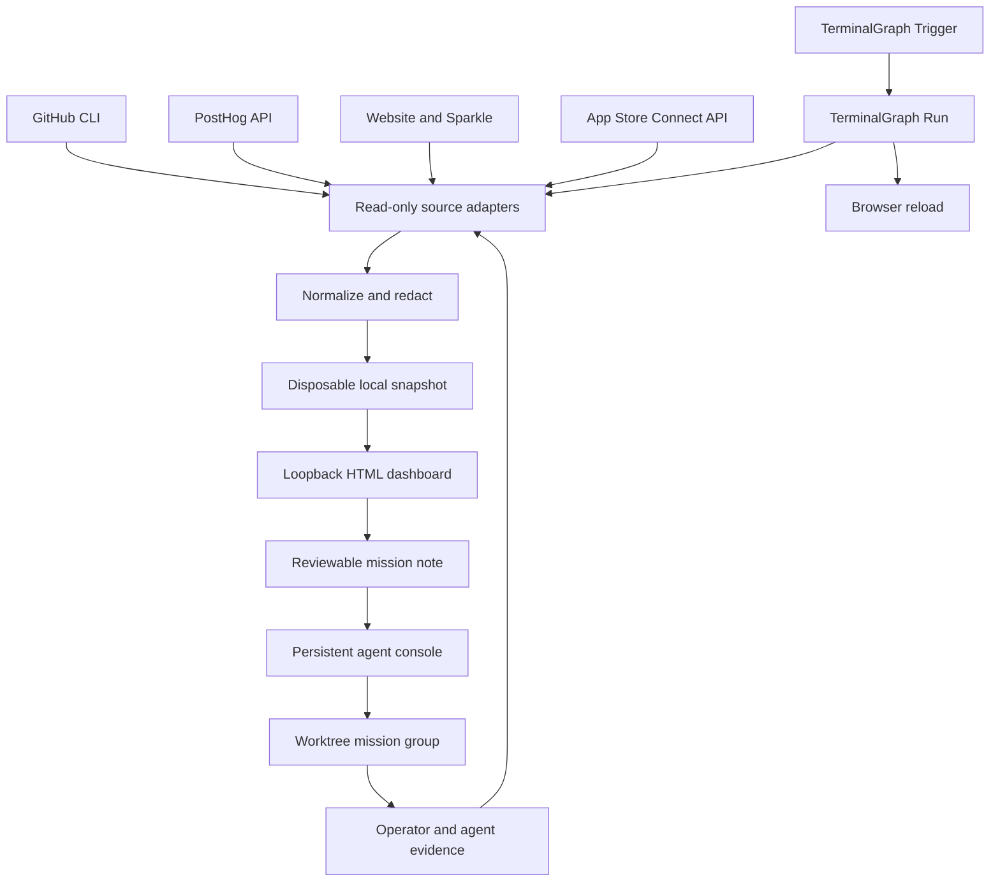
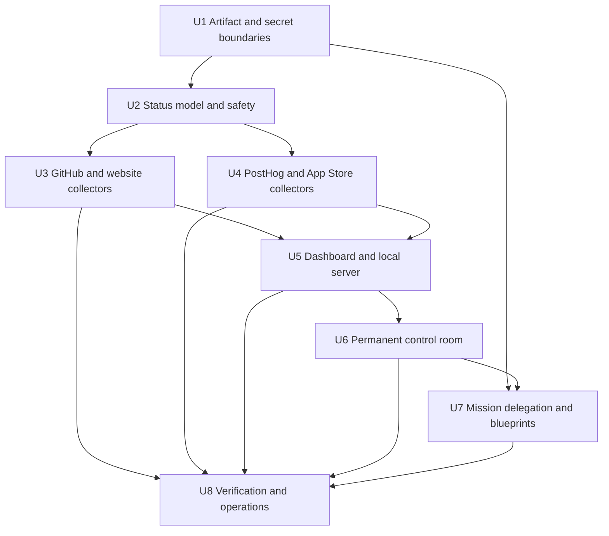
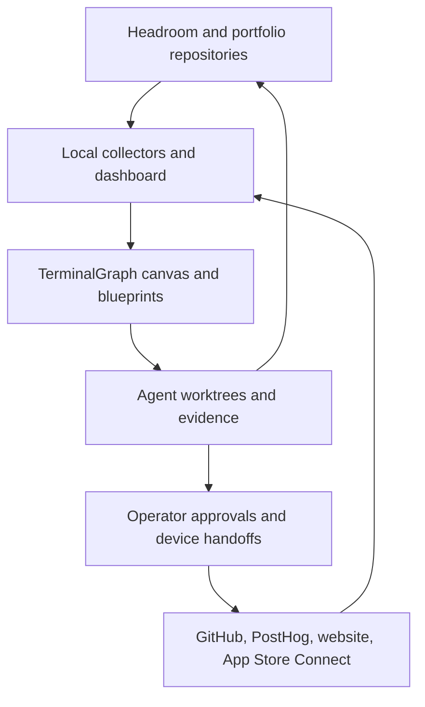

# feat: Build the Headroom TerminalGraph control room

## Summary

Build the control room as isolated local tooling under `.terminalgraph/`: typed
read-only collectors feed a loopback-only HTML dashboard, while TerminalGraph MCP,
dataflow, and portable blueprints assemble the permanent observatory and disposable
agent workbenches. Preserve the existing canvas state and keep all planning and
operating documentation under `docs/terminalgraph/`.

---

## Problem Frame

Headroom operations span the app repository, the portfolio repository, GitHub,
PostHog, public website and Sparkle artifacts, App Store Connect, and manual release
acceptance. The current TerminalGraph project contains one terminal but no reusable
observatory, source normalization, or mission workflow. The implementation therefore
needs a reproducible workspace layer without turning private tooling into Headroom
product code or weakening the release boundaries in the existing runbooks.

---

## Requirements

**Workspace organization**

- R1. Isolate TerminalGraph documents under `docs/terminalgraph/` and runtime assets
  under `.terminalgraph/`.
- R2. Provide one permanent control room plus independently disposable mission
  workbenches.
- R3. Mission workbenches remain independently creatable and removable without
  disturbing the observatory or another active mission.

**Health observatory**

- R4. Make operational health and exceptions primary; keep growth metrics secondary.
- R5. Combine a curated readout with direct access to authoritative source views.
- R6. Cover existing PostHog website analytics and download conversion.
- R7. Cover actionable GitHub state for both Headroom-related repositories.
- R8. Cover the live site, public version metadata, Sparkle feed, and macOS acceptance
  state.
- R9. Preserve distinct App Store Connect, TestFlight, device acceptance, and App
  Review states.

**Agent control loop**

- R10. Support a persistent agent console for free-form Headroom work.
- R11. Support contextual delegation from actionable observatory signals.
- R12. Give each mission the relevant repository, files, browser, terminal, notes, and
  verification evidence.
- R13. Expose agent progress, failure, evidence, and user-only handoffs.
- R14. Keep development and shipping execution agent-led instead of duplicating
  low-level controls.

**Trust and safety**

- R15. Represent stale, unavailable, unknown, and partial states honestly.
- R16. Keep secrets and personal/provider data out of tracked files, dashboard output,
  notes, prompts, screenshots, and logs.
- R17. Preserve all existing release gates and manual approval boundaries.

**Origin actors:** A1 (Headroom operator), A2 (Headroom agent), A3 (source systems)

**Origin flows:** F1 (check health), F2 (delegate from a signal), F3 (delegate a
free-form task), F4 (review and close a mission)

**Origin acceptance examples:** AE1 (partial source outage), AE2 (delegate a failing
PR), AE3 (parallel missions), AE4 (distinct release states), AE5 (credential handoff)

---

## Scope Boundaries

### Deferred for later

- Adding behavioral analytics or crash-reporting SDKs to the macOS or iOS apps
  requires a separate product/privacy plan.
- Additional source systems should be added only after the named sources are
  operating reliably.

### Outside this product's identity

- Replacing PostHog, GitHub, App Store Connect, Vercel, Sparkle, or release runbooks
  as authoritative systems.
- Becoming a public or multi-user Headroom administration product.
- Bypassing release verification, device acceptance, security boundaries, or
  operator handoffs.
- Introducing app-runtime behavior solely to support the private workspace.

### Deferred to Follow-Up Work

- Source-side PostHog dashboard reorganization: first consume the existing insights
  read-only; create or mutate PostHog dashboards only through a separately reviewed
  task once the desired metric set is proven in daily use.
- New release automation: this plan visualizes and delegates the existing workflows;
  it does not add unattended merge, deploy, publish, or App Review mutations.

---

## Context & Research

### Relevant Code and Patterns

- `.terminalgraph/state.json` is existing untracked user-owned workspace state
  containing one terminal. Preserve it and use TerminalGraph MCP for live changes.
- `.terminalgraph/hooks/post-worktree-create.sample` is the generated hook template;
  any active hook must remain non-secret and safe for both repositories.
- `Scripts/verify-ios-release.sh` and `Scripts/release-ios-testflight.sh` establish the
  iOS preflight, archive, upload, and environment-variable authentication seams.
- `Scripts/release-app.sh` and `Scripts/macos-compatibility.sh` establish the macOS
  build, notarization, Sparkle, and version-verification seams.
- `docs/release/release-operations.md` supplies the authoritative multi-lane release
  vocabulary and manual handoff boundaries.
- `docs/release/website-dmg-release.md` identifies `kz-portfolio` as the owner of
  `headroom.zantos.co` and the public Sparkle assets.
- `docs/release/ios-app-review-testflight.md` defines the current TestFlight and App
  Review acceptance states.
- The portfolio's `app/headroom/download/route.ts` emits `Headroom Download` events,
  while `components/posthog-analytics-provider.tsx` emits page views. These are the
  existing PostHog signals to summarize.
- The portfolio privacy page states that the Headroom apps have no analytics,
  telemetry, crash reporting, advertising, or third-party SDKs. The tooling must not
  invalidate that promise.
- `Scripts/gen-app-icon.mjs` demonstrates that small dependency-free Node utilities
  are acceptable in this repository, while product logic and tests remain Swift.

### Institutional Learnings

- `docs/solutions/codex-window-kind-mislabel.md`: classify source data from
  self-describing fields and preserve missing/unknown states instead of inferring
  expected rows from position.
- `docs/solutions/popover-scrollview-zero-height.md`: an offscreen or unit-only check
  can miss live-window behavior, so the TerminalGraph canvas and embedded browser need
  runtime verification in addition to collector tests.

### External References

- [TerminalGraph documentation](https://terminalgraph.com/docs/) — node ports,
  Trigger/Run dataflow, groups, worktrees, blueprints, MCP capabilities, and storage
  boundaries.
- [GitHub CLI `gh pr list`](https://cli.github.com/manual/gh_pr_list) and
  [`gh api`](https://cli.github.com/manual/gh_api) — authenticated structured GitHub
  reads without introducing another credential store.
- [PostHog API overview](https://posthog.com/docs/api) — private-query authentication,
  regional hosts, pagination, and rate limits.
- [App Store Connect API](https://developer.apple.com/documentation/AppStoreConnectAPI)
  — build, TestFlight, version, diagnostics, and reporting resources.
- [Analytics Reports API](https://developer.apple.com/help/app-store-connect-analytics/overview/analytics-reports-api)
  — recurring and snapshot aggregate reports, access roles, privacy thresholds, and
  suppressed low-volume data.
- [Apple privacy manifests](https://developer.apple.com/documentation/bundleresources/privacy-manifest-files)
  — why adding an analytics SDK would be a separate app/privacy change.

---

## Key Technical Decisions

- **Local projection, authoritative sources:** Collectors produce a disposable local
  projection for the dashboard. They do not write back to PostHog, GitHub, the public
  site, App Store Connect, or release evidence.
- **One normalized status model:** Every source reports freshness, availability,
  attention severity, evidence time, source link, and redacted detail through the same
  boundary. This prevents an unavailable integration from becoming a false all-clear.
- **Loopback-only dashboard:** Serve a self-contained local HTML surface from the
  TerminalGraph workspace. Do not add a hosted admin app or expose an inbound network
  service beyond localhost.
- **Constrained delegation bridge:** Dashboard delegation resolves an opaque signal
  identifier against the already-normalized local snapshot, accepts requests only
  from the loopback dashboard origin, and sends the resulting sanitized brief to a
  Note node. It never accepts arbitrary external prompt text or writes directly to
  agent stdin.
- **Native credential paths:** Reuse authenticated `gh`, existing App Store Connect
  key-path environment variables, and a dedicated read-only PostHog credential stored
  outside the repository. Never place a token in config, canvas state, or generated
  output.
- **Review before agent injection:** Context selected from an external source is first
  written to a reviewable mission note. Saving the reviewed note is the explicit handoff
  to the agent console; raw external text never executes as an agent prompt by itself.
- **MCP-managed live canvas plus portable artifacts:** Use MCP to add, place, connect,
  inspect, and capture nodes. Always track a non-executable recreation manifest; track
  a TerminalGraph blueprint export only when it passes the portability gate. Never
  hand-author persisted canvas state or exported blueprint JSON.
- **Two-project workspace:** Keep Headroom and `kz-portfolio` as distinct project
  regions so agents and worktrees inherit the correct repository context.
- **Fixture-first adapters:** Test every collector against recorded, redacted fixtures
  before using live credentials. Live probes verify configuration and integration, not
  parser correctness alone.

---

## Open Questions

### Resolved During Planning

- **Where should TerminalGraph-specific material live?** Documentation lives under
  `docs/terminalgraph/`; tracked runtime assets live under `.terminalgraph/`; generated
  data and user canvas state remain ignored.
- **Should the dashboard embed every source UI?** No. The default view uses a curated
  local projection, with a small set of live browser nodes and source links for
  drill-down.
- **How should contextual delegation avoid prompt injection?** Stage sanitized context
  in an editable Note node and require an explicit save/handoff before the agent
  receives it.
- **How should iOS behavior be measured without changing the app?** Use App Store
  Connect's aggregate reports when available and clearly show threshold-suppressed or
  unavailable data; do not add an app SDK.
- **Should release steps become dashboard buttons?** No. Agents continue to follow the
  existing runbooks, and the dashboard projects state and handoffs.

### Deferred to Implementation

- **Exact PostHog project and insight identifiers:** Discover them through authenticated
  read-only access during setup and save only non-secret identifiers in local config.
- **Exact App Store Connect application identifier and available report set:** Discover
  through the authenticated API; low-volume report availability is knowable only
  against the live account.
- **TerminalGraph browser handling for the local dashboard:** Prefer the loopback server;
  verify navigation, reload wiring, and background behavior in the installed beta.
- **Blueprint project targeting in a multi-project workspace:** Validate insertion in
  both project regions before finalizing exported blueprints.

---

## Output Structure

    docs/terminalgraph/
    ├── README.md
    ├── brainstorms/
    │   └── 2026-07-27-headroom-control-room-requirements.md
    ├── plans/
    │   └── 2026-07-27-001-feat-headroom-control-room-plan.md
    └── operations.md
    .terminalgraph/
    ├── .gitignore
    ├── blueprints/
    │   ├── headroom-control-room.blueprint       # only when portable
    │   ├── headroom-app-mission.blueprint        # only when portable
    │   └── headroom-site-mission.blueprint       # only when portable
    ├── headroom-hub/
    │   ├── README.md
    │   ├── config.example.json
    │   ├── blueprints/
    │   │   ├── headroom-control-room.manifest.json
    │   │   ├── headroom-app-mission.manifest.json
    │   │   └── headroom-site-mission.manifest.json
    │   ├── dashboard/
    │   │   └── index.html
    │   ├── lib/
    │   │   ├── collect.mjs
    │   │   ├── normalize.mjs
    │   │   ├── redact.mjs
    │   │   ├── render.mjs
    │   │   ├── server.mjs
    │   │   └── sources/
    │   │       ├── app-store-connect.mjs
    │   │       ├── github.mjs
    │   │       ├── posthog.mjs
    │   │       └── website.mjs
    │   └── tests/
    │       ├── collectors.test.mjs
    │       ├── dashboard.test.mjs
    │       ├── normalization.test.mjs
    │       ├── redaction.test.mjs
    │       ├── blueprints.test.mjs
    │       └── fixtures/

The tree declares intended ownership and discoverability. The implementing agent may
split a module when tests expose a clearer boundary, but must preserve the two top-level
artifact boundaries and must not move tooling into `Sources/` or `docs/plans/`.

---

## High-Level Technical Design

> *This illustrates the intended approach and is directional guidance for review, not
> implementation specification. The implementing agent should treat it as context,
> not code to reproduce.*

The collector process should complete even when one source fails, retaining the last
known value only with an explicit stale marker. The dashboard should consume the
normalized snapshot rather than source-specific payloads. TerminalGraph wiring owns
refresh, display, and reviewed delegation; the dashboard does not become an
orchestrator with independent mutation authority.

---

## Implementation Units

### U1. Establish artifact, configuration, and secret boundaries

**Goal:** Make the TerminalGraph tooling reproducible without tracking user canvas
state, generated snapshots, worktrees, or credentials.

**Requirements:** R1, R16, R17

**Dependencies:** None

**Files:**

- Create: `.terminalgraph/.gitignore`
- Create: `.terminalgraph/headroom-hub/README.md`
- Create: `.terminalgraph/headroom-hub/config.example.json`
- Create: `.terminalgraph/headroom-hub/lib/redact.mjs`
- Create: `.terminalgraph/headroom-hub/tests/redaction.test.mjs`
- Modify: `docs/terminalgraph/README.md`
- Test: `.terminalgraph/headroom-hub/tests/redaction.test.mjs`

**Approach:**

- Ignore persisted canvas state, generated dashboard data, worktrees, local config,
  operator evidence, and credential material while allowing reviewed portable
  blueprints, recreation manifests, source modules, and tests to be tracked.
- Document required tools, non-secret source identifiers, and supported credential
  lookup paths. Use dedicated read-only PostHog access and the existing App Store
  Connect environment-variable contract.
- Validate configured hosts against the expected PostHog region, Apple API, GitHub
  CLI, and Headroom public-site boundaries; do not turn local config or source-provided
  URLs into a general-purpose network fetcher.
- Add a preflight that reports only presence, absence, or permission state. It must
  never echo credential values, resolved key contents, or provider payloads.
- Preserve `.terminalgraph/state.json` and the generated sample hook exactly as found
  until MCP-driven setup intentionally acts on the live workspace.

**Execution note:** Start with redaction and ignore-boundary tests before adding any
live source access.

**Patterns to follow:**

- Credential redaction discipline in `Sources/HeadroomCore/Credentials/Redaction.swift`
- Environment-variable grouping and validation in `Scripts/release-ios-testflight.sh`
- Runtime-output ignore patterns in the repository root `.gitignore`

**Test scenarios:**

- Happy path: a local config containing only source IDs and URLs passes preflight
  without reporting credential values.
- Edge case: exactly one App Store Connect credential variable is missing, so
  preflight reports the credential set as incomplete without exposing the two present
  values.
- Error path: local config names an unexpected or non-HTTPS remote host, so preflight
  rejects it before any network request.
- Error path: a fixture containing token-shaped, authorization-header, email, and key
  path content is redacted before it can reach logs or generated output.
- Integration: after generated local state exists, repository status lists tracked
  tooling assets but not canvas state, snapshots, worktrees, local config, or
  credentials.

**Verification:**

- The existing canvas JSON is byte-for-byte unchanged.
- A repository scan finds no credential material in tracked or generated dashboard
  artifacts.
- A fresh contributor can identify which files are portable and which are local-only.

### U2. Define the normalized health and freshness model

**Goal:** Give all source adapters one honest contract for health, attention, stale
state, evidence, and redacted detail.

**Requirements:** R4, R5, R15, R16, R17

**Dependencies:** U1

**Files:**

- Create: `.terminalgraph/headroom-hub/lib/normalize.mjs`
- Create: `.terminalgraph/headroom-hub/lib/collect.mjs`
- Create: `.terminalgraph/headroom-hub/tests/normalization.test.mjs`
- Modify: `.terminalgraph/headroom-hub/tests/redaction.test.mjs`
- Test: `.terminalgraph/headroom-hub/tests/normalization.test.mjs`

**Approach:**

- Define source-independent states for healthy, attention, unavailable, stale, unknown,
  and not-configured outcomes.
- Track collection time, source evidence time, last successful value, attention reason,
  source link, and whether a value is current or retained.
- Preserve release stages individually. Overall health may summarize them, but must not
  replace their distinct state.
- Aggregate partial results even when one adapter fails. Retain last-known values only
  with an explicit stale age and bounded cache lifetime.
- Normalize only allowlisted fields; raw source payloads never enter the dashboard
  snapshot.

**Patterns to follow:**

- Typed stale-state semantics in `Sources/HeadroomCore/Models/UsageModels.swift`
- Self-describing classification principle in
  `docs/solutions/codex-window-kind-mislabel.md`
- Release-state vocabulary in `docs/release/release-operations.md`

**Test scenarios:**

- Happy path: all sources return current healthy values and the aggregate is healthy
  with each evidence timestamp preserved.
- Covers AE1. Error path: PostHog fails while other sources succeed; PostHog is
  unavailable or stale and the aggregate does not claim a complete all-clear.
- Edge case: a source has never succeeded, so it is unknown or not configured rather
  than stale with fabricated prior data.
- Edge case: retained data exceeds its cache window and becomes unknown while retaining
  only non-sensitive diagnostic metadata.
- Covers AE4. Integration: macOS published/Sparkle pending and TestFlight
  uploaded/processing remain separate in the normalized snapshot.
- Error path: a source returns unexpected fields containing sensitive text; only
  allowlisted, redacted values survive normalization.

**Verification:**

- Fixture tests prove every state transition and partial-failure behavior.
- Consumers can render the full readout without branching on source-specific payload
  shapes.

### U3. Add GitHub, website, Sparkle, and release-evidence collectors

**Goal:** Project repository and public distribution health through read-only native
tools and live endpoints.

**Requirements:** R5, R7, R8, R15, R17

**Dependencies:** U2

**Files:**

- Create: `.terminalgraph/headroom-hub/lib/sources/github.mjs`
- Create: `.terminalgraph/headroom-hub/lib/sources/website.mjs`
- Create: `.terminalgraph/headroom-hub/tests/collectors.test.mjs`
- Create: `.terminalgraph/headroom-hub/tests/fixtures/github/`
- Create: `.terminalgraph/headroom-hub/tests/fixtures/website/`
- Test: `.terminalgraph/headroom-hub/tests/collectors.test.mjs`

**Approach:**

- Use structured `gh` output for open PRs, draft/review state, required-check rollups,
  recent failed workflows, and release activity in `headroom` and `kz-portfolio`.
- Treat a repository with no configured workflow runs as not configured, not failing.
- Fetch the live page, privacy page, version manifest, Sparkle feed, and stable download
  metadata without downloading the full DMG on routine refreshes.
- Cross-check version/build and referenced asset consistency between public metadata
  surfaces. Leave signature, notarization, and installed-update acceptance to explicit
  evidence produced by the authoritative release workflow.
- Read a local ignored operator-evidence projection for states that cannot be proven
  from public endpoints, retaining its timestamp and source-document reference.

**Patterns to follow:**

- Production checks in `docs/release/website-dmg-release.md`
- Release-state separation in `docs/release/release-operations.md`
- Portfolio manifest derivation described in the portfolio `BUGS.md`

**Test scenarios:**

- Happy path: both repositories return no blocked PRs and the live manifest/feed agree
  on the current macOS version.
- Covers AE2. Integration: a PR with a failed required check becomes an actionable
  signal containing its repository, PR URL, and redacted failure summary.
- Edge case: the portfolio repository has no open PRs and the Headroom repository has
  no workflow history; both are represented without inventing failure.
- Error path: GitHub authentication is unavailable; cached GitHub state becomes stale
  while public website checks still refresh.
- Error path: the site responds but `latest.json` and the first appcast item disagree;
  macOS distribution becomes attention-required.
- Edge case: the stable DMG metadata is reachable but Sparkle acceptance evidence is
  absent; publication can be healthy while acceptance remains unknown or pending.
- Error path: operator evidence is malformed or older than its allowed age; it is
  ignored with a typed diagnostic rather than trusted.

**Verification:**

- Live read-only probes return structured results without altering either repository
  or GitHub state.
- The dashboard input distinguishes public availability, feed consistency, and manual
  acceptance.

### U4. Add PostHog and App Store Connect collectors

**Goal:** Add secondary analytics plus iOS distribution health without adding product
telemetry or exposing analytics credentials.

**Requirements:** R4, R5, R6, R9, R15, R16

**Dependencies:** U2

**Files:**

- Create: `.terminalgraph/headroom-hub/lib/sources/posthog.mjs`
- Create: `.terminalgraph/headroom-hub/lib/sources/app-store-connect.mjs`
- Create: `.terminalgraph/headroom-hub/tests/fixtures/posthog/`
- Create: `.terminalgraph/headroom-hub/tests/fixtures/app-store-connect/`
- Modify: `.terminalgraph/headroom-hub/tests/collectors.test.mjs`
- Test: `.terminalgraph/headroom-hub/tests/collectors.test.mjs`

**Approach:**

- Read existing PostHog page-view and `Headroom Download` insights for short and medium
  windows, with download source/version context and freshness. Keep exact project and
  insight IDs configurable and non-secret.
- Authenticate PostHog through a dedicated read-only credential outside the repository,
  use the correct regional private API host, and stay well below documented limits.
- Reuse the established App Store Connect key-path, key-ID, and issuer-ID contract to
  read the Headroom app record, latest build processing, TestFlight grouping, App Store
  version/submission state, and available aggregate analytics.
- For analytics, list and consume only existing report requests and their generated
  reports. Routine collection must use read methods only: it never creates, restarts,
  or deletes an analytics report request. When no active request exists, report
  analytics as not configured and point to an operator-only setup prerequisite that is
  outside this implementation's mutation authority.
- Treat missing aggregate reports, privacy threshold suppression, or a new low-volume
  app as no-data/insufficient-data states rather than zero use.
- Do not identify individual users, download raw event exports, or add SDKs to either
  app.

**Patterns to follow:**

- Existing PostHog event definitions in the portfolio download route and analytics
  provider
- App Store Connect auth grouping in `Scripts/release-ios-testflight.sh`
- App Review/TestFlight state definitions in
  `docs/release/ios-app-review-testflight.md`

**Test scenarios:**

- Happy path: PostHog returns page-view and download summaries for configured windows
  and all output remains aggregate.
- Edge case: a requested PostHog insight no longer exists; the insight is unavailable
  while other PostHog metrics and sources continue.
- Error path: PostHog rate limits or rejects auth; cached values become stale and no
  response body enters dashboard output.
- Happy path: App Store Connect returns a processed build assigned to the internal
  TestFlight group and the corresponding states render independently.
- Covers AE4. Integration: an uploaded build still processing remains uploaded but not
  available or accepted.
- Edge case: analytics reports are threshold-suppressed or not yet generated; the
  dashboard says insufficient data instead of reporting zero sessions or installs.
- Edge case: no active analytics report request exists; the collector returns not
  configured and makes no `POST` or `DELETE` request.
- Covers AE5. Error path: App Store Connect requires an operator credential handoff;
  the collector reports setup required without printing key identifiers, key paths,
  JWTs, or response bodies.

**Verification:**

- Fixture tests cover API success, pagination where applicable, absent reports,
  threshold suppression, rate limits, and authentication failure.
- A repository and dashboard scan confirms no analytics or App Store credentials are
  persisted.
- A request-method assertion proves routine App Store analytics collection uses only
  read endpoints.
- No files under `Sources/`, `Tests/HeadroomCoreTests/`, or iOS privacy manifests are
  modified.

### U5. Build the health-first dashboard and loopback server

**Goal:** Render a quiet, glanceable control-room readout that remains useful during
partial outages and links back to source truth.

**Requirements:** R4, R5, R6, R7, R8, R9, R11, R15, R16

**Dependencies:** U3, U4

**Files:**

- Create: `.terminalgraph/headroom-hub/dashboard/index.html`
- Create: `.terminalgraph/headroom-hub/lib/render.mjs`
- Create: `.terminalgraph/headroom-hub/lib/server.mjs`
- Create: `.terminalgraph/headroom-hub/tests/dashboard.test.mjs`
- Test: `.terminalgraph/headroom-hub/tests/dashboard.test.mjs`

**Approach:**

- Use one self-contained HTML surface with four visual layers: overall health and
  attention queue; GitHub and release lanes; secondary analytics; source freshness and
  drill-down.
- Keep healthy states visually quiet, use text and shape in addition to color, and
  avoid pulsing or looping attention effects.
- Render unavailable, stale, unknown, pending, and partial states explicitly. Show
  evidence timestamps and preserve the release-state vocabulary from the runbooks.
- Link each card to its authoritative live view. Contextual delegation prepares a
  sanitized mission brief for TerminalGraph rather than running a source mutation.
- Serve only on loopback, choose an available local port safely, and emit the selected
  URL for TerminalGraph browser navigation. The server reads generated normalized
  snapshots and never holds provider credentials.
- Resolve delegation requests by opaque signal ID from the normalized snapshot, reject
  non-dashboard origins and unknown IDs, and forward only the resulting allowlisted
  brief to the TerminalGraph webhook that feeds the review Note.

**Patterns to follow:**

- Quiet, precise, glanceable principles in `PRODUCT.md`
- Accessibility and no-pulse constraints in `AGENTS.md`
- Single-file artifact preference in the global project instructions

**Test scenarios:**

- Happy path: a fully healthy fixture renders an overall healthy readout with source
  timestamps and no attention clutter.
- Covers AE1. Partial failure: PostHog is unavailable while site and GitHub are healthy;
  the page renders useful remaining data and a scoped PostHog warning.
- Covers AE4. State rendering: the macOS and iOS release fixtures preserve every
  independently named release stage.
- Edge case: analytics values are absent or suppressed; analytics cards explain
  availability without rendering misleading zeros.
- Error path: a snapshot contains HTML, shell-like text, or prompt-like external
  content; the dashboard escapes it and the mission brief treats it as quoted data.
- Security: a non-dashboard origin, unknown signal ID, or caller-supplied prompt body
  cannot create or replace a mission brief.
- Accessibility: status meaning remains understandable without color and keyboard
  focus reaches source and delegation actions in a predictable order.
- Integration: the server binds only to loopback, returns the dashboard, and never
  serves local config, credentials, raw fixtures, or canvas state.

**Verification:**

- The dashboard passes fixture-driven rendering and accessibility assertions.
- A TerminalGraph browser can load and reload the dashboard without stealing focus.
- The generated page contains no secrets, raw provider payloads, or personal data.

### U6. Assemble and capture the permanent TerminalGraph control room

**Goal:** Build the stable observatory through supported MCP and dataflow primitives,
then capture a reproducible blueprint.

**Requirements:** R1, R2, R5, R10, R11, R13, R16

**Dependencies:** U5

**Files:**

- Create: `.terminalgraph/headroom-hub/blueprints/headroom-control-room.manifest.json`
- Create through TerminalGraph after the portability gate:
  `.terminalgraph/blueprints/headroom-control-room.blueprint`
- Create: `.terminalgraph/headroom-hub/tests/blueprints.test.mjs`
- Modify: `.terminalgraph/headroom-hub/README.md`
- Test: `.terminalgraph/headroom-hub/tests/blueprints.test.mjs`

**Approach:**

- Restart or reconnect the Codex session after MCP registration if TerminalGraph tools
  are not present, then target the workspace by its resolved root rather than relying
  on whichever window is focused.
- Add `headroom` and `kz-portfolio` as distinct project regions in one saved workspace.
- Create a permanent freeform control-room group containing the main dashboard browser,
  a persistent agent terminal, a reviewable mission Note, a compact refresh/status
  surface, a local Webhook node that can write only to the review Note, and nearby live
  browsers for the public site and selected source systems.
- Put a closed Gate between the review Note's save signal and the agent terminal. The
  agent terminal must replace its shell with the configured agent process; the operator
  opens the Gate only after the agent is visibly ready, and terminal exit closes it.
  A saved brief must be dropped or retained for retry when readiness is absent, never
  interpreted by a fallback shell.
- Use a long-running terminal for the local server. Wire its announced URL through a
  collector to browser navigation. Wire a manual/interval Trigger to the refresh Run
  node and refresh completion to browser reload.
- Keep authenticated live source browsers user-opened and background-safe. Do not open
  a visible logged-in Chrome profile; TerminalGraph's embedded browser is the default
  source view.
- Use MCP reads and screenshots after each meaningful layout change, then write a
  non-executable recreation manifest from the inspected node, connection, grouping,
  and project contract. Do not patch `state.json`.
- Capture the working observatory as a project blueprint, then verify that the export
  contains neither credentials nor machine-specific absolute paths. Track it only if
  it passes. If TerminalGraph's export cannot meet that portability gate, keep it local
  and use the recreation manifest as the tracked source of truth instead of rewriting
  TerminalGraph-owned JSON.

**Directional canvas arrangement:**

    Headroom project region
    ┌─────────────────────────────────────────────────────────────┐
    │ CONTROL ROOM                                                │
    │ ┌─────────────────────────────┐ ┌─────────────────────────┐ │
    │ │ Health + attention dashboard│ │ Live Headroom website   │ │
    │ └─────────────────────────────┘ └─────────────────────────┘ │
    │ ┌────────────────────┐ ┌──────────────┐ ┌────────────────┐ │
    │ │ Persistent agent   │ │ Mission brief│ │ Refresh/status │ │
    │ └────────────────────┘ └──────────────┘ └────────────────┘ │
    │ Nearby drill-down: PostHog · GitHub · App Store Connect     │
    └─────────────────────────────────────────────────────────────┘

    Headroom mission groups appear below the control room.
    Portfolio/site mission groups appear in the kz-portfolio project region.

**Patterns to follow:**

- TerminalGraph MCP workspace targeting, node lifecycle, wiring, screenshots, and
  blueprint capture
- TerminalGraph freeform groups for spatial arrangements and Focus View for temporary
  concentration

**Test scenarios:**

- Happy path: the control-room recreation manifest and, when portable, exported
  blueprint contain the expected node kinds, one review-note delegation path,
  compatible connections, and no embedded credentials.
- Edge case: recreating from the manifest or importing the portable blueprint without
  local config creates setup states rather than starting failing refresh loops or
  exposing configuration content.
- Security: blueprint terminal commands and URLs match an allowlist and contain no
  credential, destructive, publish, merge, or broad cleanup operations.
- Security: the delegation Gate starts closed, opens only after explicit readiness,
  and closes when the agent terminal exits; a later Note save cannot reach a shell.
- Integration: MCP inspection of the instantiated workspace agrees with the recreation
  manifest and, when tracked, the exported blueprint contract.

**Verification:**

- MCP inspection confirms the expected nodes, compatible connections, project
  assignments, and group membership.
- Canvas screenshots show the default observatory at a readable fit-all scale and each
  key surface remains usable in Focus View.
- Restarting TerminalGraph preserves the layout and reconnects the dashboard without
  replacing or duplicating the existing terminal unexpectedly.
- Recreating from the manifest produces the same functional node set; when the export
  is portable, exporting and re-importing the blueprint does too. Neither path exposes
  credentials or auto-runs a destructive command.

### U7. Add reviewed delegation and reusable mission workbenches

**Goal:** Turn free-form requests and observatory signals into isolated, reviewable
agent missions for either repository.

**Requirements:** R2, R3, R10, R11, R12, R13, R14, R16, R17

**Dependencies:** U1, U6

**Files:**

- Create: `.terminalgraph/headroom-hub/blueprints/headroom-app-mission.manifest.json`
- Create: `.terminalgraph/headroom-hub/blueprints/headroom-site-mission.manifest.json`
- Create through TerminalGraph after each portability gate:
  `.terminalgraph/blueprints/headroom-app-mission.blueprint`
- Create through TerminalGraph after each portability gate:
  `.terminalgraph/blueprints/headroom-site-mission.blueprint`
- Create: `docs/terminalgraph/operations.md`
- Modify: `.terminalgraph/headroom-hub/tests/blueprints.test.mjs`
- Modify: `.terminalgraph/headroom-hub/README.md`
- Test: `.terminalgraph/headroom-hub/tests/blueprints.test.mjs`

**Approach:**

- Route contextual dashboard actions into a Note node containing a sanitized,
  source-linked draft. The operator can edit or discard it; saving performs the
  explicit handoff only while the dedicated agent terminal's readiness Gate is open.
- Keep free-form work available directly through the persistent agent console.
- Create split-tree workbench groups with an agent terminal, shell/test terminal,
  editor, browser, and evidence note. Bind each instance to a fresh worktree of the
  selected project.
- Provide distinct app and site recreation manifests because their repository roots,
  preview surfaces, and validation commands differ. Export and track blueprints only
  after validating project targeting and portability in the multi-project workspace.
- Run repository-specific preflight inside the mission's diagnostic terminal after
  the worktree exists. Read that repository's agent instructions first, then report
  missing tools or setup needs without copying secrets, changing branches,
  regenerating projects, installing dependencies, or modifying tracked files.
- Define mission closeout as evidence review followed by explicit retain, detach, or
  delete action. Never delete a branch or worktree implicitly.

**Patterns to follow:**

- TerminalGraph split-tree groups and worktree binding
- TerminalGraph blueprint preview/import safety
- Release evidence and operator-handoff rules in `docs/release/release-operations.md`

**Test scenarios:**

- Happy path: each mission manifest and, when portable, exported blueprint contains the
  expected terminal, editor, browser, and evidence-note surfaces without embedding a
  repository-specific secret.
- Edge case: a mission preflight runs more than once in the same worktree and produces
  the same diagnostic result without modifying tracked files.
- Error path: a mission cannot resolve its intended project/worktree, so it stops with
  a typed setup failure instead of operating on the workspace root or another project.
- Covers AE2. Integration: selecting a failed PR creates a draft containing its source
  link and check summary; nothing is sent to the agent until the operator saves it.
- Error path: a PR title contains prompt-like instructions; the draft clearly quotes it
  as source data and the agent receives the operator-reviewed brief.
- Covers AE3. Integration: an app mission and site mission can coexist, each with the
  correct repository/worktree, without sharing terminals or overwriting evidence.
- Happy path: an app mission opens the app repository context and records test evidence
  without touching the permanent control room.
- Happy path: a site mission opens the portfolio context and its local/live browser
  surfaces without changing the app worktree.
- Error path: worktree creation fails or required tools are missing; the workbench
  remains visible with a precise recovery state and no partial cleanup.
- Covers AE5. Handoff: a release agent reaches authentication or device acceptance and
  records the exact operator action without attempting credential or device automation.
- Cleanup: detaching or removing one completed mission leaves another active mission
  and the observatory unchanged.

**Verification:**

- MCP reads prove project/worktree isolation and expected group contents for both
  blueprint types.
- No contextual signal reaches agent stdin before the reviewed Note save event.
- Removing a mission requires an explicit TerminalGraph confirmation and leaves
  unrelated worktree and branch state intact.

### U8. Verify failure modes and publish the TerminalGraph operations guide

**Goal:** Prove the control room remains honest and recoverable across restarts,
partial source failures, missing credentials, and concurrent missions.

**Requirements:** R1-R17

**Dependencies:** U3, U4, U5, U6, U7

**Files:**

- Modify: `docs/terminalgraph/operations.md`
- Modify: `docs/terminalgraph/README.md`
- Modify: `.terminalgraph/headroom-hub/README.md`
- Modify: `.terminalgraph/headroom-hub/tests/collectors.test.mjs`
- Modify: `.terminalgraph/headroom-hub/tests/dashboard.test.mjs`
- Test: `.terminalgraph/headroom-hub/tests/collectors.test.mjs`
- Test: `.terminalgraph/headroom-hub/tests/dashboard.test.mjs`

**Approach:**

- Document source setup, read-only credential provisioning, refresh cadence, source
  links, blueprint insertion, mission closeout, cache cleanup, and canvas recovery.
- Document that Apple analytics requires an existing report request, that creating one
  requires an explicitly authorized operator setup outside routine refresh, and that
  this implementation never performs that write.
- Include a source-state matrix for healthy, stale, unavailable, unknown, not
  configured, processing, pending acceptance, and partial release states.
- Run fixture checks, local live probes, MCP node/connection inspection, canvas
  screenshots, persistence restart, and two concurrent mission smokes.
- Audit tracked and generated artifacts for secret/token patterns and verify network
  listeners bind only to localhost.
- Record limitations explicitly: App Store analytics thresholds, source API rate
  limits, manual acceptance evidence, and beta TerminalGraph behavior.

**Patterns to follow:**

- Exact-state reporting and closeout evidence in
  `docs/release/release-operations.md`
- Live-surface verification lesson in
  `docs/solutions/popover-scrollview-zero-height.md`
- TerminalGraph data-storage and screenshot guidance

**Test scenarios:**

- Integration: all adapters succeed, the dashboard refreshes, source links work, and
  the canvas persists after a TerminalGraph restart.
- Covers AE1. Partial outage: each source is failed independently and the remaining
  control room stays useful with honest freshness.
- Error path: every private credential is absent; public checks still run and private
  cards present setup states without secret-shaped output.
- Covers AE3. Concurrency: app and site missions remain isolated through refresh,
  agent output, evidence, and cleanup.
- Covers AE4. Release matrix: every partial macOS/iOS combination retains its named
  states in both fixtures and the live dashboard.
- Security: tracked files, generated snapshots, screenshots, notes, and logs contain
  no tokens, authorization headers, provider payloads, email addresses, or private key
  material.
- Recovery: corrupt generated data can be discarded and rebuilt without touching
  canvas state, blueprints, product code, or source systems.

**Verification:**

- The operations guide lets a future agent recreate and diagnose the hub without
  reading the general product plans.
- All automated fixtures pass, live source probes are read-only, and MCP screenshots
  match the documented control-room structure.
- `git diff` contains no changes under `Sources/`, app tests, release runbooks, or the
  existing `.terminalgraph/state.json`.

---

## System-Wide Impact

- **Interaction graph:** Read-only adapters feed a local normalized snapshot; the
  dashboard and TerminalGraph graph project that state; reviewed briefs initiate agent
  worktrees; agents use the existing repository and release workflows.
- **Error propagation:** Adapter failures become typed per-source states. A failure
  must not abort unrelated adapters, erase fresh evidence, or convert unknown state to
  healthy.
- **State lifecycle risks:** Canvas state, ignored local config/evidence, cached
  snapshots, blueprint exports, and git worktrees have different owners. Cleanup must
  never remove another mission or the permanent observatory.
- **API surface parity:** GitHub and release state cover both the application and
  portfolio repositories. macOS and iOS release lanes remain distinct even when shown
  together.
- **Integration coverage:** Unit fixtures cannot prove TerminalGraph wiring, embedded
  browser behavior, multi-project targeting, login-shell credentials, or worktree
  isolation; U6-U8 include explicit live verification.
- **Unchanged invariants:** Headroom remains a no-telemetry app, provider credentials
  remain private, official CLIs and release runbooks own authentication and publishing,
  and no app/runtime source is modified by this tooling feature.

---

## Alternative Approaches Considered

- **Live source browsers only:** Lowest implementation cost, but it preserves the
  context-switching problem and cannot provide one health-first attention queue.
- **Standalone hosted operations app:** Easier to share, but creates a new security,
  deployment, and maintenance surface that conflicts with the private local-tool goal.
- **Dashboard-driven direct mutations:** Could make releases feel faster, but duplicates
  agent workflows, creates dangerous one-click authority, and obscures mandatory manual
  gates.
- **Directly patch TerminalGraph state JSON:** Appears reproducible but relies on an
  internal persistence format, risks destroying user state, and bypasses MCP validation.
- **Local projection plus TerminalGraph-native orchestration:** Chosen because it keeps
  source systems authoritative, limits network exposure, provides curated health, and
  makes the canvas reproducible through supported tools and blueprints.

---

## Risks & Dependencies

| Risk | Mitigation |
| --- | --- |
| TerminalGraph is beta and its MCP/tool shapes may change | Resolve live tool schemas before implementation, keep canvas setup MCP-driven, and document the verified app version. |
| Existing `.terminalgraph/state.json` is untracked user state | Hash before MCP work, never hand-edit it, and verify only intended MCP changes occur. |
| External API data or PR text attempts prompt injection | Normalize allowlisted fields, escape content, stage it in a reviewable Note, and require explicit handoff. |
| Credentials leak into logs, snapshots, canvas, or fixtures | Use native credential stores, redaction at adapter boundaries, synthetic fixtures, and artifact scans. |
| Configurable URLs turn collectors into an unintended network client | Allowlist expected HTTPS hosts and keep GitHub access behind `gh`; reject redirects or source links that leave the expected service boundary. |
| Another local page spoofs a contextual-delegation request | Bind locally, validate dashboard origin, resolve only opaque IDs from the normalized snapshot, and send output only to the review Note. |
| PostHog or Apple APIs change or rate-limit reads | Isolate adapters, retain bounded stale values, surface per-source errors, and keep refresh intervals conservative. |
| App Store analytics are absent for a new or low-volume app | Show insufficient/threshold-suppressed data and rely on distribution state rather than fabricated zeros. |
| App Store analytics has no active report request | Show not configured; never create or restart a request during refresh, and document the separate Admin-authorized setup prerequisite. |
| A partial release is summarized as complete | Model every runbook state independently and test partial combinations. |
| Multi-project blueprint insertion targets the wrong repository | Resolve workspace/project IDs explicitly and smoke both blueprint types before export. |
| Blueprint export contains absolute paths or local-only state | Inspect exported content before tracking; if it is not portable, keep it local and track a recreation manifest rather than editing TerminalGraph-owned JSON. |
| Long-running server or refresh nodes multiply after restart | Make startup idempotent, detect an existing listener, and verify node/process counts across restart. |
| Mission cleanup removes active work | Require explicit TerminalGraph confirmation, identify exact group/worktree/branch, and never use broad cleanup. |

---

## Phased Delivery

### Phase 1 — Safe local readout

- U1-U5 establish boundaries, tested collectors, normalization, and the standalone
  dashboard before the canvas gains automation.

### Phase 2 — TerminalGraph control room

- U6 wires and captures the permanent observatory using supported MCP/dataflow
  primitives.

### Phase 3 — Agent missions and hardening

- U7-U8 add reviewed delegation, worktree blueprints, concurrent mission verification,
  recovery, and operating documentation.

---

## Success Metrics

- Returning to the default canvas shows current product health and any actionable
  exception without separately opening every source.
- A failing PR or release exception can become a reviewed agent mission without manual
  context reconstruction.
- App and site missions can run concurrently in isolated worktrees and close without
  disturbing the observatory.
- Every source can fail independently without false healthy or released status.
- No TerminalGraph implementation diff touches Headroom app runtime code or weakens its
  no-telemetry privacy promise.
- A future agent can recreate the workspace from tracked recreation manifests,
  portable blueprints when available, and `docs/terminalgraph/operations.md` without
  using the general product plan directory.

---

## Documentation / Operational Notes

- `docs/terminalgraph/README.md` is the entry point and explicitly distinguishes this
  tooling from Headroom product and release documentation.
- `docs/terminalgraph/operations.md` will own setup, credentials, refresh, source
  semantics, mission lifecycle, verification, recovery, and limitations.
- `.terminalgraph/headroom-hub/README.md` will document the local module contract and
  test/fixture conventions for implementers.
- Existing product, privacy, and release docs remain authoritative and should be linked,
  not duplicated or rewritten.
- Runtime canvas changes and external source reads must be verified, but this plan does
  not authorize external writes such as merging, deploying, publishing, or changing
  PostHog dashboards.

---

## Sources & References

- **Origin document:**
  [docs/terminalgraph/brainstorms/2026-07-27-headroom-control-room-requirements.md](../brainstorms/2026-07-27-headroom-control-room-requirements.md)
- Project boundaries: `AGENTS.md`
- Product principles: `PRODUCT.md`
- Release coordination: `docs/release/release-operations.md`
- macOS/Sparkle release: `docs/release/website-dmg-release.md`
- iOS/TestFlight/App Review: `docs/release/ios-app-review-testflight.md`
- App Store listing and privacy promise: `docs/release/appstore-listing.md`,
  `docs/release/privacy-policy.md`
- Relevant learnings: `docs/solutions/codex-window-kind-mislabel.md`,
  `docs/solutions/popover-scrollview-zero-height.md`
- [TerminalGraph documentation](https://terminalgraph.com/docs/)
- [GitHub CLI manual](https://cli.github.com/manual/)
- [PostHog API overview](https://posthog.com/docs/api)
- [App Store Connect API](https://developer.apple.com/documentation/AppStoreConnectAPI)
- [App Store Connect Analytics Reports API](https://developer.apple.com/help/app-store-connect-analytics/overview/analytics-reports-api)
- [Apple privacy manifest documentation](https://developer.apple.com/documentation/bundleresources/privacy-manifest-files)
